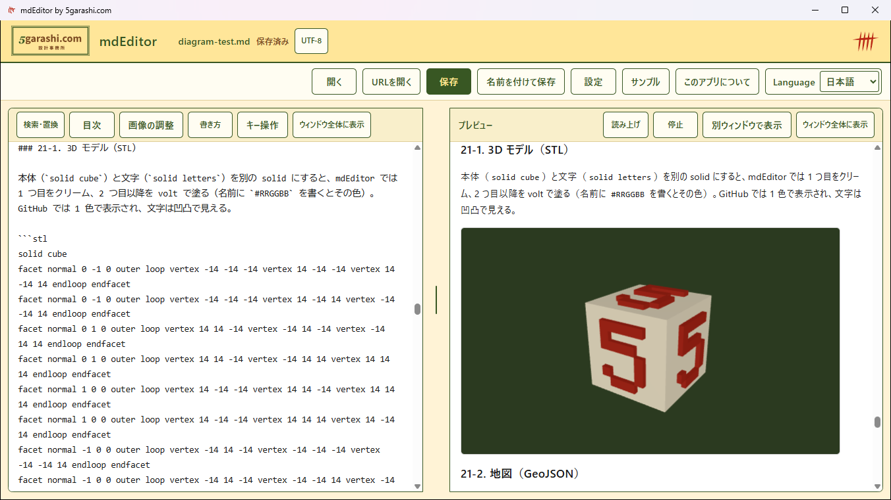
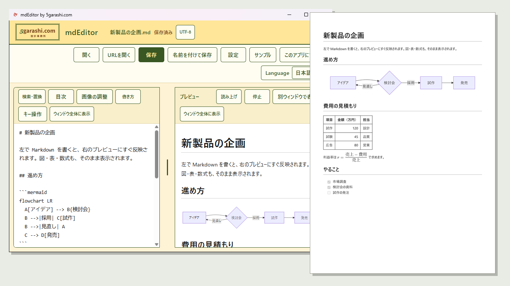
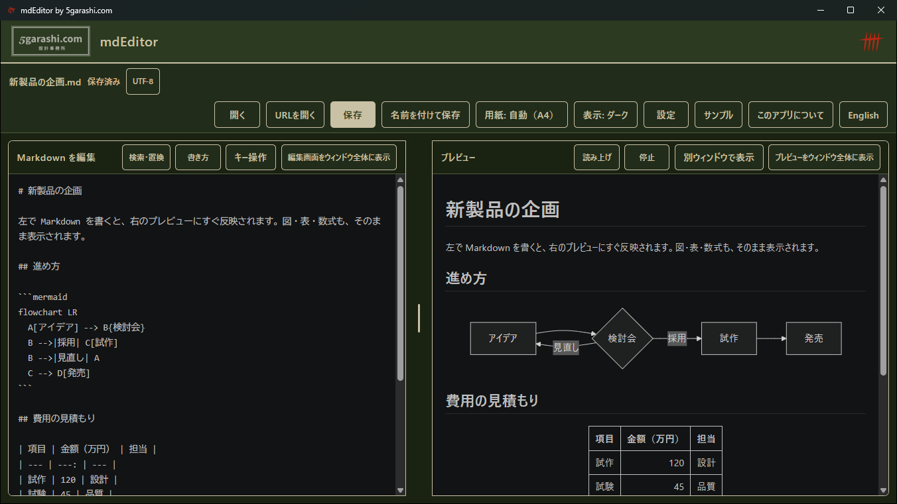
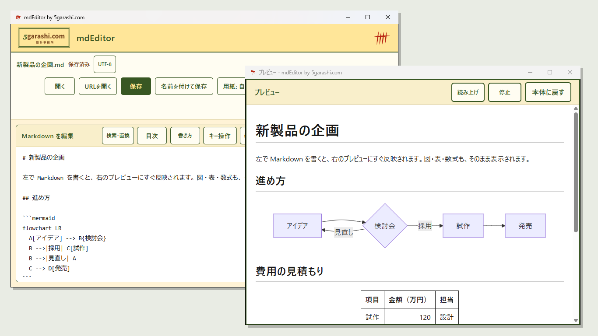
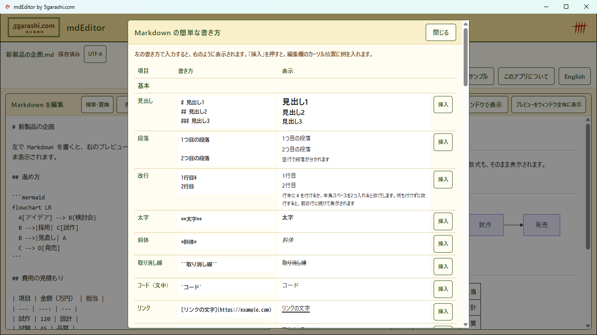
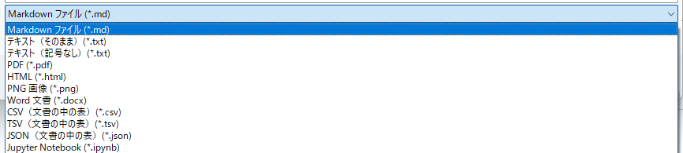
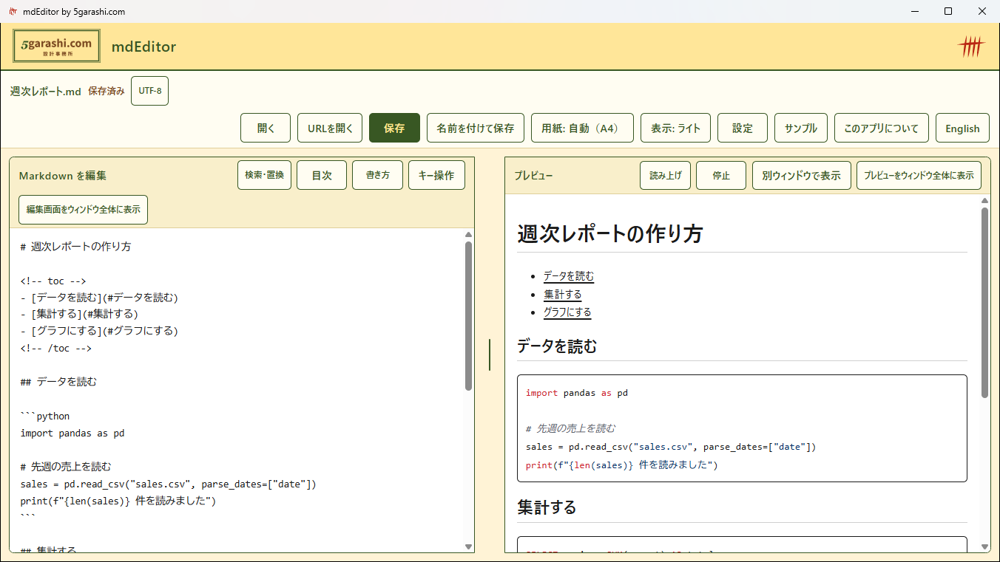
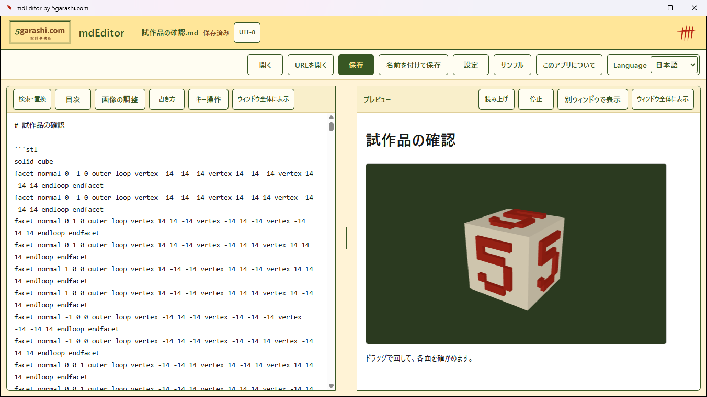
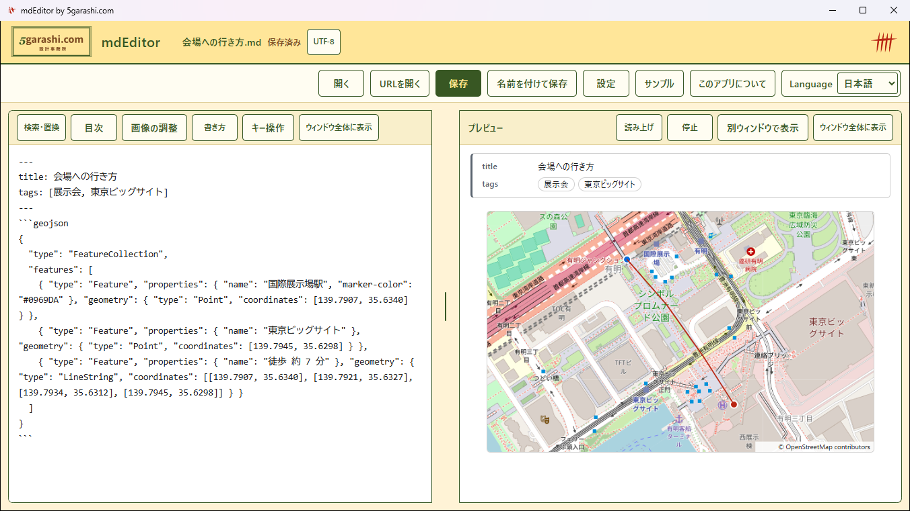
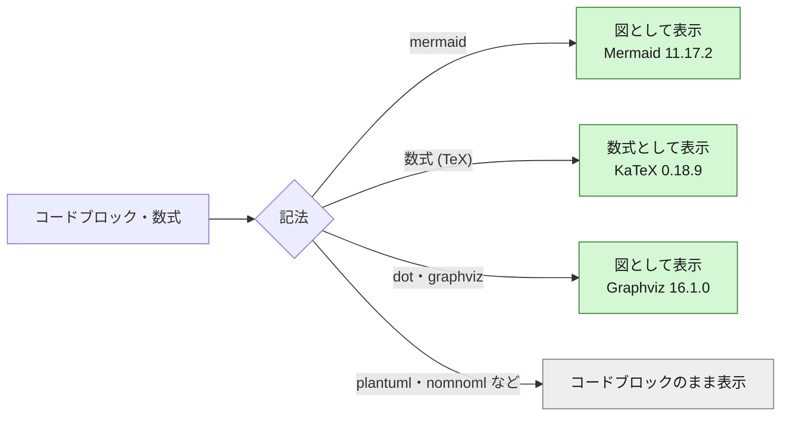

<!--
  ファイル名 / File: README.ja.md
  概要 / Description: mdEditor の使い方（日本語） / Setup and usage guide for mdEditor (Japanese)
  作成者 / Author: 5garashi.com設計事務所 / 5garashi.com Design Office
  作成日 / Created: 2026-10-10
  ライセンス / License: MIT
  SPDX-License-Identifier: MIT
-->
# mdEditor

Windows で Markdown ファイルを開き、テキストと整形済み表示を並べて編集するアプリです。

[English](./README.md) | 日本語 | [简体中文](./README.zh-CN.md)

バージョン / Version: 1.0.18（変更の記録 / Changes: [CHANGELOG.md](./CHANGELOG.md)）

## 特長

Markdown を書きながら、整形された仕上がりをすぐ横で確かめられるエディタです。図や数式もそのまま表示し、PDF に書き出せます。書く・読む・残すが、PC の中だけで完結します。

### 書く・見る・書き出す

- **エディタとビューアが一体**: 左で Markdown を書くと、右のプレビューにすぐ反映されます。両側のスクロールが連動し、検索・置換や見出しへのリンクで移動しても同じ場所を表示します。片側だけをウィンドウいっぱいに広げて、エディタやビューアとしても使えます。
- **2 台のディスプレイで、書く画面と見る画面を分けられる**: プレビューだけを別のウィンドウに出し、2 台目のディスプレイで最大化や全画面表示にできます。ウィンドウが分かれても、編集欄とプレビューのスクロールは文書の同じ行でそろいます。広い画面でも本文は読みやすい幅に収まり、表や図は広く表示します。ウィンドウの場所は次回の起動でも使います。
- **図・グラフ・数式・表がそのまま見える**: フローチャート、シーケンス図、ガントチャート、円グラフなどの Mermaid の図、KaTeX の数式、表、チェックリスト、文書内の画像をプレビューに表示します。
- **PDF と HTML に書き出し**: プレビューの見た目のまま、図や数式も含めて PDF に保存します。用紙は A4 と Letter から選べます（初期設定は地域に合わせて自動）。PDF はタグ付きで、見出し・段落・箇条書き・表の区別を持つため、読み上げソフトがたどれ、mdEditor で開き直すとそのとおりに戻ります。1 つのファイルで完結する HTML にも保存でき、メールで送ったり Web に載せたりできます。
- **いろいろな形式を開いて、保存できる**: Word・PDF・HTML・Web ページ・メール・CSV・JSON・Jupyter Notebook・画像を開いて Markdown として編集でき、「名前を付けて保存」で PNG・Word・CSV・JSON・Jupyter Notebook・配布用 ZIP などにも保存できます。
- **書き方をその場で確認**: F1 で Markdown の書き方の一覧を表示し、例を編集欄に挿入できます。
- **文字コードで困らない**: UTF-8 だけでなく Shift_JIS や EUC-JP などの古いファイルも判定して開き、推定したときや読めない文字があるときは知らせます。保存する文字コードも選べます。
- **書いたものを守る**: 保存は書き込みが途中で失敗しても元のファイルが壊れない方法で行います。保存していない変更は自動でバックアップし、アプリが異常終了しても次の起動で復元できます。
- **ダークモード**: Windows の設定に合わせて自動で切り替わり、目にやさしい夜の配色で表示します。印刷と PDF は常に白地です。
- **プライバシー**: 文書の内容や利用状況を外部に送りません。日本語・英語・簡体字中国語の表示に対応します。

### だれにでも使いやすく（ユニバーサルデザイン）

- **読みやすさを選べる**: 読みやすい BIZ UD ゴシック、文字の大きさ（最大200%）と行間、画面全体の拡大、いまの行の強調、太いカーソルを選べます。Windows のコントラスト テーマにも対応します。必要な人だけがオンにでき、ふだんは標準のまま使えます。
- **キーボードだけで全操作**: すべてのボタンにショートカットキーがあり、好きなキーに変えたり、外したりできます。Tab と F6 で全部の欄を移動でき、押しやすい大きさ（44px 以上）のボタンにしています。
- **画面読み上げソフトに配慮**: Windows ナレーターで実際に確認し、長い文書でも止まらないように編集欄を作り直しました。ボタンには名前とショートカットキーを読み上げ用に付けています。
- **文章の読み上げ**: プレビューを段落ごとに読み上げ、読んでいる場所を画面にも示します。速さと段落の間を選べます。PC に入っている音声だけを使うので、文章が外に出ません。

## 画面

**書きながら、すぐ横で仕上がりを確認** — 左で Markdown を書くと、右のプレビューにすぐ反映されます。図・表・数式も、ドラッグで回せる 3D モデルも、そのまま表示します。



**PDF に保存** — ワンクリックで、プレビューと同じ見た目の PDF に保存します。図・表・数式・色分けしたコードも、そのまま入ります。



**ダークモード** — Windows の設定に合わせて、昼と夜の配色を自動で切り替えます。「設定」の「表示」ボタン（または Ctrl+Shift+T）で選ぶこともできます。印刷と PDF は常に白地です。



**プレビューを別のウィンドウに** — 2 台目のディスプレイに置いて、書く画面と見る画面を分けられます。スクロールは編集と連動します。



**書き方をその場で確認** — Markdown の書き方の一覧（F1）。「挿入」を押すと、カーソルの位置に例が入ります。



**いろいろな形式で保存** — 「名前を付けて保存」で、Markdown・テキスト・PDF・HTML・PNG・Word・CSV・TSV・JSON・Jupyter Notebook・配布用 ZIP（文書と「名前_files」フォルダー）を選べます。Word・HTML・CSV・メール・Jupyter Notebook などのファイルも開けます。



**コードの色分けと目次** — 言語名を書いたコードを色分けして表示します。「目次」ボタンで、見出しから目次を作って入れます。



**3D モデル** — STL で書いた 3D モデルを、ドラッグで回して確かめられます。インターネットにつながなくても表示します。



**地図とフロントマター** — GeoJSON の地図は、許可すると OpenStreetMap の詳しい地図の上に描きます。先頭の YAML は、項目と値の一覧になります。



## セットアップ

1. .NET 10 SDK がインストールされた Windows で、`setup.cmd` をダブルクリックします（PowerShell から `powershell -ExecutionPolicy Bypass -File .\setup.ps1` を実行しても同じです）。`.ps1` はダブルクリックではメモ帳で開くだけで実行されないため、`setup.cmd` から呼び出します。アプリは `%LOCALAPPDATA%\Programs\mdEditor` に発行され、現在のユーザー向けに登録されます。`.md`・`.markdown` のほか、`.html`・`.htm` も「プログラムから開く」と「既定のアプリ」の候補に出ます（ブラウザーの関連付けは変えません）。Microsoft Store 版は `.html` を関連付けません（「開く」とドラッグ＆ドロップで開けます）。
2. Windows の「設定」→「アプリ」→「既定のアプリ」を開き、`.md` の既定アプリとして `mdEditor` を選びます。
3. `.md` ファイルを開くと、mdEditor の左側にテキスト、右側にプレビューが表示されます。

Windows は既定アプリをユーザーの操作で設定するため、セットアップ後に開く `mdEditor` の既定アプリ設定で、`.md` の既定アプリとして `mdEditor` を選択してください。Windowsの確認なしに既定アプリを変更することはできません。

mdEditor が開けるほかの形式（.txt、.html、.htm、.docx、.eml、.csv、.tsv、.json、.xml、.ipynb、画像）は、右クリックの「プログラムから開く」に mdEditor が出るようにしています（Microsoft Store 版も同じ）。これらの既定のアプリ（ブラウザーやメモ帳など）は変わりません。setup.cmd 版は候補に出るだけで、既定のアプリには使われません。Microsoft Store 版は、その PC にほかに開けるアプリがない形式（.ipynb や .json など）に限り、Windows の仕組みでダブルクリックでも mdEditor が開きます（ほかのアプリを既定に選べば、そちらで開きます）。

Microsoft Edge WebView2 Runtime が必要です。Microsoft Edge がインストールされている環境では、通常このランタイムも利用できます。

**Microsoft Store 用のパッケージ**: `setup.cmd` は開発用の手順です。Store 向けには、Windows SDK を入れた PC で `store\build-msix.ps1`（Partner Center の「製品の ID」の値を `-IdentityName` と `-Publisher` に指定）を実行すると、署名前の MSIX が `artifacts` に作られます。署名は Store が行います。

## バージョンの管理

バージョンは、リポジトリの一番上にある [VERSION](./VERSION) ファイルだけに書きます。アプリ（「このアプリについて」に表示）と Microsoft Store 用の MSIX（末尾に `.0` を付けた 4 桁）は、ここから読み取ります。新しい版を出すときは、次の 3 つを同じプルリクエストで変えます。

1. `VERSION` の番号を上げる（例: `1.0.3` → `1.0.4`）。
2. [CHANGELOG.md](./CHANGELOG.md) に `## 1.0.4` の節を足す。
3. README の版の行を合わせる（README.md の「Version」、README.ja.md の「バージョン / Version」、README.zh-CN.md の「版本 / Version」の 3 つ）。

プルリクエストでは、GitHub Actions がこの 3 つがそろっているかを確かめます（README は README.md の行だけを確かめるので、README.ja.md と README.zh-CN.md は書き忘れないようにします）。main にマージされると、`v1.0.4` のタグと GitHub の Release（本文は CHANGELOG の節）が自動で作られます。

## 操作

- **サンプル**: 「図と数式」「基本の書き方」の短いサンプルと、使えるすべての図・チャート・数式を確かめる「図・チャート表示テスト」（日本語・英語・簡体字中国語。[samples/](./samples/) の 3 つのファイル）を、選んだときだけ新しい文書として開きます（開いていた文書に変更があれば、先に保存するか聞きます。開いていたファイルには書き込みません）。
- **このアプリについて**: 会社紹介・サポート・プライバシーポリシーへのリンクを表示します。リンクは選んだときだけブラウザーで開きます。
- **開く**: Markdown ファイルを選択します。テキスト（.txt）、Word 文書（.docx）、HTML ファイル（.html、.htm）も開けます。テキストはそのまま開いて、そのまま上書き保存できます。Word 文書は Markdown に変換して開き、見出し・リスト・表・リンク・画像が戻ります（色や配置は戻りません）。画像は最初に保存するとき、Markdown ファイルの横に「名前_files」フォルダーとして置きます。Word の文書は書き換えません。見出しのスタイルを使わず、文字を大きくしただけで見出しを作った Word 文書は、文字の大きさから見出しを推し量ります（本文よりはっきり大きい文字、または一回り大きい太字を、見出し 1〜3 にします。いくつ見出しにしたかは、お知らせ欄に出します）。HTML ファイル（.html、.htm）も開けます。HTML は Markdown に変換して開き、見出し・段落・リスト・表・リンク・画像・数式が戻ります（色や配置、図の絵は戻りません）。保存すると Markdown ファイルになり、元の HTML ファイルは書き換えません。
  - **PDF（.pdf）**: Markdown に変換して開きます。文字を読む順に取り出し、折り返した行は 1 つの段落にまとめ、見出しは文字の大きさから推し量り、「・」や番号で始まる行は箇条書きにします。番号（1.・3.1・(1)・① など）が付き、本文と別の書体で書いた見出しも見出しにし、番号の深さに合わせて入れ子にします。目次（点線とページ番号の行）は、PDF の字下げのとおりに入れ子の箇条書きにします。画像は Word 文書と同じように扱います。罫線のある表は Markdown の表に、等幅の書体の行はコードのブロック（字下げを保つ）に、図形で描いた箇条書きの印やチェックボックス（ブラウザーや mdEditor で保存した PDF など）は箇条書きになります。線や図形で描いた図（Mermaid や Graphviz で描いたダイアグラムやグラフなど）は、線・図形・色・図の中の文字から SVG の画像に描き直して「名前_files」に保存します。図の中の文字は画像の一部になり、文字としては編集できません。直線に沿ったグラデーションと半透明の色もそのまま描きます（それ以外の模様は灰色になります）。KaTeX で組んだ数式（mdEditor で保存した PDF など）や LaTeX（Computer Modern）で組んだ数式も同じように画像に描き直し、1 行に単独の数式は中央寄せの画像に、文中の数式はその位置の画像にして、数式の文字を画像の説明に入れます（PDF には TeX の書き方が残らないため、TeX には戻りません）。元の大きさと違う大きさ・中央・右寄せ・文章の回り込みで表示していた画像は、``・`<p align>`・`align="left"`/`"right"` と、回り込む文章の後の `<br clear="all">` で戻します。PDF を作ったときに読み込んでいなかったインターネット上の動画は、アドレスだけの行に戻します。タグ付きの PDF（Word・Acrobat・LibreOffice などで作れます）は、文字が何か（見出し・段落・箇条書き・表）を PDF の中に持っているため、読む順・段落・見出しの段階・箇条書きをタグのとおりにし、罫線のない表も表に戻し、柱やページ番号として印の付いた文字は省きます。それ以外の PDF では、段組みの配置・罫線のない表は戻りません（文字は残ります）。文字の並びを読み取れないページ（縦書き、文字の上に文字を重ねたページなど）は、ページ全体を 1 枚の画像にし、どのページかをお知らせ欄に出します。ページの上下の端にあるページ番号は省きます。文字を読み取れない書体（文字化けする書体）で書かれたページは、PDFium（Chromium・Edge の PDF 描画部品）でページを画像にして取り込みます。画像だけでできた PDF（スキャンしたものなど）からは文字を取り出せず、パスワードで保護された PDF は開けません。開くのは 500 ページまでです。元の PDF は書き換えません。右寄せ・中央寄せの文と見出しは `<p align>` などの HTML で位置を残し、行った特別な処理（図を画像にした数など）はお知らせ欄に出ます。「設定」→「PDF の取り込み」で、図の範囲にかかる文字を図の画像に入れるか（見た目優先・初期設定）文字として残すか（編集優先）などを選べ、細かい数値は詳細設定ファイル（pdf-import.json）で変えられます。
  - **メール（.eml）**: 件名を見出しにし、差出人・宛先・日付・添付ファイルの名前と本文を Markdown に変換して開きます。本文の中の画像は Word 文書と同じように扱います。メールの中のインターネット上の画像（受信の確認に使われることがあります）は、確認するまで読み込みません。添付ファイルの中身は取り出しません。
  - **CSV・TSV（.csv、.tsv）**: Markdown の表にして開きます。1 行目を見出しの行にします。Excel で保存した Shift_JIS の CSV も開けます。
  - **JSON（.json）**: 一覧（オブジェクトの配列）は表にして開き、項目の名前を見出しの行にします。それ以外の JSON はコードの枠に入れて開くので、前後に説明を書き足せます。
  - **XML（.xml）**: コードの枠に入れて開きます。前後に説明を書き足せます。
  - **Jupyter Notebook（.ipynb）**: Markdown のセルはそのまま、コードのセルは言語付きのコードの枠（```python など）になります。実行結果は、文字は「output」の枠、画像と表（pandas など）はそのまま表示します。セルに貼り付けた画像も表示します。
  - **画像（.png、.jpg、.gif、.bmp、.webp）**: その画像を表示する新しい文書として開きます。画像の下に説明を書き足して、Markdown ファイルとして保存できます。別のフォルダーに保存したときは、画像もそこに写します。
  - **動画（.mp4、.m4v、.webm、.ogv、.mov）**: その動画を表示する新しい文書として開きます。扱いは画像と同じです。
- **ドラッグ＆ドロップ**: 編集画面にドロップしたファイルはカーソルの位置に入り、編集画面の外にドロップしたファイルは開きます。ドラッグしている間は、ポインターの横に「カーソルの位置に入れる」か「ファイルとして開く」を表示します。

  | ファイル | 編集画面にドロップ | 編集画面の外にドロップ |
  | :--- | :--- | :--- |
  | 画像・動画 | 文書の横の「名前_files」フォルダーに写し、`` を入れる | 画像・動画の文書として開く |
  | 「開く」で開けるファイル（.md、.txt、.html、.docx、.eml、.csv、.json、.ipynb など） | 「開く」と同じように Markdown にした中身を入れる | 開く（未保存の変更があれば、先に確認する） |
  | PDF（.pdf） | 「名前_files」フォルダーに写し、リンク `[資料.pdf](名前_files/資料.pdf)` を入れる（PDF はそのまま渡すことが多いので、変換しない） | 「開く」と同じように Markdown にして開く |
  | 開けないファイル（.pptx、.zip など） | 「名前_files」フォルダーに写し、リンク `[資料.pptx](名前_files/資料.pptx)` を入れる | 開かずに、編集画面にドロップするとリンクとして入ることを知らせる |

  - 中身を入れたときは、お知らせ欄に表示します。開くつもりだったときは、Ctrl+Z で取り消して、編集画面の外にドロップし直します。
  - 中身が表示する画像・動画やリンク先のファイルも、「名前_files」フォルダーに写します。Markdown の先頭のフロントマター（`---` で囲んだ部分）は入れません。
  - 「名前_files」フォルダーの外にあるファイルは、文書と同じフォルダーにあるものも含めて、すべて「名前_files」フォルダーに写します。すでに「名前_files」フォルダーの中にあるファイルは、写さずにそのまま使います。
  - 写したことはお知らせ欄に出します（「「A_files」フォルダーを作り、「B.pdf」を保存しました。」など）。フォルダーに同じ名前の別のファイルがあるときは、ブラウザーのダウンロードと同じように「B (1).pdf」「B (2).pdf」と番号を付けます。中身がまったく同じファイルがあるときは、写さずにそれを使います。
  - ファイルを写す必要があるのにまだ保存していない文書では、先に保存先を聞きます。
  - 画面の切り取りなどを編集画面に貼り付けた（Ctrl+V）ときも、画像を「名前_files」フォルダーに置いて入れます。
  - **Markdown のまま人に渡すときは、「名前_files」フォルダーも一緒に渡してください。** 文書は、入れた画像・動画・ファイルを、文書のある場所からの相対パス（`名前_files/…`）で指しています。.md ファイルだけを渡すと、相手の PC では表示されず、リンクも開けません。.md ファイルとフォルダーを同じ場所に置いたまま、まとめて（たとえば 1 つの zip にして）渡します。「名前_files」フォルダーの外を指すリンク（自分で書いた `../資料/…` など）は、そのファイルも一緒に渡さないと開けません。PDF・HTML・PNG・Word に保存したものは画像が中に入りますが、動画と、リンクで入れたファイルは入りません。
- **URLを開く / Ctrl+Shift+K**: `https://` で始まる Web ページを、Markdown に変換して開きます。ブラウザーからリンクをドラッグして開くこともできます。ページのスクリプトは実行しないので、開いたあとに読み込まれる内容（ランキングの数字など）は入りません。
- **インターネット上の画像・動画**: 初期設定では読み込まず、お知らせ欄の「画像・動画を読み込む」で読み込みます（その文書だけ）。「設定」→「インターネット」で「いつも読み込む」「読み込まない」も選べます。`http://` の画像は読み込みません。手元にない画像やリンクは、ページの元のアドレス（`<base>`、canonical、og:url）から探します。
- **保存**: 現在のファイルに上書きします。新規文書は保存先を選びます。
- **名前を付けて保存**: 保存先とファイル名を選びます。「開く」と同じように、ファイルの種類で保存の形式を選べます。
  - Markdown（またはテキストのそのまま）で別の場所か別の名前に保存すると、「名前_files」フォルダーも丸ごと複製します。名前を変えたときは、フォルダーも新しい名前（「C.md」なら「C_files」）で複製し、文書の中のリンクも書き換えます（保存するファイルと編集画面の両方。Ctrl+Z で戻せます）。元の文書とフォルダーは変えません。
  - 複製している間は、お知らせ欄に進み具合（何個目か）を出し、終わると「「A.md」と「A_files」フォルダーを D:\資料 に複製しました。」「「C.md」と「C_files」フォルダーとして複製しました。」「「C.md」と「C_files」フォルダーとして D:\資料 に複製しました。」と出します。
  - 保存先に同じ名前のフォルダーがあるときは、上書きせずに中へ足します。同じ名前の別のファイルには「(1)」などの番号を付け、リンクも合わせます。中身が同じファイルは、そのまま使います。
  - 別の場所に保存したとき、「名前_files」フォルダーの外を指す相対リンク（自分で書いた `../資料/x.pdf` など）は、元のファイルを指すように書き換えます。
  - PDF・HTML・PNG・Word などへの保存は、画像が中に入るので、フォルダーは複製しません。
  - **Markdown（.md）・テキスト（そのまま）（.txt）**: 文書そのものを保存します（中身はそのまま）。以後の「保存」はこのファイルに上書きします。
  - **テキスト（記号なし）・PDF・HTML・PNG・Word（.docx）・CSV・TSV・JSON・Jupyter Notebook・配布用 ZIP**: 文書を書き出します。編集中の文書のファイルはそのままです。書き出しの内容は下のとおりです。
- **テキスト（記号なし）**: プレビューに見えている文字だけを .txt にします。見出しや太字の記号は消え、行は書いたとおりに改行します。リストは「・」か番号、表はタブ区切り、リンクは「文字（アドレス）」、図は「［図］」になります。
- **CSV・TSV**: 文書の中の表を CSV（カンマ区切り）か TSV（タブ区切り）にします。表が 2 つ以上あるときは「名前-1.csv」「名前-2.csv」…に分けて保存します。Excel で文字化けしないよう、UTF-8（BOM 付き）で保存します。
- **JSON**: 文書の中の表を、見出しの行を項目の名前にしたオブジェクトの配列にします（UTF-8）。値は文字のまま書き出すので、「007」のような番号の 0 も消えません。表が 2 つ以上あるときは「名前-1.json」…に分けて保存します。
- **Jupyter Notebook**: 言語付きのコードの枠をコードのセルに、それ以外を Markdown のセルにします。実行結果は入れません（Jupyter で実行すると作り直されます）。.ipynb を開いて編集した文書を保存し直すと、元のノートブックと同じセルの並びに戻ります。
- **配布用 ZIP**: 人に渡すための ZIP にします。中身は文書（.md）と「名前_files」フォルダーで、名前はリンクのとおりなので、展開するとそのまま表示できます。文書は編集画面の内容（未保存の変更も含む）で入れます。「名前_files」フォルダーがない文書（まだ保存していない文書も）は、文書だけを入れます。
  - 「名前_files」フォルダーに、文書から参照されていないファイル（リンク・画像・HTML の src や href のどれにも書かれていないもの）があるときは、一覧を見せて確かめます。「はい」でごみ箱に移してから ZIP にし、「いいえ」ではファイルを残したまま ZIP には入れません。どちらでも、参照されていないファイルは ZIP に入りません。
  - 「名前_files」フォルダーの外のファイルへのリンクの扱いは、「設定」→「書き出し」→「配布用 ZIP に入れるファイル」で選べます。「PC の中のリンク先のファイルも『名前_files』に写す」（初期設定）では、ほかのフォルダーのファイル（相対パス・C:\… のような絶対パス・file: のアドレス）を ZIP の中の「名前_files」に写し、ZIP の中の文書はその写しにリンクします（同じ名前のファイルがあれば「名前 (1)」のようにします）。「インターネット上のリンク先のファイルも…」では、インターネット上の画像・動画と、ファイル（.pdf など）へのリンクもダウンロードして入れます（1 個 50 MB まで。Web ページへのリンクと、ダウンロードできなかったものはリンクのまま）。「『名前_files』フォルダーのファイルだけ」では、外のファイルは入れず、その数を知らせます。どれでも、元の文書とファイルは変わらず、コードの中に書いた例は書き換えません。
- **Ctrl+O**: ファイルを開きます。
- **前の文書に戻す / Ctrl+Shift+B**: 別の文書を開く前に開いていた文書に戻します。「開く」の横のボタンは、戻せる文書があるときだけ表示します。たとえば、編集画面の外にファイルをドロップして別の文書を開いてしまったときや、そのとき「キャンセル」のつもりで「いいえ」を押したときに使います。
  - 「保存しますか？」で「いいえ」を選んで閉じた文書は、閉じたときの状態（書きかけの内容・ファイルの場所・文字コード）に、まだ保存していない状態で戻ります。保存すると、元のファイルに上書きします。
  - 変更のないまま閉じた文書は、そのファイルを開き直します。ファイルが移動・削除されていたときは、そう知らせます。
  - 戻せるのは、最後に閉じた 1 つの文書だけです。ほかのウィンドウで閉じた文書や、アプリを終了するときに「いいえ」で閉じた文書も戻せます（次の起動のあとも）。「開く」のファイル選択を取り消したときのように、文書が入れ替わらなかったときは、前の文書はそのままです。
  - 戻す前に、今の文書に変更があれば保存するか聞きます。ここで「いいえ」を選ぶと、今の文書と入れ替わり、もう一度押すと今の文書に戻れます。
  - 控えは自動バックアップと同じ場所に置きます。変更のない文書は、ファイルの場所だけを控えます。設定で自動バックアップをオフにしているときは控えを残さず、このボタンも出ません。
- **Ctrl+S**: 保存します。
- **Ctrl+Shift+S**: 名前を付けて保存します。
- **PDF**: 整形したプレビューをPDFに書き出します。
- **PNG / Ctrl+Shift+G**: プレビューを昼の配色で画像（PNG）にします。長い文書は「名前-1.png」「名前-2.png」…に分けて保存します。
- **Word / Ctrl+Shift+D**: Word 文書（.docx）に書き出します。見出し・段落・リスト・引用・コード・表・リンク・画像は Word の標準のスタイルになるので、Word のナビゲーションや目次がそのまま使えます。図と数式はプレビューの画像として入ります（Word では編集できません）。
- **HTML / Ctrl+Shift+M**: 整形したプレビューを、1 つで完結する HTML ファイルに書き出します。図は SVG、数式は MathML で入り、文書と同じフォルダーの画像はファイルの中に埋め込みます。ブラウザーで開くと、ダークモードなら夜の配色で表示します。開いても外部に通信しません（文書の中のネット上の画像だけは、その画像のサーバーから読み込みます）。
- **用紙**（「設定」の中、または Ctrl+Shift+A）: PDFの用紙を「自動」→「A4」→「Letter」の順に切り替えます。「自動」は Windows の地域の設定に従います（ヤード・ポンド法の地域は Letter、それ以外は A4）。選んだ用紙は次回の起動でも使います。
- **文字コード**: ファイル名の横に文書の文字コードを表示します。押すと文字コードを選び、「この文字コードで開き直す」または「次の保存からこの文字コードにする」を選べます。
- **Ctrl+Shift+P**: PDFに保存します。
- **目次 / Ctrl+Shift+J**: 文書の見出しから目次（見出しへのリンクの一覧）を作り、カーソルの位置に入れます。目次は `<!-- toc -->` と `<!-- /toc -->` の間に入り（プレビューには出ません）、見出しを変えたあともう一度押すと、その場所の目次を新しくします。文書の題名（先頭のただ 1 つの `#` 見出し）は目次に入れず、3 段階の深さまで入れます。目次のリンクは、プレビュー・PDF・HTML・Word のどれでも見出しに移動します。
- **画像の調整 / Ctrl+Shift+F**: 画像の大きさと位置を選び、GitHub と同じ書き方（HTML の ``）に書き換えます。編集欄で画像の行にカーソルを置いて押すか、プレビューの画像を右クリックします。
  - 大きさ: 元の大きさ、本文の幅の 25%・50%・75%・100%、幅のピクセル指定（`width="50%"`、`width="300"`）。高さは縦横の比を保ちます。
  - 位置: 指定しない（左）、中央（`<p align="center">`）、右（`<p align="right">`）、左または右に置いて文章を回り込ませる（`align="left"`・`align="right"`）。中央と右は、画像だけの行で選べます。画像の下に続けて書いた文があるときは、空行を 1 つ入れます（HTML のかたまりが文を飲み込まないように）。
  - 「元の大きさ」と「指定しない」に戻すと、Markdown の `` に戻ります。書き換えは Ctrl+Z で取り消せます。
  - PDF・PNG・HTML はプレビューのとおりになります。Word では、大きさと、中央・右・左右への寄せを反映します（文章の回り込みは、左右に寄せた画像になります）。記号なしのテキストでは、Markdown の画像と同じく「［説明］」になります。
- **Ctrl+H**: 編集画面の検索・置換バーを開きます。「置換」「すべて置換」が使えます（`Enter` で次を検索、`Esc` で閉じる）。
- **書き方 / F1**: Markdown の書き方を「基本」「図（Mermaid）」「数式（KaTeX）」「GitHub と同じ書き方」「そのほかの図と動画」に分けて一覧で表示します。図はフローチャート・シーケンス図・ガントチャート・円グラフ・クラス図・状態遷移図・ER 図・マインドマップ・棒グラフと折れ線グラフ・タイムライン、数式は分数・平方根・総和・行列・場合分けなど 10 種類で、図は一覧の中に描いて見せます。GitHub と同じ書き方は注意書き・折りたたみ・キーの表示・絵文字、そのほかの図と動画は Graphviz・地図（GeoJSON）・動画です（どれも samples/diagram-test から選んで短くした例）。「挿入」で編集欄のカーソル位置に例を入れます（`Esc` で閉じる）。
- **Ctrl+F**: ウィンドウ標準の検索です。プレビューの検索にも使えます。
- **スクロールの連動**: 編集欄とプレビューのどちらかをスクロールすると、もう一方も同じ位置に移動します。検索・置換や見出しへのリンクで移動したときも連動します。
- **見出しへのリンク**: `[日本語](#セットアップ)` のような文書内のリンクを押すと、プレビューがその見出しへ移動します。見出しのIDは GitHub と同じ規則（日本語はそのまま、英字は小文字、空白は `-`）で作ります。
- **ほかのファイルへのリンク**: `[ライセンス](./LICENSE)` のように、文書と同じフォルダーにあるファイルへのリンクを押すと、Markdown とテキストのファイル（拡張子なし、`.md`、`.txt` など）は新しい mdEditor のウィンドウで開きます。元の文書はそのまま残ります。`other.md#見出し` ならその見出しを表示します。PDF・画像・CSV などはふだん使うアプリで開き、プログラムなど開くと危険なファイルは実行せず、エクスプローラーで場所を示します。
- **左右の区切り**: 中央の境界線をドラッグすると編集欄とプレビューの幅を調整できます。区切りをフォーカスして左右矢印キーを押すと、幅を5%ずつ調整します。狭い画面では縦方向の区切りを上下矢印キーで操作します。幅の設定も次回起動時に保持されます。
- **編集画面 / プレビューをウィンドウ全体に表示**: 各欄の「ウィンドウ全体に表示」ボタンで、その欄をウィンドウいっぱいに広げます（OSの全画面にはなりません）。「元の表示に戻す」ボタンまたは `Esc` で並列表示に戻ります。
- **ウィンドウの全画面表示**: `F11` で切り替えます。解除は `F11` または `Esc` です。
- **プレビューを別ウィンドウで表示 / Ctrl+Shift+3**: プレビューの見出しの「別ウィンドウで表示」で、プレビューだけのウィンドウを開きます。2 台目のディスプレイに置いて最大化したり、`F11` で全画面にしたりできます。本体は編集欄だけになり、横幅いっぱいに使えます。
  - 編集欄とプレビューのスクロールは、ウィンドウが分かれても連動します（文書の同じ行を表示します）。見出しへのリンク、検索・置換での移動、読み上げもそのまま使えます。
  - 別ウィンドウで押したショートカット（保存、検索・置換、設定など）は本体で実行します。
  - 「本体に戻す」（別ウィンドウ）、「プレビューを本体に戻す」（本体の編集欄）、または別ウィンドウを閉じると、元の並んだ表示に戻ります。
  - ウィンドウの位置・大きさ・最大化と、別ウィンドウにしていたかどうかは、次回の起動でも使います。そのディスプレイが外されていたら、見える場所に移します。
- **キー操作 / Shift+F1**: すべての操作のキーボードショートカットを一覧で表示します。「変更」でキーを好きな組み合わせ（Ctrl と英字・数字、または F キー）に変え、「なし」で外せます。「キーボードショートカットを使う」をオフにすると、すべてのショートカットを止められます。設定は次回の起動でも使います。
- **書き方の確認**: Markdown の書き間違い（見出しの段階の飛び、# の後の空白がない見出し、内側に空白のある強調、空のリンク、行き先のないページ内リンク、列の数が合わない表、閉じていないコードブロック、見つからないリンク先のファイルなど）に波線を引き、編集欄の下の「書き方の問題 ○ 件」を押すと一覧を表示します。見た目の好み（行の長さ・HTML の使用など）は指摘しません。markdownlint（MIT）を使い、PC の中だけで確かめます。「設定」→「編集欄」でオフにできます。
- **設定 / Ctrl+Shift+O**: 読みやすさと操作のしやすさを、使う人に合わせて調整します。自動バックアップ以外は初期設定がオフ（標準）で、必要な人だけが選べます。設定は次回の起動でも使います。
  - **書体**: 「BIZ UD ゴシック」（Windows に入っているユニバーサルデザイン書体）に切り替えます。
  - **文字の大きさ・行間**: 編集欄とプレビューの文字を 125%・150%・200% に、行間を「広め」「とても広い」にできます。
  - **Markdown の書き方**: 「GitHub での表示に近づける」をオンにすると（初期設定はオフ）、GitHub にない mdEditor 独自の書き方（`x^2^` の上付き、`H~2~O` の下付き、`==強調==`、`++挿入++`、定義リスト、`:::` の囲み、`{#id}` などの属性、略語、罫線の表、`a.` の番号）を、GitHub と同じく書いたとおりの文字で表示し、`~文字~` を取り消し線にします。PDF・Word などの書き出しも同じです。GitHub と完全に同じになるわけではありません（図・地図・3D モデル、コードの色分け、数式の描き方などは mdEditor のままです）。設定は次回の起動でも使います。
  - **書き出し**: 「HTMLに保存するとき、元の Markdown も入れる」をオンにすると（初期設定はオフ）、保存した HTML を mdEditor で開いたとき、書いたときのとおり（図や数式の書き方も含めて）に戻ります。HTML の中に元の文章がそのまま入り、画面に出ないコメント（`<!-- -->`）も含まれるので、人に渡す前に確かめてください。
  - **プレビューの本文の幅**: 広い画面では、読みやすいように本文の幅を全角でおよそ 44 字までにして中央に置きます（表・図・コード・数式はもっと広く表示します）。「プレビューの本文の幅を制限しない」で、画面の端まで使えます。
  - **画面全体の表示倍率**: 初期値は 90% です。「拡大」「縮小」「初期値（90%）に戻す」で画面全体を拡大・縮小します。Ctrl + マウスホイール、Ctrl + プラス／マイナス、Ctrl + 0（90% に戻す）でも変えられ、倍率は次回の起動でも使います。
  - **編集欄**: 「いまの行を強調する」「カーソルを太くする」を選べます。
  - **読み上げ**: オンにすると、プレビューの見出しに「読み上げ」「停止」ボタンが出ます。プレビューに見えている段落から順に読み上げ、読んでいる段落を枠で示します。プレビューか編集欄で文字を選んでいるときは、選んだ部分だけを読みます（編集欄では Markdown の記号を除いて読みます）。速さ（5段階）、段落の間（なし・0.5秒・1秒・2秒）、言語（自動・日本語・英語・中国語（簡体字））、音声（この PC に入っている音声から）を選べます。その言語の音声がないときは、追加のしかたを表示します。この PC に入っている音声だけを使うため、文章を外部に送りません。読み上げ中は `Esc` でも止まります。
  - **自動バックアップ**（初期設定はオン）: 保存していない変更を15秒ごとに `%LOCALAPPDATA%\mdEditor\Recovery` に控えます。アプリが異常終了したときは、次の起動時に復元するか確認します。保存するか、正常に終了すると控えは消えます。
  - **クリップボードから新規作成**: 起動するキー（Ctrl+Alt と英字・数字）を選ぶと、確認のうえ、デスクトップにそのキーを割り当てたショートカット「mdEditor（クリップボードから新規作成）」を作ります（Windows では、このキーはデスクトップかスタートメニューのショートカットにしか割り当てられません）。ほかのアプリでテキスト・画像・ファイルをコピーしてからそのキーを押すと、mdEditor が起動し、新しい文書に入れます。コピーしたファイルが 1 つで、mdEditor で開ける形式なら、編集画面の外にドロップしたときと同じく、そのファイルを開きます。書式付きの内容（Web ページや Word からコピーしたもの）は「開く」と同じように Markdown にします。画像とファイルは編集画面にドロップしたときと同じく「名前_files」フォルダーに置くため、先に保存先を聞きます。キーを押してから起動するまで、1〜2 秒かかることがあります。「なし」にするとショートカットを削除します。mdEditor を削除（アンインストール）する前に「なし」に戻してください（ショートカットは自動では消えません）。コマンドラインでは、起動オプション `--paste`（`mdEditor.exe --paste`）で同じことができます。
- **Windows のコントラスト テーマ**: Windows の「コントラスト テーマ」を使うと、その配色に合わせて表示し、ボタンの枠とフォーカスの印を保ちます。

### キーボードショートカット（初期設定）

| 操作 | キー | 操作 | キー |
| :--- | :--- | :--- | :--- |
| 開く | Ctrl+O | 検索・置換 | Ctrl+H |
| 目次を入れる・新しくする | Ctrl+Shift+J | 前の文書に戻す | Ctrl+Shift+B |
| 画像の大きさと位置 | Ctrl+Shift+F | | |
| 保存 | Ctrl+S | 次を検索 / 前を検索 | F3 / Shift+F3 |
| 名前を付けて保存 | Ctrl+Shift+S | すべて置換 | Ctrl+Shift+H |
| PDFに保存 | Ctrl+Shift+P | Markdown の書き方 | F1 |
| 用紙の切り替え | Ctrl+Shift+A | キー操作の一覧 | Shift+F1 |
| 表示テーマの切り替え | Ctrl+Shift+T | 編集画面 / プレビューをウィンドウ全体に表示 | Ctrl+Shift+1 / Ctrl+Shift+2 |
| 表示言語の切り替え | Ctrl+Shift+L | 次の欄 / 前の欄へ移動（ツールバー・編集欄・プレビュー） | F6 / Shift+F6 |
| 文字コード | Ctrl+Shift+E | ウィンドウの全画面表示 | F11 |
| 設定 | Ctrl+Shift+O | 読み上げ・一時停止 / 停止（読み上げがオンのとき） | Ctrl+Shift+Y / Ctrl+Shift+U |
| プレビューを別ウィンドウで表示・本体に戻す | Ctrl+Shift+3 | HTMLに保存 | Ctrl+Shift+M |
| URLを開く | Ctrl+Shift+K | PNGに保存 / Wordに保存 | Ctrl+Shift+G / Ctrl+Shift+D |

`Esc` は常に、読み上げを止め、全体表示や全画面表示を元に戻します。各ボタンのヒントと、画面読み上げソフトに伝える情報（`aria-keyshortcuts`）にも、いまのキーを表示します。

Markdown の変更はプレビューに反映されます。未保存の変更がある状態でファイルを開く、またはアプリを閉じると、保存するか確認します。

## 表示言語

画面と各種ダイアログは、日本語・英語・簡体字中国語に対応します。初回は OS の表示言語（日本語なら日本語、中国語なら簡体字中国語、それ以外は英語）で起動し、ツールバーの「Language」の一覧でいつでも切り替えられます。Ctrl+Shift+L を押すと、日本語 → 英語 → 簡体字中国語の順に切り替わります。選択は次回以降も保持されます。

簡体字中国語の画面では、漢字を中国語の書体（Microsoft YaHei）で表示します。中国語のロゴタイプはないため、ロゴは英語のロゴタイプを使います。読み上げも、設定で言語を「中国語（簡体字）」にするか、自動のままで、かなを含まない段落を中国語の音声で読みます（中国語の音声が Windows に入っている場合）。

起動オプションで言語を指定することもできます（`ja`、`en`、`zh`。`zh-CN` も使えます）。指定した言語はその起動の間だけ有効で、保存済みの選択は書き換えません。

```
mdEditor.exe --lang en
mdEditor.exe --lang zh
mdEditor.exe --lang ja "C:\docs\memo.md"
```

## Markdown とプレビュー

見出し、リスト、チェックリスト、引用、表（左・中央・右寄せ）、コード、リンク、画像などのMarkdownを表示します。Markdown の中に書いた HTML は、GitHub が許しているもの（`<details>`・`<summary>`・`<kbd>`・`<sup>`・`<sub>`・`<br>`・`<picture>`、画像の幅、`align` による中央寄せなど）だけを表示し、それ以外は取り除きます。スクリプト・`<style>`・`<iframe>`・埋め込み・フォーム・`onclick` などのイベント属性・`javascript:` のリンクは、GitHub と同じく取り除かれ、動きません。HTML で書いたインターネット上の画像も、Markdown の画像と同じく、許可するまで読み込みません。HTMLコメント（`<!-- -->`）は表示しません。Webリンクは既定のブラウザー、メールリンクは既定のメールアプリで開きます。PDFには整形済みのプレビューのみを出力し、編集中のテキスト欄や操作ボタンは含めません。

`images/a.png` のような相対パスの画像は、文書と同じフォルダー（とその中のフォルダー）から読み込みます。読み込むのは画像ファイル（PNG、JPEG、GIF、WebP、AVIF、BMP、ICO、SVG）だけで、文書のフォルダーより上の階層は読みません。

文書の文字コードは、UTF-8（BOMの有無）、UTF-16、Windowsの既定の文字コード（日本語環境ではShift_JIS、簡体字中国語環境では GBK）を自動で判別し、保存するときも元の文字コードのまま書き込みます。元の文字コードで保存できない文字がある場合は、UTF-8で保存するか確認します。UTF-8 ではないファイルを推定した文字コードで開いたときや、読めない文字（�）があるときは、ツールバーの下にお知らせを表示します。読めない文字があるまま上書き保存しようとすると、元のファイルのその部分が失われることを確認します。EUC-JP や ISO-2022-JP のファイルは、文字コードを選んで開き直してください。保存は一時ファイルに書いてから置き換えるので、途中で失敗しても元の文書は壊れません。

` ```mermaid ` のコードブロックは [Mermaid](https://mermaid.js.org/) で図として表示します（フローチャート、シーケンス図、クラス図、状態遷移図、ER図、ガントチャート、円グラフなど）。`$...$` と `$$...$$` の数式は [KaTeX](https://katex.org/) で表示します。どちらもアプリに同梱しているため、オフラインでも表示でき、PDFにも出力されます。` ```python ` のように言語名を書いたコードブロックは、[highlight.js](https://highlightjs.org/) で色分けして表示します（Python、JavaScript、TypeScript、C#、C/C++、Java、PowerShell、シェル、SQL、HTML、CSS、JSON、YAML、diff など約 40 の言語）。色はプレビューの昼と夜の配色に合わせ、PDF・PNG・HTML・Word に保存したときも付きます。言語名のないコードブロックは色を付けません。図の構文に誤りがある場合は、エラーメッセージと元のコードを表示します。表示の確認には [samples/diagram-test.md](./samples/diagram-test.md)（英語版: [samples/diagram-test.en.md](./samples/diagram-test.en.md)、中国語版: [samples/diagram-test.zh-CN.md](./samples/diagram-test.zh-CN.md)）を使えます。

### GitHub と同じ書き方

GitHub の README などで使われる次の書き方も、GitHub と同じように表示します。確認には [samples/github-test.md](./samples/github-test.md)（英語版: [samples/github-test.en.md](./samples/github-test.en.md)、中国語版: [samples/github-test.zh-CN.md](./samples/github-test.zh-CN.md)）を使えます。

| 書き方 | 例 | 表示 |
| :--- | :--- | :--- |
| 注意書き（アラート） | `> [!NOTE]`、`[!TIP]`、`[!IMPORTANT]`、`[!WARNING]`、`[!CAUTION]` | 色付きの線・記号・題名の枠 |
| フロントマター | 先頭の `---` と `---` の間の `title: …` など（YAML） | 「項目名と値」を縦に並べたカード。一覧はタグのような札、入れ子の項目はカードの中に並ぶ（Word も同じ形）。GitHub では表になる |
| 動画 | ``、動画へのリンクだけの行、`<video src="…">`（.mp4・.webm・.mov など） | 音を消して自動で再生し、繰り返す（音と一時停止は動画のボタンで）。Windows の「アニメーション効果」がオフのときは、「設定」→「動画」で選ぶまで再生ボタンを表示。インターネット上の動画は画像と同じく許可するまで読み込まない。PDF・PNG・Word には動画の名前、HTML には動画へのリンク |
| 数式のコードブロック | ` ```math ` | 数式（KaTeX） |
| 文中の数式（GitHub の書き方） | `` $`x^2`$ `` | 数式 |
| 絵文字の短縮名 | `:smile:`、`:+1:` | 絵文字（`:)` などはそのまま） |
| 折りたたみ | `<details><summary>…</summary>…</details>` | 押すと開く。PDF・PNG・Word に保存するときは開いた状態で入る |
| 画像の大きさと位置 | ``、`<p align="center"></p>`、`` | 本文の幅に対する割合かピクセルの幅、中央・右寄せ、文章の回り込み。「画像の調整」（Ctrl+Shift+F）かプレビューの右クリックで書き換えられる。Word にも大きさと寄せが入る |
| メールアドレス | `info@example.com` | メールのリンク（文末の「.」は含めない。コードの中はリンクにしない） |
| 表の中のコードの縦棒 | 表のセルのコードの中で、縦棒の前に `\` を付ける | コードの中に縦棒 1 本（`\` は表示しない） |
| GitHub が残す古い属性 | `<br clear="all">`、`<table border="1">`、`nowrap`、`cellpadding`、`hspace` など | 書いたとおりに効く。`<br clear="all">` で画像の回り込みを終えられる |
| 昼と夜で切り替わる画像 | `<picture>` と `<source media="(prefers-color-scheme: dark)">`、画像の URL の末尾の `#gh-dark-mode-only` / `#gh-light-mode-only` | 表示の配色に合う画像だけを表示 |

### 3D モデル・地図・動画の例

この README の先頭の表（mdEditor ではカード）は、YAML のフロントマター（`---` で囲んだ部分）です。下の 3 つも、GitHub と mdEditor のどちらでも表示されます（動画は、GitHub では動画へのリンクになります。GitHub が再生するのは、GitHub に上げた動画だけです）。

```stl
solid cube
facet normal 0 -1 0 outer loop vertex -14 -14 -14 vertex 14 -14 -14 vertex 14 -14 14 endloop endfacet
facet normal 0 -1 0 outer loop vertex -14 -14 -14 vertex 14 -14 14 vertex -14 -14 14 endloop endfacet
facet normal 0 1 0 outer loop vertex 14 14 -14 vertex -14 14 -14 vertex -14 14 14 endloop endfacet
facet normal 0 1 0 outer loop vertex 14 14 -14 vertex -14 14 14 vertex 14 14 14 endloop endfacet
facet normal 1 0 0 outer loop vertex 14 -14 -14 vertex 14 14 -14 vertex 14 14 14 endloop endfacet
facet normal 1 0 0 outer loop vertex 14 -14 -14 vertex 14 14 14 vertex 14 -14 14 endloop endfacet
facet normal -1 0 0 outer loop vertex -14 14 -14 vertex -14 -14 -14 vertex -14 -14 14 endloop endfacet
facet normal -1 0 0 outer loop vertex -14 14 -14 vertex -14 -14 14 vertex -14 14 14 endloop endfacet
facet normal 0 0 1 outer loop vertex -14 -14 14 vertex 14 -14 14 vertex 14 14 14 endloop endfacet
facet normal 0 0 1 outer loop vertex -14 -14 14 vertex 14 14 14 vertex -14 14 14 endloop endfacet
facet normal 0 0 -1 outer loop vertex -14 14 -14 vertex 14 14 -14 vertex 14 -14 -14 endloop endfacet
facet normal 0 0 -1 outer loop vertex -14 14 -14 vertex 14 -14 -14 vertex -14 -14 -14 endloop endfacet
endsolid cube
solid letters
facet normal 0 -1 0 outer loop vertex -7.5 -15.5 7.5 vertex 7.5 -15.5 7.5 vertex 7.5 -15.5 10.5 endloop endfacet
facet normal 0 -1 0 outer loop vertex -7.5 -15.5 7.5 vertex 7.5 -15.5 10.5 vertex -7.5 -15.5 10.5 endloop endfacet
facet normal 0 -1 0 outer loop vertex -7.5 -15.5 1.5 vertex -4.5 -15.5 1.5 vertex -4.5 -15.5 7.5 endloop endfacet
facet normal 0 -1 0 outer loop vertex -7.5 -15.5 1.5 vertex -4.5 -15.5 7.5 vertex -7.5 -15.5 7.5 endloop endfacet
facet normal 0 -1 0 outer loop vertex -4.5 -15.5 1.5 vertex 4.5 -15.5 1.5 vertex 4.5 -15.5 4.5 endloop endfacet
facet normal 0 -1 0 outer loop vertex -4.5 -15.5 1.5 vertex 4.5 -15.5 4.5 vertex -4.5 -15.5 4.5 endloop endfacet
facet normal 0 -1 0 outer loop vertex 4.5 -15.5 -7.5 vertex 7.5 -15.5 -7.5 vertex 7.5 -15.5 1.5 endloop endfacet
facet normal 0 -1 0 outer loop vertex 4.5 -15.5 -7.5 vertex 7.5 -15.5 1.5 vertex 4.5 -15.5 1.5 endloop endfacet
facet normal 0 -1 0 outer loop vertex -7.5 -15.5 -7.5 vertex -4.5 -15.5 -7.5 vertex -4.5 -15.5 -4.5 endloop endfacet
facet normal 0 -1 0 outer loop vertex -7.5 -15.5 -7.5 vertex -4.5 -15.5 -4.5 vertex -7.5 -15.5 -4.5 endloop endfacet
facet normal 0 -1 0 outer loop vertex -4.5 -15.5 -10.5 vertex 4.5 -15.5 -10.5 vertex 4.5 -15.5 -7.5 endloop endfacet
facet normal 0 -1 0 outer loop vertex -4.5 -15.5 -10.5 vertex 4.5 -15.5 -7.5 vertex -4.5 -15.5 -7.5 endloop endfacet
facet normal 0 0 1 outer loop vertex -7.5 -15.5 10.5 vertex 7.5 -15.5 10.5 vertex 7.5 -14 10.5 endloop endfacet
facet normal 0 0 1 outer loop vertex -7.5 -15.5 10.5 vertex 7.5 -14 10.5 vertex -7.5 -14 10.5 endloop endfacet
facet normal 0 0 -1 outer loop vertex -4.5 -14 7.5 vertex 7.5 -14 7.5 vertex 7.5 -15.5 7.5 endloop endfacet
facet normal 0 0 -1 outer loop vertex -4.5 -14 7.5 vertex 7.5 -15.5 7.5 vertex -4.5 -15.5 7.5 endloop endfacet
facet normal 0 0 1 outer loop vertex -4.5 -15.5 4.5 vertex 4.5 -15.5 4.5 vertex 4.5 -14 4.5 endloop endfacet
facet normal 0 0 1 outer loop vertex -4.5 -15.5 4.5 vertex 4.5 -14 4.5 vertex -4.5 -14 4.5 endloop endfacet
facet normal 0 0 -1 outer loop vertex -7.5 -14 1.5 vertex 4.5 -14 1.5 vertex 4.5 -15.5 1.5 endloop endfacet
facet normal 0 0 -1 outer loop vertex -7.5 -14 1.5 vertex 4.5 -15.5 1.5 vertex -7.5 -15.5 1.5 endloop endfacet
facet normal 0 0 1 outer loop vertex 4.5 -15.5 1.5 vertex 7.5 -15.5 1.5 vertex 7.5 -14 1.5 endloop endfacet
facet normal 0 0 1 outer loop vertex 4.5 -15.5 1.5 vertex 7.5 -14 1.5 vertex 4.5 -14 1.5 endloop endfacet
facet normal 0 0 1 outer loop vertex -7.5 -15.5 -4.5 vertex -4.5 -15.5 -4.5 vertex -4.5 -14 -4.5 endloop endfacet
facet normal 0 0 1 outer loop vertex -7.5 -15.5 -4.5 vertex -4.5 -14 -4.5 vertex -7.5 -14 -4.5 endloop endfacet
facet normal 0 0 -1 outer loop vertex -7.5 -14 -7.5 vertex -4.5 -14 -7.5 vertex -4.5 -15.5 -7.5 endloop endfacet
facet normal 0 0 -1 outer loop vertex -7.5 -14 -7.5 vertex -4.5 -15.5 -7.5 vertex -7.5 -15.5 -7.5 endloop endfacet
facet normal 0 0 -1 outer loop vertex 4.5 -14 -7.5 vertex 7.5 -14 -7.5 vertex 7.5 -15.5 -7.5 endloop endfacet
facet normal 0 0 -1 outer loop vertex 4.5 -14 -7.5 vertex 7.5 -15.5 -7.5 vertex 4.5 -15.5 -7.5 endloop endfacet
facet normal 0 0 1 outer loop vertex -4.5 -15.5 -7.5 vertex 4.5 -15.5 -7.5 vertex 4.5 -14 -7.5 endloop endfacet
facet normal 0 0 1 outer loop vertex -4.5 -15.5 -7.5 vertex 4.5 -14 -7.5 vertex -4.5 -14 -7.5 endloop endfacet
facet normal 0 0 -1 outer loop vertex -4.5 -14 -10.5 vertex 4.5 -14 -10.5 vertex 4.5 -15.5 -10.5 endloop endfacet
facet normal 0 0 -1 outer loop vertex -4.5 -14 -10.5 vertex 4.5 -15.5 -10.5 vertex -4.5 -15.5 -10.5 endloop endfacet
facet normal -1 0 0 outer loop vertex -7.5 -14 10.5 vertex -7.5 -14 1.5 vertex -7.5 -15.5 1.5 endloop endfacet
facet normal -1 0 0 outer loop vertex -7.5 -14 10.5 vertex -7.5 -15.5 1.5 vertex -7.5 -15.5 10.5 endloop endfacet
facet normal -1 0 0 outer loop vertex -7.5 -14 -4.5 vertex -7.5 -14 -7.5 vertex -7.5 -15.5 -7.5 endloop endfacet
facet normal -1 0 0 outer loop vertex -7.5 -14 -4.5 vertex -7.5 -15.5 -7.5 vertex -7.5 -15.5 -4.5 endloop endfacet
facet normal 1 0 0 outer loop vertex -4.5 -15.5 7.5 vertex -4.5 -15.5 4.5 vertex -4.5 -14 4.5 endloop endfacet
facet normal 1 0 0 outer loop vertex -4.5 -15.5 7.5 vertex -4.5 -14 4.5 vertex -4.5 -14 7.5 endloop endfacet
facet normal 1 0 0 outer loop vertex -4.5 -15.5 -4.5 vertex -4.5 -15.5 -7.5 vertex -4.5 -14 -7.5 endloop endfacet
facet normal 1 0 0 outer loop vertex -4.5 -15.5 -4.5 vertex -4.5 -14 -7.5 vertex -4.5 -14 -4.5 endloop endfacet
facet normal -1 0 0 outer loop vertex -4.5 -14 -7.5 vertex -4.5 -14 -10.5 vertex -4.5 -15.5 -10.5 endloop endfacet
facet normal -1 0 0 outer loop vertex -4.5 -14 -7.5 vertex -4.5 -15.5 -10.5 vertex -4.5 -15.5 -7.5 endloop endfacet
facet normal 1 0 0 outer loop vertex 4.5 -15.5 4.5 vertex 4.5 -15.5 1.5 vertex 4.5 -14 1.5 endloop endfacet
facet normal 1 0 0 outer loop vertex 4.5 -15.5 4.5 vertex 4.5 -14 1.5 vertex 4.5 -14 4.5 endloop endfacet
facet normal 1 0 0 outer loop vertex 4.5 -15.5 -7.5 vertex 4.5 -15.5 -10.5 vertex 4.5 -14 -10.5 endloop endfacet
facet normal 1 0 0 outer loop vertex 4.5 -15.5 -7.5 vertex 4.5 -14 -10.5 vertex 4.5 -14 -7.5 endloop endfacet
facet normal -1 0 0 outer loop vertex 4.5 -14 1.5 vertex 4.5 -14 -7.5 vertex 4.5 -15.5 -7.5 endloop endfacet
facet normal -1 0 0 outer loop vertex 4.5 -14 1.5 vertex 4.5 -15.5 -7.5 vertex 4.5 -15.5 1.5 endloop endfacet
facet normal 1 0 0 outer loop vertex 7.5 -15.5 10.5 vertex 7.5 -15.5 7.5 vertex 7.5 -14 7.5 endloop endfacet
facet normal 1 0 0 outer loop vertex 7.5 -15.5 10.5 vertex 7.5 -14 7.5 vertex 7.5 -14 10.5 endloop endfacet
facet normal 1 0 0 outer loop vertex 7.5 -15.5 1.5 vertex 7.5 -15.5 -7.5 vertex 7.5 -14 -7.5 endloop endfacet
facet normal 1 0 0 outer loop vertex 7.5 -15.5 1.5 vertex 7.5 -14 -7.5 vertex 7.5 -14 1.5 endloop endfacet
facet normal 0 1 0 outer loop vertex 7.5 15.5 7.5 vertex -7.5 15.5 7.5 vertex -7.5 15.5 10.5 endloop endfacet
facet normal 0 1 0 outer loop vertex 7.5 15.5 7.5 vertex -7.5 15.5 10.5 vertex 7.5 15.5 10.5 endloop endfacet
facet normal 0 1 0 outer loop vertex 7.5 15.5 1.5 vertex 4.5 15.5 1.5 vertex 4.5 15.5 7.5 endloop endfacet
facet normal 0 1 0 outer loop vertex 7.5 15.5 1.5 vertex 4.5 15.5 7.5 vertex 7.5 15.5 7.5 endloop endfacet
facet normal 0 1 0 outer loop vertex 4.5 15.5 1.5 vertex -4.5 15.5 1.5 vertex -4.5 15.5 4.5 endloop endfacet
facet normal 0 1 0 outer loop vertex 4.5 15.5 1.5 vertex -4.5 15.5 4.5 vertex 4.5 15.5 4.5 endloop endfacet
facet normal 0 1 0 outer loop vertex -4.5 15.5 -7.5 vertex -7.5 15.5 -7.5 vertex -7.5 15.5 1.5 endloop endfacet
facet normal 0 1 0 outer loop vertex -4.5 15.5 -7.5 vertex -7.5 15.5 1.5 vertex -4.5 15.5 1.5 endloop endfacet
facet normal 0 1 0 outer loop vertex 7.5 15.5 -7.5 vertex 4.5 15.5 -7.5 vertex 4.5 15.5 -4.5 endloop endfacet
facet normal 0 1 0 outer loop vertex 7.5 15.5 -7.5 vertex 4.5 15.5 -4.5 vertex 7.5 15.5 -4.5 endloop endfacet
facet normal 0 1 0 outer loop vertex 4.5 15.5 -10.5 vertex -4.5 15.5 -10.5 vertex -4.5 15.5 -7.5 endloop endfacet
facet normal 0 1 0 outer loop vertex 4.5 15.5 -10.5 vertex -4.5 15.5 -7.5 vertex 4.5 15.5 -7.5 endloop endfacet
facet normal 0 0 1 outer loop vertex 7.5 15.5 10.5 vertex -7.5 15.5 10.5 vertex -7.5 14 10.5 endloop endfacet
facet normal 0 0 1 outer loop vertex 7.5 15.5 10.5 vertex -7.5 14 10.5 vertex 7.5 14 10.5 endloop endfacet
facet normal 0 0 -1 outer loop vertex 4.5 14 7.5 vertex -7.5 14 7.5 vertex -7.5 15.5 7.5 endloop endfacet
facet normal 0 0 -1 outer loop vertex 4.5 14 7.5 vertex -7.5 15.5 7.5 vertex 4.5 15.5 7.5 endloop endfacet
facet normal 0 0 1 outer loop vertex 4.5 15.5 4.5 vertex -4.5 15.5 4.5 vertex -4.5 14 4.5 endloop endfacet
facet normal 0 0 1 outer loop vertex 4.5 15.5 4.5 vertex -4.5 14 4.5 vertex 4.5 14 4.5 endloop endfacet
facet normal 0 0 -1 outer loop vertex 7.5 14 1.5 vertex -4.5 14 1.5 vertex -4.5 15.5 1.5 endloop endfacet
facet normal 0 0 -1 outer loop vertex 7.5 14 1.5 vertex -4.5 15.5 1.5 vertex 7.5 15.5 1.5 endloop endfacet
facet normal 0 0 1 outer loop vertex -4.5 15.5 1.5 vertex -7.5 15.5 1.5 vertex -7.5 14 1.5 endloop endfacet
facet normal 0 0 1 outer loop vertex -4.5 15.5 1.5 vertex -7.5 14 1.5 vertex -4.5 14 1.5 endloop endfacet
facet normal 0 0 1 outer loop vertex 7.5 15.5 -4.5 vertex 4.5 15.5 -4.5 vertex 4.5 14 -4.5 endloop endfacet
facet normal 0 0 1 outer loop vertex 7.5 15.5 -4.5 vertex 4.5 14 -4.5 vertex 7.5 14 -4.5 endloop endfacet
facet normal 0 0 -1 outer loop vertex 7.5 14 -7.5 vertex 4.5 14 -7.5 vertex 4.5 15.5 -7.5 endloop endfacet
facet normal 0 0 -1 outer loop vertex 7.5 14 -7.5 vertex 4.5 15.5 -7.5 vertex 7.5 15.5 -7.5 endloop endfacet
facet normal 0 0 -1 outer loop vertex -4.5 14 -7.5 vertex -7.5 14 -7.5 vertex -7.5 15.5 -7.5 endloop endfacet
facet normal 0 0 -1 outer loop vertex -4.5 14 -7.5 vertex -7.5 15.5 -7.5 vertex -4.5 15.5 -7.5 endloop endfacet
facet normal 0 0 1 outer loop vertex 4.5 15.5 -7.5 vertex -4.5 15.5 -7.5 vertex -4.5 14 -7.5 endloop endfacet
facet normal 0 0 1 outer loop vertex 4.5 15.5 -7.5 vertex -4.5 14 -7.5 vertex 4.5 14 -7.5 endloop endfacet
facet normal 0 0 -1 outer loop vertex 4.5 14 -10.5 vertex -4.5 14 -10.5 vertex -4.5 15.5 -10.5 endloop endfacet
facet normal 0 0 -1 outer loop vertex 4.5 14 -10.5 vertex -4.5 15.5 -10.5 vertex 4.5 15.5 -10.5 endloop endfacet
facet normal 1 0 0 outer loop vertex 7.5 14 10.5 vertex 7.5 14 1.5 vertex 7.5 15.5 1.5 endloop endfacet
facet normal 1 0 0 outer loop vertex 7.5 14 10.5 vertex 7.5 15.5 1.5 vertex 7.5 15.5 10.5 endloop endfacet
facet normal 1 0 0 outer loop vertex 7.5 14 -4.5 vertex 7.5 14 -7.5 vertex 7.5 15.5 -7.5 endloop endfacet
facet normal 1 0 0 outer loop vertex 7.5 14 -4.5 vertex 7.5 15.5 -7.5 vertex 7.5 15.5 -4.5 endloop endfacet
facet normal -1 0 0 outer loop vertex 4.5 15.5 7.5 vertex 4.5 15.5 4.5 vertex 4.5 14 4.5 endloop endfacet
facet normal -1 0 0 outer loop vertex 4.5 15.5 7.5 vertex 4.5 14 4.5 vertex 4.5 14 7.5 endloop endfacet
facet normal -1 0 0 outer loop vertex 4.5 15.5 -4.5 vertex 4.5 15.5 -7.5 vertex 4.5 14 -7.5 endloop endfacet
facet normal -1 0 0 outer loop vertex 4.5 15.5 -4.5 vertex 4.5 14 -7.5 vertex 4.5 14 -4.5 endloop endfacet
facet normal 1 0 0 outer loop vertex 4.5 14 -7.5 vertex 4.5 14 -10.5 vertex 4.5 15.5 -10.5 endloop endfacet
facet normal 1 0 0 outer loop vertex 4.5 14 -7.5 vertex 4.5 15.5 -10.5 vertex 4.5 15.5 -7.5 endloop endfacet
facet normal -1 0 0 outer loop vertex -4.5 15.5 4.5 vertex -4.5 15.5 1.5 vertex -4.5 14 1.5 endloop endfacet
facet normal -1 0 0 outer loop vertex -4.5 15.5 4.5 vertex -4.5 14 1.5 vertex -4.5 14 4.5 endloop endfacet
facet normal -1 0 0 outer loop vertex -4.5 15.5 -7.5 vertex -4.5 15.5 -10.5 vertex -4.5 14 -10.5 endloop endfacet
facet normal -1 0 0 outer loop vertex -4.5 15.5 -7.5 vertex -4.5 14 -10.5 vertex -4.5 14 -7.5 endloop endfacet
facet normal 1 0 0 outer loop vertex -4.5 14 1.5 vertex -4.5 14 -7.5 vertex -4.5 15.5 -7.5 endloop endfacet
facet normal 1 0 0 outer loop vertex -4.5 14 1.5 vertex -4.5 15.5 -7.5 vertex -4.5 15.5 1.5 endloop endfacet
facet normal -1 0 0 outer loop vertex -7.5 15.5 10.5 vertex -7.5 15.5 7.5 vertex -7.5 14 7.5 endloop endfacet
facet normal -1 0 0 outer loop vertex -7.5 15.5 10.5 vertex -7.5 14 7.5 vertex -7.5 14 10.5 endloop endfacet
facet normal -1 0 0 outer loop vertex -7.5 15.5 1.5 vertex -7.5 15.5 -7.5 vertex -7.5 14 -7.5 endloop endfacet
facet normal -1 0 0 outer loop vertex -7.5 15.5 1.5 vertex -7.5 14 -7.5 vertex -7.5 14 1.5 endloop endfacet
facet normal 1 0 0 outer loop vertex 15.5 -7.5 7.5 vertex 15.5 7.5 7.5 vertex 15.5 7.5 10.5 endloop endfacet
facet normal 1 0 0 outer loop vertex 15.5 -7.5 7.5 vertex 15.5 7.5 10.5 vertex 15.5 -7.5 10.5 endloop endfacet
facet normal 1 0 0 outer loop vertex 15.5 -7.5 1.5 vertex 15.5 -4.5 1.5 vertex 15.5 -4.5 7.5 endloop endfacet
facet normal 1 0 0 outer loop vertex 15.5 -7.5 1.5 vertex 15.5 -4.5 7.5 vertex 15.5 -7.5 7.5 endloop endfacet
facet normal 1 0 0 outer loop vertex 15.5 -4.5 1.5 vertex 15.5 4.5 1.5 vertex 15.5 4.5 4.5 endloop endfacet
facet normal 1 0 0 outer loop vertex 15.5 -4.5 1.5 vertex 15.5 4.5 4.5 vertex 15.5 -4.5 4.5 endloop endfacet
facet normal 1 0 0 outer loop vertex 15.5 4.5 -7.5 vertex 15.5 7.5 -7.5 vertex 15.5 7.5 1.5 endloop endfacet
facet normal 1 0 0 outer loop vertex 15.5 4.5 -7.5 vertex 15.5 7.5 1.5 vertex 15.5 4.5 1.5 endloop endfacet
facet normal 1 0 0 outer loop vertex 15.5 -7.5 -7.5 vertex 15.5 -4.5 -7.5 vertex 15.5 -4.5 -4.5 endloop endfacet
facet normal 1 0 0 outer loop vertex 15.5 -7.5 -7.5 vertex 15.5 -4.5 -4.5 vertex 15.5 -7.5 -4.5 endloop endfacet
facet normal 1 0 0 outer loop vertex 15.5 -4.5 -10.5 vertex 15.5 4.5 -10.5 vertex 15.5 4.5 -7.5 endloop endfacet
facet normal 1 0 0 outer loop vertex 15.5 -4.5 -10.5 vertex 15.5 4.5 -7.5 vertex 15.5 -4.5 -7.5 endloop endfacet
facet normal 0 0 1 outer loop vertex 15.5 -7.5 10.5 vertex 15.5 7.5 10.5 vertex 14 7.5 10.5 endloop endfacet
facet normal 0 0 1 outer loop vertex 15.5 -7.5 10.5 vertex 14 7.5 10.5 vertex 14 -7.5 10.5 endloop endfacet
facet normal 0 0 -1 outer loop vertex 14 -4.5 7.5 vertex 14 7.5 7.5 vertex 15.5 7.5 7.5 endloop endfacet
facet normal 0 0 -1 outer loop vertex 14 -4.5 7.5 vertex 15.5 7.5 7.5 vertex 15.5 -4.5 7.5 endloop endfacet
facet normal 0 0 1 outer loop vertex 15.5 -4.5 4.5 vertex 15.5 4.5 4.5 vertex 14 4.5 4.5 endloop endfacet
facet normal 0 0 1 outer loop vertex 15.5 -4.5 4.5 vertex 14 4.5 4.5 vertex 14 -4.5 4.5 endloop endfacet
facet normal 0 0 -1 outer loop vertex 14 -7.5 1.5 vertex 14 4.5 1.5 vertex 15.5 4.5 1.5 endloop endfacet
facet normal 0 0 -1 outer loop vertex 14 -7.5 1.5 vertex 15.5 4.5 1.5 vertex 15.5 -7.5 1.5 endloop endfacet
facet normal 0 0 1 outer loop vertex 15.5 4.5 1.5 vertex 15.5 7.5 1.5 vertex 14 7.5 1.5 endloop endfacet
facet normal 0 0 1 outer loop vertex 15.5 4.5 1.5 vertex 14 7.5 1.5 vertex 14 4.5 1.5 endloop endfacet
facet normal 0 0 1 outer loop vertex 15.5 -7.5 -4.5 vertex 15.5 -4.5 -4.5 vertex 14 -4.5 -4.5 endloop endfacet
facet normal 0 0 1 outer loop vertex 15.5 -7.5 -4.5 vertex 14 -4.5 -4.5 vertex 14 -7.5 -4.5 endloop endfacet
facet normal 0 0 -1 outer loop vertex 14 -7.5 -7.5 vertex 14 -4.5 -7.5 vertex 15.5 -4.5 -7.5 endloop endfacet
facet normal 0 0 -1 outer loop vertex 14 -7.5 -7.5 vertex 15.5 -4.5 -7.5 vertex 15.5 -7.5 -7.5 endloop endfacet
facet normal 0 0 -1 outer loop vertex 14 4.5 -7.5 vertex 14 7.5 -7.5 vertex 15.5 7.5 -7.5 endloop endfacet
facet normal 0 0 -1 outer loop vertex 14 4.5 -7.5 vertex 15.5 7.5 -7.5 vertex 15.5 4.5 -7.5 endloop endfacet
facet normal 0 0 1 outer loop vertex 15.5 -4.5 -7.5 vertex 15.5 4.5 -7.5 vertex 14 4.5 -7.5 endloop endfacet
facet normal 0 0 1 outer loop vertex 15.5 -4.5 -7.5 vertex 14 4.5 -7.5 vertex 14 -4.5 -7.5 endloop endfacet
facet normal 0 0 -1 outer loop vertex 14 -4.5 -10.5 vertex 14 4.5 -10.5 vertex 15.5 4.5 -10.5 endloop endfacet
facet normal 0 0 -1 outer loop vertex 14 -4.5 -10.5 vertex 15.5 4.5 -10.5 vertex 15.5 -4.5 -10.5 endloop endfacet
facet normal 0 -1 0 outer loop vertex 14 -7.5 10.5 vertex 14 -7.5 1.5 vertex 15.5 -7.5 1.5 endloop endfacet
facet normal 0 -1 0 outer loop vertex 14 -7.5 10.5 vertex 15.5 -7.5 1.5 vertex 15.5 -7.5 10.5 endloop endfacet
facet normal 0 -1 0 outer loop vertex 14 -7.5 -4.5 vertex 14 -7.5 -7.5 vertex 15.5 -7.5 -7.5 endloop endfacet
facet normal 0 -1 0 outer loop vertex 14 -7.5 -4.5 vertex 15.5 -7.5 -7.5 vertex 15.5 -7.5 -4.5 endloop endfacet
facet normal 0 1 0 outer loop vertex 15.5 -4.5 7.5 vertex 15.5 -4.5 4.5 vertex 14 -4.5 4.5 endloop endfacet
facet normal 0 1 0 outer loop vertex 15.5 -4.5 7.5 vertex 14 -4.5 4.5 vertex 14 -4.5 7.5 endloop endfacet
facet normal 0 1 0 outer loop vertex 15.5 -4.5 -4.5 vertex 15.5 -4.5 -7.5 vertex 14 -4.5 -7.5 endloop endfacet
facet normal 0 1 0 outer loop vertex 15.5 -4.5 -4.5 vertex 14 -4.5 -7.5 vertex 14 -4.5 -4.5 endloop endfacet
facet normal 0 -1 0 outer loop vertex 14 -4.5 -7.5 vertex 14 -4.5 -10.5 vertex 15.5 -4.5 -10.5 endloop endfacet
facet normal 0 -1 0 outer loop vertex 14 -4.5 -7.5 vertex 15.5 -4.5 -10.5 vertex 15.5 -4.5 -7.5 endloop endfacet
facet normal 0 1 0 outer loop vertex 15.5 4.5 4.5 vertex 15.5 4.5 1.5 vertex 14 4.5 1.5 endloop endfacet
facet normal 0 1 0 outer loop vertex 15.5 4.5 4.5 vertex 14 4.5 1.5 vertex 14 4.5 4.5 endloop endfacet
facet normal 0 1 0 outer loop vertex 15.5 4.5 -7.5 vertex 15.5 4.5 -10.5 vertex 14 4.5 -10.5 endloop endfacet
facet normal 0 1 0 outer loop vertex 15.5 4.5 -7.5 vertex 14 4.5 -10.5 vertex 14 4.5 -7.5 endloop endfacet
facet normal 0 -1 0 outer loop vertex 14 4.5 1.5 vertex 14 4.5 -7.5 vertex 15.5 4.5 -7.5 endloop endfacet
facet normal 0 -1 0 outer loop vertex 14 4.5 1.5 vertex 15.5 4.5 -7.5 vertex 15.5 4.5 1.5 endloop endfacet
facet normal 0 1 0 outer loop vertex 15.5 7.5 10.5 vertex 15.5 7.5 7.5 vertex 14 7.5 7.5 endloop endfacet
facet normal 0 1 0 outer loop vertex 15.5 7.5 10.5 vertex 14 7.5 7.5 vertex 14 7.5 10.5 endloop endfacet
facet normal 0 1 0 outer loop vertex 15.5 7.5 1.5 vertex 15.5 7.5 -7.5 vertex 14 7.5 -7.5 endloop endfacet
facet normal 0 1 0 outer loop vertex 15.5 7.5 1.5 vertex 14 7.5 -7.5 vertex 14 7.5 1.5 endloop endfacet
facet normal -1 0 0 outer loop vertex -15.5 7.5 7.5 vertex -15.5 -7.5 7.5 vertex -15.5 -7.5 10.5 endloop endfacet
facet normal -1 0 0 outer loop vertex -15.5 7.5 7.5 vertex -15.5 -7.5 10.5 vertex -15.5 7.5 10.5 endloop endfacet
facet normal -1 0 0 outer loop vertex -15.5 7.5 1.5 vertex -15.5 4.5 1.5 vertex -15.5 4.5 7.5 endloop endfacet
facet normal -1 0 0 outer loop vertex -15.5 7.5 1.5 vertex -15.5 4.5 7.5 vertex -15.5 7.5 7.5 endloop endfacet
facet normal -1 0 0 outer loop vertex -15.5 4.5 1.5 vertex -15.5 -4.5 1.5 vertex -15.5 -4.5 4.5 endloop endfacet
facet normal -1 0 0 outer loop vertex -15.5 4.5 1.5 vertex -15.5 -4.5 4.5 vertex -15.5 4.5 4.5 endloop endfacet
facet normal -1 0 0 outer loop vertex -15.5 -4.5 -7.5 vertex -15.5 -7.5 -7.5 vertex -15.5 -7.5 1.5 endloop endfacet
facet normal -1 0 0 outer loop vertex -15.5 -4.5 -7.5 vertex -15.5 -7.5 1.5 vertex -15.5 -4.5 1.5 endloop endfacet
facet normal -1 0 0 outer loop vertex -15.5 7.5 -7.5 vertex -15.5 4.5 -7.5 vertex -15.5 4.5 -4.5 endloop endfacet
facet normal -1 0 0 outer loop vertex -15.5 7.5 -7.5 vertex -15.5 4.5 -4.5 vertex -15.5 7.5 -4.5 endloop endfacet
facet normal -1 0 0 outer loop vertex -15.5 4.5 -10.5 vertex -15.5 -4.5 -10.5 vertex -15.5 -4.5 -7.5 endloop endfacet
facet normal -1 0 0 outer loop vertex -15.5 4.5 -10.5 vertex -15.5 -4.5 -7.5 vertex -15.5 4.5 -7.5 endloop endfacet
facet normal 0 0 1 outer loop vertex -15.5 7.5 10.5 vertex -15.5 -7.5 10.5 vertex -14 -7.5 10.5 endloop endfacet
facet normal 0 0 1 outer loop vertex -15.5 7.5 10.5 vertex -14 -7.5 10.5 vertex -14 7.5 10.5 endloop endfacet
facet normal 0 0 -1 outer loop vertex -14 4.5 7.5 vertex -14 -7.5 7.5 vertex -15.5 -7.5 7.5 endloop endfacet
facet normal 0 0 -1 outer loop vertex -14 4.5 7.5 vertex -15.5 -7.5 7.5 vertex -15.5 4.5 7.5 endloop endfacet
facet normal 0 0 1 outer loop vertex -15.5 4.5 4.5 vertex -15.5 -4.5 4.5 vertex -14 -4.5 4.5 endloop endfacet
facet normal 0 0 1 outer loop vertex -15.5 4.5 4.5 vertex -14 -4.5 4.5 vertex -14 4.5 4.5 endloop endfacet
facet normal 0 0 -1 outer loop vertex -14 7.5 1.5 vertex -14 -4.5 1.5 vertex -15.5 -4.5 1.5 endloop endfacet
facet normal 0 0 -1 outer loop vertex -14 7.5 1.5 vertex -15.5 -4.5 1.5 vertex -15.5 7.5 1.5 endloop endfacet
facet normal 0 0 1 outer loop vertex -15.5 -4.5 1.5 vertex -15.5 -7.5 1.5 vertex -14 -7.5 1.5 endloop endfacet
facet normal 0 0 1 outer loop vertex -15.5 -4.5 1.5 vertex -14 -7.5 1.5 vertex -14 -4.5 1.5 endloop endfacet
facet normal 0 0 1 outer loop vertex -15.5 7.5 -4.5 vertex -15.5 4.5 -4.5 vertex -14 4.5 -4.5 endloop endfacet
facet normal 0 0 1 outer loop vertex -15.5 7.5 -4.5 vertex -14 4.5 -4.5 vertex -14 7.5 -4.5 endloop endfacet
facet normal 0 0 -1 outer loop vertex -14 7.5 -7.5 vertex -14 4.5 -7.5 vertex -15.5 4.5 -7.5 endloop endfacet
facet normal 0 0 -1 outer loop vertex -14 7.5 -7.5 vertex -15.5 4.5 -7.5 vertex -15.5 7.5 -7.5 endloop endfacet
facet normal 0 0 -1 outer loop vertex -14 -4.5 -7.5 vertex -14 -7.5 -7.5 vertex -15.5 -7.5 -7.5 endloop endfacet
facet normal 0 0 -1 outer loop vertex -14 -4.5 -7.5 vertex -15.5 -7.5 -7.5 vertex -15.5 -4.5 -7.5 endloop endfacet
facet normal 0 0 1 outer loop vertex -15.5 4.5 -7.5 vertex -15.5 -4.5 -7.5 vertex -14 -4.5 -7.5 endloop endfacet
facet normal 0 0 1 outer loop vertex -15.5 4.5 -7.5 vertex -14 -4.5 -7.5 vertex -14 4.5 -7.5 endloop endfacet
facet normal 0 0 -1 outer loop vertex -14 4.5 -10.5 vertex -14 -4.5 -10.5 vertex -15.5 -4.5 -10.5 endloop endfacet
facet normal 0 0 -1 outer loop vertex -14 4.5 -10.5 vertex -15.5 -4.5 -10.5 vertex -15.5 4.5 -10.5 endloop endfacet
facet normal 0 1 0 outer loop vertex -14 7.5 10.5 vertex -14 7.5 1.5 vertex -15.5 7.5 1.5 endloop endfacet
facet normal 0 1 0 outer loop vertex -14 7.5 10.5 vertex -15.5 7.5 1.5 vertex -15.5 7.5 10.5 endloop endfacet
facet normal 0 1 0 outer loop vertex -14 7.5 -4.5 vertex -14 7.5 -7.5 vertex -15.5 7.5 -7.5 endloop endfacet
facet normal 0 1 0 outer loop vertex -14 7.5 -4.5 vertex -15.5 7.5 -7.5 vertex -15.5 7.5 -4.5 endloop endfacet
facet normal 0 -1 0 outer loop vertex -15.5 4.5 7.5 vertex -15.5 4.5 4.5 vertex -14 4.5 4.5 endloop endfacet
facet normal 0 -1 0 outer loop vertex -15.5 4.5 7.5 vertex -14 4.5 4.5 vertex -14 4.5 7.5 endloop endfacet
facet normal 0 -1 0 outer loop vertex -15.5 4.5 -4.5 vertex -15.5 4.5 -7.5 vertex -14 4.5 -7.5 endloop endfacet
facet normal 0 -1 0 outer loop vertex -15.5 4.5 -4.5 vertex -14 4.5 -7.5 vertex -14 4.5 -4.5 endloop endfacet
facet normal 0 1 0 outer loop vertex -14 4.5 -7.5 vertex -14 4.5 -10.5 vertex -15.5 4.5 -10.5 endloop endfacet
facet normal 0 1 0 outer loop vertex -14 4.5 -7.5 vertex -15.5 4.5 -10.5 vertex -15.5 4.5 -7.5 endloop endfacet
facet normal 0 -1 0 outer loop vertex -15.5 -4.5 4.5 vertex -15.5 -4.5 1.5 vertex -14 -4.5 1.5 endloop endfacet
facet normal 0 -1 0 outer loop vertex -15.5 -4.5 4.5 vertex -14 -4.5 1.5 vertex -14 -4.5 4.5 endloop endfacet
facet normal 0 -1 0 outer loop vertex -15.5 -4.5 -7.5 vertex -15.5 -4.5 -10.5 vertex -14 -4.5 -10.5 endloop endfacet
facet normal 0 -1 0 outer loop vertex -15.5 -4.5 -7.5 vertex -14 -4.5 -10.5 vertex -14 -4.5 -7.5 endloop endfacet
facet normal 0 1 0 outer loop vertex -14 -4.5 1.5 vertex -14 -4.5 -7.5 vertex -15.5 -4.5 -7.5 endloop endfacet
facet normal 0 1 0 outer loop vertex -14 -4.5 1.5 vertex -15.5 -4.5 -7.5 vertex -15.5 -4.5 1.5 endloop endfacet
facet normal 0 -1 0 outer loop vertex -15.5 -7.5 10.5 vertex -15.5 -7.5 7.5 vertex -14 -7.5 7.5 endloop endfacet
facet normal 0 -1 0 outer loop vertex -15.5 -7.5 10.5 vertex -14 -7.5 7.5 vertex -14 -7.5 10.5 endloop endfacet
facet normal 0 -1 0 outer loop vertex -15.5 -7.5 1.5 vertex -15.5 -7.5 -7.5 vertex -14 -7.5 -7.5 endloop endfacet
facet normal 0 -1 0 outer loop vertex -15.5 -7.5 1.5 vertex -14 -7.5 -7.5 vertex -14 -7.5 1.5 endloop endfacet
facet normal 0 0 1 outer loop vertex -7.5 7.5 15.5 vertex 7.5 7.5 15.5 vertex 7.5 10.5 15.5 endloop endfacet
facet normal 0 0 1 outer loop vertex -7.5 7.5 15.5 vertex 7.5 10.5 15.5 vertex -7.5 10.5 15.5 endloop endfacet
facet normal 0 0 1 outer loop vertex -7.5 1.5 15.5 vertex -4.5 1.5 15.5 vertex -4.5 7.5 15.5 endloop endfacet
facet normal 0 0 1 outer loop vertex -7.5 1.5 15.5 vertex -4.5 7.5 15.5 vertex -7.5 7.5 15.5 endloop endfacet
facet normal 0 0 1 outer loop vertex -4.5 1.5 15.5 vertex 4.5 1.5 15.5 vertex 4.5 4.5 15.5 endloop endfacet
facet normal 0 0 1 outer loop vertex -4.5 1.5 15.5 vertex 4.5 4.5 15.5 vertex -4.5 4.5 15.5 endloop endfacet
facet normal 0 0 1 outer loop vertex 4.5 -7.5 15.5 vertex 7.5 -7.5 15.5 vertex 7.5 1.5 15.5 endloop endfacet
facet normal 0 0 1 outer loop vertex 4.5 -7.5 15.5 vertex 7.5 1.5 15.5 vertex 4.5 1.5 15.5 endloop endfacet
facet normal 0 0 1 outer loop vertex -7.5 -7.5 15.5 vertex -4.5 -7.5 15.5 vertex -4.5 -4.5 15.5 endloop endfacet
facet normal 0 0 1 outer loop vertex -7.5 -7.5 15.5 vertex -4.5 -4.5 15.5 vertex -7.5 -4.5 15.5 endloop endfacet
facet normal 0 0 1 outer loop vertex -4.5 -10.5 15.5 vertex 4.5 -10.5 15.5 vertex 4.5 -7.5 15.5 endloop endfacet
facet normal 0 0 1 outer loop vertex -4.5 -10.5 15.5 vertex 4.5 -7.5 15.5 vertex -4.5 -7.5 15.5 endloop endfacet
facet normal 0 1 0 outer loop vertex -7.5 10.5 15.5 vertex 7.5 10.5 15.5 vertex 7.5 10.5 14 endloop endfacet
facet normal 0 1 0 outer loop vertex -7.5 10.5 15.5 vertex 7.5 10.5 14 vertex -7.5 10.5 14 endloop endfacet
facet normal 0 -1 0 outer loop vertex -4.5 7.5 14 vertex 7.5 7.5 14 vertex 7.5 7.5 15.5 endloop endfacet
facet normal 0 -1 0 outer loop vertex -4.5 7.5 14 vertex 7.5 7.5 15.5 vertex -4.5 7.5 15.5 endloop endfacet
facet normal 0 1 0 outer loop vertex -4.5 4.5 15.5 vertex 4.5 4.5 15.5 vertex 4.5 4.5 14 endloop endfacet
facet normal 0 1 0 outer loop vertex -4.5 4.5 15.5 vertex 4.5 4.5 14 vertex -4.5 4.5 14 endloop endfacet
facet normal 0 -1 0 outer loop vertex -7.5 1.5 14 vertex 4.5 1.5 14 vertex 4.5 1.5 15.5 endloop endfacet
facet normal 0 -1 0 outer loop vertex -7.5 1.5 14 vertex 4.5 1.5 15.5 vertex -7.5 1.5 15.5 endloop endfacet
facet normal 0 1 0 outer loop vertex 4.5 1.5 15.5 vertex 7.5 1.5 15.5 vertex 7.5 1.5 14 endloop endfacet
facet normal 0 1 0 outer loop vertex 4.5 1.5 15.5 vertex 7.5 1.5 14 vertex 4.5 1.5 14 endloop endfacet
facet normal 0 1 0 outer loop vertex -7.5 -4.5 15.5 vertex -4.5 -4.5 15.5 vertex -4.5 -4.5 14 endloop endfacet
facet normal 0 1 0 outer loop vertex -7.5 -4.5 15.5 vertex -4.5 -4.5 14 vertex -7.5 -4.5 14 endloop endfacet
facet normal 0 -1 0 outer loop vertex -7.5 -7.5 14 vertex -4.5 -7.5 14 vertex -4.5 -7.5 15.5 endloop endfacet
facet normal 0 -1 0 outer loop vertex -7.5 -7.5 14 vertex -4.5 -7.5 15.5 vertex -7.5 -7.5 15.5 endloop endfacet
facet normal 0 -1 0 outer loop vertex 4.5 -7.5 14 vertex 7.5 -7.5 14 vertex 7.5 -7.5 15.5 endloop endfacet
facet normal 0 -1 0 outer loop vertex 4.5 -7.5 14 vertex 7.5 -7.5 15.5 vertex 4.5 -7.5 15.5 endloop endfacet
facet normal 0 1 0 outer loop vertex -4.5 -7.5 15.5 vertex 4.5 -7.5 15.5 vertex 4.5 -7.5 14 endloop endfacet
facet normal 0 1 0 outer loop vertex -4.5 -7.5 15.5 vertex 4.5 -7.5 14 vertex -4.5 -7.5 14 endloop endfacet
facet normal 0 -1 0 outer loop vertex -4.5 -10.5 14 vertex 4.5 -10.5 14 vertex 4.5 -10.5 15.5 endloop endfacet
facet normal 0 -1 0 outer loop vertex -4.5 -10.5 14 vertex 4.5 -10.5 15.5 vertex -4.5 -10.5 15.5 endloop endfacet
facet normal -1 0 0 outer loop vertex -7.5 10.5 14 vertex -7.5 1.5 14 vertex -7.5 1.5 15.5 endloop endfacet
facet normal -1 0 0 outer loop vertex -7.5 10.5 14 vertex -7.5 1.5 15.5 vertex -7.5 10.5 15.5 endloop endfacet
facet normal -1 0 0 outer loop vertex -7.5 -4.5 14 vertex -7.5 -7.5 14 vertex -7.5 -7.5 15.5 endloop endfacet
facet normal -1 0 0 outer loop vertex -7.5 -4.5 14 vertex -7.5 -7.5 15.5 vertex -7.5 -4.5 15.5 endloop endfacet
facet normal 1 0 0 outer loop vertex -4.5 7.5 15.5 vertex -4.5 4.5 15.5 vertex -4.5 4.5 14 endloop endfacet
facet normal 1 0 0 outer loop vertex -4.5 7.5 15.5 vertex -4.5 4.5 14 vertex -4.5 7.5 14 endloop endfacet
facet normal 1 0 0 outer loop vertex -4.5 -4.5 15.5 vertex -4.5 -7.5 15.5 vertex -4.5 -7.5 14 endloop endfacet
facet normal 1 0 0 outer loop vertex -4.5 -4.5 15.5 vertex -4.5 -7.5 14 vertex -4.5 -4.5 14 endloop endfacet
facet normal -1 0 0 outer loop vertex -4.5 -7.5 14 vertex -4.5 -10.5 14 vertex -4.5 -10.5 15.5 endloop endfacet
facet normal -1 0 0 outer loop vertex -4.5 -7.5 14 vertex -4.5 -10.5 15.5 vertex -4.5 -7.5 15.5 endloop endfacet
facet normal 1 0 0 outer loop vertex 4.5 4.5 15.5 vertex 4.5 1.5 15.5 vertex 4.5 1.5 14 endloop endfacet
facet normal 1 0 0 outer loop vertex 4.5 4.5 15.5 vertex 4.5 1.5 14 vertex 4.5 4.5 14 endloop endfacet
facet normal 1 0 0 outer loop vertex 4.5 -7.5 15.5 vertex 4.5 -10.5 15.5 vertex 4.5 -10.5 14 endloop endfacet
facet normal 1 0 0 outer loop vertex 4.5 -7.5 15.5 vertex 4.5 -10.5 14 vertex 4.5 -7.5 14 endloop endfacet
facet normal -1 0 0 outer loop vertex 4.5 1.5 14 vertex 4.5 -7.5 14 vertex 4.5 -7.5 15.5 endloop endfacet
facet normal -1 0 0 outer loop vertex 4.5 1.5 14 vertex 4.5 -7.5 15.5 vertex 4.5 1.5 15.5 endloop endfacet
facet normal 1 0 0 outer loop vertex 7.5 10.5 15.5 vertex 7.5 7.5 15.5 vertex 7.5 7.5 14 endloop endfacet
facet normal 1 0 0 outer loop vertex 7.5 10.5 15.5 vertex 7.5 7.5 14 vertex 7.5 10.5 14 endloop endfacet
facet normal 1 0 0 outer loop vertex 7.5 1.5 15.5 vertex 7.5 -7.5 15.5 vertex 7.5 -7.5 14 endloop endfacet
facet normal 1 0 0 outer loop vertex 7.5 1.5 15.5 vertex 7.5 -7.5 14 vertex 7.5 1.5 14 endloop endfacet
facet normal 0 0 -1 outer loop vertex -7.5 -7.5 -15.5 vertex 7.5 -7.5 -15.5 vertex 7.5 -10.5 -15.5 endloop endfacet
facet normal 0 0 -1 outer loop vertex -7.5 -7.5 -15.5 vertex 7.5 -10.5 -15.5 vertex -7.5 -10.5 -15.5 endloop endfacet
facet normal 0 0 -1 outer loop vertex -7.5 -1.5 -15.5 vertex -4.5 -1.5 -15.5 vertex -4.5 -7.5 -15.5 endloop endfacet
facet normal 0 0 -1 outer loop vertex -7.5 -1.5 -15.5 vertex -4.5 -7.5 -15.5 vertex -7.5 -7.5 -15.5 endloop endfacet
facet normal 0 0 -1 outer loop vertex -4.5 -1.5 -15.5 vertex 4.5 -1.5 -15.5 vertex 4.5 -4.5 -15.5 endloop endfacet
facet normal 0 0 -1 outer loop vertex -4.5 -1.5 -15.5 vertex 4.5 -4.5 -15.5 vertex -4.5 -4.5 -15.5 endloop endfacet
facet normal 0 0 -1 outer loop vertex 4.5 7.5 -15.5 vertex 7.5 7.5 -15.5 vertex 7.5 -1.5 -15.5 endloop endfacet
facet normal 0 0 -1 outer loop vertex 4.5 7.5 -15.5 vertex 7.5 -1.5 -15.5 vertex 4.5 -1.5 -15.5 endloop endfacet
facet normal 0 0 -1 outer loop vertex -7.5 7.5 -15.5 vertex -4.5 7.5 -15.5 vertex -4.5 4.5 -15.5 endloop endfacet
facet normal 0 0 -1 outer loop vertex -7.5 7.5 -15.5 vertex -4.5 4.5 -15.5 vertex -7.5 4.5 -15.5 endloop endfacet
facet normal 0 0 -1 outer loop vertex -4.5 10.5 -15.5 vertex 4.5 10.5 -15.5 vertex 4.5 7.5 -15.5 endloop endfacet
facet normal 0 0 -1 outer loop vertex -4.5 10.5 -15.5 vertex 4.5 7.5 -15.5 vertex -4.5 7.5 -15.5 endloop endfacet
facet normal 0 -1 0 outer loop vertex -7.5 -10.5 -15.5 vertex 7.5 -10.5 -15.5 vertex 7.5 -10.5 -14 endloop endfacet
facet normal 0 -1 0 outer loop vertex -7.5 -10.5 -15.5 vertex 7.5 -10.5 -14 vertex -7.5 -10.5 -14 endloop endfacet
facet normal 0 1 0 outer loop vertex -4.5 -7.5 -14 vertex 7.5 -7.5 -14 vertex 7.5 -7.5 -15.5 endloop endfacet
facet normal 0 1 0 outer loop vertex -4.5 -7.5 -14 vertex 7.5 -7.5 -15.5 vertex -4.5 -7.5 -15.5 endloop endfacet
facet normal 0 -1 0 outer loop vertex -4.5 -4.5 -15.5 vertex 4.5 -4.5 -15.5 vertex 4.5 -4.5 -14 endloop endfacet
facet normal 0 -1 0 outer loop vertex -4.5 -4.5 -15.5 vertex 4.5 -4.5 -14 vertex -4.5 -4.5 -14 endloop endfacet
facet normal 0 1 0 outer loop vertex -7.5 -1.5 -14 vertex 4.5 -1.5 -14 vertex 4.5 -1.5 -15.5 endloop endfacet
facet normal 0 1 0 outer loop vertex -7.5 -1.5 -14 vertex 4.5 -1.5 -15.5 vertex -7.5 -1.5 -15.5 endloop endfacet
facet normal 0 -1 0 outer loop vertex 4.5 -1.5 -15.5 vertex 7.5 -1.5 -15.5 vertex 7.5 -1.5 -14 endloop endfacet
facet normal 0 -1 0 outer loop vertex 4.5 -1.5 -15.5 vertex 7.5 -1.5 -14 vertex 4.5 -1.5 -14 endloop endfacet
facet normal 0 -1 0 outer loop vertex -7.5 4.5 -15.5 vertex -4.5 4.5 -15.5 vertex -4.5 4.5 -14 endloop endfacet
facet normal 0 -1 0 outer loop vertex -7.5 4.5 -15.5 vertex -4.5 4.5 -14 vertex -7.5 4.5 -14 endloop endfacet
facet normal 0 1 0 outer loop vertex -7.5 7.5 -14 vertex -4.5 7.5 -14 vertex -4.5 7.5 -15.5 endloop endfacet
facet normal 0 1 0 outer loop vertex -7.5 7.5 -14 vertex -4.5 7.5 -15.5 vertex -7.5 7.5 -15.5 endloop endfacet
facet normal 0 1 0 outer loop vertex 4.5 7.5 -14 vertex 7.5 7.5 -14 vertex 7.5 7.5 -15.5 endloop endfacet
facet normal 0 1 0 outer loop vertex 4.5 7.5 -14 vertex 7.5 7.5 -15.5 vertex 4.5 7.5 -15.5 endloop endfacet
facet normal 0 -1 0 outer loop vertex -4.5 7.5 -15.5 vertex 4.5 7.5 -15.5 vertex 4.5 7.5 -14 endloop endfacet
facet normal 0 -1 0 outer loop vertex -4.5 7.5 -15.5 vertex 4.5 7.5 -14 vertex -4.5 7.5 -14 endloop endfacet
facet normal 0 1 0 outer loop vertex -4.5 10.5 -14 vertex 4.5 10.5 -14 vertex 4.5 10.5 -15.5 endloop endfacet
facet normal 0 1 0 outer loop vertex -4.5 10.5 -14 vertex 4.5 10.5 -15.5 vertex -4.5 10.5 -15.5 endloop endfacet
facet normal -1 0 0 outer loop vertex -7.5 -10.5 -14 vertex -7.5 -1.5 -14 vertex -7.5 -1.5 -15.5 endloop endfacet
facet normal -1 0 0 outer loop vertex -7.5 -10.5 -14 vertex -7.5 -1.5 -15.5 vertex -7.5 -10.5 -15.5 endloop endfacet
facet normal -1 0 0 outer loop vertex -7.5 4.5 -14 vertex -7.5 7.5 -14 vertex -7.5 7.5 -15.5 endloop endfacet
facet normal -1 0 0 outer loop vertex -7.5 4.5 -14 vertex -7.5 7.5 -15.5 vertex -7.5 4.5 -15.5 endloop endfacet
facet normal 1 0 0 outer loop vertex -4.5 -7.5 -15.5 vertex -4.5 -4.5 -15.5 vertex -4.5 -4.5 -14 endloop endfacet
facet normal 1 0 0 outer loop vertex -4.5 -7.5 -15.5 vertex -4.5 -4.5 -14 vertex -4.5 -7.5 -14 endloop endfacet
facet normal 1 0 0 outer loop vertex -4.5 4.5 -15.5 vertex -4.5 7.5 -15.5 vertex -4.5 7.5 -14 endloop endfacet
facet normal 1 0 0 outer loop vertex -4.5 4.5 -15.5 vertex -4.5 7.5 -14 vertex -4.5 4.5 -14 endloop endfacet
facet normal -1 0 0 outer loop vertex -4.5 7.5 -14 vertex -4.5 10.5 -14 vertex -4.5 10.5 -15.5 endloop endfacet
facet normal -1 0 0 outer loop vertex -4.5 7.5 -14 vertex -4.5 10.5 -15.5 vertex -4.5 7.5 -15.5 endloop endfacet
facet normal 1 0 0 outer loop vertex 4.5 -4.5 -15.5 vertex 4.5 -1.5 -15.5 vertex 4.5 -1.5 -14 endloop endfacet
facet normal 1 0 0 outer loop vertex 4.5 -4.5 -15.5 vertex 4.5 -1.5 -14 vertex 4.5 -4.5 -14 endloop endfacet
facet normal 1 0 0 outer loop vertex 4.5 7.5 -15.5 vertex 4.5 10.5 -15.5 vertex 4.5 10.5 -14 endloop endfacet
facet normal 1 0 0 outer loop vertex 4.5 7.5 -15.5 vertex 4.5 10.5 -14 vertex 4.5 7.5 -14 endloop endfacet
facet normal -1 0 0 outer loop vertex 4.5 -1.5 -14 vertex 4.5 7.5 -14 vertex 4.5 7.5 -15.5 endloop endfacet
facet normal -1 0 0 outer loop vertex 4.5 -1.5 -14 vertex 4.5 7.5 -15.5 vertex 4.5 -1.5 -15.5 endloop endfacet
facet normal 1 0 0 outer loop vertex 7.5 -10.5 -15.5 vertex 7.5 -7.5 -15.5 vertex 7.5 -7.5 -14 endloop endfacet
facet normal 1 0 0 outer loop vertex 7.5 -10.5 -15.5 vertex 7.5 -7.5 -14 vertex 7.5 -10.5 -14 endloop endfacet
facet normal 1 0 0 outer loop vertex 7.5 -1.5 -15.5 vertex 7.5 7.5 -15.5 vertex 7.5 7.5 -14 endloop endfacet
facet normal 1 0 0 outer loop vertex 7.5 -1.5 -15.5 vertex 7.5 7.5 -14 vertex 7.5 -1.5 -14 endloop endfacet
endsolid letters
```

```geojson
{
  "type": "FeatureCollection",
  "features": [
    { "type": "Feature", "properties": { "name": "東京" }, "geometry": { "type": "Point", "coordinates": [139.767, 35.681] } },
    { "type": "Feature", "properties": { "name": "大阪", "marker-color": "#0969DA" }, "geometry": { "type": "Point", "coordinates": [135.502, 34.693] } },
    { "type": "Feature", "properties": { "name": "東海道" }, "geometry": { "type": "LineString", "coordinates": [[139.767, 35.681], [138.383, 34.976], [136.906, 35.170], [135.502, 34.693]] } },
    { "type": "Feature", "properties": { "name": "富士山", "fill": "#B92613" }, "geometry": { "type": "Polygon", "coordinates": [[[138.7274, 35.4731], [138.6080, 35.3043], [138.8468, 35.3043], [138.7274, 35.4731]]] } }
  ]
}
```

[立方体の「5」が回る動画](samples/import-test_files/cube5.mp4)

### 対応している図・チャート

コードブロックの言語名によって、表示のしかたが次のように変わります。



| 種類 | 記法 | 表示 | 補足 |
| :--- | :--- | :---: | :--- |
| フローチャート | ` ```mermaid ` + `flowchart` / `graph` | 対応 | |
| シーケンス図 | `sequenceDiagram` | 対応 | |
| クラス図 | `classDiagram` | 対応 | |
| 状態遷移図 | `stateDiagram-v2` | 対応 | |
| ER図 | `erDiagram` | 対応 | |
| ガントチャート | `gantt` | 対応 | |
| 円グラフ | `pie` | 対応 | |
| 棒グラフ・折れ線グラフ | `xychart-beta` | 対応 | 軸の日本語ラベルは `"1月"` のように `"..."` で囲みます |
| 4象限チャート | `quadrantChart` | 対応 | |
| ユーザージャーニー | `journey` | 対応 | |
| Git グラフ | `gitGraph` | 対応 | |
| マインドマップ | `mindmap` | 対応 | |
| タイムライン | `timeline` | 対応 | |
| サンキーダイアグラム | `sankey-beta` | 対応 | ノード名は英数字のみ（Mermaid の制限で、日本語は使えません） |
| 数式 | `$...$`（インライン）、`$$...$$`（ブロック） | 対応 | KaTeX で表示 |
| Graphviz | ` ```dot `、` ```graphviz `、` ```gv ` | 対応 | アプリに同梱した Graphviz（WebAssembly 版）で、オフラインで描きます。図の中のリンクと画像は使えません（安全のため取り除きます）。日本語のラベルが枠からはみ出すときは、文字を小さくして枠に収めます |
| 3D モデル | ` ```stl `（文字の STL） | 対応 | 同梱した three.js で、オフラインで表示します。ドラッグで回転、ホイールで拡大・縮小。PDF・PNG・HTML・Word には、その時点の見た目が画像として入ります |
| 地図 | ` ```geojson `、` ```topojson ` | 対応 | 点・線・面を、まず同梱した簡単な世界地図（Natural Earth）の上にオフラインで描きます。初期設定では、お知らせ欄で「詳細な地図を読み込む」かを確認し、押すとその文書だけ、道路や地名の入った OpenStreetMap の地図を読み込みます（地図のサーバーに表示している場所と IP アドレスが伝わります。保存した HTML には入れません）。「設定」→「インターネット」→「詳細な地図（OpenStreetMap）」で「いつも読み込む」「読み込まない」も選べます。GitHub と同じく、`marker-color`・`stroke`・`fill` などの色の指定が使えます |
| PlantUML | ` ```plantuml ` | 非対応 | コードブロックとして表示。描くには Java と PlantUML を PC に入れるか、文書を外部の PlantUML サーバーに送る必要があり、文書を PC の外に出さない方針に合わないため対応していません |
| nomnoml | ` ```nomnoml ` | 非対応 | コードブロックとして表示 |

上の表で「対応」の図は、テスト文書で表示を確認済みです。これ以外の Mermaid の図（`block-beta` など）も Mermaid 11.17.2 が対応していれば表示されますが、確認はしていません。

[samples/diagram-test.md](./samples/diagram-test.md)、[samples/diagram-test.en.md](./samples/diagram-test.en.md)、[samples/diagram-test.zh-CN.md](./samples/diagram-test.zh-CN.md) の 3 つは、mdEditor での表示を前提にした文書で、GitHub での表示との互換の決まり（Identity 8-9 (7)）を当てはめません。mdEditor が描ける図と描けない図をそのまま示して確かめるためのサンプルなので、GitHub では描けない書き方（Graphviz、PlantUML）も含み、表示は mdEditor で確かめています（Identity 8-9 (8)、1-4 (1)）。この前提は、それぞれの文書の冒頭にも書いています。この README のそれ以外の説明、CHANGELOG.md、PRIVACY.md、ほかのサンプルは、GitHub で表示できる書き方だけを使います。

## アクセシビリティの確認記録

Identity 第7条 7-7 の出荷前チェックの記録です。

- 確認日: 2026-10-11
- 使ったツール: Microsoft Edge（ヘッドレス）で画面の大きさを指定した iframe に表示して計測、mdEditor 本体（WebView2）を UI オートメーションとキー入力で操作、スクリーンショットのグレースケール変換
- 確認した組み合わせ: ライト・ダーク × 日本語・英語 × 1280×800、1024×768、640×400（1280×800 の 200% 拡大に相当）、320×640
- 簡体字中国語の画面（1.0.15 で追加）は、ライトで 1366×768 の表示を目で確かめただけで、この表の項目はまだ確かめていない

| 項目 | 結果 | 内容 |
| :--- | :--- | :--- |
| (a) 拡大200%で横スクロールが出ない | OK | 横にはみ出す要素なし。高さが足りないときは画面全体が縦にスクロールし、編集欄とプレビューの高さを保つ（この確認で修正） |
| (b) マウスなしで全操作できる | OK | Tab で全ボタン・編集欄・区切り・プレビューに移動できる。ダイアログは Enter で開き、矢印キーで選び、Esc で閉じて元の位置に戻る（プレビューに移動できなかった点をこの確認で修正） |
| (c) グレースケールでも意味が取れる | OK | 状態は文字（「未保存の変更」「（推定）」）、お知らせとエラーは記号と文言、選択は形で示す |
| (d) 画面幅320pxで縦スクロールだけで読める | OK | ファイル名の省略と、編集欄の見出しのボタンのはみ出しをこの確認で修正 |
| (e) 夜の配色で (a)〜(d) | OK | ダークでも同じ結果 |
| (f) コントラストテーマ（強制カラー） | OK | Edge の強制カラー（`--force-high-contrast`）で、ボタンの枠・区切り・フォーカスの印・本文が読める。編集欄の選んだ範囲と読み上げ中の枠はシステムの強調色（Highlight）、ロゴと図は元の色で表示する |
| (g) 画面読み上げソフト | OK | Windows ナレーターで、すべてのボタン・編集欄・区切りに名前と役割がある。チェックリストのチェックボックスに項目名を付けた。ナレーターをオンにして長い文書（約260行）の文字を選ぶと、以前の編集欄（textarea）では入力が約20秒止まっていたため、編集欄を CodeMirror 6 に置き換えた。置き換え後は約1秒で反応する（この確認で修正） |
| (h) 文字の大きさの設定200% | 要確認 | 本アプリの「文字の大きさ」の最大（200%）・行間「とても広い」では、文字が欠けたり重なったりせず、横にもはみ出さない（1280×800、320×640）。Windows の「テキストのサイズ」だけを200%にした確認は、まだ行っていない |
| (i) 自動バックアップからの復元 | OK | 編集後に強制終了し、次の起動で復元の確認が出て、ファイル名・文字コード・本文・「未保存の変更」が戻る。正常に終了すると控えが消える |
| (j) 外部のファイルの読み込み | 要確認 | 「確認してから読み込む」では、確認の前は読み込まず、お知らせ欄に件数と「画像を読み込む」が出る。「いつも読み込む」では https の公開アドレスの画像だけを読み込み、localhost・192.168.x.x・http:// の画像は読み込まない。「画像を読み込む」を押したあとと「読み込まない」の確認は、まだ行っていない |

そのほか、文章の読み上げで PC の音声（Microsoft Ayumi など）が使えること、速さと段落の間を選べること、読んでいる段落を画面でも示すこと（Identity 7-3 (3)、7-4）、設定画面のボタン・選択欄・チェックボックスの高さが44px以上であること（7-3 (1)）を確認しました。

## デザインと公式素材

画面デザインは5garashi.com Design Office Identity v4.20.0（2026-10-17）に基づきます。「設定」の「表示」ボタン（または Ctrl+Shift+T）で、表示テーマを「自動」（Windows の「アプリ モード」に合わせる）→「ライト」→「ダーク」の順に切り替えられます。選んだテーマは次回の起動でも使います。ダークでは第4条 4-2 の夜の配色（ダークモード）で表示し、ロゴタイプは第3条 3-7 の灰色抜きの反転版に切り替わります（右上のシンボルマークは、3-7 (5) によりダークでも赤のままです）。編集欄・プレビュー・図もダーク表示になり、ウィンドウのタイトルバーも合わせます。印刷とPDFは常に昼の配色です。公式ロゴタイプ（日本語版・英語版と、それぞれのダークモード用の反転版。表示言語に合わせて切り替え、簡体字中国語の画面では英語版を使います）とシンプル版マークは [5garashi/5garashi-identity](https://github.com/5garashi/5garashi-identity) のSVG素材を改変せずに同梱し、アプリのウィンドウ・実行ファイル・Markdown関連付けのアイコンにはシンプル版マークを使用します。各SVGファイルに記載された作者、著作権、CC BY-ND 4.0 ライセンスを保持しています。samples/diagram-test の「22. 画像の大きさと位置」の例にも、同じ公式アセット（シンボルマーク、ロゴタイプとその反転版、紹介画像 og_image.png。CC BY-ND 4.0）を改変せずに使っています（samples/import-test_files）。

## ライセンス

ソースコードは [MIT License](./LICENSE) です（Identity 第12-1条）。`wwwroot/assets/` のロゴタイプとシンボルマークは MIT の対象外で、CC BY-ND 4.0 で提供されます。名称とロゴに関する権利は留保され、公式の提供物・承認・提携と誤認される使い方はできません（第12-2条）。

`wwwroot/lib/` には、それぞれの MIT License のもとで Mermaid 11.17.2、KaTeX 0.18.9、CodeMirror 6（編集欄。`tools/codemirror` でビルド）を、BSD 3-Clause License のもとで highlight.js 11.12.0（コードの色分け）を、MIT License のもとで three.js 0.186.1（3D モデル）を、ISC License のもとで d3-geo 3.1.1・topojson-client 3.1.0・world-atlas 2.0.2（地図。世界地図のデータは Natural Earth のパブリックドメイン）を、MIT License のもとで Viz.js 3.31.0（Graphviz 16.1.0 の WebAssembly 版。Graphviz は Eclipse Public License 1.0）を、改変せずに同梱しています。同梱しているすべての第三者ソフトウェア（Markdig、HtmlSanitizer、WebView2 SDK、.NET ランタイム、Mermaid に含まれるライブラリなど）とライセンス本文は [THIRD-PARTY-NOTICES.md](./THIRD-PARTY-NOTICES.md) にあります。

## プライバシー

本アプリは文書の内容や個人情報を収集・送信しません。自動バックアップの控えも PC の中だけに置きます。外部の画像を含む文書では、その画像のサーバーへ直接接続します。詳しくは [PRIVACY.md](./PRIVACY.md) をご覧ください。

---

**作成者 / Author**: 5garashi.com設計事務所 / 5garashi.com Design Office
**最終更新 / Last updated**: 2026-10-24 JST
