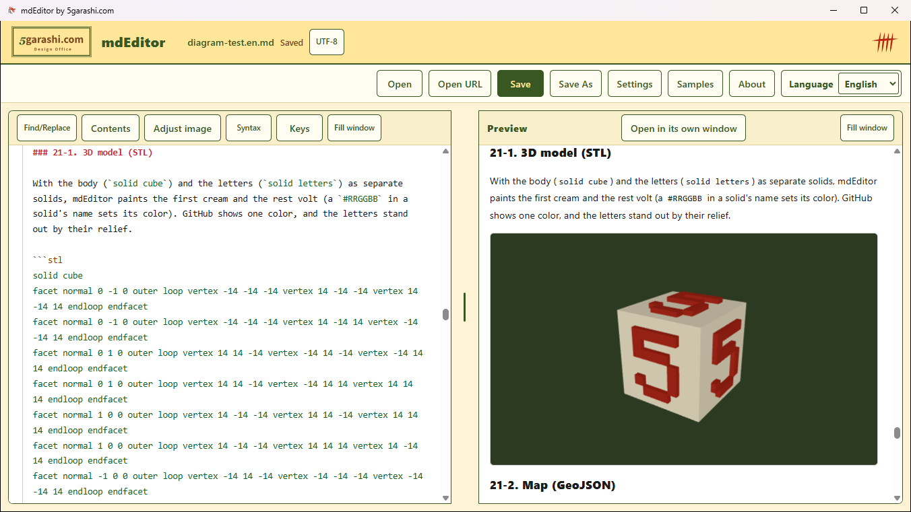
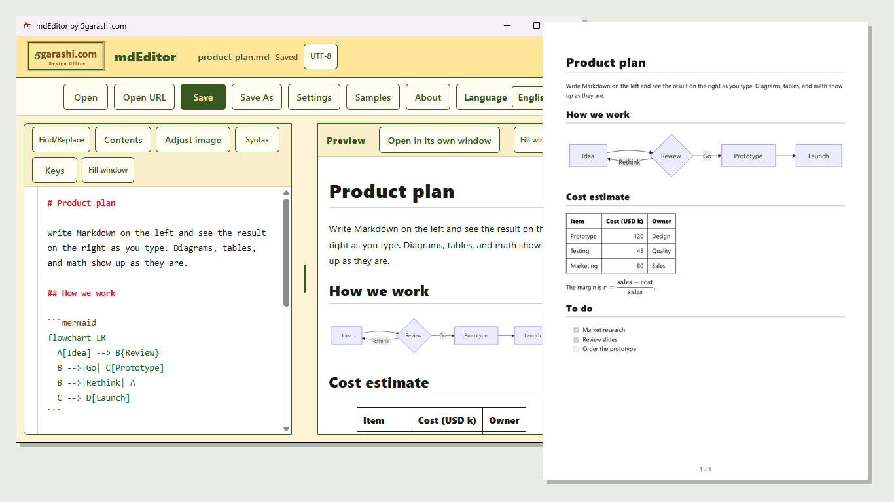
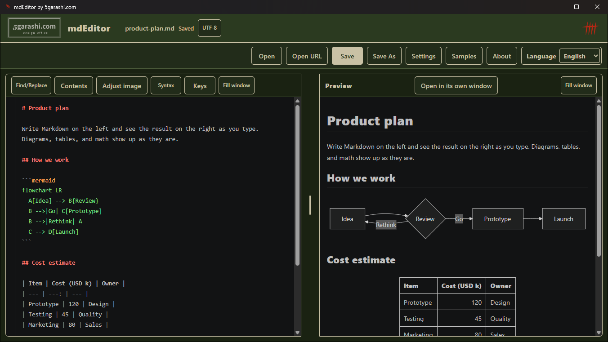
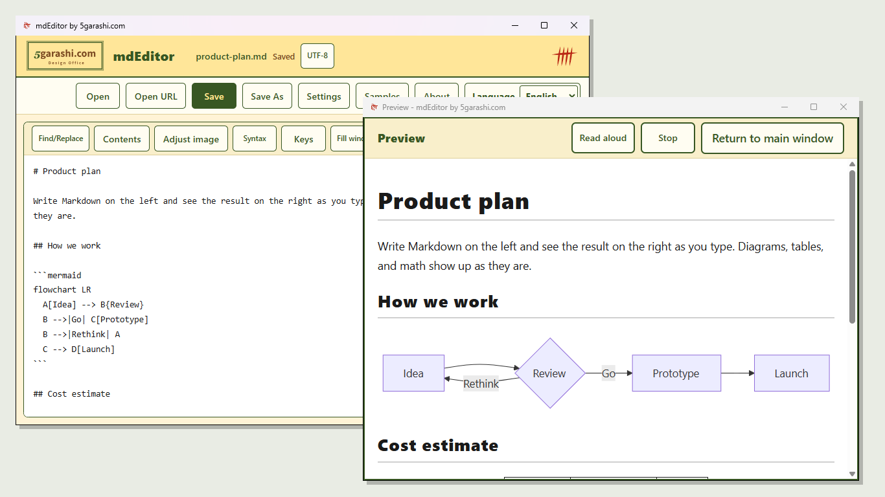
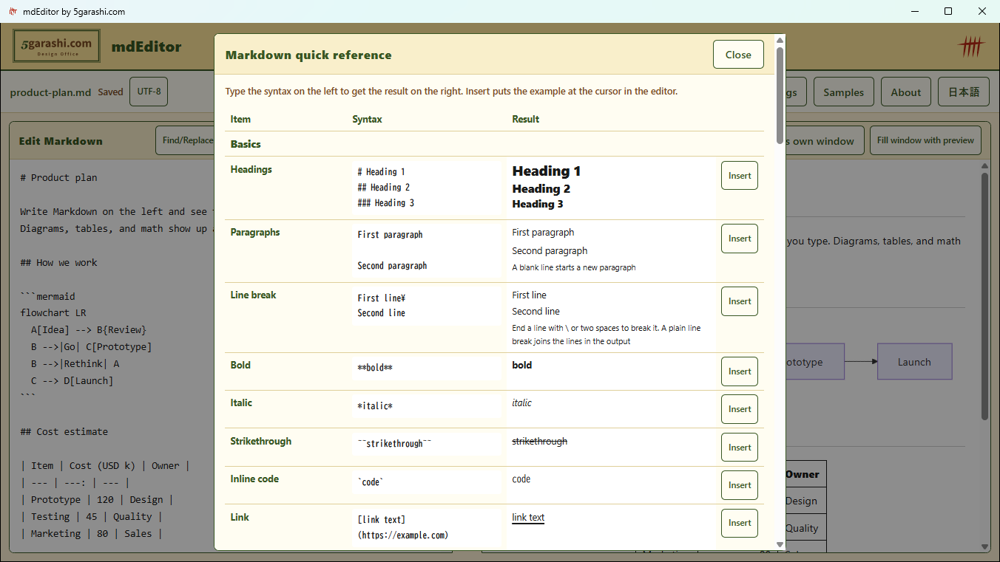
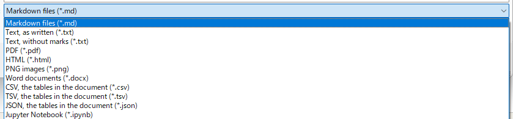
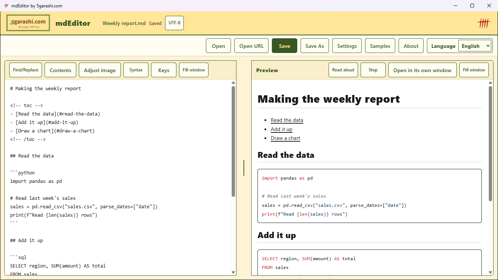
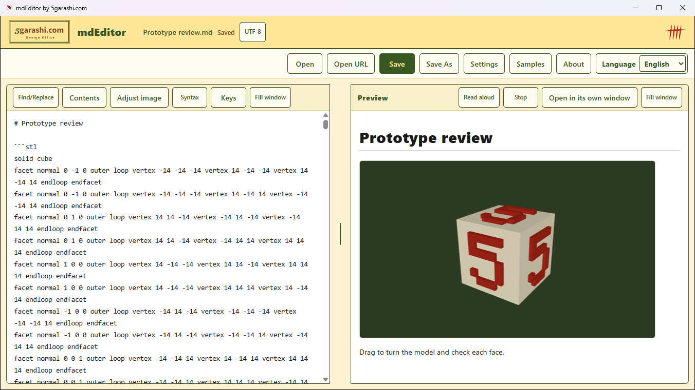
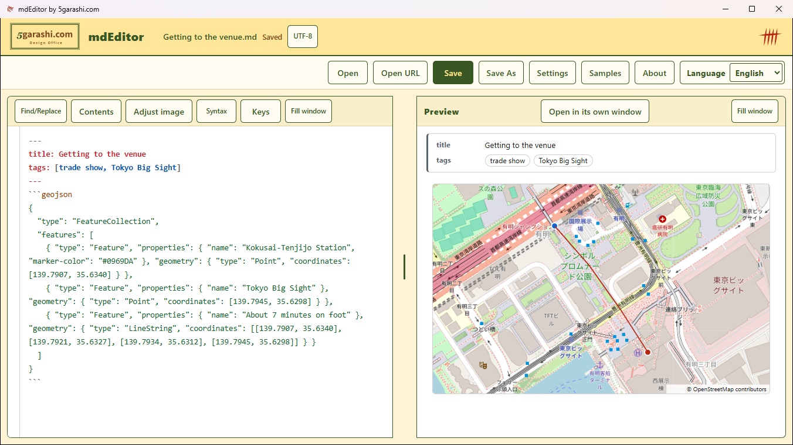
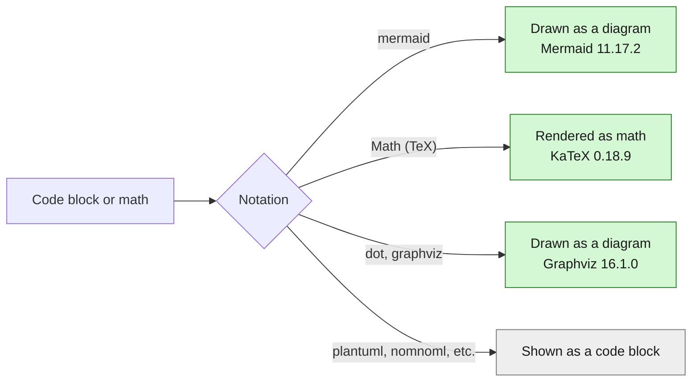

<!--
  File: README.md
  Description: Setup and usage guide for mdEditor (English)
  Author: 5garashi.com Design Office
  Created: 2026-10-10
  License: MIT
  SPDX-License-Identifier: MIT
-->
# mdEditor

A Windows app that opens Markdown files and lets you edit the text side by side with a rendered preview.

English | [日本語](./README.ja.md) | [简体中文](./README.zh-CN.md)

Version: 1.0.16 (Changes: [CHANGELOG.md](./CHANGELOG.md))

## Highlights

An editor that shows the formatted result right beside the Markdown you are writing, diagrams and math included, and exports it to PDF. Writing, reading, and keeping your work all happen on your PC.

### Write, view, and export

- **Editor and viewer in one**: what you write on the left appears at once in the preview on the right. Both sides scroll together, and stay in step when you move with find/replace or heading links. Expand either side to fill the window to use it as just an editor or just a viewer.
- **Write on one display, read on another**: open the preview in its own window and maximize it, or make it full screen, on a second display. The editor and the preview still scroll together, matched line by line. On a wide screen the text keeps a readable width while tables and diagrams spread out. The window's place is remembered for next time.
- **Diagrams, charts, math, and tables as they look**: Mermaid diagrams such as flowcharts, sequence diagrams, Gantt charts, and pie charts, KaTeX math, tables, task lists, and images in the document appear in the preview.
- **Export to PDF and HTML**: save the preview as a PDF exactly as it looks, diagrams and math included, on A4 or Letter paper (chosen automatically by region at first). Or save it as one self-contained HTML file to email or put on the web.
- **Open and save many formats**: Word, PDF, HTML, web pages, e-mail, CSV, JSON, Jupyter Notebooks, and images open as Markdown, and Save As also writes PNG, Word, CSV, JSON, Jupyter Notebook, a ZIP for sharing, and more.
- **Syntax help at hand**: F1 lists the Markdown syntax and inserts examples into the editor.
- **No trouble with text encodings**: besides UTF-8, older files in Shift_JIS, EUC-JP, and more are detected and opened, with a notice when the encoding was guessed or some characters could not be read. You can also choose the encoding to save in.
- **Your work is protected**: saving never leaves the original file broken, even if writing fails midway. Unsaved changes are backed up automatically and can be restored at the next launch after a crash.
- **Dark mode**: follows your Windows setting with an easy-on-the-eyes night palette. Printing and PDFs always use a white page.
- **Privacy**: your documents and usage are never sent anywhere. The interface is available in Japanese, English, and Simplified Chinese.

### Easy for everyone (Universal Design)

- **Readability your way**: choose the legible BIZ UD Gothic typeface, larger text (up to 200%) and line spacing, whole-window zoom, a highlighted current line, and a thick cursor. Windows contrast themes are supported. Each aid is opt-in, so the standard look stays as it is for everyone else.
- **Everything from the keyboard**: every button has a shortcut you can change or remove. Tab and F6 reach every pane, and buttons are large enough to hit easily (at least 44 px).
- **Works with screen readers**: tested with Windows Narrator; the editor was rebuilt so long documents never freeze. Buttons expose their names and shortcuts to assistive technology.
- **Read aloud**: the preview is read paragraph by paragraph, with the current paragraph shown on screen. Choose the speed and the pause between paragraphs. Only voices on your PC are used, so your text stays with you.

## Screenshots

**See the result as you write** — Write Markdown on the left and the preview on the right updates as you type, with diagrams, tables, math, and 3D models you turn by dragging.



**Save as PDF** — One click saves a PDF that looks exactly like the preview, with diagrams, tables, math, and colored code.



**Dark mode** — Follows the Windows setting, or choose day or night with the Theme button in Settings (or Ctrl+Shift+T). Printing and PDF always use a white page.



**The preview in its own window** — Put the preview on a second display to keep writing and reading apart. It scrolls along with your editing.



**Markdown at a glance** — The Markdown quick reference (F1). Insert puts the example at the cursor.



**Save in many formats** — Save As writes Markdown, text, PDF, HTML, PNG, Word, CSV, TSV, JSON, Jupyter Notebook, or a ZIP for sharing (the document and its name_files folder). Word, HTML, CSV, e-mail, Jupyter Notebook, and more open too.



**Colored code and contents** — Code with a language name is shown in color. Contents builds a table of contents from your headings.



**3D models** — A 3D model written in STL turns as you drag it. It shows without an internet connection.



**Maps and front matter** — A GeoJSON map is drawn on a detailed OpenStreetMap map once you allow it. YAML front matter at the top becomes a list of keys and values.



## Setup

1. On Windows with the .NET 10 SDK installed, double-click `setup.cmd` (or run `powershell -ExecutionPolicy Bypass -File .\setup.ps1` from PowerShell). Double-clicking a `.ps1` file only opens it in Notepad, so `setup.cmd` runs it for you. The app is published to `%LOCALAPPDATA%\Programs\mdEditor` and registered for the current user. Besides `.md` and `.markdown`, `.html` and `.htm` list mdEditor in Open with and Default apps (browser associations are not changed). The Microsoft Store version does not associate `.html` (Open and drag and drop still open it).
2. Open Windows Settings, Apps, Default apps, and choose `mdEditor` as the default app for `.md`.
3. When you open a `.md` file, mdEditor shows the text on the left and the preview on the right.

Windows requires the user to set default apps, so choose `mdEditor` for `.md` in the Settings page that opens after setup. An app cannot change the default without the user's confirmation.

The other types mdEditor opens (.txt, .html, .htm, .docx, .eml, .csv, .tsv, .json, .xml, .ipynb, and images) list mdEditor under Open with on the right-click menu (the Microsoft Store version does the same). Their default apps (such as the browser or Notepad) do not change. In the setup.cmd install mdEditor is only listed as a choice and never used as the default. In the Microsoft Store version, Windows opens a type with mdEditor on double-click only when no other app on the PC can open it (such as .ipynb or .json); choosing another app as the default takes over.

Microsoft Edge WebView2 Runtime is required. It is normally available wherever Microsoft Edge is installed.

**Package for the Microsoft Store**: `setup.cmd` is the development procedure. For the Store, run `store\build-msix.ps1` on a PC with the Windows SDK, passing the values from Partner Center's Product identity as `-IdentityName` and `-Publisher`. It creates an unsigned MSIX in `artifacts`; the Store signs it.

## Versioning

The version lives only in the [VERSION](./VERSION) file at the repository root. The app (shown in About) and the Microsoft Store MSIX (four parts, with `.0` added) read it from there. To release a new version, change these three in the same pull request:

1. Raise the number in `VERSION` (for example, `1.0.3` to `1.0.4`).
2. Add a `## 1.0.4` section to [CHANGELOG.md](./CHANGELOG.md).
3. Update the version line near the top of each README (the "Version" line in README.md, "バージョン / Version" in README.ja.md, and "版本 / Version" in README.zh-CN.md).

On pull requests, GitHub Actions checks that the three match (it reads the line in README.md only, so keep README.ja.md and README.zh-CN.md in step by hand). When merged into main, the `v1.0.4` tag and a GitHub Release (with the CHANGELOG section as its notes) are created automatically.

## Usage

- **Samples**: puts a short sample ("Diagrams and math" or "Basic writing") or the "Diagram and chart test" of every supported diagram, chart, and formula (Japanese, English, or Simplified Chinese; the three files in [samples/](./samples/)) as a new document, only when you choose it (if the open document has changes, you are asked to save them first; the open file is never written).
- **About**: shows links to the company, support, and the privacy policy. Links open in your browser only when you choose them.
- **Open**: choose a Markdown file. Text (.txt), Word (.docx), and HTML (.html, .htm) files open too. Text opens and saves back as it is. A Word document opens as Markdown: headings, lists, tables, links, and images come back (colors and layout do not); its images are placed beside the Markdown file in a "name_files" folder on the first save, and the Word document is never written. A Word document without heading styles (headings made only with larger text) gets its headings from text size: clearly larger text, or bold text one step larger, becomes heading 1 to 3, and the notice bar says how many. HTML files (.html, .htm) open too: they are converted to Markdown, and headings, paragraphs, lists, tables, links, images, and math come back (colors, layout, and drawn diagrams do not). Saving makes a Markdown file and never writes the HTML file.
  - **PDF (.pdf)**: opens as Markdown. The text comes back in reading order, wrapped lines join into paragraphs, headings are guessed from text size, lines starting with a bullet or number become list items, and pictures are handled like a Word document's. Headings that are numbered (1. / 3.1 / (1) / ① and so on) and set in another typeface than the body become headings too, nested by their numbering, and the table of contents (leader dots and a page number) becomes a list nested as the PDF indents it. Tables, math, drawings, and column layout do not come back (the text of table cells and formulas remains). Page numbers at the top or bottom of a page are left out. A PDF made only of images (a scan) has no text to take, and a password-protected PDF does not open. Up to 500 pages. The PDF itself is never written.
  - **E-mail (.eml)**: opens as Markdown with the subject as the heading, then the sender, recipients, date, attachment names, and the body. Pictures in the body are handled like a Word document's. Internet images in the mail (sometimes used to track opening) do not load until you allow them. Attachments are not extracted.
  - **CSV, TSV (.csv, .tsv)**: opens as a Markdown table with the first row as the header. Shift_JIS CSV files saved by Excel open too.
  - **JSON (.json)**: a list (an array of objects) opens as a table with the field names as the header row. Other JSON opens in a code block, so you can add notes before and after it.
  - **XML (.xml)**: opens in a code block, with room for notes before and after it.
  - **Jupyter Notebook (.ipynb)**: Markdown cells stay as they are and code cells become code blocks with their language (```python and so on). Text outputs become "output" blocks; pictures and tables (such as pandas) show as they are, and so do pictures pasted into cells.
  - **Images (.png, .jpg, .gif, .bmp, .webp)**: open as a new document that shows the image. Write a description below it and save it as Markdown; saving in another folder copies the image there too.
  - **Videos (.mp4, .m4v, .webm, .ogv, .mov)**: open as a new document that shows the video, the same way as images.
- **Drag and drop**: files dropped on the editor go in at the cursor, and files dropped anywhere else open. While you drag, a label beside the pointer says "Insert at the cursor" or "Open as a file".

  | File | Dropped on the editor | Dropped anywhere else |
  | :--- | :--- | :--- |
  | Images and videos | Copied to a "name_files" folder beside the document, with `` inserted | Opens as an image or video document |
  | Files Open accepts (.md, .txt, .html, .docx, .eml, .csv, .json, .ipynb, and so on) | Their content goes in, converted to Markdown as Open does | Opens (unsaved changes are asked about first) |
  | PDF (.pdf) | Copied to the "name_files" folder, with a link such as `[report.pdf](name_files/report.pdf)` inserted (not converted, as a PDF is usually sent along as it is) | Opens as Markdown, as Open does |
  | Files mdEditor cannot open (.pptx, .zip, and so on) | Copied to the "name_files" folder, with a link such as `[slides.pptx](name_files/slides.pptx)` inserted | Not opened; a message says that dropping it on the editor inserts a link |

  - When content goes in, the notice bar says so. If you meant to open the file, press Ctrl+Z and drop it outside the editor instead.
  - Images and videos the content shows, and files it links to, are copied to the "name_files" folder too. Front matter at the top of Markdown (the part between `---` lines) is left out.
  - Every file outside the "name_files" folder, including files in the document's own folder, is copied into the "name_files" folder. Files already inside it are used where they are.
  - The notice bar says what was copied ("Created the A_files folder and saved "B.pdf" in it." and so on). When a different file in the folder already has the name, a number is added as browsers do for downloads ("B (1).pdf", "B (2).pdf"). A file with exactly the same content is used instead of a new copy.
  - A document that has not been saved asks where to save first when files have to be copied.
  - A picture pasted into the editor (Ctrl+V), such as a screen capture, also goes in the "name_files" folder.
  - **When you give someone the Markdown file, give them the "name_files" folder too.** The document points to the images, videos, and files you inserted by paths relative to its own location (`name_files/...`). With the .md file alone, they do not show and the links do not open on the other PC. Keep the .md file and the folder side by side and send them together (for example, in one zip file). Links outside the "name_files" folder (such as `../docs/...` you wrote yourself) open only if that file goes along too. Files saved as PDF, HTML, PNG, or Word include the images, but not videos or files inserted as links.
- **Open URL / Ctrl+Shift+K**: opens a web page that starts with `https://` as Markdown. You can also drag a link in from a browser. The page's scripts never run, so content it loads afterwards (such as live rankings) is not included.
- **Images and videos on the internet**: not loaded by default; Load images and videos in the notice bar loads them for that document. Settings > Internet can also be Always load or Never load. Images over `http://` are never loaded. Images and links not found beside the file resolve from the page's own address (`<base>`, canonical, or og:url).
- **Save**: overwrite the current file. A new document asks where to save.
- **Save As**: choose a location and file name. As with Open, the file type chooses the format.
  - Saving as Markdown (or text as written) to another folder or under another name copies the whole "name_files" folder too. Under a new name, the folder is copied under the new name too ("C_files" for "C.md"), and the links in the document are rewritten, both in the saved file and in the editor (Ctrl+Z undoes it). The original document and folder are not changed.
  - While it copies, the notice bar shows how far it has got (which file of how many), then says "Copied A.md and the A_files folder to D:\Docs.", "Copied as C.md and the C_files folder.", or "Copied as C.md and the C_files folder to D:\Docs.".
  - If a folder with that name is already there, files are added to it instead of written over: a different file with the same name gets a number such as (1), and its links follow. Identical files are shared.
  - In another folder, relative links outside the "name_files" folder (such as `../docs/x.pdf` you wrote yourself) are changed to point to the original files.
  - Saving as PDF, HTML, PNG, Word, and the other export formats copies no folder, because the images go inside the file.
  - **Markdown (.md), text as written (.txt)**: save the document itself (the content as it is). Save then writes to this file.
  - **Text without marks, PDF, HTML, PNG, Word (.docx), CSV, TSV, JSON, Jupyter Notebook, ZIP for sharing**: export the document; the file you are editing stays as it was. Each export is described below.
- **Text without marks**: only the words the preview shows, as a .txt file. Heading and emphasis marks are removed and lines break where you wrote them. Lists use a bullet or number, tables are tab-separated, links become "text (address)", and diagrams become "[Figure]".
- **CSV, TSV**: the tables in the document as CSV (comma-separated) or TSV (tab-separated). Two or more tables are saved as name-1.csv, name-2.csv, and so on. Files are UTF-8 with a BOM so Excel shows Japanese correctly.
- **JSON**: the tables in the document as arrays of objects keyed by the header row (UTF-8). Values are written as text, so numbers such as 007 keep their zeros. Two or more tables are saved as name-1.json and so on.
- **Jupyter Notebook**: code blocks with a language become code cells and everything else Markdown cells. Outputs are not included (Jupyter makes them again when run). A document opened from an .ipynb file saves back to the same cells.
- **ZIP for sharing**: a ZIP to hand to someone, holding the document (.md) and its "name_files" folder under the names the links use, so it shows as it is once extracted. The document goes in as the editor has it (unsaved changes included). A document without a "name_files" folder (or not saved yet) goes in alone.
  - When the "name_files" folder has files the document does not refer to (in no link, picture, or HTML src or href), they are listed and you choose: Yes moves them to the Recycle Bin, then makes the ZIP; No keeps them where they are. Either way they stay out of the ZIP.
  - Links to files outside the "name_files" folder are not put in the ZIP; the message says how many there are.
- **Ctrl+O**: open a file.
- **Back to previous document / Ctrl+Shift+B**: goes back to the document that was open before another one took its place. The button beside Open shows only while there is a document to go back to. Use it when, for example, you dropped a file outside the editor and it opened another document, perhaps after pressing "No" when you meant "Cancel".
  - A document closed with "No" to "Save changes?" comes back as it was when you closed it (the unsaved text, its file, and its encoding), still unsaved. Saving it writes over its file as usual.
  - A document closed without changes is opened again from its file. If the file was moved or deleted, a message says so.
  - Only the last document closed can come back. That includes one closed in another window, or with "No" when closing the app (also after the next start). When no other document took its place, as when you cancel the file dialog of Open, the previous document stays as it was.
  - If the current document has changes, you are asked to save them first. Choosing "No" there swaps the two, so pressing the button again returns to the current one.
  - The copy is kept where automatic backup keeps its copies. For a document without changes, only its file location is kept. With automatic backup turned off in Settings, no copy is kept and the button does not show.
- **Ctrl+S**: save.
- **Ctrl+Shift+S**: save as.
- **PDF**: export the rendered preview as a PDF.
- **PNG / Ctrl+Shift+G**: the preview as pictures (PNG) in the day palette; a long document is split into name-1.png, name-2.png, and so on.
- **Word / Ctrl+Shift+D**: export a Word document (.docx). Headings, paragraphs, lists, quotes, code, tables, links, and images use Word's own styles, so Word's navigation pane and table of contents work. Diagrams and math go in as pictures from the preview (not editable in Word).
- **HTML / Ctrl+Shift+M**: export the rendered preview as one self-contained HTML file. Diagrams are SVG, math is MathML, and images beside the document are embedded. In a browser it switches to the night palette in dark mode. Opening it makes no connections, except that web images in the document load from their servers.
- **Paper** (in Settings, or Ctrl+Shift+A): cycle the PDF paper through Auto, A4, and Letter. Auto follows the Windows region (Letter where US customary units are used, A4 elsewhere). The choice is remembered.
- **Encoding**: the document's encoding is shown next to the file name. Press it to choose an encoding and either reopen the file in it or use it from the next save.
- **Ctrl+Shift+P**: save as PDF.
- **Contents / Ctrl+Shift+J**: build a table of contents (links to the headings) and insert it at the cursor. It goes between `<!-- toc -->` and `<!-- /toc -->` (not shown in the preview); after changing headings, press it again to update that table in place. The document title (a single `#` heading at the top) is left out, and three levels are kept. The links go to the headings in the preview, PDF, HTML, and Word.
- **Adjust image / Ctrl+Shift+F**: choose an image's size and position, and have it rewritten the way GitHub does it (HTML ``). Put the cursor on the image's line in the editor and press it, or right-click the image in the preview.
  - Size: original size, 25%, 50%, 75%, or 100% of the text width, or a width in pixels (`width="50%"`, `width="300"`). The height keeps the picture's proportions.
  - Position: not set (left), center (`<p align="center">`), right (`<p align="right">`), or on the left or right with text flowing around it (`align="left"`, `align="right"`). Center and Right need the image on a line of its own. If text follows on the next line, a blank line goes in between, so the HTML block does not swallow it.
  - Choosing Original size and Not set turns the image back into Markdown, ``. Ctrl+Z undoes the change.
  - PDF, PNG, and HTML follow the preview. Word gets the size and the center, right, or left placement (text does not flow around it there; the image is placed left or right). Text without marks shows "[description]", as for Markdown images.
- **Ctrl+H**: open the editor's find/replace bar with Replace and Replace all (`Enter` finds next, `Esc` closes).
- **Syntax / F1**: show a Markdown quick reference grouped into Basics, Diagrams (Mermaid), Math (KaTeX), Written as on GitHub, and Other drawings and video: flowchart, sequence, Gantt, pie, class, state, ER, mind map, bar and line chart, and timeline diagrams (drawn in the list), and ten math examples such as fractions, roots, sums, matrices, and cases. Written as on GitHub has alerts, collapsible sections, keys, and emoji; Other drawings and video has Graphviz, a map (GeoJSON), and video (all short versions of examples in samples/diagram-test). Insert puts an example at the cursor in the editor (`Esc` closes).
- **Ctrl+F**: the standard window find, which also works in the preview.
- **Scroll sync**: scrolling the editor or the preview moves the other to the same place, including jumps from find/replace and heading links.
- **Heading links**: links within the document such as `[English](#english)` move the preview to that heading. Heading ids follow GitHub rules (Japanese kept as is, letters in lowercase, spaces as `-`).
- **Links to other files**: a link to a file beside the document, such as `[License](./LICENSE)`, opens Markdown and text files (no extension, `.md`, `.txt`, and so on) in a new mdEditor window, leaving the current document open. `other.md#heading` shows that heading. PDFs, images, CSV files, and similar open in their usual app; programs and other files that could be unsafe are never run but shown in File Explorer.
- **Pane divider**: drag the center divider to resize the editor and the preview. Focus the divider and press the left or right arrow keys to resize in 5% steps. On narrow windows the divider is vertical and uses the up and down arrow keys. The width is remembered for the next launch.
- **Fill window with editor / preview**: each pane has a Fill window button that expands that pane to fill the app window (not OS full screen). Return with "Restore layout" or `Esc`.
- **Window full screen**: toggle with `F11`; exit with `F11` or `Esc`.
- **Preview in its own window / Ctrl+Shift+3**: "Open in its own window" in the preview heading opens a window with only the preview. Put it on a second display, maximize it, or press `F11` for full screen. The main window then shows the editor across its full width.
  - The editor and the preview still scroll together (they show the same line of the document). Heading links, moving with find/replace, and read-aloud keep working.
  - Shortcuts pressed in the preview window (Save, Find/Replace, Settings, and so on) run in the main window.
  - "Return to main window" (in the preview window), "Return preview here" (in the editor), or closing the preview window brings back the side-by-side layout.
  - The window's position, size, and maximized state, and whether the preview was in its own window, are remembered. If that display is no longer connected, the window moves to one you can see.
- **Keys / Shift+F1**: list the keyboard shortcuts for every command. Change any key with Change (Ctrl with a letter or digit, or an F key), remove it with None, or turn every shortcut off with Use keyboard shortcuts. The settings are remembered.
- **Settings / Ctrl+Shift+O**: adjust readability and ease of use to suit you. Every option except automatic backup starts off (standard), so only the people who need one turn it on. Settings are remembered.
  - **Typeface**: switch to BIZ UD Gothic, a Universal Design typeface included with Windows.
  - **Text size and line spacing**: make the editor and preview text 125%, 150%, or 200%, and the line spacing Wide or Wider.
  - **Markdown syntax**: with "Show documents closer to GitHub" on (off by default), mdEditor's own syntax that GitHub does not have (`x^2^` superscript, `H~2~O` subscript, `==highlight==`, `++insert++`, definition lists, `:::` containers, attributes such as `{#id}`, abbreviations, grid tables, and `a.` numbering) shows as the plain text you wrote, as on GitHub, and `~text~` is struck through. Exports such as PDF and Word follow it too. It does not make the display identical to GitHub (diagrams, maps, 3D models, code colors, and how math is drawn stay mdEditor's own). The setting is remembered.
  - **Export**: with "Keep the original Markdown in saved HTML" on (off by default), HTML you save opens back in mdEditor exactly as written, diagram and math source included. The original text goes into the HTML file as it is, including comments (`<!-- -->`) that are never shown, so check it before you share the file.
  - **Preview text width**: on wide screens the preview text keeps a comfortable width (about 44 full-width characters), centered; tables, diagrams, code, and display math may be wider. "Don't limit the preview text width" uses the full width.
  - **Zoom**: the whole window starts at 90%. Zoom in, Zoom out, and Reset to default (90%) change it. Ctrl + mouse wheel, Ctrl + plus/minus, and Ctrl + 0 (back to 90%) also work; the zoom level is remembered.
  - **Editor**: highlight the current line and use a thick cursor.
  - **Read aloud**: when on, Read aloud and Stop buttons appear in the preview heading. Reading starts from the first paragraph visible in the preview and outlines the paragraph being read. Choose the speed (five steps), the pause between paragraphs (none, 0.5, 1, or 2 seconds), the language (Automatic, Japanese, English, Chinese (Simplified)), and the voice (from those on this PC). If no voice is installed for the language, the app explains how to add one. Only voices installed on this PC are used, so the text is never sent anywhere. `Esc` also stops reading.
  - **Automatic backup** (on by default): unsaved changes are copied every 15 seconds to `%LOCALAPPDATA%\mdEditor\Recovery`. If the app ends abnormally, the next launch asks whether to restore them. The copy is removed when you save or close normally.
  - **New from clipboard**: choose a start key (Ctrl+Alt with a letter or digit). After you confirm, mdEditor creates the desktop shortcut "mdEditor (new from clipboard)" with that key (Windows lets such keys start only shortcuts on the desktop or in the Start menu). Copy text, a picture, or files in any app, then press the key: mdEditor starts with a new document holding them. One copied file that mdEditor opens is opened instead, as when dropped outside the editor. Formatted content (from a web page or Word) becomes Markdown as with Open; pictures and files go in the "name_files" folder as when dropped on the editor, so the new document first asks where to save. Windows may take a second or two to react to the key. Choosing None deletes the shortcut. Set it back to None before uninstalling mdEditor, as the shortcut is not removed automatically. The `--paste` option (`mdEditor.exe --paste`) does the same from a command line.
- **Windows contrast themes**: with a Windows contrast theme, the app uses its colors and keeps button outlines and focus indicators.

### Keyboard shortcuts (defaults)

| Command | Key | Command | Key |
| :--- | :--- | :--- | :--- |
| Open | Ctrl+O | Find/Replace | Ctrl+H |
| Insert or update the table of contents | Ctrl+Shift+J | Back to previous document | Ctrl+Shift+B |
| Image size and position | Ctrl+Shift+F | | |
| Save | Ctrl+S | Find next / previous | F3 / Shift+F3 |
| Save As | Ctrl+Shift+S | Replace all | Ctrl+Shift+H |
| Save as PDF | Ctrl+Shift+P | Markdown syntax | F1 |
| Switch paper size | Ctrl+Shift+A | Keyboard shortcuts | Shift+F1 |
| Switch theme | Ctrl+Shift+T | Fill window with editor / preview | Ctrl+Shift+1 / Ctrl+Shift+2 |
| Switch language | Ctrl+Shift+L | Next / previous pane (toolbar, editor, preview) | F6 / Shift+F6 |
| Text encoding | Ctrl+Shift+E | Window full screen | F11 |
| Settings | Ctrl+Shift+O | Read aloud / pause, Stop (when read-aloud is on) | Ctrl+Shift+Y / Ctrl+Shift+U |
| Preview in its own window / return | Ctrl+Shift+3 | Save as HTML | Ctrl+Shift+M |
| Open URL | Ctrl+Shift+K | Save as PNG / Save as Word | Ctrl+Shift+G / Ctrl+Shift+D |

`Esc` always stops reading aloud, restores the layout, or leaves full screen. Each button's tooltip and the information given to screen readers (`aria-keyshortcuts`) show the current key.

Changes in the Markdown are reflected in the preview. If there are unsaved changes when you open a file or close the app, you are asked whether to save.

## Display language

The interface and dialogs support Japanese, English, and Simplified Chinese. On first launch the language follows the Windows display language (Japanese for Japanese, Simplified Chinese for Chinese, otherwise English). Choose another one at any time from the Language list in the toolbar, or press Ctrl+Shift+L to go through Japanese, English, and Simplified Chinese in turn. The choice is remembered.

In Simplified Chinese, Chinese characters use a Chinese typeface (Microsoft YaHei), and the logo is the English logotype, as there is no Chinese one. Read-aloud uses a Chinese voice (if one is installed in Windows) when its language is set to Chinese (Simplified), or, in Automatic, for paragraphs without kana.

The `--lang` option (`ja`, `en`, or `zh`; `zh-CN` works too, as does `--lang=zh`) sets the language for that launch only and does not overwrite the saved choice.

```
mdEditor.exe --lang en
mdEditor.exe --lang zh
mdEditor.exe --lang ja "C:\docs\memo.md"
```

## Markdown and preview

Headings, lists, task lists, quotes, tables (left, center, and right alignment), code, links, and images are rendered. HTML written in Markdown shows only what GitHub allows (`<details>`, `<summary>`, `<kbd>`, `<sup>`, `<sub>`, `<br>`, `<picture>`, image widths, centering with `align`, and so on); everything else is removed. As on GitHub, scripts, `<style>`, `<iframe>`, embeds, forms, event attributes such as `onclick`, and `javascript:` links are removed and never run. Internet images written in HTML wait for permission, like Markdown images. HTML comments (`<!-- -->`) are not shown. Web links open in the default browser and mail links in the default mail app. The PDF contains only the rendered preview, not the editing text area or buttons.

Relative images such as `images/a.png` load from the document's folder and its subfolders. Only image files (PNG, JPEG, GIF, WebP, AVIF, BMP, ICO, SVG) are read, and nothing above the document's folder.

The text encoding is detected automatically: UTF-8 (with or without BOM), UTF-16, or the Windows default code page (Shift_JIS on Japanese Windows, GBK on Simplified Chinese Windows). Saving keeps the original encoding; if some characters cannot be saved in it, the app asks whether to save as UTF-8. A notice appears under the toolbar when a non-UTF-8 file was opened with a guessed encoding or when some bytes could not be read (shown as �); overwriting such a file asks for confirmation first, because those parts of the original would be lost. For EUC-JP or ISO-2022-JP files, choose the encoding and reopen the file. Saves are written to a temporary file and then swapped in, so a failure part-way never damages the original document.

` ```mermaid ` code blocks are drawn as diagrams with [Mermaid](https://mermaid.js.org/) (flowcharts, sequence, class, state, ER, Gantt, pie charts, and more). Math in `$...$` and `$$...$$` is rendered with [KaTeX](https://katex.org/). Both are bundled with the app, so they work offline and are included in PDFs. Code blocks with a language name, such as ` ```python `, are colored with [highlight.js](https://highlightjs.org/) (about 40 languages, including Python, JavaScript, TypeScript, C#, C/C++, Java, PowerShell, shell, SQL, HTML, CSS, JSON, YAML, and diff). The colors follow the preview's day and night palettes and are kept when you save as PDF, PNG, HTML, or Word. Code blocks without a language stay plain. A diagram with a syntax error shows the error message and its source. Use [samples/diagram-test.en.md](./samples/diagram-test.en.md) (Japanese: [samples/diagram-test.md](./samples/diagram-test.md), Chinese: [samples/diagram-test.zh-CN.md](./samples/diagram-test.zh-CN.md)) to check the rendering.

### Supported diagrams and charts

How a block is rendered depends on the language name of the code block.



| Type | Syntax | Rendered | Notes |
| :--- | :--- | :---: | :--- |
| Flowchart | ` ```mermaid ` + `flowchart` / `graph` | Yes | |
| Sequence diagram | `sequenceDiagram` | Yes | |
| Class diagram | `classDiagram` | Yes | |
| State diagram | `stateDiagram-v2` | Yes | |
| ER diagram | `erDiagram` | Yes | |
| Gantt chart | `gantt` | Yes | |
| Pie chart | `pie` | Yes | |
| Bar and line chart | `xychart-beta` | Yes | Quote non-ASCII axis labels, such as `"1月"` |
| Quadrant chart | `quadrantChart` | Yes | |
| User journey | `journey` | Yes | |
| Git graph | `gitGraph` | Yes | |
| Mind map | `mindmap` | Yes | |
| Timeline | `timeline` | Yes | |
| Sankey diagram | `sankey-beta` | Yes | ASCII node names only (a Mermaid limitation) |
| Math | `$...$` (inline), `$$...$$` (display) | Yes | Rendered with KaTeX |
| Graphviz | ` ```dot `, ` ```graphviz `, ` ```gv ` | Yes | Drawn offline with the bundled Graphviz (WebAssembly). Links and images inside a diagram are removed for safety. Japanese labels that would overflow their box are made smaller to fit |
| 3D model | ` ```stl ` (ASCII STL) | Yes | Shown offline with the bundled three.js. Drag to turn, use the wheel to zoom. PDF, PNG, HTML, and Word get a picture of the current view |
| Map | ` ```geojson `, ` ```topojson ` | Yes | Points, lines, and areas are first drawn offline on a simple bundled world map (Natural Earth). By default the notice bar asks whether to load detailed maps; pressing Load detailed maps loads an OpenStreetMap map with roads and place names for that document only (the map server sees the area shown and your IP address; it is not kept in saved HTML). Settings > Internet > Detailed maps (OpenStreetMap) also offers Always load and Never load. GitHub's `marker-color`, `stroke`, and `fill` styles work |
| PlantUML | ` ```plantuml ` | No | Shown as a code block. Drawing it needs Java and PlantUML on the PC, or sending the document to an outside PlantUML server, which goes against keeping documents on the PC |
| nomnoml | ` ```nomnoml ` | No | Shown as a code block |

Everything marked Yes is verified with the test documents. Other Mermaid diagrams (such as `block-beta`) render if Mermaid 11.17.2 supports them, but they have not been checked.

Three documents, [samples/diagram-test.md](./samples/diagram-test.md), [samples/diagram-test.en.md](./samples/diagram-test.en.md), and [samples/diagram-test.zh-CN.md](./samples/diagram-test.zh-CN.md), assume they are shown in mdEditor and are not held to GitHub compatibility (Identity 8-9 (7)). They show as they are which diagrams mdEditor can and cannot draw, so they include syntax GitHub cannot render (Graphviz, PlantUML), and their rendering is checked in mdEditor (Identity 8-9 (8), 1-4 (1)). Each says so at the top. The rest of this README, CHANGELOG.md, PRIVACY.md, and the other samples keep to what GitHub can show.


## Written as on GitHub

These ways of writing, common in GitHub READMEs, show the same way as on GitHub. Use [samples/github-test.en.md](./samples/github-test.en.md) (Japanese: [samples/github-test.md](./samples/github-test.md), Chinese: [samples/github-test.zh-CN.md](./samples/github-test.zh-CN.md)) to check them.

| Syntax | Example | Shown as |
| :--- | :--- | :--- |
| Alerts | `> [!NOTE]`, `[!TIP]`, `[!IMPORTANT]`, `[!WARNING]`, `[!CAUTION]` | A box with a colored bar, symbol, and title |
| Front matter | `title: …` and so on between `---` lines at the top (YAML) | A card of key and value rows; lists become small labels and nested items sit inside the card (the same in Word). GitHub shows a table |
| Videos | ``, a lone link to a video, or `<video src="…">` (.mp4, .webm, .mov, and so on) | A video that starts by itself without sound and loops (the controls turn the sound on or pause it). With Windows animation effects off, it shows a play button unless autoplay is chosen in Settings > Videos. Internet videos wait for permission, like images. PDF, PNG, and Word get the video's name, HTML a link to it |
| Math code block | ` ```math ` | Math (KaTeX) |
| Inline math, GitHub style | `` $`x^2`$ `` | Math |
| Emoji short names | `:smile:`, `:+1:` | Emoji (smileys such as `:)` stay text) |
| Collapsible sections | `<details><summary>…</summary>…</details>` | Opens when pressed; saved open in PDF, PNG, and Word |
| Image size and position | ``, `<p align="center"></p>`, `` | A width as a share of the text width or in pixels, centered or on the right, or with text flowing around it. Adjust image (Ctrl+Shift+F) or a right-click in the preview rewrites it. Word gets the size and placement too |
| E-mail addresses | `info@example.com` | A mailto link (a full stop at the end is left out; addresses in code stay text) |
| Bars in code inside a table | A `\` before the bar, in code inside a table cell | A single bar in the code (the `\` is not shown) |
| Older attributes GitHub keeps | `<br clear="all">`, `<table border="1">`, `nowrap`, `cellpadding`, `hspace`, and so on | Work as written; `<br clear="all">` ends text flowing around a picture |
| Day and night pictures | `<picture>` with `<source media="(prefers-color-scheme: dark)">`, or `#gh-dark-mode-only` / `#gh-light-mode-only` at the end of an image URL | Only the picture for the current palette |

## Examples: 3D model, map, and video

The table at the top of this README (a card in mdEditor) is the YAML front matter (the part between `---` lines). The three examples below also show on both GitHub and mdEditor (on GitHub the video is a link to it; GitHub plays only videos uploaded to GitHub).

```stl
solid cube
facet normal 0 -1 0 outer loop vertex -14 -14 -14 vertex 14 -14 -14 vertex 14 -14 14 endloop endfacet
facet normal 0 -1 0 outer loop vertex -14 -14 -14 vertex 14 -14 14 vertex -14 -14 14 endloop endfacet
facet normal 0 1 0 outer loop vertex 14 14 -14 vertex -14 14 -14 vertex -14 14 14 endloop endfacet
facet normal 0 1 0 outer loop vertex 14 14 -14 vertex -14 14 14 vertex 14 14 14 endloop endfacet
facet normal 1 0 0 outer loop vertex 14 -14 -14 vertex 14 14 -14 vertex 14 14 14 endloop endfacet
facet normal 1 0 0 outer loop vertex 14 -14 -14 vertex 14 14 14 vertex 14 -14 14 endloop endfacet
facet normal -1 0 0 outer loop vertex -14 14 -14 vertex -14 -14 -14 vertex -14 -14 14 endloop endfacet
facet normal -1 0 0 outer loop vertex -14 14 -14 vertex -14 -14 14 vertex -14 14 14 endloop endfacet
facet normal 0 0 1 outer loop vertex -14 -14 14 vertex 14 -14 14 vertex 14 14 14 endloop endfacet
facet normal 0 0 1 outer loop vertex -14 -14 14 vertex 14 14 14 vertex -14 14 14 endloop endfacet
facet normal 0 0 -1 outer loop vertex -14 14 -14 vertex 14 14 -14 vertex 14 -14 -14 endloop endfacet
facet normal 0 0 -1 outer loop vertex -14 14 -14 vertex 14 -14 -14 vertex -14 -14 -14 endloop endfacet
endsolid cube
solid letters
facet normal 0 -1 0 outer loop vertex -7.5 -15.5 7.5 vertex 7.5 -15.5 7.5 vertex 7.5 -15.5 10.5 endloop endfacet
facet normal 0 -1 0 outer loop vertex -7.5 -15.5 7.5 vertex 7.5 -15.5 10.5 vertex -7.5 -15.5 10.5 endloop endfacet
facet normal 0 -1 0 outer loop vertex -7.5 -15.5 1.5 vertex -4.5 -15.5 1.5 vertex -4.5 -15.5 7.5 endloop endfacet
facet normal 0 -1 0 outer loop vertex -7.5 -15.5 1.5 vertex -4.5 -15.5 7.5 vertex -7.5 -15.5 7.5 endloop endfacet
facet normal 0 -1 0 outer loop vertex -4.5 -15.5 1.5 vertex 4.5 -15.5 1.5 vertex 4.5 -15.5 4.5 endloop endfacet
facet normal 0 -1 0 outer loop vertex -4.5 -15.5 1.5 vertex 4.5 -15.5 4.5 vertex -4.5 -15.5 4.5 endloop endfacet
facet normal 0 -1 0 outer loop vertex 4.5 -15.5 -7.5 vertex 7.5 -15.5 -7.5 vertex 7.5 -15.5 1.5 endloop endfacet
facet normal 0 -1 0 outer loop vertex 4.5 -15.5 -7.5 vertex 7.5 -15.5 1.5 vertex 4.5 -15.5 1.5 endloop endfacet
facet normal 0 -1 0 outer loop vertex -7.5 -15.5 -7.5 vertex -4.5 -15.5 -7.5 vertex -4.5 -15.5 -4.5 endloop endfacet
facet normal 0 -1 0 outer loop vertex -7.5 -15.5 -7.5 vertex -4.5 -15.5 -4.5 vertex -7.5 -15.5 -4.5 endloop endfacet
facet normal 0 -1 0 outer loop vertex -4.5 -15.5 -10.5 vertex 4.5 -15.5 -10.5 vertex 4.5 -15.5 -7.5 endloop endfacet
facet normal 0 -1 0 outer loop vertex -4.5 -15.5 -10.5 vertex 4.5 -15.5 -7.5 vertex -4.5 -15.5 -7.5 endloop endfacet
facet normal 0 0 1 outer loop vertex -7.5 -15.5 10.5 vertex 7.5 -15.5 10.5 vertex 7.5 -14 10.5 endloop endfacet
facet normal 0 0 1 outer loop vertex -7.5 -15.5 10.5 vertex 7.5 -14 10.5 vertex -7.5 -14 10.5 endloop endfacet
facet normal 0 0 -1 outer loop vertex -4.5 -14 7.5 vertex 7.5 -14 7.5 vertex 7.5 -15.5 7.5 endloop endfacet
facet normal 0 0 -1 outer loop vertex -4.5 -14 7.5 vertex 7.5 -15.5 7.5 vertex -4.5 -15.5 7.5 endloop endfacet
facet normal 0 0 1 outer loop vertex -4.5 -15.5 4.5 vertex 4.5 -15.5 4.5 vertex 4.5 -14 4.5 endloop endfacet
facet normal 0 0 1 outer loop vertex -4.5 -15.5 4.5 vertex 4.5 -14 4.5 vertex -4.5 -14 4.5 endloop endfacet
facet normal 0 0 -1 outer loop vertex -7.5 -14 1.5 vertex 4.5 -14 1.5 vertex 4.5 -15.5 1.5 endloop endfacet
facet normal 0 0 -1 outer loop vertex -7.5 -14 1.5 vertex 4.5 -15.5 1.5 vertex -7.5 -15.5 1.5 endloop endfacet
facet normal 0 0 1 outer loop vertex 4.5 -15.5 1.5 vertex 7.5 -15.5 1.5 vertex 7.5 -14 1.5 endloop endfacet
facet normal 0 0 1 outer loop vertex 4.5 -15.5 1.5 vertex 7.5 -14 1.5 vertex 4.5 -14 1.5 endloop endfacet
facet normal 0 0 1 outer loop vertex -7.5 -15.5 -4.5 vertex -4.5 -15.5 -4.5 vertex -4.5 -14 -4.5 endloop endfacet
facet normal 0 0 1 outer loop vertex -7.5 -15.5 -4.5 vertex -4.5 -14 -4.5 vertex -7.5 -14 -4.5 endloop endfacet
facet normal 0 0 -1 outer loop vertex -7.5 -14 -7.5 vertex -4.5 -14 -7.5 vertex -4.5 -15.5 -7.5 endloop endfacet
facet normal 0 0 -1 outer loop vertex -7.5 -14 -7.5 vertex -4.5 -15.5 -7.5 vertex -7.5 -15.5 -7.5 endloop endfacet
facet normal 0 0 -1 outer loop vertex 4.5 -14 -7.5 vertex 7.5 -14 -7.5 vertex 7.5 -15.5 -7.5 endloop endfacet
facet normal 0 0 -1 outer loop vertex 4.5 -14 -7.5 vertex 7.5 -15.5 -7.5 vertex 4.5 -15.5 -7.5 endloop endfacet
facet normal 0 0 1 outer loop vertex -4.5 -15.5 -7.5 vertex 4.5 -15.5 -7.5 vertex 4.5 -14 -7.5 endloop endfacet
facet normal 0 0 1 outer loop vertex -4.5 -15.5 -7.5 vertex 4.5 -14 -7.5 vertex -4.5 -14 -7.5 endloop endfacet
facet normal 0 0 -1 outer loop vertex -4.5 -14 -10.5 vertex 4.5 -14 -10.5 vertex 4.5 -15.5 -10.5 endloop endfacet
facet normal 0 0 -1 outer loop vertex -4.5 -14 -10.5 vertex 4.5 -15.5 -10.5 vertex -4.5 -15.5 -10.5 endloop endfacet
facet normal -1 0 0 outer loop vertex -7.5 -14 10.5 vertex -7.5 -14 1.5 vertex -7.5 -15.5 1.5 endloop endfacet
facet normal -1 0 0 outer loop vertex -7.5 -14 10.5 vertex -7.5 -15.5 1.5 vertex -7.5 -15.5 10.5 endloop endfacet
facet normal -1 0 0 outer loop vertex -7.5 -14 -4.5 vertex -7.5 -14 -7.5 vertex -7.5 -15.5 -7.5 endloop endfacet
facet normal -1 0 0 outer loop vertex -7.5 -14 -4.5 vertex -7.5 -15.5 -7.5 vertex -7.5 -15.5 -4.5 endloop endfacet
facet normal 1 0 0 outer loop vertex -4.5 -15.5 7.5 vertex -4.5 -15.5 4.5 vertex -4.5 -14 4.5 endloop endfacet
facet normal 1 0 0 outer loop vertex -4.5 -15.5 7.5 vertex -4.5 -14 4.5 vertex -4.5 -14 7.5 endloop endfacet
facet normal 1 0 0 outer loop vertex -4.5 -15.5 -4.5 vertex -4.5 -15.5 -7.5 vertex -4.5 -14 -7.5 endloop endfacet
facet normal 1 0 0 outer loop vertex -4.5 -15.5 -4.5 vertex -4.5 -14 -7.5 vertex -4.5 -14 -4.5 endloop endfacet
facet normal -1 0 0 outer loop vertex -4.5 -14 -7.5 vertex -4.5 -14 -10.5 vertex -4.5 -15.5 -10.5 endloop endfacet
facet normal -1 0 0 outer loop vertex -4.5 -14 -7.5 vertex -4.5 -15.5 -10.5 vertex -4.5 -15.5 -7.5 endloop endfacet
facet normal 1 0 0 outer loop vertex 4.5 -15.5 4.5 vertex 4.5 -15.5 1.5 vertex 4.5 -14 1.5 endloop endfacet
facet normal 1 0 0 outer loop vertex 4.5 -15.5 4.5 vertex 4.5 -14 1.5 vertex 4.5 -14 4.5 endloop endfacet
facet normal 1 0 0 outer loop vertex 4.5 -15.5 -7.5 vertex 4.5 -15.5 -10.5 vertex 4.5 -14 -10.5 endloop endfacet
facet normal 1 0 0 outer loop vertex 4.5 -15.5 -7.5 vertex 4.5 -14 -10.5 vertex 4.5 -14 -7.5 endloop endfacet
facet normal -1 0 0 outer loop vertex 4.5 -14 1.5 vertex 4.5 -14 -7.5 vertex 4.5 -15.5 -7.5 endloop endfacet
facet normal -1 0 0 outer loop vertex 4.5 -14 1.5 vertex 4.5 -15.5 -7.5 vertex 4.5 -15.5 1.5 endloop endfacet
facet normal 1 0 0 outer loop vertex 7.5 -15.5 10.5 vertex 7.5 -15.5 7.5 vertex 7.5 -14 7.5 endloop endfacet
facet normal 1 0 0 outer loop vertex 7.5 -15.5 10.5 vertex 7.5 -14 7.5 vertex 7.5 -14 10.5 endloop endfacet
facet normal 1 0 0 outer loop vertex 7.5 -15.5 1.5 vertex 7.5 -15.5 -7.5 vertex 7.5 -14 -7.5 endloop endfacet
facet normal 1 0 0 outer loop vertex 7.5 -15.5 1.5 vertex 7.5 -14 -7.5 vertex 7.5 -14 1.5 endloop endfacet
facet normal 0 1 0 outer loop vertex 7.5 15.5 7.5 vertex -7.5 15.5 7.5 vertex -7.5 15.5 10.5 endloop endfacet
facet normal 0 1 0 outer loop vertex 7.5 15.5 7.5 vertex -7.5 15.5 10.5 vertex 7.5 15.5 10.5 endloop endfacet
facet normal 0 1 0 outer loop vertex 7.5 15.5 1.5 vertex 4.5 15.5 1.5 vertex 4.5 15.5 7.5 endloop endfacet
facet normal 0 1 0 outer loop vertex 7.5 15.5 1.5 vertex 4.5 15.5 7.5 vertex 7.5 15.5 7.5 endloop endfacet
facet normal 0 1 0 outer loop vertex 4.5 15.5 1.5 vertex -4.5 15.5 1.5 vertex -4.5 15.5 4.5 endloop endfacet
facet normal 0 1 0 outer loop vertex 4.5 15.5 1.5 vertex -4.5 15.5 4.5 vertex 4.5 15.5 4.5 endloop endfacet
facet normal 0 1 0 outer loop vertex -4.5 15.5 -7.5 vertex -7.5 15.5 -7.5 vertex -7.5 15.5 1.5 endloop endfacet
facet normal 0 1 0 outer loop vertex -4.5 15.5 -7.5 vertex -7.5 15.5 1.5 vertex -4.5 15.5 1.5 endloop endfacet
facet normal 0 1 0 outer loop vertex 7.5 15.5 -7.5 vertex 4.5 15.5 -7.5 vertex 4.5 15.5 -4.5 endloop endfacet
facet normal 0 1 0 outer loop vertex 7.5 15.5 -7.5 vertex 4.5 15.5 -4.5 vertex 7.5 15.5 -4.5 endloop endfacet
facet normal 0 1 0 outer loop vertex 4.5 15.5 -10.5 vertex -4.5 15.5 -10.5 vertex -4.5 15.5 -7.5 endloop endfacet
facet normal 0 1 0 outer loop vertex 4.5 15.5 -10.5 vertex -4.5 15.5 -7.5 vertex 4.5 15.5 -7.5 endloop endfacet
facet normal 0 0 1 outer loop vertex 7.5 15.5 10.5 vertex -7.5 15.5 10.5 vertex -7.5 14 10.5 endloop endfacet
facet normal 0 0 1 outer loop vertex 7.5 15.5 10.5 vertex -7.5 14 10.5 vertex 7.5 14 10.5 endloop endfacet
facet normal 0 0 -1 outer loop vertex 4.5 14 7.5 vertex -7.5 14 7.5 vertex -7.5 15.5 7.5 endloop endfacet
facet normal 0 0 -1 outer loop vertex 4.5 14 7.5 vertex -7.5 15.5 7.5 vertex 4.5 15.5 7.5 endloop endfacet
facet normal 0 0 1 outer loop vertex 4.5 15.5 4.5 vertex -4.5 15.5 4.5 vertex -4.5 14 4.5 endloop endfacet
facet normal 0 0 1 outer loop vertex 4.5 15.5 4.5 vertex -4.5 14 4.5 vertex 4.5 14 4.5 endloop endfacet
facet normal 0 0 -1 outer loop vertex 7.5 14 1.5 vertex -4.5 14 1.5 vertex -4.5 15.5 1.5 endloop endfacet
facet normal 0 0 -1 outer loop vertex 7.5 14 1.5 vertex -4.5 15.5 1.5 vertex 7.5 15.5 1.5 endloop endfacet
facet normal 0 0 1 outer loop vertex -4.5 15.5 1.5 vertex -7.5 15.5 1.5 vertex -7.5 14 1.5 endloop endfacet
facet normal 0 0 1 outer loop vertex -4.5 15.5 1.5 vertex -7.5 14 1.5 vertex -4.5 14 1.5 endloop endfacet
facet normal 0 0 1 outer loop vertex 7.5 15.5 -4.5 vertex 4.5 15.5 -4.5 vertex 4.5 14 -4.5 endloop endfacet
facet normal 0 0 1 outer loop vertex 7.5 15.5 -4.5 vertex 4.5 14 -4.5 vertex 7.5 14 -4.5 endloop endfacet
facet normal 0 0 -1 outer loop vertex 7.5 14 -7.5 vertex 4.5 14 -7.5 vertex 4.5 15.5 -7.5 endloop endfacet
facet normal 0 0 -1 outer loop vertex 7.5 14 -7.5 vertex 4.5 15.5 -7.5 vertex 7.5 15.5 -7.5 endloop endfacet
facet normal 0 0 -1 outer loop vertex -4.5 14 -7.5 vertex -7.5 14 -7.5 vertex -7.5 15.5 -7.5 endloop endfacet
facet normal 0 0 -1 outer loop vertex -4.5 14 -7.5 vertex -7.5 15.5 -7.5 vertex -4.5 15.5 -7.5 endloop endfacet
facet normal 0 0 1 outer loop vertex 4.5 15.5 -7.5 vertex -4.5 15.5 -7.5 vertex -4.5 14 -7.5 endloop endfacet
facet normal 0 0 1 outer loop vertex 4.5 15.5 -7.5 vertex -4.5 14 -7.5 vertex 4.5 14 -7.5 endloop endfacet
facet normal 0 0 -1 outer loop vertex 4.5 14 -10.5 vertex -4.5 14 -10.5 vertex -4.5 15.5 -10.5 endloop endfacet
facet normal 0 0 -1 outer loop vertex 4.5 14 -10.5 vertex -4.5 15.5 -10.5 vertex 4.5 15.5 -10.5 endloop endfacet
facet normal 1 0 0 outer loop vertex 7.5 14 10.5 vertex 7.5 14 1.5 vertex 7.5 15.5 1.5 endloop endfacet
facet normal 1 0 0 outer loop vertex 7.5 14 10.5 vertex 7.5 15.5 1.5 vertex 7.5 15.5 10.5 endloop endfacet
facet normal 1 0 0 outer loop vertex 7.5 14 -4.5 vertex 7.5 14 -7.5 vertex 7.5 15.5 -7.5 endloop endfacet
facet normal 1 0 0 outer loop vertex 7.5 14 -4.5 vertex 7.5 15.5 -7.5 vertex 7.5 15.5 -4.5 endloop endfacet
facet normal -1 0 0 outer loop vertex 4.5 15.5 7.5 vertex 4.5 15.5 4.5 vertex 4.5 14 4.5 endloop endfacet
facet normal -1 0 0 outer loop vertex 4.5 15.5 7.5 vertex 4.5 14 4.5 vertex 4.5 14 7.5 endloop endfacet
facet normal -1 0 0 outer loop vertex 4.5 15.5 -4.5 vertex 4.5 15.5 -7.5 vertex 4.5 14 -7.5 endloop endfacet
facet normal -1 0 0 outer loop vertex 4.5 15.5 -4.5 vertex 4.5 14 -7.5 vertex 4.5 14 -4.5 endloop endfacet
facet normal 1 0 0 outer loop vertex 4.5 14 -7.5 vertex 4.5 14 -10.5 vertex 4.5 15.5 -10.5 endloop endfacet
facet normal 1 0 0 outer loop vertex 4.5 14 -7.5 vertex 4.5 15.5 -10.5 vertex 4.5 15.5 -7.5 endloop endfacet
facet normal -1 0 0 outer loop vertex -4.5 15.5 4.5 vertex -4.5 15.5 1.5 vertex -4.5 14 1.5 endloop endfacet
facet normal -1 0 0 outer loop vertex -4.5 15.5 4.5 vertex -4.5 14 1.5 vertex -4.5 14 4.5 endloop endfacet
facet normal -1 0 0 outer loop vertex -4.5 15.5 -7.5 vertex -4.5 15.5 -10.5 vertex -4.5 14 -10.5 endloop endfacet
facet normal -1 0 0 outer loop vertex -4.5 15.5 -7.5 vertex -4.5 14 -10.5 vertex -4.5 14 -7.5 endloop endfacet
facet normal 1 0 0 outer loop vertex -4.5 14 1.5 vertex -4.5 14 -7.5 vertex -4.5 15.5 -7.5 endloop endfacet
facet normal 1 0 0 outer loop vertex -4.5 14 1.5 vertex -4.5 15.5 -7.5 vertex -4.5 15.5 1.5 endloop endfacet
facet normal -1 0 0 outer loop vertex -7.5 15.5 10.5 vertex -7.5 15.5 7.5 vertex -7.5 14 7.5 endloop endfacet
facet normal -1 0 0 outer loop vertex -7.5 15.5 10.5 vertex -7.5 14 7.5 vertex -7.5 14 10.5 endloop endfacet
facet normal -1 0 0 outer loop vertex -7.5 15.5 1.5 vertex -7.5 15.5 -7.5 vertex -7.5 14 -7.5 endloop endfacet
facet normal -1 0 0 outer loop vertex -7.5 15.5 1.5 vertex -7.5 14 -7.5 vertex -7.5 14 1.5 endloop endfacet
facet normal 1 0 0 outer loop vertex 15.5 -7.5 7.5 vertex 15.5 7.5 7.5 vertex 15.5 7.5 10.5 endloop endfacet
facet normal 1 0 0 outer loop vertex 15.5 -7.5 7.5 vertex 15.5 7.5 10.5 vertex 15.5 -7.5 10.5 endloop endfacet
facet normal 1 0 0 outer loop vertex 15.5 -7.5 1.5 vertex 15.5 -4.5 1.5 vertex 15.5 -4.5 7.5 endloop endfacet
facet normal 1 0 0 outer loop vertex 15.5 -7.5 1.5 vertex 15.5 -4.5 7.5 vertex 15.5 -7.5 7.5 endloop endfacet
facet normal 1 0 0 outer loop vertex 15.5 -4.5 1.5 vertex 15.5 4.5 1.5 vertex 15.5 4.5 4.5 endloop endfacet
facet normal 1 0 0 outer loop vertex 15.5 -4.5 1.5 vertex 15.5 4.5 4.5 vertex 15.5 -4.5 4.5 endloop endfacet
facet normal 1 0 0 outer loop vertex 15.5 4.5 -7.5 vertex 15.5 7.5 -7.5 vertex 15.5 7.5 1.5 endloop endfacet
facet normal 1 0 0 outer loop vertex 15.5 4.5 -7.5 vertex 15.5 7.5 1.5 vertex 15.5 4.5 1.5 endloop endfacet
facet normal 1 0 0 outer loop vertex 15.5 -7.5 -7.5 vertex 15.5 -4.5 -7.5 vertex 15.5 -4.5 -4.5 endloop endfacet
facet normal 1 0 0 outer loop vertex 15.5 -7.5 -7.5 vertex 15.5 -4.5 -4.5 vertex 15.5 -7.5 -4.5 endloop endfacet
facet normal 1 0 0 outer loop vertex 15.5 -4.5 -10.5 vertex 15.5 4.5 -10.5 vertex 15.5 4.5 -7.5 endloop endfacet
facet normal 1 0 0 outer loop vertex 15.5 -4.5 -10.5 vertex 15.5 4.5 -7.5 vertex 15.5 -4.5 -7.5 endloop endfacet
facet normal 0 0 1 outer loop vertex 15.5 -7.5 10.5 vertex 15.5 7.5 10.5 vertex 14 7.5 10.5 endloop endfacet
facet normal 0 0 1 outer loop vertex 15.5 -7.5 10.5 vertex 14 7.5 10.5 vertex 14 -7.5 10.5 endloop endfacet
facet normal 0 0 -1 outer loop vertex 14 -4.5 7.5 vertex 14 7.5 7.5 vertex 15.5 7.5 7.5 endloop endfacet
facet normal 0 0 -1 outer loop vertex 14 -4.5 7.5 vertex 15.5 7.5 7.5 vertex 15.5 -4.5 7.5 endloop endfacet
facet normal 0 0 1 outer loop vertex 15.5 -4.5 4.5 vertex 15.5 4.5 4.5 vertex 14 4.5 4.5 endloop endfacet
facet normal 0 0 1 outer loop vertex 15.5 -4.5 4.5 vertex 14 4.5 4.5 vertex 14 -4.5 4.5 endloop endfacet
facet normal 0 0 -1 outer loop vertex 14 -7.5 1.5 vertex 14 4.5 1.5 vertex 15.5 4.5 1.5 endloop endfacet
facet normal 0 0 -1 outer loop vertex 14 -7.5 1.5 vertex 15.5 4.5 1.5 vertex 15.5 -7.5 1.5 endloop endfacet
facet normal 0 0 1 outer loop vertex 15.5 4.5 1.5 vertex 15.5 7.5 1.5 vertex 14 7.5 1.5 endloop endfacet
facet normal 0 0 1 outer loop vertex 15.5 4.5 1.5 vertex 14 7.5 1.5 vertex 14 4.5 1.5 endloop endfacet
facet normal 0 0 1 outer loop vertex 15.5 -7.5 -4.5 vertex 15.5 -4.5 -4.5 vertex 14 -4.5 -4.5 endloop endfacet
facet normal 0 0 1 outer loop vertex 15.5 -7.5 -4.5 vertex 14 -4.5 -4.5 vertex 14 -7.5 -4.5 endloop endfacet
facet normal 0 0 -1 outer loop vertex 14 -7.5 -7.5 vertex 14 -4.5 -7.5 vertex 15.5 -4.5 -7.5 endloop endfacet
facet normal 0 0 -1 outer loop vertex 14 -7.5 -7.5 vertex 15.5 -4.5 -7.5 vertex 15.5 -7.5 -7.5 endloop endfacet
facet normal 0 0 -1 outer loop vertex 14 4.5 -7.5 vertex 14 7.5 -7.5 vertex 15.5 7.5 -7.5 endloop endfacet
facet normal 0 0 -1 outer loop vertex 14 4.5 -7.5 vertex 15.5 7.5 -7.5 vertex 15.5 4.5 -7.5 endloop endfacet
facet normal 0 0 1 outer loop vertex 15.5 -4.5 -7.5 vertex 15.5 4.5 -7.5 vertex 14 4.5 -7.5 endloop endfacet
facet normal 0 0 1 outer loop vertex 15.5 -4.5 -7.5 vertex 14 4.5 -7.5 vertex 14 -4.5 -7.5 endloop endfacet
facet normal 0 0 -1 outer loop vertex 14 -4.5 -10.5 vertex 14 4.5 -10.5 vertex 15.5 4.5 -10.5 endloop endfacet
facet normal 0 0 -1 outer loop vertex 14 -4.5 -10.5 vertex 15.5 4.5 -10.5 vertex 15.5 -4.5 -10.5 endloop endfacet
facet normal 0 -1 0 outer loop vertex 14 -7.5 10.5 vertex 14 -7.5 1.5 vertex 15.5 -7.5 1.5 endloop endfacet
facet normal 0 -1 0 outer loop vertex 14 -7.5 10.5 vertex 15.5 -7.5 1.5 vertex 15.5 -7.5 10.5 endloop endfacet
facet normal 0 -1 0 outer loop vertex 14 -7.5 -4.5 vertex 14 -7.5 -7.5 vertex 15.5 -7.5 -7.5 endloop endfacet
facet normal 0 -1 0 outer loop vertex 14 -7.5 -4.5 vertex 15.5 -7.5 -7.5 vertex 15.5 -7.5 -4.5 endloop endfacet
facet normal 0 1 0 outer loop vertex 15.5 -4.5 7.5 vertex 15.5 -4.5 4.5 vertex 14 -4.5 4.5 endloop endfacet
facet normal 0 1 0 outer loop vertex 15.5 -4.5 7.5 vertex 14 -4.5 4.5 vertex 14 -4.5 7.5 endloop endfacet
facet normal 0 1 0 outer loop vertex 15.5 -4.5 -4.5 vertex 15.5 -4.5 -7.5 vertex 14 -4.5 -7.5 endloop endfacet
facet normal 0 1 0 outer loop vertex 15.5 -4.5 -4.5 vertex 14 -4.5 -7.5 vertex 14 -4.5 -4.5 endloop endfacet
facet normal 0 -1 0 outer loop vertex 14 -4.5 -7.5 vertex 14 -4.5 -10.5 vertex 15.5 -4.5 -10.5 endloop endfacet
facet normal 0 -1 0 outer loop vertex 14 -4.5 -7.5 vertex 15.5 -4.5 -10.5 vertex 15.5 -4.5 -7.5 endloop endfacet
facet normal 0 1 0 outer loop vertex 15.5 4.5 4.5 vertex 15.5 4.5 1.5 vertex 14 4.5 1.5 endloop endfacet
facet normal 0 1 0 outer loop vertex 15.5 4.5 4.5 vertex 14 4.5 1.5 vertex 14 4.5 4.5 endloop endfacet
facet normal 0 1 0 outer loop vertex 15.5 4.5 -7.5 vertex 15.5 4.5 -10.5 vertex 14 4.5 -10.5 endloop endfacet
facet normal 0 1 0 outer loop vertex 15.5 4.5 -7.5 vertex 14 4.5 -10.5 vertex 14 4.5 -7.5 endloop endfacet
facet normal 0 -1 0 outer loop vertex 14 4.5 1.5 vertex 14 4.5 -7.5 vertex 15.5 4.5 -7.5 endloop endfacet
facet normal 0 -1 0 outer loop vertex 14 4.5 1.5 vertex 15.5 4.5 -7.5 vertex 15.5 4.5 1.5 endloop endfacet
facet normal 0 1 0 outer loop vertex 15.5 7.5 10.5 vertex 15.5 7.5 7.5 vertex 14 7.5 7.5 endloop endfacet
facet normal 0 1 0 outer loop vertex 15.5 7.5 10.5 vertex 14 7.5 7.5 vertex 14 7.5 10.5 endloop endfacet
facet normal 0 1 0 outer loop vertex 15.5 7.5 1.5 vertex 15.5 7.5 -7.5 vertex 14 7.5 -7.5 endloop endfacet
facet normal 0 1 0 outer loop vertex 15.5 7.5 1.5 vertex 14 7.5 -7.5 vertex 14 7.5 1.5 endloop endfacet
facet normal -1 0 0 outer loop vertex -15.5 7.5 7.5 vertex -15.5 -7.5 7.5 vertex -15.5 -7.5 10.5 endloop endfacet
facet normal -1 0 0 outer loop vertex -15.5 7.5 7.5 vertex -15.5 -7.5 10.5 vertex -15.5 7.5 10.5 endloop endfacet
facet normal -1 0 0 outer loop vertex -15.5 7.5 1.5 vertex -15.5 4.5 1.5 vertex -15.5 4.5 7.5 endloop endfacet
facet normal -1 0 0 outer loop vertex -15.5 7.5 1.5 vertex -15.5 4.5 7.5 vertex -15.5 7.5 7.5 endloop endfacet
facet normal -1 0 0 outer loop vertex -15.5 4.5 1.5 vertex -15.5 -4.5 1.5 vertex -15.5 -4.5 4.5 endloop endfacet
facet normal -1 0 0 outer loop vertex -15.5 4.5 1.5 vertex -15.5 -4.5 4.5 vertex -15.5 4.5 4.5 endloop endfacet
facet normal -1 0 0 outer loop vertex -15.5 -4.5 -7.5 vertex -15.5 -7.5 -7.5 vertex -15.5 -7.5 1.5 endloop endfacet
facet normal -1 0 0 outer loop vertex -15.5 -4.5 -7.5 vertex -15.5 -7.5 1.5 vertex -15.5 -4.5 1.5 endloop endfacet
facet normal -1 0 0 outer loop vertex -15.5 7.5 -7.5 vertex -15.5 4.5 -7.5 vertex -15.5 4.5 -4.5 endloop endfacet
facet normal -1 0 0 outer loop vertex -15.5 7.5 -7.5 vertex -15.5 4.5 -4.5 vertex -15.5 7.5 -4.5 endloop endfacet
facet normal -1 0 0 outer loop vertex -15.5 4.5 -10.5 vertex -15.5 -4.5 -10.5 vertex -15.5 -4.5 -7.5 endloop endfacet
facet normal -1 0 0 outer loop vertex -15.5 4.5 -10.5 vertex -15.5 -4.5 -7.5 vertex -15.5 4.5 -7.5 endloop endfacet
facet normal 0 0 1 outer loop vertex -15.5 7.5 10.5 vertex -15.5 -7.5 10.5 vertex -14 -7.5 10.5 endloop endfacet
facet normal 0 0 1 outer loop vertex -15.5 7.5 10.5 vertex -14 -7.5 10.5 vertex -14 7.5 10.5 endloop endfacet
facet normal 0 0 -1 outer loop vertex -14 4.5 7.5 vertex -14 -7.5 7.5 vertex -15.5 -7.5 7.5 endloop endfacet
facet normal 0 0 -1 outer loop vertex -14 4.5 7.5 vertex -15.5 -7.5 7.5 vertex -15.5 4.5 7.5 endloop endfacet
facet normal 0 0 1 outer loop vertex -15.5 4.5 4.5 vertex -15.5 -4.5 4.5 vertex -14 -4.5 4.5 endloop endfacet
facet normal 0 0 1 outer loop vertex -15.5 4.5 4.5 vertex -14 -4.5 4.5 vertex -14 4.5 4.5 endloop endfacet
facet normal 0 0 -1 outer loop vertex -14 7.5 1.5 vertex -14 -4.5 1.5 vertex -15.5 -4.5 1.5 endloop endfacet
facet normal 0 0 -1 outer loop vertex -14 7.5 1.5 vertex -15.5 -4.5 1.5 vertex -15.5 7.5 1.5 endloop endfacet
facet normal 0 0 1 outer loop vertex -15.5 -4.5 1.5 vertex -15.5 -7.5 1.5 vertex -14 -7.5 1.5 endloop endfacet
facet normal 0 0 1 outer loop vertex -15.5 -4.5 1.5 vertex -14 -7.5 1.5 vertex -14 -4.5 1.5 endloop endfacet
facet normal 0 0 1 outer loop vertex -15.5 7.5 -4.5 vertex -15.5 4.5 -4.5 vertex -14 4.5 -4.5 endloop endfacet
facet normal 0 0 1 outer loop vertex -15.5 7.5 -4.5 vertex -14 4.5 -4.5 vertex -14 7.5 -4.5 endloop endfacet
facet normal 0 0 -1 outer loop vertex -14 7.5 -7.5 vertex -14 4.5 -7.5 vertex -15.5 4.5 -7.5 endloop endfacet
facet normal 0 0 -1 outer loop vertex -14 7.5 -7.5 vertex -15.5 4.5 -7.5 vertex -15.5 7.5 -7.5 endloop endfacet
facet normal 0 0 -1 outer loop vertex -14 -4.5 -7.5 vertex -14 -7.5 -7.5 vertex -15.5 -7.5 -7.5 endloop endfacet
facet normal 0 0 -1 outer loop vertex -14 -4.5 -7.5 vertex -15.5 -7.5 -7.5 vertex -15.5 -4.5 -7.5 endloop endfacet
facet normal 0 0 1 outer loop vertex -15.5 4.5 -7.5 vertex -15.5 -4.5 -7.5 vertex -14 -4.5 -7.5 endloop endfacet
facet normal 0 0 1 outer loop vertex -15.5 4.5 -7.5 vertex -14 -4.5 -7.5 vertex -14 4.5 -7.5 endloop endfacet
facet normal 0 0 -1 outer loop vertex -14 4.5 -10.5 vertex -14 -4.5 -10.5 vertex -15.5 -4.5 -10.5 endloop endfacet
facet normal 0 0 -1 outer loop vertex -14 4.5 -10.5 vertex -15.5 -4.5 -10.5 vertex -15.5 4.5 -10.5 endloop endfacet
facet normal 0 1 0 outer loop vertex -14 7.5 10.5 vertex -14 7.5 1.5 vertex -15.5 7.5 1.5 endloop endfacet
facet normal 0 1 0 outer loop vertex -14 7.5 10.5 vertex -15.5 7.5 1.5 vertex -15.5 7.5 10.5 endloop endfacet
facet normal 0 1 0 outer loop vertex -14 7.5 -4.5 vertex -14 7.5 -7.5 vertex -15.5 7.5 -7.5 endloop endfacet
facet normal 0 1 0 outer loop vertex -14 7.5 -4.5 vertex -15.5 7.5 -7.5 vertex -15.5 7.5 -4.5 endloop endfacet
facet normal 0 -1 0 outer loop vertex -15.5 4.5 7.5 vertex -15.5 4.5 4.5 vertex -14 4.5 4.5 endloop endfacet
facet normal 0 -1 0 outer loop vertex -15.5 4.5 7.5 vertex -14 4.5 4.5 vertex -14 4.5 7.5 endloop endfacet
facet normal 0 -1 0 outer loop vertex -15.5 4.5 -4.5 vertex -15.5 4.5 -7.5 vertex -14 4.5 -7.5 endloop endfacet
facet normal 0 -1 0 outer loop vertex -15.5 4.5 -4.5 vertex -14 4.5 -7.5 vertex -14 4.5 -4.5 endloop endfacet
facet normal 0 1 0 outer loop vertex -14 4.5 -7.5 vertex -14 4.5 -10.5 vertex -15.5 4.5 -10.5 endloop endfacet
facet normal 0 1 0 outer loop vertex -14 4.5 -7.5 vertex -15.5 4.5 -10.5 vertex -15.5 4.5 -7.5 endloop endfacet
facet normal 0 -1 0 outer loop vertex -15.5 -4.5 4.5 vertex -15.5 -4.5 1.5 vertex -14 -4.5 1.5 endloop endfacet
facet normal 0 -1 0 outer loop vertex -15.5 -4.5 4.5 vertex -14 -4.5 1.5 vertex -14 -4.5 4.5 endloop endfacet
facet normal 0 -1 0 outer loop vertex -15.5 -4.5 -7.5 vertex -15.5 -4.5 -10.5 vertex -14 -4.5 -10.5 endloop endfacet
facet normal 0 -1 0 outer loop vertex -15.5 -4.5 -7.5 vertex -14 -4.5 -10.5 vertex -14 -4.5 -7.5 endloop endfacet
facet normal 0 1 0 outer loop vertex -14 -4.5 1.5 vertex -14 -4.5 -7.5 vertex -15.5 -4.5 -7.5 endloop endfacet
facet normal 0 1 0 outer loop vertex -14 -4.5 1.5 vertex -15.5 -4.5 -7.5 vertex -15.5 -4.5 1.5 endloop endfacet
facet normal 0 -1 0 outer loop vertex -15.5 -7.5 10.5 vertex -15.5 -7.5 7.5 vertex -14 -7.5 7.5 endloop endfacet
facet normal 0 -1 0 outer loop vertex -15.5 -7.5 10.5 vertex -14 -7.5 7.5 vertex -14 -7.5 10.5 endloop endfacet
facet normal 0 -1 0 outer loop vertex -15.5 -7.5 1.5 vertex -15.5 -7.5 -7.5 vertex -14 -7.5 -7.5 endloop endfacet
facet normal 0 -1 0 outer loop vertex -15.5 -7.5 1.5 vertex -14 -7.5 -7.5 vertex -14 -7.5 1.5 endloop endfacet
facet normal 0 0 1 outer loop vertex -7.5 7.5 15.5 vertex 7.5 7.5 15.5 vertex 7.5 10.5 15.5 endloop endfacet
facet normal 0 0 1 outer loop vertex -7.5 7.5 15.5 vertex 7.5 10.5 15.5 vertex -7.5 10.5 15.5 endloop endfacet
facet normal 0 0 1 outer loop vertex -7.5 1.5 15.5 vertex -4.5 1.5 15.5 vertex -4.5 7.5 15.5 endloop endfacet
facet normal 0 0 1 outer loop vertex -7.5 1.5 15.5 vertex -4.5 7.5 15.5 vertex -7.5 7.5 15.5 endloop endfacet
facet normal 0 0 1 outer loop vertex -4.5 1.5 15.5 vertex 4.5 1.5 15.5 vertex 4.5 4.5 15.5 endloop endfacet
facet normal 0 0 1 outer loop vertex -4.5 1.5 15.5 vertex 4.5 4.5 15.5 vertex -4.5 4.5 15.5 endloop endfacet
facet normal 0 0 1 outer loop vertex 4.5 -7.5 15.5 vertex 7.5 -7.5 15.5 vertex 7.5 1.5 15.5 endloop endfacet
facet normal 0 0 1 outer loop vertex 4.5 -7.5 15.5 vertex 7.5 1.5 15.5 vertex 4.5 1.5 15.5 endloop endfacet
facet normal 0 0 1 outer loop vertex -7.5 -7.5 15.5 vertex -4.5 -7.5 15.5 vertex -4.5 -4.5 15.5 endloop endfacet
facet normal 0 0 1 outer loop vertex -7.5 -7.5 15.5 vertex -4.5 -4.5 15.5 vertex -7.5 -4.5 15.5 endloop endfacet
facet normal 0 0 1 outer loop vertex -4.5 -10.5 15.5 vertex 4.5 -10.5 15.5 vertex 4.5 -7.5 15.5 endloop endfacet
facet normal 0 0 1 outer loop vertex -4.5 -10.5 15.5 vertex 4.5 -7.5 15.5 vertex -4.5 -7.5 15.5 endloop endfacet
facet normal 0 1 0 outer loop vertex -7.5 10.5 15.5 vertex 7.5 10.5 15.5 vertex 7.5 10.5 14 endloop endfacet
facet normal 0 1 0 outer loop vertex -7.5 10.5 15.5 vertex 7.5 10.5 14 vertex -7.5 10.5 14 endloop endfacet
facet normal 0 -1 0 outer loop vertex -4.5 7.5 14 vertex 7.5 7.5 14 vertex 7.5 7.5 15.5 endloop endfacet
facet normal 0 -1 0 outer loop vertex -4.5 7.5 14 vertex 7.5 7.5 15.5 vertex -4.5 7.5 15.5 endloop endfacet
facet normal 0 1 0 outer loop vertex -4.5 4.5 15.5 vertex 4.5 4.5 15.5 vertex 4.5 4.5 14 endloop endfacet
facet normal 0 1 0 outer loop vertex -4.5 4.5 15.5 vertex 4.5 4.5 14 vertex -4.5 4.5 14 endloop endfacet
facet normal 0 -1 0 outer loop vertex -7.5 1.5 14 vertex 4.5 1.5 14 vertex 4.5 1.5 15.5 endloop endfacet
facet normal 0 -1 0 outer loop vertex -7.5 1.5 14 vertex 4.5 1.5 15.5 vertex -7.5 1.5 15.5 endloop endfacet
facet normal 0 1 0 outer loop vertex 4.5 1.5 15.5 vertex 7.5 1.5 15.5 vertex 7.5 1.5 14 endloop endfacet
facet normal 0 1 0 outer loop vertex 4.5 1.5 15.5 vertex 7.5 1.5 14 vertex 4.5 1.5 14 endloop endfacet
facet normal 0 1 0 outer loop vertex -7.5 -4.5 15.5 vertex -4.5 -4.5 15.5 vertex -4.5 -4.5 14 endloop endfacet
facet normal 0 1 0 outer loop vertex -7.5 -4.5 15.5 vertex -4.5 -4.5 14 vertex -7.5 -4.5 14 endloop endfacet
facet normal 0 -1 0 outer loop vertex -7.5 -7.5 14 vertex -4.5 -7.5 14 vertex -4.5 -7.5 15.5 endloop endfacet
facet normal 0 -1 0 outer loop vertex -7.5 -7.5 14 vertex -4.5 -7.5 15.5 vertex -7.5 -7.5 15.5 endloop endfacet
facet normal 0 -1 0 outer loop vertex 4.5 -7.5 14 vertex 7.5 -7.5 14 vertex 7.5 -7.5 15.5 endloop endfacet
facet normal 0 -1 0 outer loop vertex 4.5 -7.5 14 vertex 7.5 -7.5 15.5 vertex 4.5 -7.5 15.5 endloop endfacet
facet normal 0 1 0 outer loop vertex -4.5 -7.5 15.5 vertex 4.5 -7.5 15.5 vertex 4.5 -7.5 14 endloop endfacet
facet normal 0 1 0 outer loop vertex -4.5 -7.5 15.5 vertex 4.5 -7.5 14 vertex -4.5 -7.5 14 endloop endfacet
facet normal 0 -1 0 outer loop vertex -4.5 -10.5 14 vertex 4.5 -10.5 14 vertex 4.5 -10.5 15.5 endloop endfacet
facet normal 0 -1 0 outer loop vertex -4.5 -10.5 14 vertex 4.5 -10.5 15.5 vertex -4.5 -10.5 15.5 endloop endfacet
facet normal -1 0 0 outer loop vertex -7.5 10.5 14 vertex -7.5 1.5 14 vertex -7.5 1.5 15.5 endloop endfacet
facet normal -1 0 0 outer loop vertex -7.5 10.5 14 vertex -7.5 1.5 15.5 vertex -7.5 10.5 15.5 endloop endfacet
facet normal -1 0 0 outer loop vertex -7.5 -4.5 14 vertex -7.5 -7.5 14 vertex -7.5 -7.5 15.5 endloop endfacet
facet normal -1 0 0 outer loop vertex -7.5 -4.5 14 vertex -7.5 -7.5 15.5 vertex -7.5 -4.5 15.5 endloop endfacet
facet normal 1 0 0 outer loop vertex -4.5 7.5 15.5 vertex -4.5 4.5 15.5 vertex -4.5 4.5 14 endloop endfacet
facet normal 1 0 0 outer loop vertex -4.5 7.5 15.5 vertex -4.5 4.5 14 vertex -4.5 7.5 14 endloop endfacet
facet normal 1 0 0 outer loop vertex -4.5 -4.5 15.5 vertex -4.5 -7.5 15.5 vertex -4.5 -7.5 14 endloop endfacet
facet normal 1 0 0 outer loop vertex -4.5 -4.5 15.5 vertex -4.5 -7.5 14 vertex -4.5 -4.5 14 endloop endfacet
facet normal -1 0 0 outer loop vertex -4.5 -7.5 14 vertex -4.5 -10.5 14 vertex -4.5 -10.5 15.5 endloop endfacet
facet normal -1 0 0 outer loop vertex -4.5 -7.5 14 vertex -4.5 -10.5 15.5 vertex -4.5 -7.5 15.5 endloop endfacet
facet normal 1 0 0 outer loop vertex 4.5 4.5 15.5 vertex 4.5 1.5 15.5 vertex 4.5 1.5 14 endloop endfacet
facet normal 1 0 0 outer loop vertex 4.5 4.5 15.5 vertex 4.5 1.5 14 vertex 4.5 4.5 14 endloop endfacet
facet normal 1 0 0 outer loop vertex 4.5 -7.5 15.5 vertex 4.5 -10.5 15.5 vertex 4.5 -10.5 14 endloop endfacet
facet normal 1 0 0 outer loop vertex 4.5 -7.5 15.5 vertex 4.5 -10.5 14 vertex 4.5 -7.5 14 endloop endfacet
facet normal -1 0 0 outer loop vertex 4.5 1.5 14 vertex 4.5 -7.5 14 vertex 4.5 -7.5 15.5 endloop endfacet
facet normal -1 0 0 outer loop vertex 4.5 1.5 14 vertex 4.5 -7.5 15.5 vertex 4.5 1.5 15.5 endloop endfacet
facet normal 1 0 0 outer loop vertex 7.5 10.5 15.5 vertex 7.5 7.5 15.5 vertex 7.5 7.5 14 endloop endfacet
facet normal 1 0 0 outer loop vertex 7.5 10.5 15.5 vertex 7.5 7.5 14 vertex 7.5 10.5 14 endloop endfacet
facet normal 1 0 0 outer loop vertex 7.5 1.5 15.5 vertex 7.5 -7.5 15.5 vertex 7.5 -7.5 14 endloop endfacet
facet normal 1 0 0 outer loop vertex 7.5 1.5 15.5 vertex 7.5 -7.5 14 vertex 7.5 1.5 14 endloop endfacet
facet normal 0 0 -1 outer loop vertex -7.5 -7.5 -15.5 vertex 7.5 -7.5 -15.5 vertex 7.5 -10.5 -15.5 endloop endfacet
facet normal 0 0 -1 outer loop vertex -7.5 -7.5 -15.5 vertex 7.5 -10.5 -15.5 vertex -7.5 -10.5 -15.5 endloop endfacet
facet normal 0 0 -1 outer loop vertex -7.5 -1.5 -15.5 vertex -4.5 -1.5 -15.5 vertex -4.5 -7.5 -15.5 endloop endfacet
facet normal 0 0 -1 outer loop vertex -7.5 -1.5 -15.5 vertex -4.5 -7.5 -15.5 vertex -7.5 -7.5 -15.5 endloop endfacet
facet normal 0 0 -1 outer loop vertex -4.5 -1.5 -15.5 vertex 4.5 -1.5 -15.5 vertex 4.5 -4.5 -15.5 endloop endfacet
facet normal 0 0 -1 outer loop vertex -4.5 -1.5 -15.5 vertex 4.5 -4.5 -15.5 vertex -4.5 -4.5 -15.5 endloop endfacet
facet normal 0 0 -1 outer loop vertex 4.5 7.5 -15.5 vertex 7.5 7.5 -15.5 vertex 7.5 -1.5 -15.5 endloop endfacet
facet normal 0 0 -1 outer loop vertex 4.5 7.5 -15.5 vertex 7.5 -1.5 -15.5 vertex 4.5 -1.5 -15.5 endloop endfacet
facet normal 0 0 -1 outer loop vertex -7.5 7.5 -15.5 vertex -4.5 7.5 -15.5 vertex -4.5 4.5 -15.5 endloop endfacet
facet normal 0 0 -1 outer loop vertex -7.5 7.5 -15.5 vertex -4.5 4.5 -15.5 vertex -7.5 4.5 -15.5 endloop endfacet
facet normal 0 0 -1 outer loop vertex -4.5 10.5 -15.5 vertex 4.5 10.5 -15.5 vertex 4.5 7.5 -15.5 endloop endfacet
facet normal 0 0 -1 outer loop vertex -4.5 10.5 -15.5 vertex 4.5 7.5 -15.5 vertex -4.5 7.5 -15.5 endloop endfacet
facet normal 0 -1 0 outer loop vertex -7.5 -10.5 -15.5 vertex 7.5 -10.5 -15.5 vertex 7.5 -10.5 -14 endloop endfacet
facet normal 0 -1 0 outer loop vertex -7.5 -10.5 -15.5 vertex 7.5 -10.5 -14 vertex -7.5 -10.5 -14 endloop endfacet
facet normal 0 1 0 outer loop vertex -4.5 -7.5 -14 vertex 7.5 -7.5 -14 vertex 7.5 -7.5 -15.5 endloop endfacet
facet normal 0 1 0 outer loop vertex -4.5 -7.5 -14 vertex 7.5 -7.5 -15.5 vertex -4.5 -7.5 -15.5 endloop endfacet
facet normal 0 -1 0 outer loop vertex -4.5 -4.5 -15.5 vertex 4.5 -4.5 -15.5 vertex 4.5 -4.5 -14 endloop endfacet
facet normal 0 -1 0 outer loop vertex -4.5 -4.5 -15.5 vertex 4.5 -4.5 -14 vertex -4.5 -4.5 -14 endloop endfacet
facet normal 0 1 0 outer loop vertex -7.5 -1.5 -14 vertex 4.5 -1.5 -14 vertex 4.5 -1.5 -15.5 endloop endfacet
facet normal 0 1 0 outer loop vertex -7.5 -1.5 -14 vertex 4.5 -1.5 -15.5 vertex -7.5 -1.5 -15.5 endloop endfacet
facet normal 0 -1 0 outer loop vertex 4.5 -1.5 -15.5 vertex 7.5 -1.5 -15.5 vertex 7.5 -1.5 -14 endloop endfacet
facet normal 0 -1 0 outer loop vertex 4.5 -1.5 -15.5 vertex 7.5 -1.5 -14 vertex 4.5 -1.5 -14 endloop endfacet
facet normal 0 -1 0 outer loop vertex -7.5 4.5 -15.5 vertex -4.5 4.5 -15.5 vertex -4.5 4.5 -14 endloop endfacet
facet normal 0 -1 0 outer loop vertex -7.5 4.5 -15.5 vertex -4.5 4.5 -14 vertex -7.5 4.5 -14 endloop endfacet
facet normal 0 1 0 outer loop vertex -7.5 7.5 -14 vertex -4.5 7.5 -14 vertex -4.5 7.5 -15.5 endloop endfacet
facet normal 0 1 0 outer loop vertex -7.5 7.5 -14 vertex -4.5 7.5 -15.5 vertex -7.5 7.5 -15.5 endloop endfacet
facet normal 0 1 0 outer loop vertex 4.5 7.5 -14 vertex 7.5 7.5 -14 vertex 7.5 7.5 -15.5 endloop endfacet
facet normal 0 1 0 outer loop vertex 4.5 7.5 -14 vertex 7.5 7.5 -15.5 vertex 4.5 7.5 -15.5 endloop endfacet
facet normal 0 -1 0 outer loop vertex -4.5 7.5 -15.5 vertex 4.5 7.5 -15.5 vertex 4.5 7.5 -14 endloop endfacet
facet normal 0 -1 0 outer loop vertex -4.5 7.5 -15.5 vertex 4.5 7.5 -14 vertex -4.5 7.5 -14 endloop endfacet
facet normal 0 1 0 outer loop vertex -4.5 10.5 -14 vertex 4.5 10.5 -14 vertex 4.5 10.5 -15.5 endloop endfacet
facet normal 0 1 0 outer loop vertex -4.5 10.5 -14 vertex 4.5 10.5 -15.5 vertex -4.5 10.5 -15.5 endloop endfacet
facet normal -1 0 0 outer loop vertex -7.5 -10.5 -14 vertex -7.5 -1.5 -14 vertex -7.5 -1.5 -15.5 endloop endfacet
facet normal -1 0 0 outer loop vertex -7.5 -10.5 -14 vertex -7.5 -1.5 -15.5 vertex -7.5 -10.5 -15.5 endloop endfacet
facet normal -1 0 0 outer loop vertex -7.5 4.5 -14 vertex -7.5 7.5 -14 vertex -7.5 7.5 -15.5 endloop endfacet
facet normal -1 0 0 outer loop vertex -7.5 4.5 -14 vertex -7.5 7.5 -15.5 vertex -7.5 4.5 -15.5 endloop endfacet
facet normal 1 0 0 outer loop vertex -4.5 -7.5 -15.5 vertex -4.5 -4.5 -15.5 vertex -4.5 -4.5 -14 endloop endfacet
facet normal 1 0 0 outer loop vertex -4.5 -7.5 -15.5 vertex -4.5 -4.5 -14 vertex -4.5 -7.5 -14 endloop endfacet
facet normal 1 0 0 outer loop vertex -4.5 4.5 -15.5 vertex -4.5 7.5 -15.5 vertex -4.5 7.5 -14 endloop endfacet
facet normal 1 0 0 outer loop vertex -4.5 4.5 -15.5 vertex -4.5 7.5 -14 vertex -4.5 4.5 -14 endloop endfacet
facet normal -1 0 0 outer loop vertex -4.5 7.5 -14 vertex -4.5 10.5 -14 vertex -4.5 10.5 -15.5 endloop endfacet
facet normal -1 0 0 outer loop vertex -4.5 7.5 -14 vertex -4.5 10.5 -15.5 vertex -4.5 7.5 -15.5 endloop endfacet
facet normal 1 0 0 outer loop vertex 4.5 -4.5 -15.5 vertex 4.5 -1.5 -15.5 vertex 4.5 -1.5 -14 endloop endfacet
facet normal 1 0 0 outer loop vertex 4.5 -4.5 -15.5 vertex 4.5 -1.5 -14 vertex 4.5 -4.5 -14 endloop endfacet
facet normal 1 0 0 outer loop vertex 4.5 7.5 -15.5 vertex 4.5 10.5 -15.5 vertex 4.5 10.5 -14 endloop endfacet
facet normal 1 0 0 outer loop vertex 4.5 7.5 -15.5 vertex 4.5 10.5 -14 vertex 4.5 7.5 -14 endloop endfacet
facet normal -1 0 0 outer loop vertex 4.5 -1.5 -14 vertex 4.5 7.5 -14 vertex 4.5 7.5 -15.5 endloop endfacet
facet normal -1 0 0 outer loop vertex 4.5 -1.5 -14 vertex 4.5 7.5 -15.5 vertex 4.5 -1.5 -15.5 endloop endfacet
facet normal 1 0 0 outer loop vertex 7.5 -10.5 -15.5 vertex 7.5 -7.5 -15.5 vertex 7.5 -7.5 -14 endloop endfacet
facet normal 1 0 0 outer loop vertex 7.5 -10.5 -15.5 vertex 7.5 -7.5 -14 vertex 7.5 -10.5 -14 endloop endfacet
facet normal 1 0 0 outer loop vertex 7.5 -1.5 -15.5 vertex 7.5 7.5 -15.5 vertex 7.5 7.5 -14 endloop endfacet
facet normal 1 0 0 outer loop vertex 7.5 -1.5 -15.5 vertex 7.5 7.5 -14 vertex 7.5 -1.5 -14 endloop endfacet
endsolid letters
```

```geojson
{
  "type": "FeatureCollection",
  "features": [
    { "type": "Feature", "properties": { "name": "British Museum", "marker": "triangle", "description": "The British Museum" }, "geometry": { "type": "Polygon", "coordinates": [[[-0.1270, 51.5199], [-0.1280, 51.5184], [-0.1260, 51.5184], [-0.1270, 51.5199]]] } },
    { "type": "Feature", "properties": { "name": "Royal Observatory, Greenwich", "marker": "circle", "description": "Royal Observatory, Greenwich" }, "geometry": { "type": "Polygon", "coordinates": [[[0.0005, 51.4770], [0.0002, 51.4769], [0.0000, 51.4767], [0.0000, 51.4764], [0.0002, 51.4762], [0.0005, 51.4761], [0.0008, 51.4762], [0.0010, 51.4764], [0.0010, 51.4767], [0.0008, 51.4769], [0.0005, 51.4770]]] } },
    { "type": "Feature", "properties": { "name": "Route", "description": "A line connecting the British Museum and the Royal Observatory, Greenwich" }, "geometry": { "type": "LineString", "coordinates": [[-0.1270, 51.5190], [0.0005, 51.4766]] } }
  ]
}
```

[A video of the "5" cube turning](samples/import-test_files/cube5.mp4)

## Accessibility check record

Record of the pre-release check in Identity Art. 7-7.

- Date: 2026-10-11
- Tools: Microsoft Edge (headless) with the page in fixed-size iframes, mdEditor itself (WebView2) driven by UI Automation and keystrokes, grayscale conversion of screenshots
- Combinations: Light and Dark × Japanese and English × 1280×800, 1024×768, 640×400 (200% zoom of 1280×800), and 320×640
- The Simplified Chinese interface (added in 1.0.15) has only been looked over in Light at 1366×768; the items in this table have not been checked for it yet

| Item | Result | Notes |
| :--- | :--- | :--- |
| (a) No horizontal scroll at 200% zoom | OK | Nothing overflows horizontally. Short windows scroll the whole page so the editor and preview keep their height (fixed during this check) |
| (b) Full operation without a mouse | OK | Tab reaches every button, the editor, the divider, and the preview. Dialogs open with Enter, choices use the arrow keys, and Esc closes them and returns focus (preview focus fixed during this check) |
| (c) Meaning survives in grayscale | OK | States are words ("Unsaved changes", "(guessed)"); notices and errors use a symbol and wording; selection uses shape |
| (d) 320 CSS px, vertical scrolling only | OK | Truncated file name and an overflowing pane-heading button fixed during this check |
| (e) (a)–(d) in the night palette | OK | Same results in Dark |
| (f) Contrast themes (forced colors) | OK | With Edge forced colors (`--force-high-contrast`), button borders, dividers, focus indicators, and body text stay readable. Editor selections and the read-aloud frame use the system Highlight color; the logos and diagrams keep their own colors |
| (g) Screen readers | OK | With Windows Narrator, every button, the editor, and the divider have names and roles; task-list checkboxes carry their item text. With Narrator on, selecting text in a long document (about 260 lines) froze input for about 20 seconds in the old editor (a textarea), so the editor was replaced with CodeMirror 6; it now responds in about 1 second (fixed during this check) |
| (h) 200% text size | Needs checking | At the app's largest text size (200%) with Wider line spacing, no text is cut off or overlaps and nothing overflows horizontally (1280×800 and 320×640). Setting only the Windows text size to 200% has not been checked yet |
| (i) Recovery from automatic backup | OK | After editing and killing the process, the next launch offers recovery and restores the file name, encoding, text, and the Unsaved changes state. A normal close removes the copy |
| (j) Loading external files | Needs checking | With "Ask before loading", nothing loads before consent and the notice bar shows the count with Load images. With "Always load", only https images at public addresses load; localhost, 192.168.x.x, and http:// images do not. Pressing Load images and the "Never load" setting have not been checked yet |

Also confirmed: read-aloud can use voices on the PC (such as Microsoft Ayumi), the speed and pause are chosen by the user, and the paragraph being read is shown on screen (Identity 7-3 (3), 7-4); buttons, lists, and checkboxes in Settings are at least 44 px tall (7-3 (1)).

## Design and official assets

The screen design follows the 5garashi.com Design Office Identity v4.20.0 (2026-10-17). The Theme button in Settings (or Ctrl+Shift+T) cycles the theme through Auto (follows the Windows app mode), Light, and Dark, and the choice is remembered for the next launch. In Dark, the app uses the night palette (dark mode) of Art. 4-2, and the logotype switches to the gray reversal of Art. 3-7 (the symbol mark at the top right stays red in Dark too, as Art. 3-7 (5) allows). The editor, preview, diagrams, and window title bar follow as well. Printing and PDFs always use the day palette. The official logotype (Japanese and English versions, each with its dark-mode reversal, chosen by the display language; the Simplified Chinese interface uses the English version) and simple symbol mark are bundled unmodified from the SVG assets of [5garashi/5garashi-identity](https://github.com/5garashi/5garashi-identity). The simple mark is used for the window, the executable, and the Markdown file association icons. The author, copyright, and CC BY-ND 4.0 license stated in each SVG file are preserved. The image size and position examples in samples/diagram-test (section 22) use the same official assets, unmodified (the symbol mark, the logotypes and their reversals, and the banner og_image.png; CC BY-ND 4.0), in samples/import-test_files.

## License

The source code is under the [MIT License](./LICENSE) (Identity Art. 12-1). The logotype and symbol mark in `wwwroot/assets/` are not covered by MIT and are provided under CC BY-ND 4.0. All rights in the name and logos are reserved, and they may not be used in a way that implies official origin, endorsement, or affiliation (Art. 12-2).

`wwwroot/lib/` bundles Mermaid 11.17.2, KaTeX 0.18.9, and CodeMirror 6 (the editor, built with `tools/codemirror`) unmodified under their MIT Licenses, highlight.js 11.12.0 (code colors) under the BSD 3-Clause License, three.js 0.186.1 (3D models) under the MIT License, d3-geo 3.1.1, topojson-client 3.1.0, and world-atlas 2.0.2 (maps; the world outline is Natural Earth, public domain) under the ISC License, and Viz.js 3.31.0 (a WebAssembly build of Graphviz 16.1.0; Graphviz is under the Eclipse Public License 1.0) under the MIT License. All bundled third-party software (Markdig, HtmlSanitizer, the WebView2 SDK, the .NET runtime, the libraries inside Mermaid, and more) and the full license texts are listed in [THIRD-PARTY-NOTICES.md](./THIRD-PARTY-NOTICES.md).

## Privacy

The app does not collect or transmit your documents or personal information. Automatic backup copies stay on your PC. Documents with external images connect directly to those image servers. See [PRIVACY.md](./PRIVACY.md) for details.

---

**Author**: 5garashi.com Design Office
**Last updated**: 2026-10-24 JST
