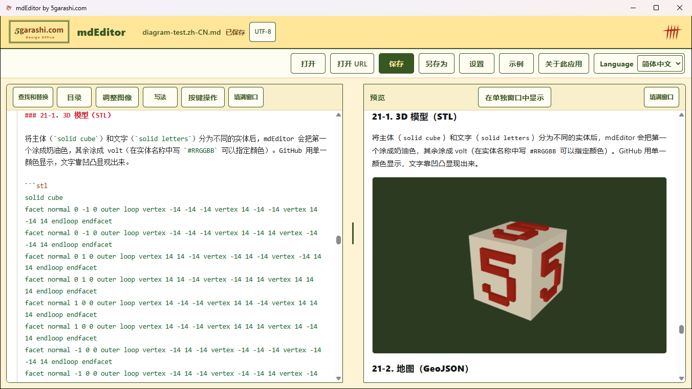
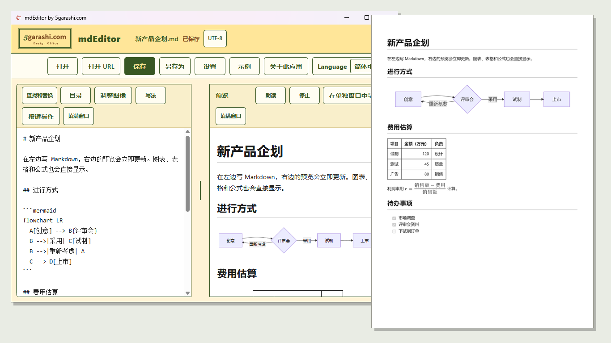
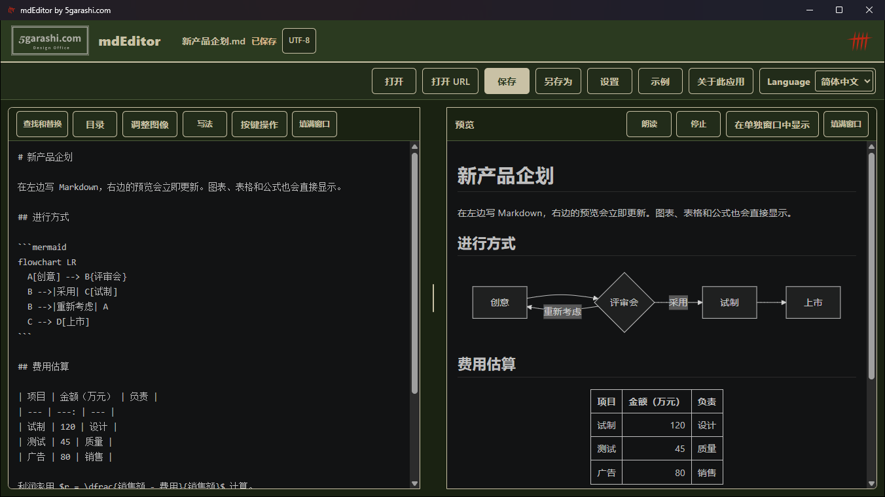
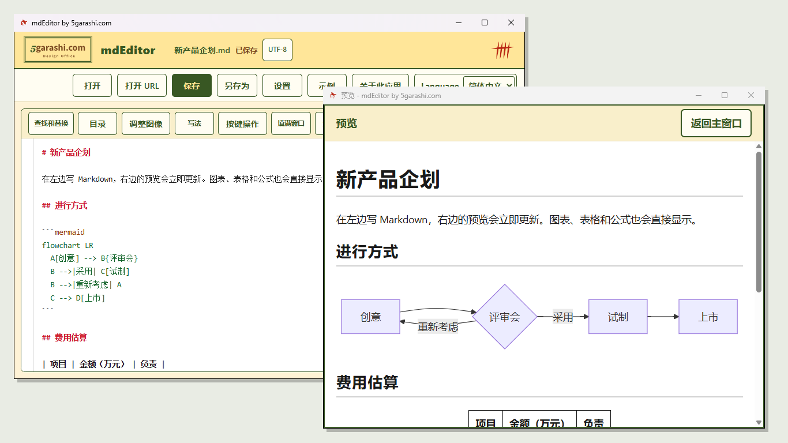
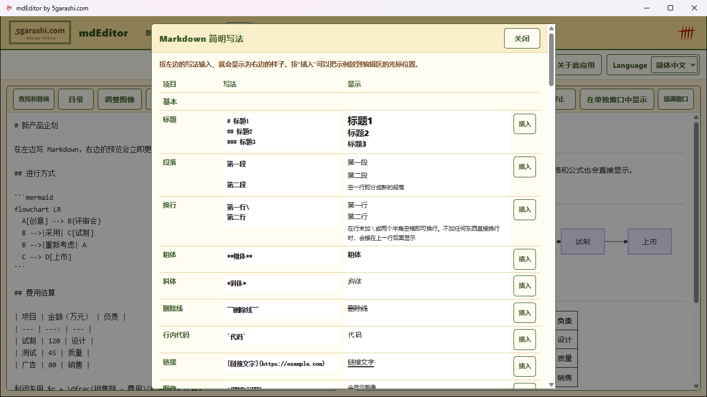
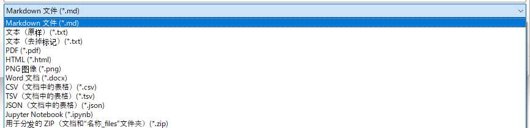
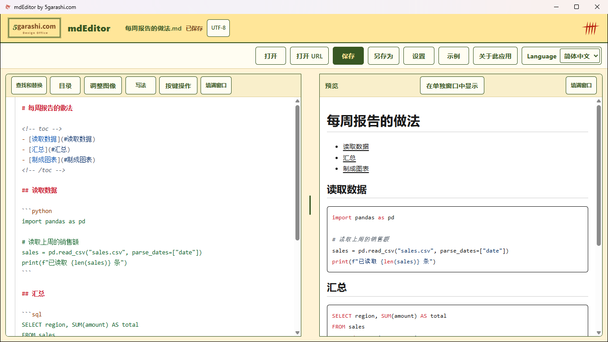
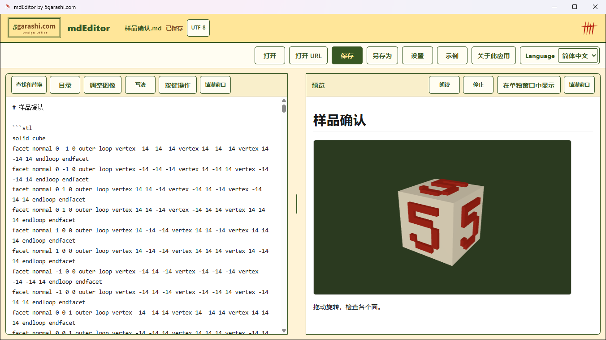
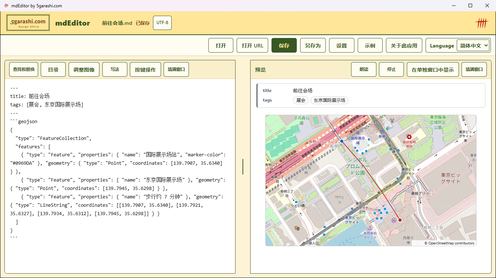
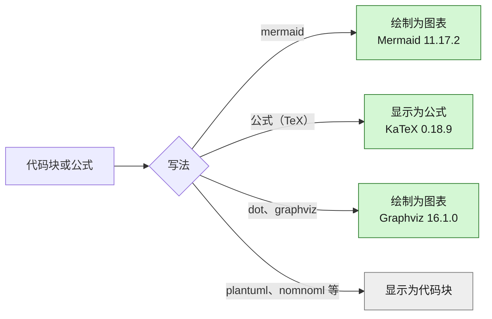

<!--
  ファイル名 / File: README.zh-CN.md
  概要 / Description: Setup and usage guide for mdEditor (Simplified Chinese)
  作成者 / Author: 5garashi.com設計事務所 / 5garashi.com Design Office
  作成日 / Created: 2026-10-21
  ライセンス / License: MIT
  SPDX-License-Identifier: MIT
-->
# mdEditor

在 Windows 上打开 Markdown 文件，一边编辑源文，一边在旁边查看排版预览的应用。

[English](./README.md) | [日本語](./README.ja.md) | 简体中文

版本 / Version: 1.0.17（更改记录 / Changes: [CHANGELOG.md](./CHANGELOG.md)）

## 特点

一边写 Markdown，一边在旁边立即看到排版后的效果，图表和公式也一样，并且可以导出为 PDF。写作、阅读和保存都只在你的电脑中完成。

### 写作、查看和导出

- **编辑器和查看器合二为一**：在左边写的内容会立即显示在右边的预览中。两边同步滚动，使用查找和替换或标题链接跳转时也保持一致。把任意一边扩展到填满窗口，就可以只当作编辑器或只当作查看器使用。
- **在一个显示器上写，在另一个显示器上读**：可以在第二个显示器上用单独的窗口打开预览，并最大化或全屏显示。编辑区和预览仍然按行同步滚动。在宽屏上，正文保持易读的宽度，而表格和图表会展开。下次启动时会恢复窗口位置。
- **图表、公式和表格所见即所得**：流程图、时序图、甘特图、饼图等 Mermaid 图表，KaTeX 公式，表格，任务列表以及文档中的图像都会显示在预览中。
- **导出为 PDF 和 HTML**：可以把预览按原样保存为 PDF，包括图表和公式，纸张为 A4 或 Letter（默认根据地区自动选择）。也可以保存为一个独立的 HTML 文件，用于发送邮件或放到网上。
- **打开和保存多种格式**：Word、PDF、HTML、网页、电子邮件、CSV、JSON、Jupyter Notebook 和图像可以作为 Markdown 打开，“另存为”还可以保存为 PNG、Word、CSV、JSON、Jupyter Notebook、用于分发的 ZIP 等。
- **写法随时可查**：按 F1 可以列出 Markdown 的写法，并把示例插入编辑区。
- **不怕编码问题**：除了 UTF-8，也能识别并打开 Shift_JIS、EUC-JP 等旧文件，推测编码或有字符无法读取时会提示。也可以选择保存时使用的编码。
- **保护你的工作**：即使写入中途失败，原文件也不会损坏。未保存的更改会自动备份，异常退出后可以在下次启动时恢复。
- **深色模式**：跟随 Windows 的设置，使用柔和的夜间配色。打印和 PDF 始终使用白色页面。
- **隐私**：不会把你的文档和使用情况发送到任何地方。界面支持日语、英语和简体中文。

### 人人都好用（通用设计）

- **按自己的需要调整易读性**：可以选择易读的 BIZ UD Gothic 字体、更大的文字（最大 200%）和行距、整个窗口的缩放、突出显示当前行以及加粗光标。支持 Windows 的对比度主题。每项辅助功能都需要自己开启，因此其他人看到的标准外观保持不变。
- **全部操作都可以用键盘完成**：每个按钮都有可以更改或取消的快捷键。用 Tab 和 F6 可以到达每个区域，按钮尺寸也足够大，便于点击（至少 44 px）。
- **支持屏幕阅读器**：已用 Windows 讲述人测试；为了让长文档不再卡顿，重新构建了编辑区。按钮会把名称和快捷键提供给辅助技术。
- **朗读**：按段落朗读预览，并在画面上标出正在朗读的段落。可以选择速度和段落之间的间隔。只使用电脑中已安装的语音，因此文字不会离开你的电脑。

## 截图

**边写边看结果** — 在左边写 Markdown，右边的预览会随输入更新，包括图表、表格、公式和可以拖动旋转的 3D 模型。



**保存为 PDF** — 一键保存与预览外观相同的 PDF，图表、表格、公式和着色的代码都会原样放入。



**深色模式** — 跟随 Windows 的设置，也可以用“设置”中的“显示”按钮（或 Ctrl+Shift+T）选择白天或夜间。打印和 PDF 始终使用白色页面。



**在单独窗口中显示预览** — 把预览放到第二个显示器上，写作和阅读分开进行。预览会跟随编辑滚动。



**Markdown 写法一目了然** — Markdown 简明写法（F1）。按“插入”会把示例放到光标位置。



**保存为多种格式** — “另存为”可以保存为 Markdown、文本、PDF、HTML、PNG、Word、CSV、TSV、JSON、Jupyter Notebook，或用于分发的 ZIP（文档和“名称_files”文件夹）。也可以打开 Word、HTML、CSV、电子邮件、Jupyter Notebook 等文件。



**代码着色和目录** — 写了语言名的代码会着色显示。“目录”会根据标题生成目录。



**3D 模型** — 用 STL 写的 3D 模型可以拖动旋转。不需要连接互联网也能显示。



**地图和前置元数据** — 经你同意后，GeoJSON 地图会绘制在 OpenStreetMap 的详细地图上。开头的 YAML 前置元数据显示为项目名和值的列表。



## 安装

1. 在安装了 .NET 10 SDK 的 Windows 上，双击 `setup.cmd`（或在 PowerShell 中运行 `powershell -ExecutionPolicy Bypass -File .\setup.ps1`）。双击 `.ps1` 文件只会用记事本打开它，因此由 `setup.cmd` 代为运行。应用会发布到 `%LOCALAPPDATA%\Programs\mdEditor`，并为当前用户注册。除了 `.md` 和 `.markdown`，`.html` 和 `.htm` 的“打开方式”和“默认应用”中也会列出 mdEditor（不会更改浏览器的关联）。Microsoft Store 版不关联 `.html`（“打开”和拖放仍可以打开它）。
2. 打开 Windows 的“设置”→“应用”→“默认应用”，将 `.md` 的默认应用设为 `mdEditor`。
3. 打开 `.md` 文件时，mdEditor 会在左边显示文本，右边显示预览。

Windows 规定默认应用由用户设置，因此请在安装后打开的“设置”页面中，为 `.md` 选择 `mdEditor`。应用无法在没有用户确认的情况下更改默认应用。

mdEditor 能打开的其他类型（.txt、.html、.htm、.docx、.eml、.csv、.tsv、.json、.xml、.ipynb 和图像）会在右键菜单的“打开方式”中列出 mdEditor（Microsoft Store 版也一样）。这些类型的默认应用（如浏览器或记事本）不会改变。通过 setup.cmd 安装时，mdEditor 只作为候选列出，不会成为默认应用。在 Microsoft Store 版中，只有当电脑上没有其他应用能打开某个类型时（如 .ipynb 或 .json），Windows 才会在双击时用 mdEditor 打开；选择其他应用作为默认后，以该应用为准。

需要 Microsoft Edge WebView2 Runtime。安装了 Microsoft Edge 的环境通常已经具备。

**为 Microsoft Store 打包**：`setup.cmd` 是开发用的步骤。提交到 Store 时，在装有 Windows SDK 的电脑上运行 `store\build-msix.ps1`，并把 Partner Center 中“产品标识”的值作为 `-IdentityName` 和 `-Publisher` 传入。它会在 `artifacts` 中生成未签名的 MSIX，由 Store 签名。

## 版本管理

版本只写在仓库根目录的 [VERSION](./VERSION) 文件中。应用（在“关于此应用”中显示）和 Microsoft Store 用的 MSIX（末尾加 `.0` 的四段式版本）都从这里读取。发布新版本时，请在同一个拉取请求中更改以下三项：

1. 提高 `VERSION` 中的版本号（例如 `1.0.3` → `1.0.4`）。
2. 在 [CHANGELOG.md](./CHANGELOG.md) 中添加 `## 1.0.4` 一节。
3. 同步各 README 开头的版本行（README.md 的“Version”、README.ja.md 的“バージョン / Version”和 README.zh-CN.md 的“版本 / Version”）。

在拉取请求中，GitHub Actions 会检查这三项是否一致（它只读取 README.md 中的那一行，因此 README.ja.md 和 README.zh-CN.md 需要手动同步）。合并到 main 后，会自动创建 `v1.0.4` 标签和 GitHub Release（正文为 CHANGELOG 中的对应一节）。

## 使用方法

- **示例**：只有在选择时，才会把简短的示例（“图表和公式”或“基本写法”），或检查所有支持的图表、图形和公式的“图表显示测试”（日语、英语或简体中文；[samples/](./samples/) 中的三个文件）作为新文档放入（如果当前文档有更改，会先询问是否保存；不会写入当前打开的文件）。
- **关于此应用**：显示公司介绍、支持和隐私政策的链接。只有在选择链接时才会用浏览器打开。
- **打开**：选择 Markdown 文件。也可以打开文本（.txt）、Word（.docx）和 HTML（.html、.htm）文件。文本按原样打开和保存。Word 文档作为 Markdown 打开：标题、列表、表格、链接和图像会保留（颜色和排版不会保留）；其中的图像在第一次保存时放到 Markdown 文件旁边的“名称_files”文件夹中，不会写入 Word 文档。没有使用标题样式、只用较大文字做标题的 Word 文档，会根据文字大小推测标题（明显大于正文的文字，或大一号的粗体，成为标题 1～3；设为标题的个数会在通知栏中显示）。也可以打开 HTML 文件（.html、.htm）：会转换为 Markdown，标题、段落、列表、表格、链接、图像和公式会保留（颜色、排版和绘制的图表不会保留）。保存后成为 Markdown 文件，不会写入 HTML 文件。
  - **PDF（.pdf）**：转换为 Markdown 打开。按阅读顺序取出文字，把折行的行合成一个段落，根据文字大小推测标题，以项目符号或编号开头的行成为列表项。带编号（1.、3.1、(1)、① 等）且字体与正文不同的标题也会成为标题，并按编号的深度嵌套。目录（点线和页码的行）按 PDF 的缩进成为嵌套的列表。图像与 Word 文档的图像处理方式相同。有边框的表格成为 Markdown 表格，等宽字体的行成为代码块（保留缩进），用图形绘制的项目符号和复选框（例如从浏览器或 mdEditor 保存的 PDF）成为列表项。用线条和图形绘制的图（示意图、图表）替换为“（图）”标记，图中的文字会省去。公式、分栏排版和没有边框的表格不会恢复（文字会保留）。页面上下边缘的页码会省去。只由图像组成的 PDF（扫描件等）无法取出文字，受密码保护的 PDF 无法打开。最多打开 500 页。不会改写原 PDF。
  - **电子邮件（.eml）**：作为 Markdown 打开，主题为标题，然后是发件人、收件人、日期、附件名称和正文。正文中的图片与 Word 文档的图像处理方式相同。邮件中网络上的图像（有时用于追踪是否打开）未经你同意不会加载。不会取出附件。
  - **CSV、TSV（.csv、.tsv）**：作为 Markdown 表格打开，第一行为表头。Excel 保存的 Shift_JIS 格式的 CSV 也能打开。
  - **JSON（.json）**：列表（对象数组）作为表格打开，字段名为表头行。其他 JSON 放入代码块中打开，可以在前后添加说明。
  - **XML（.xml）**：放入代码块中打开，可以在前后添加说明。
  - **Jupyter Notebook（.ipynb）**：Markdown 单元格保持原样，代码单元格成为带语言名的代码块（```python 等）。文本输出显示为“output”代码块；图片和表格（如 pandas）按原样显示，单元格中粘贴的图片也会显示。
  - **图像（.png、.jpg、.gif、.bmp、.webp）**：作为显示该图像的新文档打开。可以在下方写说明并保存为 Markdown；保存到其他文件夹时，图像也会复制过去。
  - **视频（.mp4、.m4v、.webm、.ogv、.mov）**：与图像一样，作为显示该视频的新文档打开。
- **拖放**：拖放到编辑区的文件会插入到光标位置，拖放到其他地方的文件会被打开。拖动时，指针旁边会显示“插入到光标位置”或“作为文件打开”。

  | 文件 | 拖放到编辑区 | 拖放到其他地方 |
  | :--- | :--- | :--- |
  | 图像和视频 | 复制到文档旁边的“名称_files”文件夹，并插入 `` | 作为图像或视频文档打开 |
  | “打开”能打开的文件（.md、.txt、.html、.docx、.eml、.csv、.json、.ipynb 等） | 按“打开”的方式转换为 Markdown 后插入其内容 | 打开（有未保存的更改时先询问） |
  | PDF（.pdf） | 复制到“名称_files”文件夹，并插入 `[report.pdf](名称_files/report.pdf)` 这样的链接（PDF 通常按原样发送，因此不转换） | 与“打开”一样转换为 Markdown 打开 |
  | mdEditor 不能打开的文件（.pptx、.zip 等） | 复制到“名称_files”文件夹，并插入 `[slides.pptx](名称_files/slides.pptx)` 这样的链接 | 不打开；提示拖放到编辑区即可作为链接插入 |

  - 插入内容时，通知栏会说明。如果本来想打开该文件，请按 Ctrl+Z，然后拖放到编辑区以外。
  - 内容中显示的图像和视频，以及链接指向的文件，也会复制到“名称_files”文件夹。Markdown 开头的前置元数据（`---` 之间的部分）不会插入。
  - “名称_files”文件夹以外的所有文件（包括与文档在同一文件夹中的文件）都会复制到“名称_files”文件夹。已经在其中的文件直接使用。
  - 通知栏会说明复制了什么（如“已创建“A_files”文件夹，并保存了“B.pdf”。”）。文件夹中已有同名的其他文件时，会像浏览器下载一样加上编号（“B (1).pdf”“B (2).pdf”）。内容完全相同的文件直接使用，不再复制。
  - 需要复制文件时，尚未保存的文档会先询问保存位置。
  - 粘贴到编辑区的图片（Ctrl+V），如屏幕截图，也会放到“名称_files”文件夹中。
  - **把 Markdown 文件交给别人时，请同时交出“名称_files”文件夹。** 文档用相对于自身位置的路径（`名称_files/...`）指向插入的图像、视频和文件。只有 .md 文件时，在对方的电脑上图像不会显示，链接也打不开。请把 .md 文件和文件夹放在一起发送（例如打包为一个 zip 文件，也可以用“另存为”中的“用于分发的 ZIP”）。“名称_files”文件夹以外的链接（如自己写的 `../docs/...`）只有在该文件也一起发送时才能打开。保存为 PDF、HTML、PNG 或 Word 的文件包含图像，但不包含视频和作为链接插入的文件。
- **打开 URL / Ctrl+Shift+K**：将以 `https://` 开头的网页作为 Markdown 打开。也可以从浏览器把链接拖进来。页面的脚本不会运行，因此页面之后加载的内容（如实时排行）不会包含在内。
- **网络上的图像和视频**：默认不加载；按通知栏中的“加载图像和视频”可以为该文档加载。“设置”→“互联网”中也可以选择“始终加载”或“不加载”。`http://` 的图像始终不加载。在文件旁边找不到的图像和链接，按页面自身的地址（`<base>`、canonical 或 og:url）解析。
- **保存**：覆盖当前文件。新文档会询问保存位置。
- **另存为**：选择保存位置和文件名。与“打开”一样，用文件类型选择格式。
  - 以 Markdown（或“文本（原样）”）保存到其他文件夹或其他名称时，“名称_files”文件夹也会整个复制。改名时，文件夹也会以新名称复制（“C.md”对应“C_files”），并改写文档中的链接，保存的文件和编辑区两边都会改写（可以用 Ctrl+Z 撤销）。原来的文档和文件夹不会改变。
  - 复制期间，通知栏会显示进度（第几个，共几个），完成后显示“已将“A.md”和“A_files”文件夹复制到 D:\Docs。”“已复制为“C.md”和“C_files”文件夹。”或“已在 D:\Docs 复制为“C.md”和“C_files”文件夹。”。
  - 如果保存位置已有同名的文件夹，会把文件添加进去而不是覆盖：同名的其他文件会加上 (1) 等编号，链接也随之调整。相同的文件共用。
  - 保存到其他文件夹时，指向“名称_files”文件夹以外的相对链接（如自己写的 `../docs/x.pdf`）会改为指向原来的文件。
  - 保存为 PDF、HTML、PNG、Word 等导出格式时，图像会放入文件中，因此不复制文件夹。
  - **Markdown（.md）、文本（原样）（.txt）**：保存文档本身（内容按原样）。之后“保存”会写入此文件。
  - **文本（去掉标记）、PDF、HTML、PNG、Word（.docx）、CSV、TSV、JSON、Jupyter Notebook、用于分发的 ZIP**：导出文档；正在编辑的文件保持原样。各种导出的说明如下。
- **文本（去掉标记）**：只把预览中显示的文字保存为 .txt 文件。去掉标题和强调的标记，并在原文换行处换行。列表使用项目符号或编号，表格以制表符分隔，链接变为“文字（地址）”，图表变为“［图］”（界面语言为中文时）。
- **CSV、TSV**：把文档中的表格保存为 CSV（以逗号分隔）或 TSV（以制表符分隔）。有两个以上的表格时，保存为 名称-1.csv、名称-2.csv 等。文件为带 BOM 的 UTF-8，以便 Excel 正确显示日语和中文。
- **JSON**：把文档中的表格保存为以表头行为键的对象数组（UTF-8）。值按文字写入，因此 007 这样的数字不会丢掉 0。有两个以上的表格时，保存为 名称-1.json 等。
- **Jupyter Notebook**：带语言名的代码块成为代码单元格，其余成为 Markdown 单元格。不包含运行结果（在 Jupyter 中运行时会重新生成）。从 .ipynb 文件打开的文档会保存回原来的单元格结构。
- **用于分发的 ZIP**：生成用于交给别人的 ZIP，其中包含文档（.md）和“名称_files”文件夹，名称与链接一致，解压后即可原样显示。文档按编辑区中的内容放入（包括未保存的更改）。没有“名称_files”文件夹的文档（或尚未保存的文档）只放入文档本身。
  - “名称_files”文件夹中有文档没有引用的文件（不在任何链接、图像或 HTML 的 src、href 中）时，会列出这些文件让你选择：“是”会先将它们移到回收站，再生成 ZIP；“否”会把它们保留在原处。无论哪种，它们都不会放入 ZIP。
  - 指向“名称_files”文件夹以外的文件的链接不放入 ZIP；消息中会说明数量。
- **Ctrl+O**：打开文件。
- **返回上一个文档 / Ctrl+Shift+B**：返回被其他文档替换之前打开的文档。只有在有可以返回的文档时，“打开”旁边才会显示这个按钮。例如，把文件拖放到编辑区以外而打开了其他文档时，或本想“取消”却按了“否”时使用。
  - 在“是否保存更改？”中选择“否”而关闭的文档，会恢复到关闭时的状态（未保存的文字、文件和编码），仍为未保存。保存时会照常覆盖其文件。
  - 没有更改而关闭的文档，会从其文件重新打开。如果文件已被移动或删除，会有提示。
  - 只能返回最后关闭的那一个文档，包括在其他窗口中关闭的文档，或关闭应用时选择“否”的文档（下次启动后也可以）。没有其他文档替换它时（例如取消了“打开”的文件对话框），上一个文档保持不变。
  - 如果当前文档有更改，会先询问是否保存。在那里选择“否”时，两个文档会互换，因此再按一次按钮就会回到当前的文档。
  - 副本保存在自动备份存放副本的位置。没有更改的文档只保存文件的位置。在“设置”中关闭自动备份后，不保存副本，也不显示这个按钮。
- **Ctrl+S**：保存。
- **Ctrl+Shift+S**：另存为。
- **PDF**：把排版后的预览导出为 PDF。
- **PNG / Ctrl+Shift+G**：以白天配色把预览保存为图片（PNG）；长文档分为 名称-1.png、名称-2.png 等。
- **Word / Ctrl+Shift+D**：导出 Word 文档（.docx）。标题、段落、列表、引用、代码、表格、链接和图像使用 Word 自带的样式，因此 Word 的导航窗格和目录功能可以使用。图表和公式以预览中的图片放入（在 Word 中不能编辑）。
- **HTML / Ctrl+Shift+M**：把排版后的预览导出为一个独立的 HTML 文件。图表为 SVG，公式为 MathML，文档旁边的图像会嵌入。在浏览器中，深色模式下会切换为夜间配色。打开它时不会建立连接，只有文档中网络上的图像会从其服务器加载。
- **纸张**（在“设置”中，或 Ctrl+Shift+A）：按“自动”→“A4”→“Letter”的顺序切换 PDF 的纸张。“自动”跟随 Windows 的区域设置（使用美国惯用单位的地区为 Letter，其他为 A4）。选择会被记住。
- **编码**：文档的编码显示在文件名旁边。按下后可以选择编码，并用它重新打开文件，或从下次保存起使用它。
- **Ctrl+Shift+P**：保存为 PDF。
- **目录 / Ctrl+Shift+J**：根据文档的标题生成目录（指向各标题的链接），并插入到光标位置。目录放在 `<!-- toc -->` 和 `<!-- /toc -->` 之间（不在预览中显示）；更改标题后再按一次，会就地更新该目录。文档标题（开头唯一的 `#` 标题）不放入目录，最多放入三层。目录中的链接在预览、PDF、HTML 和 Word 中都能跳到对应的标题。
- **调整图像 / Ctrl+Shift+F**：选择图像的大小和位置，并按 GitHub 的方式（HTML 的 ``）改写。在编辑区中把光标放在图像所在的行后按下，或在预览中右键单击图像。
  - 大小：原始大小，正文宽度的 25%、50%、75% 或 100%，或以像素指定宽度（`width="50%"`、`width="300"`）。高度保持图片的比例。
  - 位置：不指定（左）、居中（`<p align="center">`）、右（`<p align="right">`），或放在左边或右边并让文字环绕（`align="left"`、`align="right"`）。“居中”和“右”需要图像单独占一行。如果下一行接着有文字，会在中间插入一个空行，以免 HTML 块把文字吞进去。
  - 选择“原始大小”和“不指定”时，图像会变回 Markdown 的 ``。可以用 Ctrl+Z 撤销更改。
  - PDF、PNG 和 HTML 与预览相同。Word 中会反映大小以及居中、靠右或靠左的位置（在 Word 中文字不会环绕；图像放在左边或右边）。“文本（去掉标记）”中与 Markdown 的图像一样显示为“［说明］”。
- **Ctrl+H**：打开编辑区的查找和替换栏，可以使用“替换”和“全部替换”（按 `Enter` 查找下一个，按 `Esc` 关闭）。
- **写法 / F1**：显示 Markdown 简明写法，分为“基本”“图表（Mermaid）”“公式（KaTeX）”“与 GitHub 相同的写法”和“其他图表和视频”：流程图、时序图、甘特图、饼图、类图、状态图、ER 图、思维导图、柱状图和折线图、时间线（在列表中绘制），以及分数、平方根、求和、矩阵、分段函数等十个公式示例。“与 GitHub 相同的写法”包括提示框、折叠、按键和表情符号；“其他图表和视频”包括 Graphviz、地图（GeoJSON）和视频（都是从 samples/diagram-test 中挑选并简化的示例）。按“插入”会把示例放到编辑区的光标位置（按 `Esc` 关闭）。
- **Ctrl+F**：窗口自带的查找，也可以在预览中使用。
- **同步滚动**：滚动编辑区或预览时，另一边会移动到相同的位置，包括用查找和替换或标题链接跳转时。
- **标题链接**：点击 `[English](#english)` 这样的文档内链接，预览会移动到该标题。标题的 ID 遵循 GitHub 的规则（日语和中文保持原样，英文字母变为小写，空格变为 `-`）。
- **指向其他文件的链接**：点击指向文档旁边文件的链接，如 `[License](./LICENSE)`，Markdown 和文本文件（无扩展名、`.md`、`.txt` 等）会在新的 mdEditor 窗口中打开，当前文档保持打开。`other.md#标题` 会显示该标题。PDF、图像、CSV 文件等用平时使用的应用打开；程序等可能不安全的文件不会运行，而是在文件资源管理器中显示其位置。
- **分隔线**：拖动中间的分隔线可以调整编辑区和预览的宽度。让分隔线获得焦点后，按左右方向键可以按 5% 调整宽度。在窄窗口中，分隔线为纵向排列，使用上下方向键。下次启动时会恢复该宽度。
- **编辑区／预览填满窗口**：每个区域都有一个“填满窗口”按钮，可以把该区域扩展到填满应用窗口（不是操作系统的全屏）。用“恢复原来的布局”或 `Esc` 返回。
- **窗口全屏**：用 `F11` 切换；用 `F11` 或 `Esc` 退出。
- **在单独窗口中显示预览 / Ctrl+Shift+3**：按预览标题栏中的“在单独窗口中显示”，会打开只有预览的窗口。可以放到第二个显示器上，最大化，或按 `F11` 全屏。主窗口则以全宽显示编辑区。
  - 窗口分开后，编辑区和预览仍然同步滚动（显示文档的同一行）。标题链接、查找和替换的跳转以及朗读都可以继续使用。
  - 在预览窗口中按下的快捷键（保存、查找和替换、设置等）会在主窗口中执行。
  - 按“返回主窗口”（预览窗口中）、“将预览返回主窗口”（编辑区中），或关闭预览窗口，会恢复并排显示。
  - 窗口的位置、大小和最大化状态，以及预览是否在单独窗口中，都会被记住。如果那个显示器已经断开，窗口会移到能看到的位置。
- **按键操作 / Shift+F1**：列出所有操作的键盘快捷键。可以用“更改”把按键改为喜欢的组合（Ctrl 加字母或数字，或 F 键），用“无”取消，或用“使用键盘快捷键”停用所有快捷键。设置会被记住。
- **设置 / Ctrl+Shift+O**：根据使用者调整易读性和易用性。除了自动备份，所有选项默认关闭（标准），只有需要的人才开启。设置会被记住。
  - **字体**：切换为 Windows 自带的通用设计字体 BIZ UD Gothic。
  - **文字大小和行距**：把编辑区和预览的文字设为 125%、150% 或 200%，行距设为“较宽”或“很宽”。
  - **Markdown 写法**：开启“显示效果接近 GitHub”（默认关闭）后，GitHub 没有的 mdEditor 独有写法（`x^2^` 上标、`H~2~O` 下标、`==强调==`、`++插入++`、定义列表、`:::` 容器、`{#id}` 等属性、缩写、网格表格、`a.` 编号）会像在 GitHub 上一样按原文显示，`~文字~` 显示为删除线。导出 PDF、Word 等时也一样。它并不会让显示与 GitHub 完全相同（图表、地图、3D 模型、代码着色和公式的绘制方式仍是 mdEditor 的方式）。设置会被记住。
  - **导出**：开启“保存为 HTML 时，同时放入原来的 Markdown”（默认关闭）后，保存的 HTML 用 mdEditor 打开时会完全恢复原样，包括图表和公式的写法。原文会原样放入 HTML 中，其中也包括不显示的注释（`<!-- -->`），交给别人之前请先检查。
  - **预览正文的宽度**：在宽屏上，预览正文保持易读的宽度（约 44 个全角字符）并居中；表格、图表、代码和独立公式可以更宽。选择“不限制预览正文的宽度”可以使用全宽。
  - **缩放**：整个窗口默认为 90%。用“放大”“缩小”和“恢复为默认值（90%）”缩放整个窗口。也可以使用 Ctrl + 鼠标滚轮、Ctrl + 加号／减号和 Ctrl + 0（恢复为 90%）；缩放比例会被记住。
  - **编辑区**：突出显示当前行，加粗光标。
  - **朗读**：开启后，预览的标题栏中会出现“朗读”和“停止”按钮。从预览中可见的第一个段落开始朗读，并用框标出正在朗读的段落。在预览或编辑区中选择了文字时，只朗读所选的部分（编辑区中的 Markdown 标记不会读出）。可以选择速度（五级）、段落间隔（无、0.5 秒、1 秒或 2 秒）、语言（自动、日语、英语、中文（简体））和语音（从这台电脑上的语音中选择）。如果没有安装该语言的语音，应用会说明添加方法。只使用这台电脑上安装的语音，因此文字不会发送到任何地方。按 `Esc` 也可以停止朗读。
  - **自动备份**（默认开启）：每 15 秒将未保存的更改备份到 `%LOCALAPPDATA%\mdEditor\Recovery`。应用异常退出时，下次启动会询问是否恢复。保存或正常退出后，备份会被删除。
  - **从剪贴板新建**：选择启动按键（Ctrl+Alt 加字母或数字）后，经你确认，会在桌面上创建分配了该按键的快捷方式“mdEditor（从剪贴板新建）”（Windows 只允许桌面或“开始”菜单中的快捷方式使用这种按键）。在其他应用中复制文本、图像或文件后按该键，mdEditor 会启动并把它们放入新文档。如果复制的是一个 mdEditor 能打开的文件，则与拖放到编辑区以外时一样，打开该文件。带格式的内容（从网页或 Word 复制的内容）会像“打开”一样转换为 Markdown。图像和文件与拖放到编辑区时一样放到“名称_files”文件夹中，因此会先询问保存位置。按键后到启动可能需要 1～2 秒。选择“无”会删除快捷方式。删除（卸载）mdEditor 之前，请改回“无”（快捷方式不会自动删除）。在命令行中，可以用启动选项 `--paste`（`mdEditor.exe --paste`）做到同样的事。
- **Windows 对比度主题**：使用 Windows 的对比度主题时，应用会使用其配色，并保留按钮边框和焦点指示。

### 键盘快捷键（默认）

| 操作 | 按键 | 操作 | 按键 |
| :--- | :--- | :--- | :--- |
| 打开 | Ctrl+O | 查找和替换 | Ctrl+H |
| 插入或更新目录 | Ctrl+Shift+J | 返回上一个文档 | Ctrl+Shift+B |
| 图像的大小和位置 | Ctrl+Shift+F | | |
| 保存 | Ctrl+S | 查找下一个／上一个 | F3 / Shift+F3 |
| 另存为 | Ctrl+Shift+S | 全部替换 | Ctrl+Shift+H |
| 保存为 PDF | Ctrl+Shift+P | Markdown 写法 | F1 |
| 切换纸张 | Ctrl+Shift+A | 按键操作一览 | Shift+F1 |
| 切换显示主题 | Ctrl+Shift+T | 编辑区／预览填满窗口 | Ctrl+Shift+1 / Ctrl+Shift+2 |
| 切换显示语言 | Ctrl+Shift+L | 移到下一个／上一个区域（工具栏、编辑区、预览） | F6 / Shift+F6 |
| 编码 | Ctrl+Shift+E | 窗口全屏显示 | F11 |
| 设置 | Ctrl+Shift+O | 朗读／暂停、停止（开启朗读时） | Ctrl+Shift+Y / Ctrl+Shift+U |
| 在单独窗口中显示预览／返回主窗口 | Ctrl+Shift+3 | 保存为 HTML | Ctrl+Shift+M |
| 打开 URL | Ctrl+Shift+K | 保存为 PNG／保存为 Word | Ctrl+Shift+G / Ctrl+Shift+D |

`Esc` 始终会停止朗读、恢复布局或退出全屏。每个按钮的提示和提供给屏幕阅读器的信息（`aria-keyshortcuts`）都会显示当前的按键。

Markdown 的更改会反映在预览中。有未保存的更改时打开文件或关闭应用，会询问是否保存。

## 显示语言

界面和各种对话框支持日语、英语和简体中文。第一次启动时，语言跟随 Windows 的显示语言（日语为日语，中文为简体中文，其他为英语）。随时可以在工具栏的“Language”列表中选择其他语言，或按 Ctrl+Shift+L 按日语、英语、简体中文的顺序切换。选择会被记住。

在简体中文界面中，汉字使用中文字体（Microsoft YaHei）显示。由于没有中文徽标，徽标使用英文徽标。朗读的语言设为“中文（简体）”时，或在“自动”下朗读不含假名的段落时，会使用中文语音（需要 Windows 中已安装中文语音）。

`--lang` 选项（`ja`、`en` 或 `zh`；也可以用 `zh-CN` 或 `--lang=zh`）只在该次启动时设置语言，不会改写已保存的选择。

```
mdEditor.exe --lang en
mdEditor.exe --lang zh
mdEditor.exe --lang ja "C:\docs\memo.md"
```

## Markdown 和预览

会显示标题、列表、任务列表、引用、表格（左对齐、居中、右对齐）、代码、链接和图像。Markdown 中写的 HTML 只显示 GitHub 允许的部分（`<details>`、`<summary>`、`<kbd>`、`<sup>`、`<sub>`、`<br>`、`<picture>`、图像宽度、用 `align` 居中等），其他部分会被移除。与 GitHub 相同，脚本、`<style>`、`<iframe>`、嵌入内容、表单、`onclick` 等事件属性和 `javascript:` 链接都会被移除，不会运行。用 HTML 写的网络图像与 Markdown 的图像一样，未经你同意不会加载。HTML 注释（`<!-- -->`）不显示。网页链接用默认浏览器打开，邮件链接用默认邮件应用打开。PDF 中只输出排版后的预览，不包含编辑中的文本区域和按钮。

`images/a.png` 这样的相对路径图像从文档所在的文件夹及其子文件夹加载。只读取图像文件（PNG、JPEG、GIF、WebP、AVIF、BMP、ICO、SVG），不会读取文档所在文件夹以上的位置。

文本的编码会自动识别：UTF-8（有无 BOM）、UTF-16 或 Windows 的默认代码页（日语 Windows 为 Shift_JIS，简体中文 Windows 为 GBK）。保存时保持原来的编码；如果有字符无法用该编码保存，会询问是否保存为 UTF-8。用推测的编码打开非 UTF-8 文件，或有字节无法读取（显示为 �）时，工具栏下方会显示提示；覆盖这样的文件之前会先确认，因为原文件中的这些部分会丢失。对于 EUC-JP 或 ISO-2022-JP 文件，请选择编码后重新打开。保存时先写入临时文件再替换，因此中途失败也不会损坏原文档。

` ```mermaid ` 代码块用 [Mermaid](https://mermaid.js.org/) 绘制为图表（流程图、时序图、类图、状态图、ER 图、甘特图、饼图等）。`$...$` 和 `$$...$$` 中的公式用 [KaTeX](https://katex.org/) 显示。两者都随应用一起提供，因此离线也能使用，并会包含在 PDF 中。写了语言名的代码块（如 ` ```python `）用 [highlight.js](https://highlightjs.org/) 着色（约 40 种语言，包括 Python、JavaScript、TypeScript、C#、C/C++、Java、PowerShell、shell、SQL、HTML、CSS、JSON、YAML 和 diff）。颜色跟随预览的白天和夜间配色，保存为 PDF、PNG、HTML 或 Word 时也会保留。没有语言名的代码块不着色。语法有误的图表会显示错误信息和原始代码。可以用 [samples/diagram-test.zh-CN.md](./samples/diagram-test.zh-CN.md)（日语：[samples/diagram-test.md](./samples/diagram-test.md)，英语：[samples/diagram-test.en.md](./samples/diagram-test.en.md)）检查显示效果。

### 支持的图表

显示方式取决于代码块的语言名。



| 类型 | 写法 | 显示 | 说明 |
| :--- | :--- | :---: | :--- |
| 流程图 | ` ```mermaid ` + `flowchart` / `graph` | 支持 | |
| 时序图 | `sequenceDiagram` | 支持 | |
| 类图 | `classDiagram` | 支持 | |
| 状态图 | `stateDiagram-v2` | 支持 | |
| ER 图 | `erDiagram` | 支持 | |
| 甘特图 | `gantt` | 支持 | |
| 饼图 | `pie` | 支持 | |
| 柱状图和折线图 | `xychart-beta` | 支持 | 非 ASCII 的轴标签请加引号，如 `"1月"` |
| 四象限图 | `quadrantChart` | 支持 | |
| 用户旅程图 | `journey` | 支持 | |
| Git 图 | `gitGraph` | 支持 | |
| 思维导图 | `mindmap` | 支持 | |
| 时间线 | `timeline` | 支持 | |
| 桑基图 | `sankey-beta` | 支持 | 节点名称只能用 ASCII（Mermaid 的限制） |
| 公式 | `$...$`（行内）、`$$...$$`（独立） | 支持 | 用 KaTeX 显示 |
| Graphviz | ` ```dot `、` ```graphviz `、` ```gv ` | 支持 | 用随附的 Graphviz（WebAssembly）离线绘制。为安全起见，图中的链接和图像会被移除。会超出框的日语和中文标签会缩小以适应 |
| 3D 模型 | ` ```stl `（ASCII STL） | 支持 | 用随附的 three.js 离线显示。拖动旋转，滚轮缩放。PDF、PNG、HTML 和 Word 中放入当前视角的图片 |
| 地图 | ` ```geojson `、` ```topojson ` | 支持 | 点、线和面先离线绘制在随附的简单世界地图（Natural Earth）上。默认情况下，通知栏会询问是否加载详细地图；按“加载详细地图”后，只为该文档加载带有道路和地名的 OpenStreetMap 地图（地图服务器会得知显示的地点和你的 IP 地址；保存的 HTML 中不包含）。“设置”→“互联网”→“详细地图（OpenStreetMap）”中也可以选择“始终加载”和“不加载”。GitHub 的 `marker-color`、`stroke` 和 `fill` 样式可以使用 |
| PlantUML | ` ```plantuml ` | 不支持 | 显示为代码块。绘制它需要电脑上有 Java 和 PlantUML，或把文档发送到外部的 PlantUML 服务器，这违背了把文档留在电脑中的原则 |
| nomnoml | ` ```nomnoml ` | 不支持 | 显示为代码块 |

标为“支持”的都已用测试文档验证。其他 Mermaid 图表（如 `block-beta`）如果 Mermaid 11.17.2 支持也会显示，但尚未检查。

[samples/diagram-test.md](./samples/diagram-test.md)、[samples/diagram-test.en.md](./samples/diagram-test.en.md) 和 [samples/diagram-test.zh-CN.md](./samples/diagram-test.zh-CN.md) 这三个文档专为在 mdEditor 中查看而编写，不要求与 GitHub 兼容（Identity 8-9 (7)）。它们用来原样展示 mdEditor 能画和不能画的图表，因此包含 GitHub 无法绘制的写法（Graphviz、PlantUML），显示效果在 mdEditor 中检查（Identity 8-9 (8)、1-4 (1)）。每个文档的开头都写明了这一点。本 README 的其他说明、CHANGELOG.md、PRIVACY.md 和其他示例只使用 GitHub 能显示的写法。

## 与 GitHub 相同的写法

GitHub 的 README 等中常用的以下写法，也会与 GitHub 显示得一样。可以用 [samples/github-test.zh-CN.md](./samples/github-test.zh-CN.md)（日语：[samples/github-test.md](./samples/github-test.md)，英语：[samples/github-test.en.md](./samples/github-test.en.md)）检查。

| 写法 | 示例 | 显示 |
| :--- | :--- | :--- |
| 提示框 | `> [!NOTE]`、`[!TIP]`、`[!IMPORTANT]`、`[!WARNING]`、`[!CAUTION]` | 带彩色竖线、符号和标题的框 |
| 前置元数据 | 开头 `---` 之间的 `title: …` 等（YAML） | 项目名和值排成的卡片；列表变为小标签，嵌套的项目排在卡片中（Word 中也一样）。GitHub 显示为表格 |
| 视频 | ``、只有指向视频的链接的一行，或 `<video src="…">`（.mp4、.webm、.mov 等） | 静音自动播放并循环（声音和暂停用视频的按钮控制）。Windows 的“动画效果”关闭时，除非在“设置”→“视频”中选择自动播放，否则显示播放按钮。网络上的视频与图像一样，未经你同意不会加载。PDF、PNG 和 Word 中放入视频的名称，HTML 中放入指向视频的链接 |
| 公式代码块 | ` ```math ` | 公式（KaTeX） |
| 行内公式（GitHub 的写法） | `` $`x^2`$ `` | 公式 |
| 表情符号的短名称 | `:smile:`、`:+1:` | 表情符号（`:)` 等保持为文字） |
| 折叠 | `<details><summary>…</summary>…</details>` | 按下后展开；保存为 PDF、PNG 和 Word 时以展开状态放入 |
| 图像的大小和位置 | ``、`<p align="center"></p>`、`` | 以正文宽度的比例或像素指定宽度，居中或靠右，或让文字环绕。可以用“调整图像”（Ctrl+Shift+F）或在预览中右键单击来改写。Word 中也会反映大小和位置 |
| 电子邮件地址 | `info@example.com` | mailto 链接（末尾的句号不包含在内；代码中的地址保持为文字） |
| 表格中代码里的竖线 | 在表格单元格的代码中，竖线前加 `\` | 代码中显示一根竖线（不显示 `\`） |
| GitHub 保留的旧属性 | `<br clear="all">`、`<table border="1">`、`nowrap`、`cellpadding`、`hspace` 等 | 按写法生效；用 `<br clear="all">` 可以结束图片周围的文字环绕 |
| 白天和夜间切换的图片 | `<picture>` 与 `<source media="(prefers-color-scheme: dark)">`，或在图像 URL 末尾加 `#gh-dark-mode-only` / `#gh-light-mode-only` | 只显示与当前配色对应的图片 |

## 示例：3D 模型、地图和视频

本 README 开头的表格（在 mdEditor 中为卡片）是 YAML 前置元数据（`---` 之间的部分）。下面三个示例在 GitHub 和 mdEditor 中都能显示（在 GitHub 上视频显示为链接；GitHub 只播放上传到 GitHub 的视频）。

```stl
solid cube
facet normal 0 -1 0 outer loop vertex -14 -14 -14 vertex 14 -14 -14 vertex 14 -14 14 endloop endfacet
facet normal 0 -1 0 outer loop vertex -14 -14 -14 vertex 14 -14 14 vertex -14 -14 14 endloop endfacet
facet normal 0 1 0 outer loop vertex 14 14 -14 vertex -14 14 -14 vertex -14 14 14 endloop endfacet
facet normal 0 1 0 outer loop vertex 14 14 -14 vertex -14 14 14 vertex 14 14 14 endloop endfacet
facet normal 1 0 0 outer loop vertex 14 -14 -14 vertex 14 14 -14 vertex 14 14 14 endloop endfacet
facet normal 1 0 0 outer loop vertex 14 -14 -14 vertex 14 14 14 vertex 14 -14 14 endloop endfacet
facet normal -1 0 0 outer loop vertex -14 14 -14 vertex -14 -14 -14 vertex -14 -14 14 endloop endfacet
facet normal -1 0 0 outer loop vertex -14 14 -14 vertex -14 -14 14 vertex -14 14 14 endloop endfacet
facet normal 0 0 1 outer loop vertex -14 -14 14 vertex 14 -14 14 vertex 14 14 14 endloop endfacet
facet normal 0 0 1 outer loop vertex -14 -14 14 vertex 14 14 14 vertex -14 14 14 endloop endfacet
facet normal 0 0 -1 outer loop vertex -14 14 -14 vertex 14 14 -14 vertex 14 -14 -14 endloop endfacet
facet normal 0 0 -1 outer loop vertex -14 14 -14 vertex 14 -14 -14 vertex -14 -14 -14 endloop endfacet
endsolid cube
solid letters
facet normal 0 -1 0 outer loop vertex -7.5 -15.5 7.5 vertex 7.5 -15.5 7.5 vertex 7.5 -15.5 10.5 endloop endfacet
facet normal 0 -1 0 outer loop vertex -7.5 -15.5 7.5 vertex 7.5 -15.5 10.5 vertex -7.5 -15.5 10.5 endloop endfacet
facet normal 0 -1 0 outer loop vertex -7.5 -15.5 1.5 vertex -4.5 -15.5 1.5 vertex -4.5 -15.5 7.5 endloop endfacet
facet normal 0 -1 0 outer loop vertex -7.5 -15.5 1.5 vertex -4.5 -15.5 7.5 vertex -7.5 -15.5 7.5 endloop endfacet
facet normal 0 -1 0 outer loop vertex -4.5 -15.5 1.5 vertex 4.5 -15.5 1.5 vertex 4.5 -15.5 4.5 endloop endfacet
facet normal 0 -1 0 outer loop vertex -4.5 -15.5 1.5 vertex 4.5 -15.5 4.5 vertex -4.5 -15.5 4.5 endloop endfacet
facet normal 0 -1 0 outer loop vertex 4.5 -15.5 -7.5 vertex 7.5 -15.5 -7.5 vertex 7.5 -15.5 1.5 endloop endfacet
facet normal 0 -1 0 outer loop vertex 4.5 -15.5 -7.5 vertex 7.5 -15.5 1.5 vertex 4.5 -15.5 1.5 endloop endfacet
facet normal 0 -1 0 outer loop vertex -7.5 -15.5 -7.5 vertex -4.5 -15.5 -7.5 vertex -4.5 -15.5 -4.5 endloop endfacet
facet normal 0 -1 0 outer loop vertex -7.5 -15.5 -7.5 vertex -4.5 -15.5 -4.5 vertex -7.5 -15.5 -4.5 endloop endfacet
facet normal 0 -1 0 outer loop vertex -4.5 -15.5 -10.5 vertex 4.5 -15.5 -10.5 vertex 4.5 -15.5 -7.5 endloop endfacet
facet normal 0 -1 0 outer loop vertex -4.5 -15.5 -10.5 vertex 4.5 -15.5 -7.5 vertex -4.5 -15.5 -7.5 endloop endfacet
facet normal 0 0 1 outer loop vertex -7.5 -15.5 10.5 vertex 7.5 -15.5 10.5 vertex 7.5 -14 10.5 endloop endfacet
facet normal 0 0 1 outer loop vertex -7.5 -15.5 10.5 vertex 7.5 -14 10.5 vertex -7.5 -14 10.5 endloop endfacet
facet normal 0 0 -1 outer loop vertex -4.5 -14 7.5 vertex 7.5 -14 7.5 vertex 7.5 -15.5 7.5 endloop endfacet
facet normal 0 0 -1 outer loop vertex -4.5 -14 7.5 vertex 7.5 -15.5 7.5 vertex -4.5 -15.5 7.5 endloop endfacet
facet normal 0 0 1 outer loop vertex -4.5 -15.5 4.5 vertex 4.5 -15.5 4.5 vertex 4.5 -14 4.5 endloop endfacet
facet normal 0 0 1 outer loop vertex -4.5 -15.5 4.5 vertex 4.5 -14 4.5 vertex -4.5 -14 4.5 endloop endfacet
facet normal 0 0 -1 outer loop vertex -7.5 -14 1.5 vertex 4.5 -14 1.5 vertex 4.5 -15.5 1.5 endloop endfacet
facet normal 0 0 -1 outer loop vertex -7.5 -14 1.5 vertex 4.5 -15.5 1.5 vertex -7.5 -15.5 1.5 endloop endfacet
facet normal 0 0 1 outer loop vertex 4.5 -15.5 1.5 vertex 7.5 -15.5 1.5 vertex 7.5 -14 1.5 endloop endfacet
facet normal 0 0 1 outer loop vertex 4.5 -15.5 1.5 vertex 7.5 -14 1.5 vertex 4.5 -14 1.5 endloop endfacet
facet normal 0 0 1 outer loop vertex -7.5 -15.5 -4.5 vertex -4.5 -15.5 -4.5 vertex -4.5 -14 -4.5 endloop endfacet
facet normal 0 0 1 outer loop vertex -7.5 -15.5 -4.5 vertex -4.5 -14 -4.5 vertex -7.5 -14 -4.5 endloop endfacet
facet normal 0 0 -1 outer loop vertex -7.5 -14 -7.5 vertex -4.5 -14 -7.5 vertex -4.5 -15.5 -7.5 endloop endfacet
facet normal 0 0 -1 outer loop vertex -7.5 -14 -7.5 vertex -4.5 -15.5 -7.5 vertex -7.5 -15.5 -7.5 endloop endfacet
facet normal 0 0 -1 outer loop vertex 4.5 -14 -7.5 vertex 7.5 -14 -7.5 vertex 7.5 -15.5 -7.5 endloop endfacet
facet normal 0 0 -1 outer loop vertex 4.5 -14 -7.5 vertex 7.5 -15.5 -7.5 vertex 4.5 -15.5 -7.5 endloop endfacet
facet normal 0 0 1 outer loop vertex -4.5 -15.5 -7.5 vertex 4.5 -15.5 -7.5 vertex 4.5 -14 -7.5 endloop endfacet
facet normal 0 0 1 outer loop vertex -4.5 -15.5 -7.5 vertex 4.5 -14 -7.5 vertex -4.5 -14 -7.5 endloop endfacet
facet normal 0 0 -1 outer loop vertex -4.5 -14 -10.5 vertex 4.5 -14 -10.5 vertex 4.5 -15.5 -10.5 endloop endfacet
facet normal 0 0 -1 outer loop vertex -4.5 -14 -10.5 vertex 4.5 -15.5 -10.5 vertex -4.5 -15.5 -10.5 endloop endfacet
facet normal -1 0 0 outer loop vertex -7.5 -14 10.5 vertex -7.5 -14 1.5 vertex -7.5 -15.5 1.5 endloop endfacet
facet normal -1 0 0 outer loop vertex -7.5 -14 10.5 vertex -7.5 -15.5 1.5 vertex -7.5 -15.5 10.5 endloop endfacet
facet normal -1 0 0 outer loop vertex -7.5 -14 -4.5 vertex -7.5 -14 -7.5 vertex -7.5 -15.5 -7.5 endloop endfacet
facet normal -1 0 0 outer loop vertex -7.5 -14 -4.5 vertex -7.5 -15.5 -7.5 vertex -7.5 -15.5 -4.5 endloop endfacet
facet normal 1 0 0 outer loop vertex -4.5 -15.5 7.5 vertex -4.5 -15.5 4.5 vertex -4.5 -14 4.5 endloop endfacet
facet normal 1 0 0 outer loop vertex -4.5 -15.5 7.5 vertex -4.5 -14 4.5 vertex -4.5 -14 7.5 endloop endfacet
facet normal 1 0 0 outer loop vertex -4.5 -15.5 -4.5 vertex -4.5 -15.5 -7.5 vertex -4.5 -14 -7.5 endloop endfacet
facet normal 1 0 0 outer loop vertex -4.5 -15.5 -4.5 vertex -4.5 -14 -7.5 vertex -4.5 -14 -4.5 endloop endfacet
facet normal -1 0 0 outer loop vertex -4.5 -14 -7.5 vertex -4.5 -14 -10.5 vertex -4.5 -15.5 -10.5 endloop endfacet
facet normal -1 0 0 outer loop vertex -4.5 -14 -7.5 vertex -4.5 -15.5 -10.5 vertex -4.5 -15.5 -7.5 endloop endfacet
facet normal 1 0 0 outer loop vertex 4.5 -15.5 4.5 vertex 4.5 -15.5 1.5 vertex 4.5 -14 1.5 endloop endfacet
facet normal 1 0 0 outer loop vertex 4.5 -15.5 4.5 vertex 4.5 -14 1.5 vertex 4.5 -14 4.5 endloop endfacet
facet normal 1 0 0 outer loop vertex 4.5 -15.5 -7.5 vertex 4.5 -15.5 -10.5 vertex 4.5 -14 -10.5 endloop endfacet
facet normal 1 0 0 outer loop vertex 4.5 -15.5 -7.5 vertex 4.5 -14 -10.5 vertex 4.5 -14 -7.5 endloop endfacet
facet normal -1 0 0 outer loop vertex 4.5 -14 1.5 vertex 4.5 -14 -7.5 vertex 4.5 -15.5 -7.5 endloop endfacet
facet normal -1 0 0 outer loop vertex 4.5 -14 1.5 vertex 4.5 -15.5 -7.5 vertex 4.5 -15.5 1.5 endloop endfacet
facet normal 1 0 0 outer loop vertex 7.5 -15.5 10.5 vertex 7.5 -15.5 7.5 vertex 7.5 -14 7.5 endloop endfacet
facet normal 1 0 0 outer loop vertex 7.5 -15.5 10.5 vertex 7.5 -14 7.5 vertex 7.5 -14 10.5 endloop endfacet
facet normal 1 0 0 outer loop vertex 7.5 -15.5 1.5 vertex 7.5 -15.5 -7.5 vertex 7.5 -14 -7.5 endloop endfacet
facet normal 1 0 0 outer loop vertex 7.5 -15.5 1.5 vertex 7.5 -14 -7.5 vertex 7.5 -14 1.5 endloop endfacet
facet normal 0 1 0 outer loop vertex 7.5 15.5 7.5 vertex -7.5 15.5 7.5 vertex -7.5 15.5 10.5 endloop endfacet
facet normal 0 1 0 outer loop vertex 7.5 15.5 7.5 vertex -7.5 15.5 10.5 vertex 7.5 15.5 10.5 endloop endfacet
facet normal 0 1 0 outer loop vertex 7.5 15.5 1.5 vertex 4.5 15.5 1.5 vertex 4.5 15.5 7.5 endloop endfacet
facet normal 0 1 0 outer loop vertex 7.5 15.5 1.5 vertex 4.5 15.5 7.5 vertex 7.5 15.5 7.5 endloop endfacet
facet normal 0 1 0 outer loop vertex 4.5 15.5 1.5 vertex -4.5 15.5 1.5 vertex -4.5 15.5 4.5 endloop endfacet
facet normal 0 1 0 outer loop vertex 4.5 15.5 1.5 vertex -4.5 15.5 4.5 vertex 4.5 15.5 4.5 endloop endfacet
facet normal 0 1 0 outer loop vertex -4.5 15.5 -7.5 vertex -7.5 15.5 -7.5 vertex -7.5 15.5 1.5 endloop endfacet
facet normal 0 1 0 outer loop vertex -4.5 15.5 -7.5 vertex -7.5 15.5 1.5 vertex -4.5 15.5 1.5 endloop endfacet
facet normal 0 1 0 outer loop vertex 7.5 15.5 -7.5 vertex 4.5 15.5 -7.5 vertex 4.5 15.5 -4.5 endloop endfacet
facet normal 0 1 0 outer loop vertex 7.5 15.5 -7.5 vertex 4.5 15.5 -4.5 vertex 7.5 15.5 -4.5 endloop endfacet
facet normal 0 1 0 outer loop vertex 4.5 15.5 -10.5 vertex -4.5 15.5 -10.5 vertex -4.5 15.5 -7.5 endloop endfacet
facet normal 0 1 0 outer loop vertex 4.5 15.5 -10.5 vertex -4.5 15.5 -7.5 vertex 4.5 15.5 -7.5 endloop endfacet
facet normal 0 0 1 outer loop vertex 7.5 15.5 10.5 vertex -7.5 15.5 10.5 vertex -7.5 14 10.5 endloop endfacet
facet normal 0 0 1 outer loop vertex 7.5 15.5 10.5 vertex -7.5 14 10.5 vertex 7.5 14 10.5 endloop endfacet
facet normal 0 0 -1 outer loop vertex 4.5 14 7.5 vertex -7.5 14 7.5 vertex -7.5 15.5 7.5 endloop endfacet
facet normal 0 0 -1 outer loop vertex 4.5 14 7.5 vertex -7.5 15.5 7.5 vertex 4.5 15.5 7.5 endloop endfacet
facet normal 0 0 1 outer loop vertex 4.5 15.5 4.5 vertex -4.5 15.5 4.5 vertex -4.5 14 4.5 endloop endfacet
facet normal 0 0 1 outer loop vertex 4.5 15.5 4.5 vertex -4.5 14 4.5 vertex 4.5 14 4.5 endloop endfacet
facet normal 0 0 -1 outer loop vertex 7.5 14 1.5 vertex -4.5 14 1.5 vertex -4.5 15.5 1.5 endloop endfacet
facet normal 0 0 -1 outer loop vertex 7.5 14 1.5 vertex -4.5 15.5 1.5 vertex 7.5 15.5 1.5 endloop endfacet
facet normal 0 0 1 outer loop vertex -4.5 15.5 1.5 vertex -7.5 15.5 1.5 vertex -7.5 14 1.5 endloop endfacet
facet normal 0 0 1 outer loop vertex -4.5 15.5 1.5 vertex -7.5 14 1.5 vertex -4.5 14 1.5 endloop endfacet
facet normal 0 0 1 outer loop vertex 7.5 15.5 -4.5 vertex 4.5 15.5 -4.5 vertex 4.5 14 -4.5 endloop endfacet
facet normal 0 0 1 outer loop vertex 7.5 15.5 -4.5 vertex 4.5 14 -4.5 vertex 7.5 14 -4.5 endloop endfacet
facet normal 0 0 -1 outer loop vertex 7.5 14 -7.5 vertex 4.5 14 -7.5 vertex 4.5 15.5 -7.5 endloop endfacet
facet normal 0 0 -1 outer loop vertex 7.5 14 -7.5 vertex 4.5 15.5 -7.5 vertex 7.5 15.5 -7.5 endloop endfacet
facet normal 0 0 -1 outer loop vertex -4.5 14 -7.5 vertex -7.5 14 -7.5 vertex -7.5 15.5 -7.5 endloop endfacet
facet normal 0 0 -1 outer loop vertex -4.5 14 -7.5 vertex -7.5 15.5 -7.5 vertex -4.5 15.5 -7.5 endloop endfacet
facet normal 0 0 1 outer loop vertex 4.5 15.5 -7.5 vertex -4.5 15.5 -7.5 vertex -4.5 14 -7.5 endloop endfacet
facet normal 0 0 1 outer loop vertex 4.5 15.5 -7.5 vertex -4.5 14 -7.5 vertex 4.5 14 -7.5 endloop endfacet
facet normal 0 0 -1 outer loop vertex 4.5 14 -10.5 vertex -4.5 14 -10.5 vertex -4.5 15.5 -10.5 endloop endfacet
facet normal 0 0 -1 outer loop vertex 4.5 14 -10.5 vertex -4.5 15.5 -10.5 vertex 4.5 15.5 -10.5 endloop endfacet
facet normal 1 0 0 outer loop vertex 7.5 14 10.5 vertex 7.5 14 1.5 vertex 7.5 15.5 1.5 endloop endfacet
facet normal 1 0 0 outer loop vertex 7.5 14 10.5 vertex 7.5 15.5 1.5 vertex 7.5 15.5 10.5 endloop endfacet
facet normal 1 0 0 outer loop vertex 7.5 14 -4.5 vertex 7.5 14 -7.5 vertex 7.5 15.5 -7.5 endloop endfacet
facet normal 1 0 0 outer loop vertex 7.5 14 -4.5 vertex 7.5 15.5 -7.5 vertex 7.5 15.5 -4.5 endloop endfacet
facet normal -1 0 0 outer loop vertex 4.5 15.5 7.5 vertex 4.5 15.5 4.5 vertex 4.5 14 4.5 endloop endfacet
facet normal -1 0 0 outer loop vertex 4.5 15.5 7.5 vertex 4.5 14 4.5 vertex 4.5 14 7.5 endloop endfacet
facet normal -1 0 0 outer loop vertex 4.5 15.5 -4.5 vertex 4.5 15.5 -7.5 vertex 4.5 14 -7.5 endloop endfacet
facet normal -1 0 0 outer loop vertex 4.5 15.5 -4.5 vertex 4.5 14 -7.5 vertex 4.5 14 -4.5 endloop endfacet
facet normal 1 0 0 outer loop vertex 4.5 14 -7.5 vertex 4.5 14 -10.5 vertex 4.5 15.5 -10.5 endloop endfacet
facet normal 1 0 0 outer loop vertex 4.5 14 -7.5 vertex 4.5 15.5 -10.5 vertex 4.5 15.5 -7.5 endloop endfacet
facet normal -1 0 0 outer loop vertex -4.5 15.5 4.5 vertex -4.5 15.5 1.5 vertex -4.5 14 1.5 endloop endfacet
facet normal -1 0 0 outer loop vertex -4.5 15.5 4.5 vertex -4.5 14 1.5 vertex -4.5 14 4.5 endloop endfacet
facet normal -1 0 0 outer loop vertex -4.5 15.5 -7.5 vertex -4.5 15.5 -10.5 vertex -4.5 14 -10.5 endloop endfacet
facet normal -1 0 0 outer loop vertex -4.5 15.5 -7.5 vertex -4.5 14 -10.5 vertex -4.5 14 -7.5 endloop endfacet
facet normal 1 0 0 outer loop vertex -4.5 14 1.5 vertex -4.5 14 -7.5 vertex -4.5 15.5 -7.5 endloop endfacet
facet normal 1 0 0 outer loop vertex -4.5 14 1.5 vertex -4.5 15.5 -7.5 vertex -4.5 15.5 1.5 endloop endfacet
facet normal -1 0 0 outer loop vertex -7.5 15.5 10.5 vertex -7.5 15.5 7.5 vertex -7.5 14 7.5 endloop endfacet
facet normal -1 0 0 outer loop vertex -7.5 15.5 10.5 vertex -7.5 14 7.5 vertex -7.5 14 10.5 endloop endfacet
facet normal -1 0 0 outer loop vertex -7.5 15.5 1.5 vertex -7.5 15.5 -7.5 vertex -7.5 14 -7.5 endloop endfacet
facet normal -1 0 0 outer loop vertex -7.5 15.5 1.5 vertex -7.5 14 -7.5 vertex -7.5 14 1.5 endloop endfacet
facet normal 1 0 0 outer loop vertex 15.5 -7.5 7.5 vertex 15.5 7.5 7.5 vertex 15.5 7.5 10.5 endloop endfacet
facet normal 1 0 0 outer loop vertex 15.5 -7.5 7.5 vertex 15.5 7.5 10.5 vertex 15.5 -7.5 10.5 endloop endfacet
facet normal 1 0 0 outer loop vertex 15.5 -7.5 1.5 vertex 15.5 -4.5 1.5 vertex 15.5 -4.5 7.5 endloop endfacet
facet normal 1 0 0 outer loop vertex 15.5 -7.5 1.5 vertex 15.5 -4.5 7.5 vertex 15.5 -7.5 7.5 endloop endfacet
facet normal 1 0 0 outer loop vertex 15.5 -4.5 1.5 vertex 15.5 4.5 1.5 vertex 15.5 4.5 4.5 endloop endfacet
facet normal 1 0 0 outer loop vertex 15.5 -4.5 1.5 vertex 15.5 4.5 4.5 vertex 15.5 -4.5 4.5 endloop endfacet
facet normal 1 0 0 outer loop vertex 15.5 4.5 -7.5 vertex 15.5 7.5 -7.5 vertex 15.5 7.5 1.5 endloop endfacet
facet normal 1 0 0 outer loop vertex 15.5 4.5 -7.5 vertex 15.5 7.5 1.5 vertex 15.5 4.5 1.5 endloop endfacet
facet normal 1 0 0 outer loop vertex 15.5 -7.5 -7.5 vertex 15.5 -4.5 -7.5 vertex 15.5 -4.5 -4.5 endloop endfacet
facet normal 1 0 0 outer loop vertex 15.5 -7.5 -7.5 vertex 15.5 -4.5 -4.5 vertex 15.5 -7.5 -4.5 endloop endfacet
facet normal 1 0 0 outer loop vertex 15.5 -4.5 -10.5 vertex 15.5 4.5 -10.5 vertex 15.5 4.5 -7.5 endloop endfacet
facet normal 1 0 0 outer loop vertex 15.5 -4.5 -10.5 vertex 15.5 4.5 -7.5 vertex 15.5 -4.5 -7.5 endloop endfacet
facet normal 0 0 1 outer loop vertex 15.5 -7.5 10.5 vertex 15.5 7.5 10.5 vertex 14 7.5 10.5 endloop endfacet
facet normal 0 0 1 outer loop vertex 15.5 -7.5 10.5 vertex 14 7.5 10.5 vertex 14 -7.5 10.5 endloop endfacet
facet normal 0 0 -1 outer loop vertex 14 -4.5 7.5 vertex 14 7.5 7.5 vertex 15.5 7.5 7.5 endloop endfacet
facet normal 0 0 -1 outer loop vertex 14 -4.5 7.5 vertex 15.5 7.5 7.5 vertex 15.5 -4.5 7.5 endloop endfacet
facet normal 0 0 1 outer loop vertex 15.5 -4.5 4.5 vertex 15.5 4.5 4.5 vertex 14 4.5 4.5 endloop endfacet
facet normal 0 0 1 outer loop vertex 15.5 -4.5 4.5 vertex 14 4.5 4.5 vertex 14 -4.5 4.5 endloop endfacet
facet normal 0 0 -1 outer loop vertex 14 -7.5 1.5 vertex 14 4.5 1.5 vertex 15.5 4.5 1.5 endloop endfacet
facet normal 0 0 -1 outer loop vertex 14 -7.5 1.5 vertex 15.5 4.5 1.5 vertex 15.5 -7.5 1.5 endloop endfacet
facet normal 0 0 1 outer loop vertex 15.5 4.5 1.5 vertex 15.5 7.5 1.5 vertex 14 7.5 1.5 endloop endfacet
facet normal 0 0 1 outer loop vertex 15.5 4.5 1.5 vertex 14 7.5 1.5 vertex 14 4.5 1.5 endloop endfacet
facet normal 0 0 1 outer loop vertex 15.5 -7.5 -4.5 vertex 15.5 -4.5 -4.5 vertex 14 -4.5 -4.5 endloop endfacet
facet normal 0 0 1 outer loop vertex 15.5 -7.5 -4.5 vertex 14 -4.5 -4.5 vertex 14 -7.5 -4.5 endloop endfacet
facet normal 0 0 -1 outer loop vertex 14 -7.5 -7.5 vertex 14 -4.5 -7.5 vertex 15.5 -4.5 -7.5 endloop endfacet
facet normal 0 0 -1 outer loop vertex 14 -7.5 -7.5 vertex 15.5 -4.5 -7.5 vertex 15.5 -7.5 -7.5 endloop endfacet
facet normal 0 0 -1 outer loop vertex 14 4.5 -7.5 vertex 14 7.5 -7.5 vertex 15.5 7.5 -7.5 endloop endfacet
facet normal 0 0 -1 outer loop vertex 14 4.5 -7.5 vertex 15.5 7.5 -7.5 vertex 15.5 4.5 -7.5 endloop endfacet
facet normal 0 0 1 outer loop vertex 15.5 -4.5 -7.5 vertex 15.5 4.5 -7.5 vertex 14 4.5 -7.5 endloop endfacet
facet normal 0 0 1 outer loop vertex 15.5 -4.5 -7.5 vertex 14 4.5 -7.5 vertex 14 -4.5 -7.5 endloop endfacet
facet normal 0 0 -1 outer loop vertex 14 -4.5 -10.5 vertex 14 4.5 -10.5 vertex 15.5 4.5 -10.5 endloop endfacet
facet normal 0 0 -1 outer loop vertex 14 -4.5 -10.5 vertex 15.5 4.5 -10.5 vertex 15.5 -4.5 -10.5 endloop endfacet
facet normal 0 -1 0 outer loop vertex 14 -7.5 10.5 vertex 14 -7.5 1.5 vertex 15.5 -7.5 1.5 endloop endfacet
facet normal 0 -1 0 outer loop vertex 14 -7.5 10.5 vertex 15.5 -7.5 1.5 vertex 15.5 -7.5 10.5 endloop endfacet
facet normal 0 -1 0 outer loop vertex 14 -7.5 -4.5 vertex 14 -7.5 -7.5 vertex 15.5 -7.5 -7.5 endloop endfacet
facet normal 0 -1 0 outer loop vertex 14 -7.5 -4.5 vertex 15.5 -7.5 -7.5 vertex 15.5 -7.5 -4.5 endloop endfacet
facet normal 0 1 0 outer loop vertex 15.5 -4.5 7.5 vertex 15.5 -4.5 4.5 vertex 14 -4.5 4.5 endloop endfacet
facet normal 0 1 0 outer loop vertex 15.5 -4.5 7.5 vertex 14 -4.5 4.5 vertex 14 -4.5 7.5 endloop endfacet
facet normal 0 1 0 outer loop vertex 15.5 -4.5 -4.5 vertex 15.5 -4.5 -7.5 vertex 14 -4.5 -7.5 endloop endfacet
facet normal 0 1 0 outer loop vertex 15.5 -4.5 -4.5 vertex 14 -4.5 -7.5 vertex 14 -4.5 -4.5 endloop endfacet
facet normal 0 -1 0 outer loop vertex 14 -4.5 -7.5 vertex 14 -4.5 -10.5 vertex 15.5 -4.5 -10.5 endloop endfacet
facet normal 0 -1 0 outer loop vertex 14 -4.5 -7.5 vertex 15.5 -4.5 -10.5 vertex 15.5 -4.5 -7.5 endloop endfacet
facet normal 0 1 0 outer loop vertex 15.5 4.5 4.5 vertex 15.5 4.5 1.5 vertex 14 4.5 1.5 endloop endfacet
facet normal 0 1 0 outer loop vertex 15.5 4.5 4.5 vertex 14 4.5 1.5 vertex 14 4.5 4.5 endloop endfacet
facet normal 0 1 0 outer loop vertex 15.5 4.5 -7.5 vertex 15.5 4.5 -10.5 vertex 14 4.5 -10.5 endloop endfacet
facet normal 0 1 0 outer loop vertex 15.5 4.5 -7.5 vertex 14 4.5 -10.5 vertex 14 4.5 -7.5 endloop endfacet
facet normal 0 -1 0 outer loop vertex 14 4.5 1.5 vertex 14 4.5 -7.5 vertex 15.5 4.5 -7.5 endloop endfacet
facet normal 0 -1 0 outer loop vertex 14 4.5 1.5 vertex 15.5 4.5 -7.5 vertex 15.5 4.5 1.5 endloop endfacet
facet normal 0 1 0 outer loop vertex 15.5 7.5 10.5 vertex 15.5 7.5 7.5 vertex 14 7.5 7.5 endloop endfacet
facet normal 0 1 0 outer loop vertex 15.5 7.5 10.5 vertex 14 7.5 7.5 vertex 14 7.5 10.5 endloop endfacet
facet normal 0 1 0 outer loop vertex 15.5 7.5 1.5 vertex 15.5 7.5 -7.5 vertex 14 7.5 -7.5 endloop endfacet
facet normal 0 1 0 outer loop vertex 15.5 7.5 1.5 vertex 14 7.5 -7.5 vertex 14 7.5 1.5 endloop endfacet
facet normal -1 0 0 outer loop vertex -15.5 7.5 7.5 vertex -15.5 -7.5 7.5 vertex -15.5 -7.5 10.5 endloop endfacet
facet normal -1 0 0 outer loop vertex -15.5 7.5 7.5 vertex -15.5 -7.5 10.5 vertex -15.5 7.5 10.5 endloop endfacet
facet normal -1 0 0 outer loop vertex -15.5 7.5 1.5 vertex -15.5 4.5 1.5 vertex -15.5 4.5 7.5 endloop endfacet
facet normal -1 0 0 outer loop vertex -15.5 7.5 1.5 vertex -15.5 4.5 7.5 vertex -15.5 7.5 7.5 endloop endfacet
facet normal -1 0 0 outer loop vertex -15.5 4.5 1.5 vertex -15.5 -4.5 1.5 vertex -15.5 -4.5 4.5 endloop endfacet
facet normal -1 0 0 outer loop vertex -15.5 4.5 1.5 vertex -15.5 -4.5 4.5 vertex -15.5 4.5 4.5 endloop endfacet
facet normal -1 0 0 outer loop vertex -15.5 -4.5 -7.5 vertex -15.5 -7.5 -7.5 vertex -15.5 -7.5 1.5 endloop endfacet
facet normal -1 0 0 outer loop vertex -15.5 -4.5 -7.5 vertex -15.5 -7.5 1.5 vertex -15.5 -4.5 1.5 endloop endfacet
facet normal -1 0 0 outer loop vertex -15.5 7.5 -7.5 vertex -15.5 4.5 -7.5 vertex -15.5 4.5 -4.5 endloop endfacet
facet normal -1 0 0 outer loop vertex -15.5 7.5 -7.5 vertex -15.5 4.5 -4.5 vertex -15.5 7.5 -4.5 endloop endfacet
facet normal -1 0 0 outer loop vertex -15.5 4.5 -10.5 vertex -15.5 -4.5 -10.5 vertex -15.5 -4.5 -7.5 endloop endfacet
facet normal -1 0 0 outer loop vertex -15.5 4.5 -10.5 vertex -15.5 -4.5 -7.5 vertex -15.5 4.5 -7.5 endloop endfacet
facet normal 0 0 1 outer loop vertex -15.5 7.5 10.5 vertex -15.5 -7.5 10.5 vertex -14 -7.5 10.5 endloop endfacet
facet normal 0 0 1 outer loop vertex -15.5 7.5 10.5 vertex -14 -7.5 10.5 vertex -14 7.5 10.5 endloop endfacet
facet normal 0 0 -1 outer loop vertex -14 4.5 7.5 vertex -14 -7.5 7.5 vertex -15.5 -7.5 7.5 endloop endfacet
facet normal 0 0 -1 outer loop vertex -14 4.5 7.5 vertex -15.5 -7.5 7.5 vertex -15.5 4.5 7.5 endloop endfacet
facet normal 0 0 1 outer loop vertex -15.5 4.5 4.5 vertex -15.5 -4.5 4.5 vertex -14 -4.5 4.5 endloop endfacet
facet normal 0 0 1 outer loop vertex -15.5 4.5 4.5 vertex -14 -4.5 4.5 vertex -14 4.5 4.5 endloop endfacet
facet normal 0 0 -1 outer loop vertex -14 7.5 1.5 vertex -14 -4.5 1.5 vertex -15.5 -4.5 1.5 endloop endfacet
facet normal 0 0 -1 outer loop vertex -14 7.5 1.5 vertex -15.5 -4.5 1.5 vertex -15.5 7.5 1.5 endloop endfacet
facet normal 0 0 1 outer loop vertex -15.5 -4.5 1.5 vertex -15.5 -7.5 1.5 vertex -14 -7.5 1.5 endloop endfacet
facet normal 0 0 1 outer loop vertex -15.5 -4.5 1.5 vertex -14 -7.5 1.5 vertex -14 -4.5 1.5 endloop endfacet
facet normal 0 0 1 outer loop vertex -15.5 7.5 -4.5 vertex -15.5 4.5 -4.5 vertex -14 4.5 -4.5 endloop endfacet
facet normal 0 0 1 outer loop vertex -15.5 7.5 -4.5 vertex -14 4.5 -4.5 vertex -14 7.5 -4.5 endloop endfacet
facet normal 0 0 -1 outer loop vertex -14 7.5 -7.5 vertex -14 4.5 -7.5 vertex -15.5 4.5 -7.5 endloop endfacet
facet normal 0 0 -1 outer loop vertex -14 7.5 -7.5 vertex -15.5 4.5 -7.5 vertex -15.5 7.5 -7.5 endloop endfacet
facet normal 0 0 -1 outer loop vertex -14 -4.5 -7.5 vertex -14 -7.5 -7.5 vertex -15.5 -7.5 -7.5 endloop endfacet
facet normal 0 0 -1 outer loop vertex -14 -4.5 -7.5 vertex -15.5 -7.5 -7.5 vertex -15.5 -4.5 -7.5 endloop endfacet
facet normal 0 0 1 outer loop vertex -15.5 4.5 -7.5 vertex -15.5 -4.5 -7.5 vertex -14 -4.5 -7.5 endloop endfacet
facet normal 0 0 1 outer loop vertex -15.5 4.5 -7.5 vertex -14 -4.5 -7.5 vertex -14 4.5 -7.5 endloop endfacet
facet normal 0 0 -1 outer loop vertex -14 4.5 -10.5 vertex -14 -4.5 -10.5 vertex -15.5 -4.5 -10.5 endloop endfacet
facet normal 0 0 -1 outer loop vertex -14 4.5 -10.5 vertex -15.5 -4.5 -10.5 vertex -15.5 4.5 -10.5 endloop endfacet
facet normal 0 1 0 outer loop vertex -14 7.5 10.5 vertex -14 7.5 1.5 vertex -15.5 7.5 1.5 endloop endfacet
facet normal 0 1 0 outer loop vertex -14 7.5 10.5 vertex -15.5 7.5 1.5 vertex -15.5 7.5 10.5 endloop endfacet
facet normal 0 1 0 outer loop vertex -14 7.5 -4.5 vertex -14 7.5 -7.5 vertex -15.5 7.5 -7.5 endloop endfacet
facet normal 0 1 0 outer loop vertex -14 7.5 -4.5 vertex -15.5 7.5 -7.5 vertex -15.5 7.5 -4.5 endloop endfacet
facet normal 0 -1 0 outer loop vertex -15.5 4.5 7.5 vertex -15.5 4.5 4.5 vertex -14 4.5 4.5 endloop endfacet
facet normal 0 -1 0 outer loop vertex -15.5 4.5 7.5 vertex -14 4.5 4.5 vertex -14 4.5 7.5 endloop endfacet
facet normal 0 -1 0 outer loop vertex -15.5 4.5 -4.5 vertex -15.5 4.5 -7.5 vertex -14 4.5 -7.5 endloop endfacet
facet normal 0 -1 0 outer loop vertex -15.5 4.5 -4.5 vertex -14 4.5 -7.5 vertex -14 4.5 -4.5 endloop endfacet
facet normal 0 1 0 outer loop vertex -14 4.5 -7.5 vertex -14 4.5 -10.5 vertex -15.5 4.5 -10.5 endloop endfacet
facet normal 0 1 0 outer loop vertex -14 4.5 -7.5 vertex -15.5 4.5 -10.5 vertex -15.5 4.5 -7.5 endloop endfacet
facet normal 0 -1 0 outer loop vertex -15.5 -4.5 4.5 vertex -15.5 -4.5 1.5 vertex -14 -4.5 1.5 endloop endfacet
facet normal 0 -1 0 outer loop vertex -15.5 -4.5 4.5 vertex -14 -4.5 1.5 vertex -14 -4.5 4.5 endloop endfacet
facet normal 0 -1 0 outer loop vertex -15.5 -4.5 -7.5 vertex -15.5 -4.5 -10.5 vertex -14 -4.5 -10.5 endloop endfacet
facet normal 0 -1 0 outer loop vertex -15.5 -4.5 -7.5 vertex -14 -4.5 -10.5 vertex -14 -4.5 -7.5 endloop endfacet
facet normal 0 1 0 outer loop vertex -14 -4.5 1.5 vertex -14 -4.5 -7.5 vertex -15.5 -4.5 -7.5 endloop endfacet
facet normal 0 1 0 outer loop vertex -14 -4.5 1.5 vertex -15.5 -4.5 -7.5 vertex -15.5 -4.5 1.5 endloop endfacet
facet normal 0 -1 0 outer loop vertex -15.5 -7.5 10.5 vertex -15.5 -7.5 7.5 vertex -14 -7.5 7.5 endloop endfacet
facet normal 0 -1 0 outer loop vertex -15.5 -7.5 10.5 vertex -14 -7.5 7.5 vertex -14 -7.5 10.5 endloop endfacet
facet normal 0 -1 0 outer loop vertex -15.5 -7.5 1.5 vertex -15.5 -7.5 -7.5 vertex -14 -7.5 -7.5 endloop endfacet
facet normal 0 -1 0 outer loop vertex -15.5 -7.5 1.5 vertex -14 -7.5 -7.5 vertex -14 -7.5 1.5 endloop endfacet
facet normal 0 0 1 outer loop vertex -7.5 7.5 15.5 vertex 7.5 7.5 15.5 vertex 7.5 10.5 15.5 endloop endfacet
facet normal 0 0 1 outer loop vertex -7.5 7.5 15.5 vertex 7.5 10.5 15.5 vertex -7.5 10.5 15.5 endloop endfacet
facet normal 0 0 1 outer loop vertex -7.5 1.5 15.5 vertex -4.5 1.5 15.5 vertex -4.5 7.5 15.5 endloop endfacet
facet normal 0 0 1 outer loop vertex -7.5 1.5 15.5 vertex -4.5 7.5 15.5 vertex -7.5 7.5 15.5 endloop endfacet
facet normal 0 0 1 outer loop vertex -4.5 1.5 15.5 vertex 4.5 1.5 15.5 vertex 4.5 4.5 15.5 endloop endfacet
facet normal 0 0 1 outer loop vertex -4.5 1.5 15.5 vertex 4.5 4.5 15.5 vertex -4.5 4.5 15.5 endloop endfacet
facet normal 0 0 1 outer loop vertex 4.5 -7.5 15.5 vertex 7.5 -7.5 15.5 vertex 7.5 1.5 15.5 endloop endfacet
facet normal 0 0 1 outer loop vertex 4.5 -7.5 15.5 vertex 7.5 1.5 15.5 vertex 4.5 1.5 15.5 endloop endfacet
facet normal 0 0 1 outer loop vertex -7.5 -7.5 15.5 vertex -4.5 -7.5 15.5 vertex -4.5 -4.5 15.5 endloop endfacet
facet normal 0 0 1 outer loop vertex -7.5 -7.5 15.5 vertex -4.5 -4.5 15.5 vertex -7.5 -4.5 15.5 endloop endfacet
facet normal 0 0 1 outer loop vertex -4.5 -10.5 15.5 vertex 4.5 -10.5 15.5 vertex 4.5 -7.5 15.5 endloop endfacet
facet normal 0 0 1 outer loop vertex -4.5 -10.5 15.5 vertex 4.5 -7.5 15.5 vertex -4.5 -7.5 15.5 endloop endfacet
facet normal 0 1 0 outer loop vertex -7.5 10.5 15.5 vertex 7.5 10.5 15.5 vertex 7.5 10.5 14 endloop endfacet
facet normal 0 1 0 outer loop vertex -7.5 10.5 15.5 vertex 7.5 10.5 14 vertex -7.5 10.5 14 endloop endfacet
facet normal 0 -1 0 outer loop vertex -4.5 7.5 14 vertex 7.5 7.5 14 vertex 7.5 7.5 15.5 endloop endfacet
facet normal 0 -1 0 outer loop vertex -4.5 7.5 14 vertex 7.5 7.5 15.5 vertex -4.5 7.5 15.5 endloop endfacet
facet normal 0 1 0 outer loop vertex -4.5 4.5 15.5 vertex 4.5 4.5 15.5 vertex 4.5 4.5 14 endloop endfacet
facet normal 0 1 0 outer loop vertex -4.5 4.5 15.5 vertex 4.5 4.5 14 vertex -4.5 4.5 14 endloop endfacet
facet normal 0 -1 0 outer loop vertex -7.5 1.5 14 vertex 4.5 1.5 14 vertex 4.5 1.5 15.5 endloop endfacet
facet normal 0 -1 0 outer loop vertex -7.5 1.5 14 vertex 4.5 1.5 15.5 vertex -7.5 1.5 15.5 endloop endfacet
facet normal 0 1 0 outer loop vertex 4.5 1.5 15.5 vertex 7.5 1.5 15.5 vertex 7.5 1.5 14 endloop endfacet
facet normal 0 1 0 outer loop vertex 4.5 1.5 15.5 vertex 7.5 1.5 14 vertex 4.5 1.5 14 endloop endfacet
facet normal 0 1 0 outer loop vertex -7.5 -4.5 15.5 vertex -4.5 -4.5 15.5 vertex -4.5 -4.5 14 endloop endfacet
facet normal 0 1 0 outer loop vertex -7.5 -4.5 15.5 vertex -4.5 -4.5 14 vertex -7.5 -4.5 14 endloop endfacet
facet normal 0 -1 0 outer loop vertex -7.5 -7.5 14 vertex -4.5 -7.5 14 vertex -4.5 -7.5 15.5 endloop endfacet
facet normal 0 -1 0 outer loop vertex -7.5 -7.5 14 vertex -4.5 -7.5 15.5 vertex -7.5 -7.5 15.5 endloop endfacet
facet normal 0 -1 0 outer loop vertex 4.5 -7.5 14 vertex 7.5 -7.5 14 vertex 7.5 -7.5 15.5 endloop endfacet
facet normal 0 -1 0 outer loop vertex 4.5 -7.5 14 vertex 7.5 -7.5 15.5 vertex 4.5 -7.5 15.5 endloop endfacet
facet normal 0 1 0 outer loop vertex -4.5 -7.5 15.5 vertex 4.5 -7.5 15.5 vertex 4.5 -7.5 14 endloop endfacet
facet normal 0 1 0 outer loop vertex -4.5 -7.5 15.5 vertex 4.5 -7.5 14 vertex -4.5 -7.5 14 endloop endfacet
facet normal 0 -1 0 outer loop vertex -4.5 -10.5 14 vertex 4.5 -10.5 14 vertex 4.5 -10.5 15.5 endloop endfacet
facet normal 0 -1 0 outer loop vertex -4.5 -10.5 14 vertex 4.5 -10.5 15.5 vertex -4.5 -10.5 15.5 endloop endfacet
facet normal -1 0 0 outer loop vertex -7.5 10.5 14 vertex -7.5 1.5 14 vertex -7.5 1.5 15.5 endloop endfacet
facet normal -1 0 0 outer loop vertex -7.5 10.5 14 vertex -7.5 1.5 15.5 vertex -7.5 10.5 15.5 endloop endfacet
facet normal -1 0 0 outer loop vertex -7.5 -4.5 14 vertex -7.5 -7.5 14 vertex -7.5 -7.5 15.5 endloop endfacet
facet normal -1 0 0 outer loop vertex -7.5 -4.5 14 vertex -7.5 -7.5 15.5 vertex -7.5 -4.5 15.5 endloop endfacet
facet normal 1 0 0 outer loop vertex -4.5 7.5 15.5 vertex -4.5 4.5 15.5 vertex -4.5 4.5 14 endloop endfacet
facet normal 1 0 0 outer loop vertex -4.5 7.5 15.5 vertex -4.5 4.5 14 vertex -4.5 7.5 14 endloop endfacet
facet normal 1 0 0 outer loop vertex -4.5 -4.5 15.5 vertex -4.5 -7.5 15.5 vertex -4.5 -7.5 14 endloop endfacet
facet normal 1 0 0 outer loop vertex -4.5 -4.5 15.5 vertex -4.5 -7.5 14 vertex -4.5 -4.5 14 endloop endfacet
facet normal -1 0 0 outer loop vertex -4.5 -7.5 14 vertex -4.5 -10.5 14 vertex -4.5 -10.5 15.5 endloop endfacet
facet normal -1 0 0 outer loop vertex -4.5 -7.5 14 vertex -4.5 -10.5 15.5 vertex -4.5 -7.5 15.5 endloop endfacet
facet normal 1 0 0 outer loop vertex 4.5 4.5 15.5 vertex 4.5 1.5 15.5 vertex 4.5 1.5 14 endloop endfacet
facet normal 1 0 0 outer loop vertex 4.5 4.5 15.5 vertex 4.5 1.5 14 vertex 4.5 4.5 14 endloop endfacet
facet normal 1 0 0 outer loop vertex 4.5 -7.5 15.5 vertex 4.5 -10.5 15.5 vertex 4.5 -10.5 14 endloop endfacet
facet normal 1 0 0 outer loop vertex 4.5 -7.5 15.5 vertex 4.5 -10.5 14 vertex 4.5 -7.5 14 endloop endfacet
facet normal -1 0 0 outer loop vertex 4.5 1.5 14 vertex 4.5 -7.5 14 vertex 4.5 -7.5 15.5 endloop endfacet
facet normal -1 0 0 outer loop vertex 4.5 1.5 14 vertex 4.5 -7.5 15.5 vertex 4.5 1.5 15.5 endloop endfacet
facet normal 1 0 0 outer loop vertex 7.5 10.5 15.5 vertex 7.5 7.5 15.5 vertex 7.5 7.5 14 endloop endfacet
facet normal 1 0 0 outer loop vertex 7.5 10.5 15.5 vertex 7.5 7.5 14 vertex 7.5 10.5 14 endloop endfacet
facet normal 1 0 0 outer loop vertex 7.5 1.5 15.5 vertex 7.5 -7.5 15.5 vertex 7.5 -7.5 14 endloop endfacet
facet normal 1 0 0 outer loop vertex 7.5 1.5 15.5 vertex 7.5 -7.5 14 vertex 7.5 1.5 14 endloop endfacet
facet normal 0 0 -1 outer loop vertex -7.5 -7.5 -15.5 vertex 7.5 -7.5 -15.5 vertex 7.5 -10.5 -15.5 endloop endfacet
facet normal 0 0 -1 outer loop vertex -7.5 -7.5 -15.5 vertex 7.5 -10.5 -15.5 vertex -7.5 -10.5 -15.5 endloop endfacet
facet normal 0 0 -1 outer loop vertex -7.5 -1.5 -15.5 vertex -4.5 -1.5 -15.5 vertex -4.5 -7.5 -15.5 endloop endfacet
facet normal 0 0 -1 outer loop vertex -7.5 -1.5 -15.5 vertex -4.5 -7.5 -15.5 vertex -7.5 -7.5 -15.5 endloop endfacet
facet normal 0 0 -1 outer loop vertex -4.5 -1.5 -15.5 vertex 4.5 -1.5 -15.5 vertex 4.5 -4.5 -15.5 endloop endfacet
facet normal 0 0 -1 outer loop vertex -4.5 -1.5 -15.5 vertex 4.5 -4.5 -15.5 vertex -4.5 -4.5 -15.5 endloop endfacet
facet normal 0 0 -1 outer loop vertex 4.5 7.5 -15.5 vertex 7.5 7.5 -15.5 vertex 7.5 -1.5 -15.5 endloop endfacet
facet normal 0 0 -1 outer loop vertex 4.5 7.5 -15.5 vertex 7.5 -1.5 -15.5 vertex 4.5 -1.5 -15.5 endloop endfacet
facet normal 0 0 -1 outer loop vertex -7.5 7.5 -15.5 vertex -4.5 7.5 -15.5 vertex -4.5 4.5 -15.5 endloop endfacet
facet normal 0 0 -1 outer loop vertex -7.5 7.5 -15.5 vertex -4.5 4.5 -15.5 vertex -7.5 4.5 -15.5 endloop endfacet
facet normal 0 0 -1 outer loop vertex -4.5 10.5 -15.5 vertex 4.5 10.5 -15.5 vertex 4.5 7.5 -15.5 endloop endfacet
facet normal 0 0 -1 outer loop vertex -4.5 10.5 -15.5 vertex 4.5 7.5 -15.5 vertex -4.5 7.5 -15.5 endloop endfacet
facet normal 0 -1 0 outer loop vertex -7.5 -10.5 -15.5 vertex 7.5 -10.5 -15.5 vertex 7.5 -10.5 -14 endloop endfacet
facet normal 0 -1 0 outer loop vertex -7.5 -10.5 -15.5 vertex 7.5 -10.5 -14 vertex -7.5 -10.5 -14 endloop endfacet
facet normal 0 1 0 outer loop vertex -4.5 -7.5 -14 vertex 7.5 -7.5 -14 vertex 7.5 -7.5 -15.5 endloop endfacet
facet normal 0 1 0 outer loop vertex -4.5 -7.5 -14 vertex 7.5 -7.5 -15.5 vertex -4.5 -7.5 -15.5 endloop endfacet
facet normal 0 -1 0 outer loop vertex -4.5 -4.5 -15.5 vertex 4.5 -4.5 -15.5 vertex 4.5 -4.5 -14 endloop endfacet
facet normal 0 -1 0 outer loop vertex -4.5 -4.5 -15.5 vertex 4.5 -4.5 -14 vertex -4.5 -4.5 -14 endloop endfacet
facet normal 0 1 0 outer loop vertex -7.5 -1.5 -14 vertex 4.5 -1.5 -14 vertex 4.5 -1.5 -15.5 endloop endfacet
facet normal 0 1 0 outer loop vertex -7.5 -1.5 -14 vertex 4.5 -1.5 -15.5 vertex -7.5 -1.5 -15.5 endloop endfacet
facet normal 0 -1 0 outer loop vertex 4.5 -1.5 -15.5 vertex 7.5 -1.5 -15.5 vertex 7.5 -1.5 -14 endloop endfacet
facet normal 0 -1 0 outer loop vertex 4.5 -1.5 -15.5 vertex 7.5 -1.5 -14 vertex 4.5 -1.5 -14 endloop endfacet
facet normal 0 -1 0 outer loop vertex -7.5 4.5 -15.5 vertex -4.5 4.5 -15.5 vertex -4.5 4.5 -14 endloop endfacet
facet normal 0 -1 0 outer loop vertex -7.5 4.5 -15.5 vertex -4.5 4.5 -14 vertex -7.5 4.5 -14 endloop endfacet
facet normal 0 1 0 outer loop vertex -7.5 7.5 -14 vertex -4.5 7.5 -14 vertex -4.5 7.5 -15.5 endloop endfacet
facet normal 0 1 0 outer loop vertex -7.5 7.5 -14 vertex -4.5 7.5 -15.5 vertex -7.5 7.5 -15.5 endloop endfacet
facet normal 0 1 0 outer loop vertex 4.5 7.5 -14 vertex 7.5 7.5 -14 vertex 7.5 7.5 -15.5 endloop endfacet
facet normal 0 1 0 outer loop vertex 4.5 7.5 -14 vertex 7.5 7.5 -15.5 vertex 4.5 7.5 -15.5 endloop endfacet
facet normal 0 -1 0 outer loop vertex -4.5 7.5 -15.5 vertex 4.5 7.5 -15.5 vertex 4.5 7.5 -14 endloop endfacet
facet normal 0 -1 0 outer loop vertex -4.5 7.5 -15.5 vertex 4.5 7.5 -14 vertex -4.5 7.5 -14 endloop endfacet
facet normal 0 1 0 outer loop vertex -4.5 10.5 -14 vertex 4.5 10.5 -14 vertex 4.5 10.5 -15.5 endloop endfacet
facet normal 0 1 0 outer loop vertex -4.5 10.5 -14 vertex 4.5 10.5 -15.5 vertex -4.5 10.5 -15.5 endloop endfacet
facet normal -1 0 0 outer loop vertex -7.5 -10.5 -14 vertex -7.5 -1.5 -14 vertex -7.5 -1.5 -15.5 endloop endfacet
facet normal -1 0 0 outer loop vertex -7.5 -10.5 -14 vertex -7.5 -1.5 -15.5 vertex -7.5 -10.5 -15.5 endloop endfacet
facet normal -1 0 0 outer loop vertex -7.5 4.5 -14 vertex -7.5 7.5 -14 vertex -7.5 7.5 -15.5 endloop endfacet
facet normal -1 0 0 outer loop vertex -7.5 4.5 -14 vertex -7.5 7.5 -15.5 vertex -7.5 4.5 -15.5 endloop endfacet
facet normal 1 0 0 outer loop vertex -4.5 -7.5 -15.5 vertex -4.5 -4.5 -15.5 vertex -4.5 -4.5 -14 endloop endfacet
facet normal 1 0 0 outer loop vertex -4.5 -7.5 -15.5 vertex -4.5 -4.5 -14 vertex -4.5 -7.5 -14 endloop endfacet
facet normal 1 0 0 outer loop vertex -4.5 4.5 -15.5 vertex -4.5 7.5 -15.5 vertex -4.5 7.5 -14 endloop endfacet
facet normal 1 0 0 outer loop vertex -4.5 4.5 -15.5 vertex -4.5 7.5 -14 vertex -4.5 4.5 -14 endloop endfacet
facet normal -1 0 0 outer loop vertex -4.5 7.5 -14 vertex -4.5 10.5 -14 vertex -4.5 10.5 -15.5 endloop endfacet
facet normal -1 0 0 outer loop vertex -4.5 7.5 -14 vertex -4.5 10.5 -15.5 vertex -4.5 7.5 -15.5 endloop endfacet
facet normal 1 0 0 outer loop vertex 4.5 -4.5 -15.5 vertex 4.5 -1.5 -15.5 vertex 4.5 -1.5 -14 endloop endfacet
facet normal 1 0 0 outer loop vertex 4.5 -4.5 -15.5 vertex 4.5 -1.5 -14 vertex 4.5 -4.5 -14 endloop endfacet
facet normal 1 0 0 outer loop vertex 4.5 7.5 -15.5 vertex 4.5 10.5 -15.5 vertex 4.5 10.5 -14 endloop endfacet
facet normal 1 0 0 outer loop vertex 4.5 7.5 -15.5 vertex 4.5 10.5 -14 vertex 4.5 7.5 -14 endloop endfacet
facet normal -1 0 0 outer loop vertex 4.5 -1.5 -14 vertex 4.5 7.5 -14 vertex 4.5 7.5 -15.5 endloop endfacet
facet normal -1 0 0 outer loop vertex 4.5 -1.5 -14 vertex 4.5 7.5 -15.5 vertex 4.5 -1.5 -15.5 endloop endfacet
facet normal 1 0 0 outer loop vertex 7.5 -10.5 -15.5 vertex 7.5 -7.5 -15.5 vertex 7.5 -7.5 -14 endloop endfacet
facet normal 1 0 0 outer loop vertex 7.5 -10.5 -15.5 vertex 7.5 -7.5 -14 vertex 7.5 -10.5 -14 endloop endfacet
facet normal 1 0 0 outer loop vertex 7.5 -1.5 -15.5 vertex 7.5 7.5 -15.5 vertex 7.5 7.5 -14 endloop endfacet
facet normal 1 0 0 outer loop vertex 7.5 -1.5 -15.5 vertex 7.5 7.5 -14 vertex 7.5 -1.5 -14 endloop endfacet
endsolid letters
```

```geojson
{
  "type": "FeatureCollection",
  "features": [
    { "type": "Feature", "properties": { "name": "北京", "marker-color": "#c8102e", "description": "北京（天安门）" }, "geometry": { "type": "Point", "coordinates": [116.397, 39.908] } },
    { "type": "Feature", "properties": { "name": "上海", "marker-color": "#c8102e", "description": "上海（外滩）" }, "geometry": { "type": "Point", "coordinates": [121.490, 31.240] } },
    { "type": "Feature", "properties": { "name": "京沪线", "stroke": "#1f4e9c", "description": "经济南、南京连接北京和上海的线" }, "geometry": { "type": "LineString", "coordinates": [[116.397, 39.908], [117.000, 36.651], [118.797, 32.060], [121.490, 31.240]] } },
    { "type": "Feature", "properties": { "name": "泰山", "fill": "#2a7a2a", "description": "泰山" }, "geometry": { "type": "Polygon", "coordinates": [[[117.1010, 36.3665], [116.9804, 36.1978], [117.2216, 36.1978], [117.1010, 36.3665]]] } }
  ]
}
```

[“5”立方体旋转的视频](samples/import-test_files/cube5.mp4)

## 无障碍检查记录

Identity 第 7-7 条规定的发布前检查记录。

- 日期：2026-10-11
- 工具：Microsoft Edge（无头模式）在固定大小的 iframe 中显示页面；用 UI Automation 和按键操作 mdEditor 本身（WebView2）；把截图转换为灰度
- 组合：白天和夜间 × 日语和英语 × 1280×800、1024×768、640×400（相当于 1280×800 放大 200%）和 320×640
- 简体中文界面（1.0.15 新增）只在白天配色下以 1366×768 目视检查过，下表中的项目尚未对它检查

| 项目 | 结果 | 说明 |
| :--- | :--- | :--- |
| (a) 放大 200% 时没有水平滚动 | OK | 没有内容在水平方向溢出。窗口较矮时整个页面滚动，以保持编辑区和预览的高度（在本次检查中修正） |
| (b) 不用鼠标完成全部操作 | OK | 用 Tab 可以到达每个按钮、编辑区、分隔线和预览。对话框用 Enter 打开，选项用方向键选择，用 Esc 关闭并返回焦点（预览的焦点在本次检查中修正） |
| (c) 灰度下含义不变 | OK | 状态用文字表示（“未保存的更改”“（推测）”）；通知和错误使用符号和文字；选择用形状表示 |
| (d) 320 CSS px，只纵向滚动 | OK | 被截断的文件名和溢出的区域标题按钮在本次检查中修正 |
| (e) 夜间配色下的 (a)–(d) | OK | 夜间配色下结果相同 |
| (f) 对比度主题（强制颜色） | OK | 在 Edge 的强制颜色（`--force-high-contrast`）下，按钮边框、分隔线、焦点指示和正文都清晰可读。编辑区的选择和朗读的框使用系统的突出显示颜色；徽标和图表保持各自的颜色 |
| (g) 屏幕阅读器 | OK | 在 Windows 讲述人中，每个按钮、编辑区和分隔线都有名称和角色；任务列表的复选框带有项目的文字。在旧编辑区（textarea）中，开启讲述人后在长文档（约 260 行）中选择文字会使输入停止约 20 秒，因此把编辑区换成了 CodeMirror 6；现在约 1 秒即可响应（在本次检查中修正） |
| (h) 200% 文字大小 | 需要检查 | 在应用最大的文字大小（200%）和“较宽”行距下，没有文字被截断或重叠，也没有水平溢出（1280×800 和 320×640）。只把 Windows 的文字大小设为 200% 的情况尚未检查 |
| (i) 从自动备份恢复 | OK | 编辑后强制结束进程，下次启动时会提示恢复，并恢复文件名、编码、文字和“未保存的更改”状态。正常关闭会删除副本 |
| (j) 加载外部文件 | 需要检查 | 选择“加载前询问”时，未经你同意不会加载任何内容，通知栏显示数量和“加载图像”。选择“始终加载”时，只加载公开地址的 https 图像；localhost、192.168.x.x 和 http:// 的图像不加载。按“加载图像”和“不加载”设置尚未检查 |

另外已确认：朗读可以使用电脑上的语音（如 Microsoft Ayumi），速度和间隔由使用者选择，正在朗读的段落会显示在画面上（Identity 7-3 (3)、7-4）；“设置”中的按钮、列表和复选框高度至少为 44 px（7-3 (1)）。

## 设计和官方素材

界面设计遵循 5garashi.com Design Office Identity v4.20.0（2026-10-17）。“设置”中的“显示”按钮（或 Ctrl+Shift+T）按“自动”（跟随 Windows 的应用模式）、“白天”、“夜间”的顺序切换，下次启动时会保留所选的主题。夜间使用第 4-2 条的夜间配色（深色模式），徽标切换为第 3-7 条的灰色反白版本（右上角的标志在夜间也保持红色，这是第 3-7 条 (5) 允许的）。编辑区、预览、图表和窗口标题栏也会跟随。打印和 PDF 始终使用白天配色。官方徽标（日文版和英文版，各自带有深色模式的反白版本，根据显示语言选择；简体中文界面使用英文版）和简易标志，从 [5garashi/5garashi-identity](https://github.com/5garashi/5garashi-identity) 的 SVG 素材原样随附，未作修改。简易标志用于窗口、可执行文件和 Markdown 文件关联的图标。各 SVG 文件中写明的作者、版权和 CC BY-ND 4.0 许可证均予保留。samples/diagram-test 中图像大小和位置的示例（第 22 节）在 samples/import-test_files 中使用同样未经修改的官方素材（标志、徽标及其反白版本，以及横幅 og_image.png；CC BY-ND 4.0）。

Identity 中没有关于中文的规定。简体中文界面的正式名称使用英文名称“5garashi.com Design Office”，字体使用 Windows 标准的简体中文字体（Microsoft YaHei）。

## 许可证

源代码采用 [MIT 许可证](./LICENSE)（Identity 第 12-1 条）。`wwwroot/assets/` 中的徽标和标志不适用 MIT，以 CC BY-ND 4.0 提供。名称和徽标的所有权利均予保留，不得以暗示官方出处、认可或关联的方式使用（第 12-2 条）。

`wwwroot/lib/` 随附以下软件：Mermaid 11.17.2、KaTeX 0.18.9 和 CodeMirror 6（编辑区，用 `tools/codemirror` 构建），均未修改，采用各自的 MIT 许可证；highlight.js 11.12.0（代码着色），采用 BSD 3-Clause 许可证；three.js 0.186.1（3D 模型），采用 MIT 许可证；d3-geo 3.1.1、topojson-client 3.1.0 和 world-atlas 2.0.2（地图；世界轮廓为 Natural Earth，属于公有领域），采用 ISC 许可证；Viz.js 3.31.0（Graphviz 16.1.0 的 WebAssembly 版本；Graphviz 采用 Eclipse Public License 1.0），采用 MIT 许可证。所有随附的第三方软件（Markdig、HtmlSanitizer、WebView2 SDK、.NET 运行时、Mermaid 内部的库等）和许可证全文列在 [THIRD-PARTY-NOTICES.md](./THIRD-PARTY-NOTICES.md) 中。

## 隐私

本应用不会收集或发送你的文档和个人信息。自动备份的副本保存在你的电脑中。含有网络图像的文档会直接连接这些图像的服务器。详细信息请参阅 [PRIVACY.md](./PRIVACY.md)。

---

**作者 / Author**: 5garashi.com Design Office
**最后更新 / Last updated**: 2026-10-24 JST
