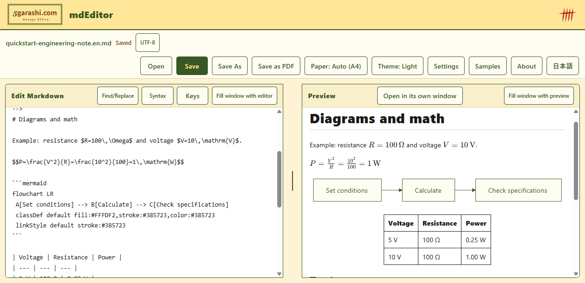
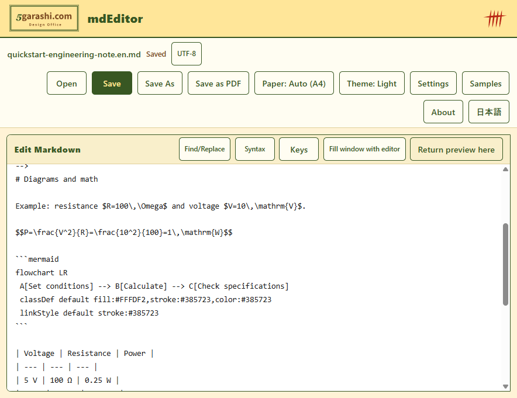
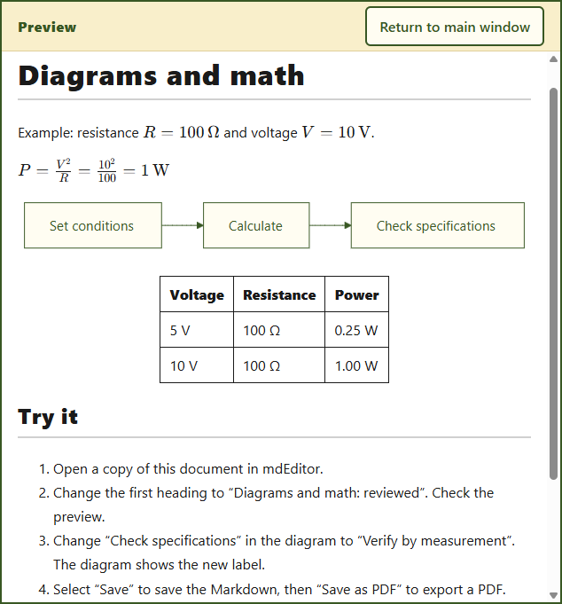

<!--
File: promotion/multichannel/articles/technical-note-en.md
Description: mdEditor use-case article
Author: 5garashi.com Design Office
Created: 2026-10-13
Version: 1.2.0
License: MIT
SPDX-License-Identifier: MIT
-->
# Make a technical note with Markdown diagrams and math, then share a PDF

When you need to record a short calculation and a work procedure, keeping the text, diagram and equation in one Markdown file makes later edits easier. Keep the Markdown for editing and give readers a PDF of the rendered document.

This walkthrough uses mdEditor, a free Windows app developed by the author, 5garashi.com Design Office. We will open a note, edit it, check its preview and export it as PDF.

## 1. Keep an editable source and a readable copy

Markdown is a text format for headings, tables and other document elements. Mermaid diagrams are also written as text, and equations rendered by KaTeX use TeX notation.

- Editable source: `.md`. Revise conditions and procedures later.
- Reader's copy: `.pdf`. Share a rendered document without requiring a Markdown setup.

A PDF records the document at the time of export. Editing the Markdown does not update an earlier PDF; export it again after making changes.

## 2. Try a small document

Install mdEditor from [Microsoft Store](https://apps.microsoft.com/detail/9nww2qrclmhc?hl=en-US&gl=US), then choose a local file with Open. You can start with a copy of the [diagrams and math sample](../../samples/quickstart-engineering-note.en.md).

The following example records power dissipated by a resistor. `$...$` marks inline math; `$$...$$` marks a separate equation. The Mermaid code block is rendered as a diagram.

````markdown
# Resistor power

Conditions: $R=100\,\Omega$ and $V=10\,\mathrm{V}$.

$$P=\frac{V^2}{R}=\frac{10^2}{100}=1\,\mathrm{W}$$


| Voltage | Resistance | Power |
| --- | --- | --- |
| 5 V | 100 Ω | 0.25 W |
| 10 V | 100 Ω | 1.00 W |
````

The equation and table record results calculated by the author. mdEditor does not calculate them. When changing a voltage, recalculate and update the text, equation and table yourself. This small example is not sufficient for choosing an actual component.

## 3. Edit the text and diagram

Change the heading to “Resistor power: reviewed” and check that the preview updates. Then replace “Check specifications” in the Mermaid block with “Verify by measurement”.

You change the text that describes the diagram, rather than manipulating shapes directly. This keeps the diagram and the prose together in the same editable file.



This screenshot uses source build mdEditor 1.0.5. The [English demonstration](../../assets/mdEditor-demo-en.mp4) shows real Windows operations.

## 4. Put the preview in another window

Select Open in its own window in the preview pane to detach it. Place it beside other work or move it to another display. If you only want to read, you can also fill the main window with the preview.

The following screens show the main editor and its detached preview, captured with source build 1.0.5. If the Store build does not show this button, check the features and update status for that build. Detaching the preview and filling the main window with it are separate operations.





## 5. Save the Markdown and check the PDF

1. Select Save to preserve the edited Markdown.
2. Select Save as PDF and choose a destination.
3. Open the saved PDF.
4. Check the heading, diagram, equation and table, along with page breaks and unwanted pages.

In the tested source build, a short technical note could produce a trailing blank PDF page. The document content was exported, but check the page count before sharing. PDF files do not update automatically, and numerical results are not calculated by mdEditor.

External images in a document connect to their image servers. This sample has no external images; its diagrams and equations use components bundled with the app. See the [app privacy policy](https://github.com/5garashi/mdEditor/blob/main/PRIVACY.md).

## References and author

- [Mermaid documentation](https://mermaid.js.org/): text-based diagram notation.
- [KaTeX documentation](https://katex.org/docs/supported.html): supported math notation.
- [mdEditor source and usage](https://github.com/5garashi/mdEditor).

The steps and screenshots were checked with unmodified source build 1.0.5. The currently available Store build and certification status are unverified. The free price follows the owner's confirmation and Store listing data.

mdEditor is a development project by [5garashi.com Design Office](https://www.5garashi.com/). This is an unpublished use-case article. The developer should review it and adapt it to the destination's rules before publishing.

Design reference: [Design Office Identity v4.12.0](https://5garashi.github.io/5garashi-identity/), 5garashi.com Design Office. Official logos are CC BY-ND 4.0; this article and its notation examples are MIT.

---

**Author**: 5garashi.com Design Office
**Last updated**: 2026-10-13 JST
