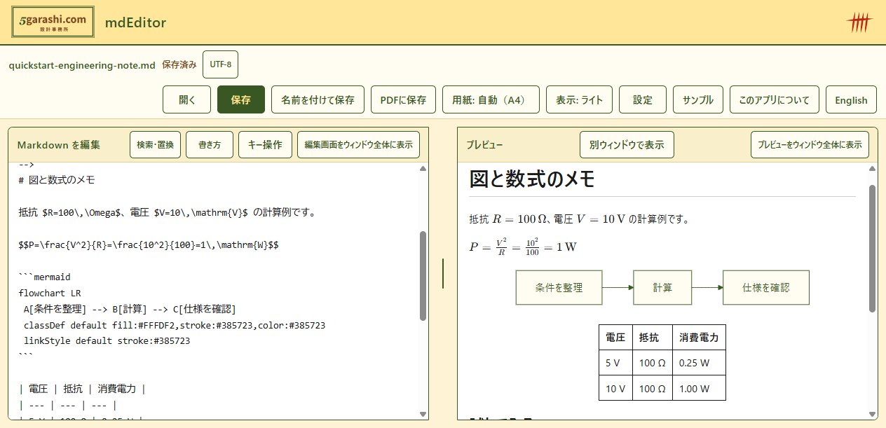
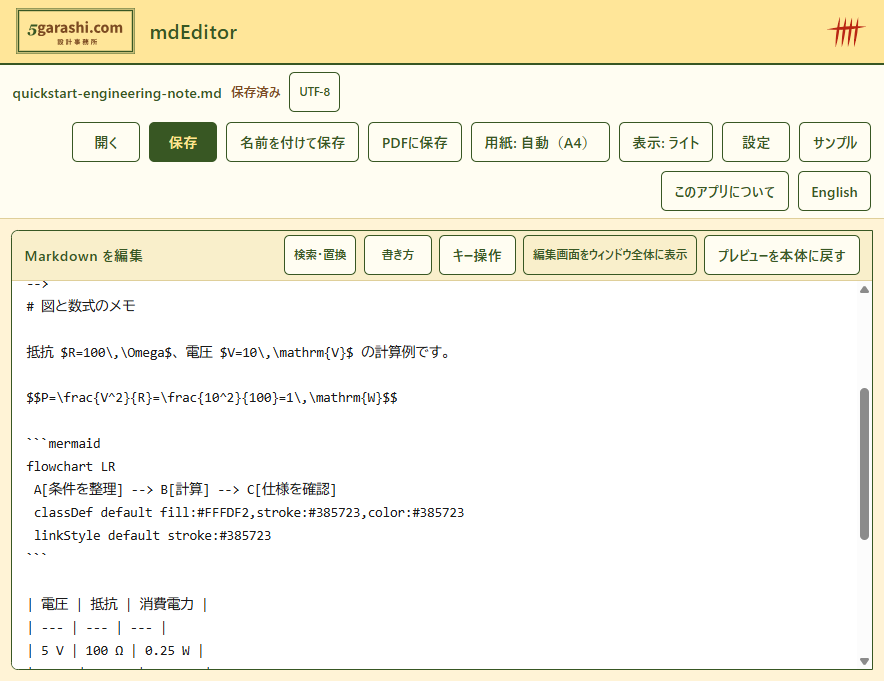
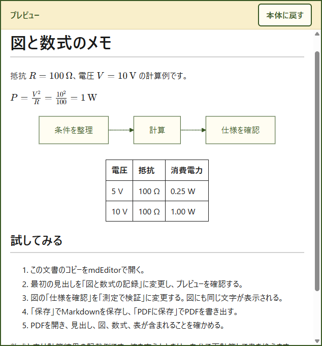

<!--
ファイル名 / File: promotion/multichannel/articles/technical-note-ja.md
概要 / Description: mdEditor用途記事 / mdEditor use-case article
作成者 / Author: 5garashi.com設計事務所 / 5garashi.com Design Office
作成日 / Created: 2026-10-17
版 / Version: 1.5.1
ライセンス / License: MIT
SPDX-License-Identifier: MIT
-->
# Markdownで図と数式の技術メモを作り、PDFで渡す

数行の計算と作業の流れを残したいとき、文章・図・数式を一つのMarkdownファイルにまとめると、後から修正しやすくなります。読み手にはPDFを渡し、自分の手元には編集用のMarkdownを残す使い方を紹介します。

今回は、無料のWindows用アプリmdEditorを使います。作成者は、本稿の著者である5garashi.com設計事務所です。技術メモを例に、開く、編集する、プレビューする、PDFに保存するまでを説明します。

## 1. 編集用と配布用を分ける

Markdownはテキストファイルなので、見出しや表を文章と一緒に編集できます。Mermaidの図もテキストで記述でき、KaTeXで表示する数式はTeX記法で記述します。

- 編集用: `.md`。計算条件や作業手順を後から直す。
- 配布用: `.pdf`。読み手がMarkdownを表示する環境を用意しなくても読める形で渡す。

PDFは共有する時点の記録です。元のMarkdownを変更しても、以前に保存したPDFは自動更新されません。修正後はPDFも保存し直します。

## 2. 小さな文書で試す

[Microsoft Store](https://apps.microsoft.com/detail/9nww2qrclmhc?hl=ja-JP&gl=JP)からmdEditorを導入し、「開く」で手元のmdファイルを選びます。新しく試す場合は、[図と数式のサンプル](../../samples/quickstart-engineering-note.md)のコピーを使ってください。

以下は、抵抗の消費電力を記録する例です。`$...$` が文章中の数式、`$$...$$` が独立した数式です。Mermaidのコードブロックは図としてプレビューされます。

````markdown
# 抵抗の消費電力

条件は $R=100\,\Omega$、$V=10\,\mathrm{V}$ とする。

$$P=\frac{V^2}{R}=\frac{10^2}{100}=1\,\mathrm{W}$$


| 電圧 | 抵抗 | 消費電力 |
| --- | --- | --- |
| 5 V | 100 Ω | 0.25 W |
| 10 V | 100 Ω | 1.00 W |
````

数式と表は自分で計算した結果の記載です。mdEditorは数値を自動計算しません。電圧を変える場合、文章・式・表の結果を自分で再計算して書き換えてください。この例だけで実際の部品選定を決めるものではありません。

## 3. 文章と図を編集する

最初の見出しを「抵抗の消費電力の記録」に変え、右側のプレビューにも反映されることを確認します。次に図の「仕様を確認」を「測定で検証」に変えてみます。

図の見た目を直接操作するのではなく、元になる文字を修正する操作です。文章と図の変更履歴を同じmdファイルで残せることが、この形式の扱いやすさです。



主画面はソース版mdEditor 1.0.10の実機表示です。実演動画も[日本語MP4](../../assets/mdEditor-demo-1.0.10-ja.mp4)で確認できます。

## 4. 別ウィンドウで見比べる

プレビュー側の「別ウィンドウで表示」を選ぶと、読む画面を本体から分けられます。ほかの作業と並べたり、別のディスプレイに置いたりして使います。単に読みたいときは、プレビューをウィンドウ全体に広げる操作もあります。

以下は、本体と別プレビューの実画面です。ソース版1.0.5で取得しました。Storeの提供版にこのボタンがない場合は、その版の機能・更新状況を確認してください。別ウィンドウ表示と、ウィンドウ全体のプレビュー表示はそれぞれ異なる操作です。





## 5. Markdownを保存し、PDFを確認する

1. 「保存」で編集したMarkdownを保存する。
2. 「名前を付けて保存」でPDF形式を選び、保存先を指定する。
3. 保存したPDFを開く。
4. 見出し・図・数式・表が含まれること、文章の切れや不要なページがないかを確認する。

旧ソース1.0.5にはPDFの末尾に空白ページが付く場合がありました（変更履歴では1.0.6で修正）。本文・図・数式・表は出力されていますが、配布前にページ数を確認してください。PDFの自動更新や、数値の自動計算は行われません。

文書内の外部画像は初期設定で同意後に読み込み、その画像サーバーへの通信が発生します。本稿のサンプルには外部画像がなく、図・数式はアプリに同梱された部品で描画します。[アプリのプライバシーポリシー](https://github.com/5garashi/mdEditor/blob/main/PRIVACY.md)も参照してください。

## 参考資料と作成者

- [Mermaid公式資料](https://mermaid.js.org/): テキストから図を描く記法。
- [KaTeX公式資料](https://katex.org/docs/supported.html): 表示できる数式の記法。
- [mdEditorのソースと使い方](https://github.com/5garashi/mdEditor)。

主画面と取り込み・編集・書き出し動画は、変更していないソース版1.0.10です。別ウィンドウの画像は1.0.5の記録です。Storeの提供版番号・認定状況は未確認です。価格は所有者の確認と掲載情報に基づき無料と記載しています。

mdEditorは[5garashi.com設計事務所](https://www.5garashi.com/)の開発作品です。本文は用途を試すための手順記事で、未投稿の原稿です。掲載先のルールに合わせ、開発者本人が内容を確認してから公開してください。

デザイン基準出典: [Design Office Identity 4.15.0](https://5garashi.github.io/5garashi-identity/)、5garashi.com設計事務所 / 5garashi.com Design Office。公式ロゴはCC BY-ND 4.0、本文と記法例はMIT。

---

**作成者 / Author**: 5garashi.com設計事務所 / 5garashi.com Design Office
**最終更新 / Last updated**: 2026-10-17 JST
