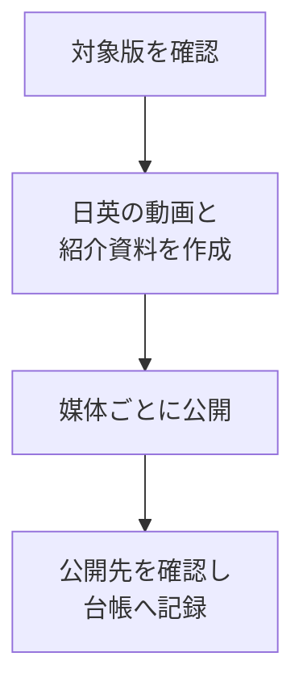

<!--
ファイル名 / File: promotion/MARKDOWN-CHECKLIST.md
概要 / Description: mdEditor用MarkdownとMermaidの作成・目視確認手順 / Markdown and Mermaid authoring checklist
作成者 / Author: 5garashi.com設計事務所 / 5garashi.com Design Office
作成日 / Created: 2026-10-17
版 / Version: 1.5.3
ライセンス / License: MIT
SPDX-License-Identifier: MIT
-->
# Markdown・Mermaidの書き方チェックリスト

mdEditorで読む説明資料を作成・修正するときに使います。**構文が通ること、実際の表示が読めること、書いてある内容が正しいことを別々に確認**します。入口は[プロモーション台帳](PROMOTION-SYSTEM.md)です。

English: Check syntax, visible layout and factual accuracy separately. A successful SVG render does not prove that labels are readable or free of overlaps. Validate using mdEditor's bundled engine and inspect the result at the intended display size.

## 1. 文章・Markdownの基本

- [ ] 冒頭に目的・対象版・確認日を書いた。
- [ ] 見出しは `#`、`##`、`###` の順で階層を付け、見出し・段落・リスト・表・コードブロックの前後に空行を置いた。
- [ ] リストを深く入れ子にせず、比較項目は表、操作の順番は番号付きリストにした。
- [ ] 表の区切り行を入れ、セル内の `|` はエスケープした。長文を一つのセルへ詰め込まなかった。
- [ ] コードフェンスの開始と終了を対応させた。Markdownのコード例にコードフェンスを含める場合は、外側を4個以上のバッククォートにした。
- [ ] リンク先が実在する。ローカル文書は相対パス、公開先はHTTPSで記述した。特定PCの絶対パスを共有リンクにしなかった。
- [ ] 画像の代替テキストと、図を読めない場合にも分かる本文・表を用意した。
- [ ] 作者・ライセンス・デザイン参照・末尾署名を記載し、文書ヘッダーとVERSION・CHANGELOGを今回の改版に合わせた。

## 2. Mermaidを書く前に選ぶこと

| 伝える内容 | 第一候補 | 読みにくい場合の変更 |
| --- | --- | --- |
| 作業順序・日付ごとの工程 | `flowchart TD` | 図を工程ごとに分割し、日付と詳細を表にする |
| 媒体・ブランチの関係 | `flowchart LR` または `TD` | 横に広がる場合はTDへ変更し、図を分ける |
| 担当間のやり取り | `sequenceDiagram` | 参加者名とメッセージを短くし、段階別に分ける |
| 進捗と待ち・再試行 | `stateDiagram-v2` | 状態名を短くし、条件の説明を本文へ移す |
| 短い出来事を日付で並べる | `timeline` | 長い日本語や列の重なりが出たら縦のflowchartまたは表へ変更 |

チャートの種類を増やすことより、読む人が判断できることを優先します。同じ情報に表のほうが適する場合は表を使います。

## 3. 文字の重なりを防ぐ書き方

- [ ] ノードIDは `A`、`Review` など短い英数字にし、表示名は `A["日本語の表示名"]` のように引用符で囲んだ。
- [ ] 1ノードは一つの作業・状態にした。URL、長い正式名称、制約説明は本文や表へ移した。
- [ ] 日本語ラベルは短い句に分けた。目安として1行10～16文字程度から試すが、文字数だけで合否を決めなかった。
- [ ] flowchart内で改行が必要な箇所は `<br/>` を入れた。すべての図種で同じ改行指定が使えるとは仮定しなかった。
- [ ] 横の列数を増やす前に、`LR` から `TD` への変更や図の分割を検討した。
- [ ] 図が横に広いとき、文字を小さくして収めるだけの修正にしなかった。
- [ ] `timeline` の日本語説明がカード幅を越えていないか確認した。長文の場合は余白の設定だけで済ませず、図種も見直した。
- [ ] ラベルが枠内に収まり、隣のラベル・矢印・日付・凡例と重なっていないことを画像で確認した。

書き方の例（下記はコード例で、図の自動描画はしません）：

````markdown

````

## 4. 描画・表示を確認する

- [ ] mdEditorに同梱されたMermaidで描画した。別サイトの新しいMermaidだけで成功と判定しなかった。
- [ ] フォントの読み込み完了後に確認した。書体・太さ・文字サイズが変わると幅の測定結果も変わることを考慮した。
- [ ] 全図を画像または実プレビューで見て、文字の重なり、切れ、枠からのはみ出しを確認した。
- [ ] 通常の画面幅と狭いプレビュー幅で確認した。拡大で文字が極端に小さくなる図は分割した。
- [ ] 昼・夜で文字と線が読めるか確認した。色だけで状態を区別しなかった。
- [ ] 図と同じ情報を本文・表でもたどれるか確認した。
- [ ] PDF・HTMLで配る場合は実際に書き出して確認した。PDFは改ページ、図の途中切れ、余白、リンクを確認した。
- [ ] 自動検証と目視確認を分けて記録した。未確認の表示条件や読み上げを「確認済み」にしなかった。

## 5. 内容とリンクの確認

- [ ] ソース版・Store配信版・動画revision・資料版を混同していない。
- [ ] 最新の操作名を使っている。1.0.10のPDF保存は「名前を付けて保存」でPDF形式を選ぶ。
- [ ] 新しい実演へのリンクと、古い画面・動画の版表示が一致する。
- [ ] 原稿完成・GitHub保存・投稿送信・審査中・公開確認済みを区別した。
- [ ] 公開先のアカウント名と公開範囲を確認し、URL・確認日・根拠を残した。
- [ ] 生成した文書を修正する場合は生成元も直した。ユーザーの未コミット変更を混ぜなかった。

## 6. 今回の修正から残す教訓

2026-10-17、プロモーション台帳の横型timelineで、日付ごとのカードから長い日本語がはみ出して隣の列と重なりました。前回はSVG生成の成功までを確認し、文字の収まりを目視確認できていませんでした。今回、短いラベルと明示改行を使う縦型flowchartへ変更しました。

「5図すべて描画成功」は構文・描画の確認です。「文字の重なりがない」は別の確認として記録します。この区別を今後の修正でも維持します。

### 確認記録のひな形

| 項目 | 記入内容 |
| --- | --- |
| 対象文書・対象版 | ファイル名、文書版、アプリのソース版 |
| 確認日・担当 | 日付と担当者 |
| 描画エンジン | mdEditor同梱Mermaidなど、実際に使ったもの |
| 自動確認 | 図数、構文、相対リンクなど |
| 目視確認 | 対象図、画面幅、書体、重なり・切れの有無 |
| 書き出し | PDF・HTMLなど、実施したものだけ |
| 未確認・残る問題 | 表示条件、読み上げ、改ページなど |

デザイン参照 / Design reference: [Design Office Identity 4.15.0](https://5garashi.github.io/5garashi-identity/) 第6・7・8・9条。文書と図コードはMIT。読み上げや全表示条件の確認を済ませたという宣言ではありません。

---

**作成者 / Author**: 5garashi.com設計事務所 / 5garashi.com Design Office
**最終更新 / Last updated**: 2026-10-17 JST
