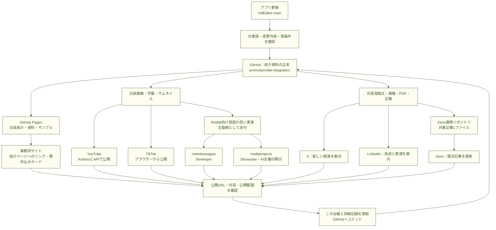
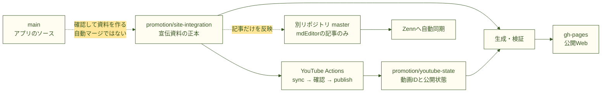
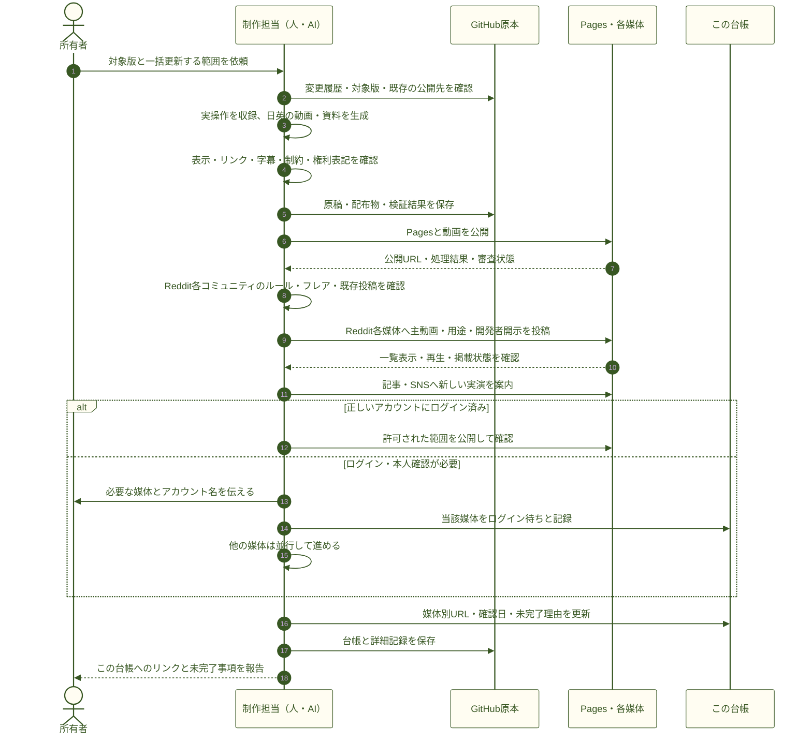
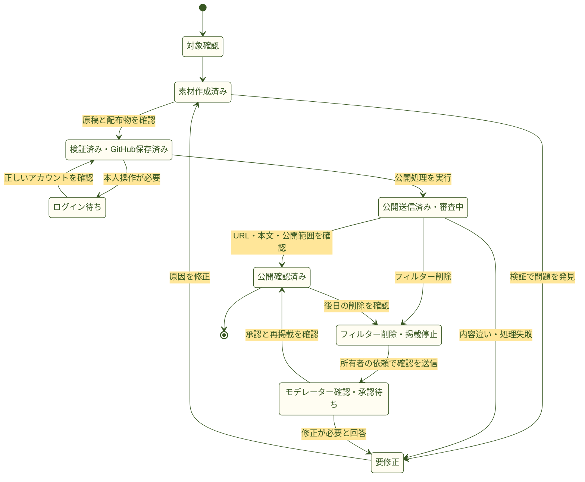
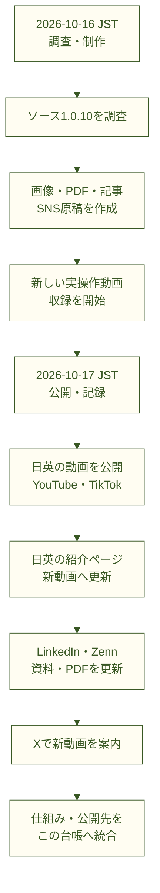

<!--
ファイル名 / File: promotion/PROMOTION-SYSTEM.md
概要 / Description: GitHubを核にしたプロモーションの全体図・更新手順・公開台帳 / GitHub-centered promotion guide and publication register
作成者 / Author: 5garashi.com設計事務所 / 5garashi.com Design Office
作成日 / Created: 2026-10-17
版 / Version: 1.13.0
ライセンス / License: MIT
SPDX-License-Identifier: MIT
-->
# mdEditor プロモーションの全体図と更新台帳

2026-10-23：**[ソース1.0.15・日英中の公開記録](multichannel/update-2026-10-23/PUBLICATION.md)**。簡体字中国語・クリップボード新規作成・起動改善と、ライブプレビュー・図・3D・PDFを案内。媒体別の公開状態は今回の記録を優先します。

2026-10-20：**[ソース1.0.14の公開資料と媒体別記録](multichannel/update-2026-10-20/README.md)** を公開しました。YouTube・TikTok・X・LinkedIn・ZennとReddit既存本文を更新。事務所サイトの本文変更のみ保留です。画像のドロップ・サイズと中央揃え・ZIP保存を案内。以下の2026-10-18の結果は前回版の履歴です。

現在の公開対象はソース版1.0.14・動画revision 1.0.1です。[今回の媒体別結果・未完了事項](multichannel/update-2026-10-20/PUBLICATION.md)を確認してください。Redditの添付動画は旧版を残し、新版へのリンクを本文へ追記しました。

2026-10-18：Redditの **r/windowsapps・r/sideprojects** を全体図・媒体一覧・更新手順・進捗・結果に統合しました。r/sideprojectsはフィルター削除、モデレーターへ確認依頼済みで、承認は未確認です。[Reddit資料](integration/reddit/README.md)・[詳細記録](integration/reddit/SIDEPROJECTS.md)。

このファイルを、**「次の版で何を更新するか」「どこから公開するか」「公開できたか」**を確認する入口にします。アプリのソース・紹介原稿・画像・動画・検証結果をGitHubに置き、各媒体へ展開し、公開URLと確認結果をここへ戻します。次回は媒体を個別に依頼する代わりに、末尾の依頼文を使えます。

前回の対象はソース版 **1.0.12**、動画パッケージ **revision 1.1.1**、YouTube公開管理 **revision 3.0.0**。2026-10-18 JSTに日英動画と各媒体を公開・確認しました。Store配信版も1.0.12として案内します（所有者確認。収録はソースビルド）。文書の版はヘッダー、資料キットは[VERSION](VERSION)、改版内容は[CHANGELOG](CHANGELOG.md)で管理します。

前回版：[日英の公開資料と媒体別記録](multichannel/update-2026-10-18/README.md)。3Dから始め、主な20機能へつなぐ日英の紹介・資料ページ、PDF・画像・サンプル、YouTube・TikTok・X・LinkedIn・Zennを更新し、Redditの2コミュニティへの初回投稿とその後の状態も記録しました。[動画原本と編集記録](showcase-1.0.12-revision-1.1.1/README.md)には背景映り込みの除去方法も保存しています。

English: This is the single entry point for the GitHub-centered promotion process, channel inventory, verified publication links and next-release checklist. It describes the existing mix of automation and browser work; it does not implement a new automatic publisher.

## 1. 全体図 — GitHubを核にして、結果もGitHubへ戻す

図の読み方：GitHubに保存しただけではSNS公開は完了しません。公開後のURL・内容・公開範囲まで確認して、台帳へ記録します。Redditは2コミュニティのルールと掲載状態を別々に確認します。投稿直後に表示できても、後からフィルター削除される場合があります。事務所サイトのカードはGitHub Pagesで管理できますが、Google Sites側の埋め込み表示は別途確認します。

## 2. 何をどこで管理するか

| 管理対象 | 正本・公開元 | 役割・今回の扱い |
| --- | --- | --- |
| アプリ | [5garashi/mdEditor：main](https://github.com/5garashi/mdEditor/tree/main) | アプリの変更内容と対象ソース版を確認。宣伝作業ではアプリ本体を変更しない |
| 宣伝資料 | [promotion/site-integration：promotion](https://github.com/5garashi/mdEditor/tree/promotion/site-integration/promotion) | この台帳、日英原稿、画像、動画、字幕、生成コード、公開記録 |
| 公開Web | 同じリポジトリの `gh-pages` | `integration/publish.py --push` で生成物を公開。公開元コミットは `SOURCE-COMMIT.txt` |
| YouTube状態 | 同じリポジトリの `promotion/youtube-state` | アップロード済みID・revision・公開状態を保持。二重投稿防止に使う |
| Zenn原稿 | [5garashi/galois-theory-introduction：対象記事](https://github.com/5garashi/galois-theory-introduction/blob/master/articles/mdeditor-diagrams-math-pdf.md) | 既存連携の `master` からZennへ同期。この1記事だけを更新 |
| 生の録画・作業用ファイル | このPCの `work/` | 録画素材・中間生成物。GitHubにある配布物とは区別する |
| ローカル配布物 | このPCの `deliverables/` | MP4・字幕・検証記録・ZIP。GitHub上の原本も参照する |

このPCでは、ワークスペース直下の `README.md` または `PROMOTION-SYSTEM.md` からこの正本へ移動できます。正本は `C:\miFfplay\mdEditorPromotion\audit-source\promotion\PROMOTION-SYSTEM.md` です。`work/publish-video-2026-10-17/repo` は今回の公開作業用コピーで、恒久的な原稿の入口ではありません。

実線は生成・公開・同期の経路、破線は人またはAIが確認して行う反映です。GitHubのすべてのブランチを自動的につなぐ設定ではありません。

## 3. 媒体別の更新一覧 — 毎回ここを一巡する

| 媒体 / Channel | 更新内容 | 公開方法 | 完了とする確認 |
| --- | --- | --- | --- |
| GitHub紹介資料 | 原稿・画像・動画・字幕・サンプル・生成元・この台帳 | 宣伝ブランチへコミット・push | 対象ファイルとコミットを確認 |
| 日英紹介ページ | 対象版、実画面、動画、機能説明、制約 | 生成して `gh-pages` へ公開 | 日英の公開HTML、新動画参照、配信ファイルを確認 |
| 日英資料・制作事例 | 記事、サンプル、PDF、画像、動画への導線 | 同じPages公開処理 | 古い手順・版説明が残っていないか確認 |
| YouTube 日英 | 新動画・説明・字幕・サムネイル・旧動画からの案内 | 既存Actions/API | 日英ともpublic、新動画ID、説明・字幕・リンクを確認 |
| TikTok 日英 | 縦動画・説明・宣伝開示・必要なAIラベル | ログイン済みブラウザー | 審査完了、「誰でも」、投稿URL、動画の版を確認 |
| X | 新版の用途と日英実演リンク。画像使用時は代替テキスト | ログイン済みブラウザー | **@5garashi_com**、送信結果、投稿URL、本文を確認 |
| LinkedIn | 開発者としての更新案内、用途、実演リンク | 本人プロフィールのブラウザー | **MOTOMASA IGARASHI**、Anyone、投稿URL、本文を確認 |
| Reddit r/windowsapps | 英語の短い実演・開発者の明示・Storeリンク | u/5garashi、Developerフレア | 週1投稿まで（2026-10-18確認）。URL・本文・再生・掲載状態・反応と返信時間を記録 |
| Reddit r/sideprojects | 主動画・解決する用途・機能・制約・AI支援開発の開示 | u/5garashi、選択可能な適切なShowcaseフレア | 詳細説明・関係開示・過剰宣伝禁止。URL・一覧動画・掲載状態を確認。削除時は承認待ちを明記 |
| Zenn | 既存記事の新画面・新動画・保存手順・制約 | 対象記事だけを連携元へpush | Zennの公開HTMLで新しい内容を確認 |
| 事務所サイト | 日英紹介へのリンク、埋め込みカード | カードはPages。サイト本文変更は別作業 | 公開サイト内のリンクと埋め込み表示を確認 |
| 配布資料 | 日英SNS画像・1枚PDF・必要なZIP | GitHubへ保存し資料ページから案内 | 画像の可読性、PDFページ数・文字・リンク、配信一致 |

公開方法の詳細：[YouTube自動化](integration/youtube/automation/README.md)、[TikTok](integration/tiktok/README.md)、[X](integration/x/README.md)、[LinkedIn](integration/LINKEDIN-FIRST-POST.md)、[Zenn](integration/zenn/README.md)、[Reddit](integration/reddit/README.md)・[r/sideprojects](integration/reddit/SIDEPROJECTS.md)、[Pages公開処理](integration/publish.py)。過去の説明を含むため、現在の状態はこの台帳の「今回の公開結果」を優先します。

## 4. 更新の順番 — 一度の依頼で各媒体まで進める

YouTubeとPagesを先に整え、そのURLをSNSと記事へ案内するとリンクの食い違いを減らせます。YouTubeの `sync` は新動画を非公開で用意し、確認後の `publish` で公開します。TikTokは投稿送信後の審査完了まで確認します。Redditはコミュニティごとに既存投稿とルールを確認し、有意な更新がない連投を避けます。動画は「本文に追加」せず主媒体として添付し、説明欄が保持されていることを送信前に確認します。一覧の動画表示と自動再生は閲覧者の設定に依存します。

## 5. 進捗の扱い — 原稿完成と公開完了を分ける

各媒体の状態を個別に記録します。「送信済み」で止まった媒体を「公開確認済み」とは扱いません。応答不明時は先に管理画面・既存IDを調べ、重複投稿を避けます。Redditで削除された場合は自動的に再投稿せず、状態を掲載停止へ戻します。モデレーターへの連絡は所有者が依頼した場合に行い、送信済みと承認済みを区別します。

## 6. 今回の公開結果 — ソース1.0.12

2026-10-18 JSTに確認。日英Web・動画・PDF・画像・20機能ガイド・記事・SNSの公開結果と範囲は [詳細記録](multichannel/update-2026-10-18/PUBLICATION.md)へまとめました。

| 媒体 | 公開URL | 状態 |
| --- | --- | --- |
| YouTube JA | [開く](https://www.youtube.com/watch?v=FCAnLgFUx9Q) | 公開確認済み |
| YouTube EN | [開く](https://www.youtube.com/watch?v=ELYbCiZKXMc) | 公開確認済み |
| TikTok JA | [開く](https://www.tiktok.com/@5garashi_com/video/7698653479656557831) | 公開確認済み |
| TikTok EN | [開く](https://www.tiktok.com/@5garashi_com/video/7698653923128823047) | 公開確認済み |
| X | [開く](https://x.com/5garashi_com/status/2112538505989820568) | 公開確認済み |
| LinkedIn | [開く](https://www.linkedin.com/feed/update/urn:li:activity:7518218531650383872/) | 公開確認済み |
| Reddit r/windowsapps | [投稿](https://www.reddit.com/r/windowsapps/comments/1x8rt4k/) | 投稿・本文訂正を確認。[原稿・記録](integration/reddit/POST.md)。継続掲載は未監視 |
| Reddit r/sideprojects | [投稿](https://www.reddit.com/r/sideprojects/comments/1x8shm2/) | フィルター削除。モデレーターへ確認依頼済み、承認・再掲載は未確認。[記録](integration/reddit/SIDEPROJECTS.md) |
| Zenn | [開く](https://zenn.dev/5garashi_com/articles/mdeditor-diagrams-math-pdf) | 公開確認済み |
| 日英紹介・資料・PDF・画像 | [日本語](https://5garashi.github.io/mdEditor/) / [English](https://5garashi.github.io/mdEditor/en.html) / [資料](https://5garashi.github.io/mdEditor/resources.html) | 原本と配信一致 |
| 制作事例・事務所カード | [制作事例](https://5garashi.github.io/mdEditor/case-study.html) / [カード](https://5garashi.github.io/mdEditor/office-card-ja.html) | 日英更新済み |
| 事務所サイト | [5garashi.com](https://www.5garashi.com/) | 既存導線を確認。案内先を更新 |

### 6.1 前回の公開記録 — ソース1.0.10

以下は2026-10-17 JSTの作業時に確認した記録です。将来のURL到達性や配信状況を継続監視しているわけではありません。

| 媒体 | 日本語 / Japanese | 英語 / English | 状態・確認内容 |
| --- | --- | --- | --- |
| 紹介ページ | [日本語](https://5garashi.github.io/mdEditor/) | [English](https://5garashi.github.io/mdEditor/en.html) | 公開確認済み。1.0.10表記、新MP4のSHA-256一致 |
| YouTube | [日本語動画](https://www.youtube.com/watch?v=pXQqzLLf8FM) | [English video](https://www.youtube.com/watch?v=FxBILEFQMQk) | 日英ともpublic。旧動画の説明に最新版リンク |
| YouTube固定入口 | [日本語入口](https://5garashi.github.io/mdEditor/youtube.html) | [English entry](https://5garashi.github.io/mdEditor/youtube-en.html) | 新動画IDへの案内を確認 |
| TikTok | [日本語縦動画](https://www.tiktok.com/@5garashi_com/video/7697326216935640372) | [English vertical video](https://www.tiktok.com/@5garashi_com/video/7697324847185136912) | 審査完了、両方「誰でも」。自社宣伝とAI生成ラベル |
| X | 日英動画へのリンクを1投稿に掲載 | [公開投稿](https://x.com/5garashi_com/status/2111263200478105694) | @5garashi_comで送信結果と投稿URLを確認 |
| LinkedIn | 投稿本文内に日本語実演リンク | [公開投稿](https://www.linkedin.com/feed/update/urn:li:activity:7516922147580055552/) | 本人プロフィール、Anyone、Post successful |
| Zenn | [既存記事](https://zenn.dev/5garashi_com/articles/mdeditor-diagrams-math-pdf) | 独立した英語記事は今回作成なし | 公開HTMLで新動画・更新日を確認 |
| 資料ページ | [日本語資料](https://5garashi.github.io/mdEditor/resources.html) | [English resources](https://5garashi.github.io/mdEditor/resources-en.html) | 新PDFリンクと1.0.10表記を確認 |
| 新しい1枚PDF | [日本語PDF](https://5garashi.github.io/mdEditor/multichannel/update-2026-10-17/one-page-ja.pdf) | [English PDF](https://5garashi.github.io/mdEditor/multichannel/update-2026-10-17/one-page-en.pdf) | 各1ページ、本文・リンクあり。配信SHA-256一致 |
| 埋め込みカード | [日本語カード](https://5garashi.github.io/mdEditor/office-card-ja.html) | [English card](https://5garashi.github.io/mdEditor/office-card-en.html) | カードURLで更新確認。Google Sites内の表示は未確認 |
| 事務所サイト | [5garashi.com](https://www.5garashi.com/) | 同じサイトの日英案内 | 既存リンクを利用。今回サイト本文の再編集は実施なし |

日付ごとの作業を上から下へ読みます。同じ日付内の並びは作業をまとめたもので、分単位の実行順序を表すものではありません。横並びのtimelineでは長い日本語が隣の列へはみ出したため、短いラベルと明示改行を使う縦のフローチャートへ変更しました。

2026-10-17の再確認：同梱Mermaidで全5図の描画成功を確認し、この図は900px幅の描画画像でラベルの枠内収まりと重なりがないことを目視確認しました。[確認画像](validation/promotion-system-flow-1.5.3.png)。mdEditor本体の表示とPDF改ページは今回未確認です。

### 詳細記録と原本

| 調べたいこと | 記録・原本 |
| --- | --- |
| 動画の内容、制作方法、制約 | [動画制作README](video-update-1.0.10/README.md) |
| YouTube・TikTok・紹介ページの公開結果 | [動画公開記録](video-update-1.0.10/PUBLICATION-2026-10-17.md) |
| X・LinkedIn・Zenn・新資料の公開結果 | [その他媒体の公開記録](multichannel/update-2026-10-17/PUBLICATION.md) |
| 昨日の旧動画説明・更新案内 | [2026-10-16の記録](multichannel/update-2026-10-16/PUBLICATION.md) |
| 新しい日英画像・PDF・原稿 | [2026-10-17の資料](multichannel/update-2026-10-17/README.md) |
| 対象記事のGitHub反映 | Zenn連携元コミット `91fb19d`（対象記事1ファイル） |
| 新動画・日英紹介の制作 | 宣伝ブランチ `df032ab`、公開結果記録 `d61ccec` |
| その他媒体・PDF・カード | 宣伝ブランチ `bf2f780`、PDF軽量化 `0558e34` |
| X公開と資料配信の確認 | 宣伝ブランチ `7937723` |

### 今回から引き継ぐ注意点

- **Xはページを見られることと本人ログインを区別する。** @5garashi_comのプロフィール編集リンク・アカウント名を投稿前に確認する。別Chromeに正しいログインがある場合もある。今回の別アカウントへの誤投稿は削除確認済み。
- **版番号を混同しない。** アプリのソース版、Store配信版、資料キット、動画revisionは別。ソース版で収録したものをStore配信バイナリの実演とは書かない。
- **映っていない機能を動画の実演として案内しない。** Word・CSV・Web取り込みと4形式の書き出しは新動画で確認。別ウィンドウの古い画像は1.0.5の記録と明記して保持。
- **YouTube動画の映像変更は新ID。** 旧投稿・旧動画は削除を依頼されたもの以外保持し、新版への導線を追加する。
- **Pagesの自動公開には現状制限がある。** YouTube自動化は稼働するが、`PROMOTION_REPO_TOKEN`がなく自動Pages更新はスキップされた。今回は既存GitHub認証で `publish.py --push` を実行。将来の自動化設定は別の変更として扱う。
- **ユーザーの未コミット変更を保護する。** `integration/linkedin/company-logo.png` と `company-logo2.png` は今回の更新に混ぜない。公開処理がクリーンな作業コピーを必要とする場合は別コピーを使う。

## 7. 次の版で使うチェックリスト

毎回この欄をコピーして新しい公開結果を追加し、前回の記録は詳細ファイルとして残します。対象外の媒体は理由を書きます。

1. 対象版・変更履歴・Store配信版の確認範囲を決める。
2. 最新Identityを読み、既存資料との差分を確認する。
3. 日英の原稿、実画面、横動画、縦動画、字幕、サムネイル、画像、PDF、サンプルを確認する。
4. 変更した生成元と配布物を検証し、宣伝ブランチへ保存する。
5. 日英の紹介・資料・制作事例・埋め込みカードを生成し、Pagesの公開後に確認する。
6. YouTube日英を用意・確認・公開し、最新動画入口と旧動画の説明を更新する。
7. TikTok日英を正しいアカウントで投稿し、審査と公開範囲を確認する。
8. X・LinkedInで新版を案内し、Zenn既存記事の画面・手順・リンクを更新する。
9. Redditのr/windowsapps・r/sideprojectsを個別に判断し、ルールに沿って英語の主動画投稿・本文を更新する。既存投稿の削除・承認待ちを確認し、連投しない。
10. 事務所サイトのリンクと埋め込み表示を確認する。本文の変更が必要な場合は範囲内で対応する。
11. 公開URL、確認日、コミット、完了・待ち・未確認事項をこの台帳にまとめて保存する。

| 次回の記入欄 | 値 |
| --- | --- |
| 対象ソース版・確認日 | 未記入 |
| Store配信版の確認結果 | 未確認／確認した番号と根拠を記入 |
| 日英Web・資料 | 未着手 |
| YouTube 日英 | 未着手 |
| TikTok 日英 | 未着手 |
| X・LinkedIn・Zenn | 未着手 |
| Reddit r/windowsapps | ルール・既存投稿・掲載状態を確認して判断 |
| Reddit r/sideprojects | 承認待ちの結果・ルールを確認して判断 |
| 事務所サイト・PDF・画像・サンプル | 未着手 |
| 公開元コミット・詳細記録 | 未記入 |
| 未完了項目・次の担当 | 未記入 |

### 次回の依頼文

> mdEditorをソース版 X.Y.Z に更新しました。promotion/PROMOTION-SYSTEM.md を入口に、記載の全媒体を対象にプロモーション資料・実演動画・紹介ページ・記事・SNSを更新し、公開確認と台帳更新まで進めてください。日英の対象は媒体別一覧に従ってください。Redditのr/windowsapps・r/sideprojectsも個別に確認し、既存の削除・承認待ちと投稿頻度のルールを踏まえて更新可否を判断してください。ログインなど本人操作が必要な媒体は理由を記録し、ほかの媒体を進めてください。旧投稿・旧動画は削除せず、ユーザーの未コミット変更を保持してください。

この文書を保存しただけでは、将来のSNS公開を自動実行しません。実際の更新は、その回の依頼と対象範囲に基づいて行います。

## 8. mdEditorでの利用と確認範囲

この `.md` ファイルをmdEditorの「開く」で選ぶと、Mermaidの全体図、ブランチの関係図、シーケンス図、状態遷移図、日付順のフローチャートを文章と一緒に読めます。図の修正はコードブロック内の文字を編集します。共有する場合は「名前を付けて保存」でPDF・HTMLなどを選び、図や表の改ページを確認してください。

作成・修正のたびに、Identity管理の[共通チェックリスト（参照タグ4.20.0）](https://github.com/5garashi/5garashi-identity/blob/v4.20.0/docs/MARKDOWN-CHECKLIST.md)と[mdEditor固有の補足](MARKDOWN-CHECKLIST.md)を使います。「描画できた」と「文字が重ならず読める」は別の確認項目です。GitHubとmdEditorの両方で共通に描画できるMermaidを選び、両環境の確認結果を分けて記録します。共通原則はIdentity第8条8-9で管理しています。

図と同じ判断材料を本文・表にも記載し、色だけで進捗を表しません。日本語を主に、英語の概要と媒体名を併記しています。配色はIdentityの文書用パレットを参照。2026-10-17の検証記録は改訂前の5図が対象です。今回のReddit追加後の検証結果は[1.10.0の記録](validation/promotion-system-1.10.0.json)を参照してください。2026-10-18にGitHubの明色表示で5図の読み込みと拡大全体図内のRedditラベルを確認し、mdEditor 1.0.12本体でもこの文書を開いて5図のSVG描画を確認しました。[実表示の確認記録](validation/promotion-system-1.10.1.json)。左右分割のプレビューでは全体図とシーケンス図の文字が小さく、描画成功を可読性の合格とは扱いません。mdEditorでは「プレビューをウィンドウ全体に表示」と拡大を使い、GitHubでは図の拡大表示を使ってください。図の要点は媒体一覧・手順・状態の文章でも確認できます。[検証記録](validation/promotion-system.json)。暗色表示、全図・全領域の文字の収まり、読み上げ、実OSのコントラストテーマ、全図のPDF改ページは今回未確認です。完全準拠は宣言しません。

デザイン基準出典 / Design reference: [Design Office Identity 4.20.0](https://5garashi.github.io/5garashi-identity/)、5garashi.com設計事務所 / 5garashi.com Design Office。原本はCC BY-ND 4.0。この文書の文章と図のコードは既存資料と同じMITです。

---

**作成者 / Author**: 5garashi.com設計事務所 / 5garashi.com Design Office
**最終更新 / Last updated**: 2026-10-18 JST
