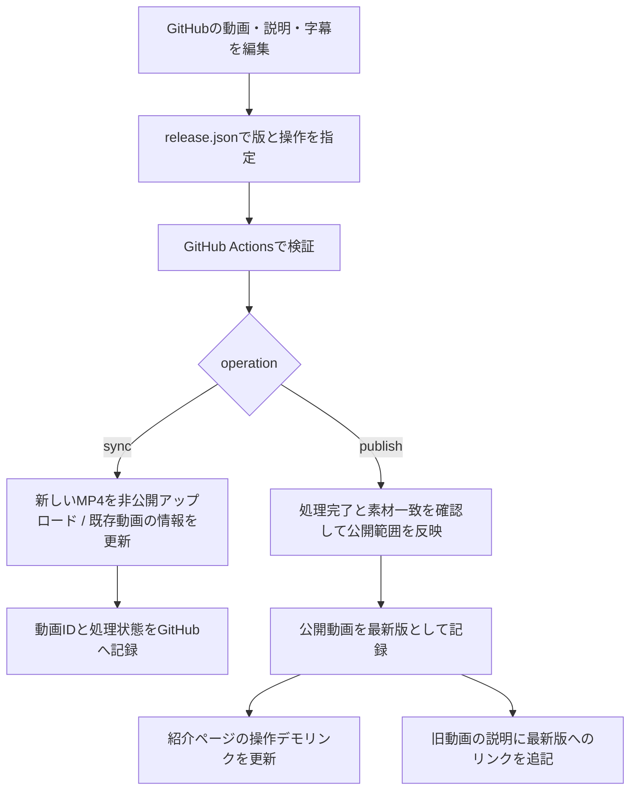

<!--
ファイル名 / File: promotion/integration/youtube/automation/README.md
概要 / Description: GitHubからYouTubeへ更新する仕組みと初期設定 / YouTube release automation and setup
作成者 / Author: 5garashi.com設計事務所 / 5garashi.com Design Office
作成日 / Created: 2026-10-13
版 / Version: 1.0.2
ライセンス / License: MIT
SPDX-License-Identifier: MIT
-->
# GitHubからYouTubeを更新する / YouTube release automation

バージョン / Version: 1.0.2 · [CHANGELOG.md](CHANGELOG.md)

2026-10-16: 既存動画の説明に新機能の案内を追加します。動画自体は1.0.5の実演のままです。 / Update the existing video descriptions; the recordings still show 1.0.5.

**現状: 本人の認証とGitHub Secrets登録、日英2本の非公開同期と一般公開が完了。`enabled: true`、`operation: publish`、`target_privacy: public`。** 公開は本人の明示的な指示に基づき実行しました。動画URLと実施結果は[SETUP-STATUS.md](SETUP-STATUS.md)を参照してください。追加機能を含む新しい録画はこの仕組みでは制作しません。

## 仕組み / How it works



YouTubeはMP4の差し替えを提供しません。動画本体を変更すると新しい動画ID・URLになります。タイトル・説明・字幕・サムネイルだけなら同じIDを更新します。旧動画は削除せず、視聴回数やコメントを残します。[YouTube公式案内](https://support.google.com/youtube/answer/55770?hl=ja)

アプリ本体、mdEditorのmain、Zenn連携設定は変更していません。チャンネルのバナーやプロフィールも、この自動化では変更しません。

## ファイルと更新する場所 / Files

| 場所 | 役割 |
| --- | --- |
| release.json | 投稿する素材、動画の版、タイトル、公開範囲、実行する操作 |
| description-en.txt / description-ja.txt | 日英の説明文。固定の秒数は名称に使わない |
| promotion/assets/mdEditor-demo-*.mp4 | 動画本体 |
| promotion/assets/demo-*.vtt | 時間付き字幕 |
| promotion/multichannel/social/read-*-landscape.png | 初回サムネイル |
| sync.py | YouTubeへの同期・公開・重複防止 |
| authorize.py | PCのブラウザーで初回アクセス許可を取得 |
| .github/workflows/youtube-promotion.yml | GitHub Actionsの実行定義 |
| promotion/youtube-state ブランチの state.json | 動画ID、ファイルハッシュ、処理状態、最新版URL。認証情報は保存しない |

## 1. Google Cloudプロジェクトを作る / Create the project

1. [Google Cloud Console](https://console.cloud.google.com/)を開き、`moto@5garashi.com`でログインします。
2. 上部のプロジェクト選択から「新しいプロジェクト」を選びます。
3. 名前を `5garashi YouTube Promotion` にして作成します。プロジェクトIDは画面で生成されたものを記録します。組織の選択が必要な場合は、自分が管理する組織を選びます。
4. 作成したプロジェクトを選択し、「APIとサービス」→「ライブラリ」で **YouTube Data API v3** を検索し、有効にします。

この処理はYouTubeへの投稿APIを使うための設定です。動画をアップロードしたり、既存のチャンネルを変更したりする操作ではありません。

## 2. 初回認証用のクライアントを作る / Configure OAuth

1. Google Auth Platform（旧「OAuth同意画面」）を開き、アプリ名 `5garashi YouTube Promotion`、サポート用メール、連絡用メールを入力します。
2. 自分のWorkspace組織内だけで使うなら、画面で選択可能な「内部」を使います。「外部」を使う場合は、テストユーザーに `moto@5garashi.com` を追加します。
3. データアクセスに `https://www.googleapis.com/auth/youtube.force-ssl` を追加します。この権限は動画・字幕の編集や削除も可能です。本実装は削除APIを使いませんが、Googleが示す権限内容を確認して許可してください。
4. 「クライアント」→「クライアントを作成」で、種類 **デスクトップアプリ**、名前 `5garashi Promotion PC` を指定します。
5. クライアントJSONをダウンロードし、Git管理外のユーザー専用フォルダーへ保存します。チャットへ貼り付けないでください。

外部アプリの「テスト」状態では、今回の権限を含むrefresh tokenは通常7日で失効します。長期運用ではGoogleの案内に従って本番状態と必要な検証を確認し、その後に再認証します。OAuth同意の検証とYouTube API側の審査・制限は別のものです。[Googleの説明](https://developers.google.com/identity/protocols/oauth2)

## 3. PCで本人のアクセス許可を取得する / Authorize locally

リポジトリのルートでPowerShellを開き、次を実行します。保存したクライアントJSONを例の場所へ置くか、パスを変更してください。

```powershell
$youtubePrivate = Join-Path $env:LOCALAPPDATA '5garashi\YouTubePromotion'
New-Item -ItemType Directory -Force -Path $youtubePrivate
python -m venv .youtube-runtime/venv
.youtube-runtime/venv/Scripts/python.exe -m pip install -r promotion/integration/youtube/automation/requirements.txt
.youtube-runtime/venv/Scripts/python.exe promotion/integration/youtube/automation/authorize.py --client "$youtubePrivate/client_secret.json" --output "$youtubePrivate/youtube-credentials.json"
```

ブラウザーで `moto@5garashi.com` を選び、対象の **@5garashi_com** チャンネルへの権限を確認して許可します。パスワードはコードやGitHubに渡しません。本人のGoogleログインと許可操作は本人が行います。

認証用JSONは標準出力に表示しません。既存の出力ファイルは上書きしません。再認証では新しいファイル名を指定してください。Windowsでは保存フォルダーのアクセス権もユーザー専用であることを確認します。

## 4. GitHub Secretsへ登録する / Store credentials

認証情報は次のコマンドでファイルから直接登録します。中身を画面やチャットに表示する必要はありません。

```powershell
Get-Content -Raw -LiteralPath "$youtubePrivate/youtube-credentials.json" | gh secret set YOUTUBE_CREDENTIALS_JSON --repo 5garashi/mdEditor
```

紹介ページも自動更新する場合は、GitHubで **5garashi/mdEditorのみ**を対象とするfine-grained Personal Access Tokenを作り、Contentsの読み書き権限を付けます。GitHubのSecrets設定画面で **PROMOTION_REPO_TOKEN** に登録します。このトークンは状態ブランチとgh-pagesへの保存に使います。

`GITHUB_TOKEN`だけでもYouTube同期と状態保存は可能ですが、現在の「ブランチから公開する」Pages構成では、そのトークンによるpushはPagesビルドを起動しません。追加トークンがない場合、YouTube更新後にPages更新を省略してログに理由を残します。[GitHub公式案内](https://docs.github.com/en/pages/getting-started-with-github-pages/creating-a-github-pages-site)

## 5. 最初は非公開で同期する / Initial synchronization

1. `release.json` の `enabled` を `true`、`operation` を `sync` にします。
2. `target_privacy` は最初は `unlisted` のままにします。ただしsync段階の新規アップロードは常に **private（非公開）** です。
3. 作業ブランチ `promotion/site-integration` にコミット・pushします。release.jsonの変更だけが自動実行の入口です。MP4だけをpushしても投稿されません。
4. GitHubのActionsで **YouTube promotion** を開き、実行結果の動画URLを確認します。
5. YouTube Studioで動画・字幕・サムネイル、透かし、PDF保存の実演などを確認します。API認証と実機投稿の検証はこの時点で初めて完了します。

公開設定ファイルは日英2本をまとめて処理します。片方だけの場合はvideos配列から対象外を外してから実行します。

## 6. 限定公開、一般公開へ進める / Publish

1. 確認後、`operation` を `publish` に変更してpushします。処理完了・素材一致を確認したうえで、指定された `target_privacy` に変更します。
2. `unlisted` ならURLを知る人だけが見られます。この段階では紹介ページの最新版リンクに載せません。
3. 一般公開する際は `target_privacy` を `public` に変更し、まず `operation: sync` で同期、次に `operation: publish` で公開します。
4. 一般公開をAPIで再取得して確認後、最新版を状態ブランチへ記録します。PROMOTION_REPO_TOKENがあればgh-pagesも更新します。
5. 紹介ページには最新版の入口 **youtube.html / youtube-en.html** が追加されます。動画のURLが変わっても、この入口URLは変わりません。YouTubeへの通信はリンクをクリックした後に発生します。

最新版入口URLは、一般公開動画の確認後に生成します。2026-10-13に、ローカルの公開処理からyoutube.html / youtube-en.htmlを公開し、日英紹介ページのナビゲーションへ追加しました。日英ともHTTP 200と正しい動画リンクを確認済みです。Google SitesやSNS本文のリンクは自動変更しません。今後はこの固定入口を案内すると、リンクの貼り替えを減らせます。

## 更新時の操作 / Future updates

- **説明・タイトル・字幕・サムネイルだけ変更**: revisionはそのまま。ファイルを修正し、release.jsonをoperation: syncへ変更してpushします。すでにsyncの場合はrequest_idを更新し、release.jsonにも変更を作ります。同じ動画IDを更新し、公開範囲は変えません。説明文先頭の管理ヘッダーは投稿時に取り除きます。
- **MP4を変更**: revisionを1.0.0→1.1.0等に上げ、operation: syncで新しい非公開動画をアップロードします。確認後にpublishを実行します。同じrevisionでMP4を変更すると停止します。
- 旧動画は残ります。新しい一般公開動画へ切り替えると、旧動画の説明にLatest demoのURLを追記します。タイトルと公開範囲は維持します。
- ワークフローの手動実行ボタンは、定義がデフォルトブランチに存在する必要があります。今回はmainをマージしていないため、作業ブランチへのrelease.json変更による自動実行を使います。
- 日英2本の処理は一括トランザクションではありません。片方成功・片方失敗は各動画の状態に残ります。再実行では成功済みのIDを使います。

## 失敗・復旧 / Recovery

| 状況 | 次の操作 |
| --- | --- |
| OAuth期限切れ・取り消し | 初回認証を新しいファイルへ実行し、Secretを更新 |
| 字幕やサムネイルだけ失敗 | Studioの権限や形式を確認してsyncを再実行。動画IDは保持済み |
| アップロードの応答が失われた | 再投稿を停止。StudioでPublication行・版を照合し、IDを回収 |
| YouTubeの処理が未完了 | 時間を置いてpublishを再実行 |
| 要求と公開範囲が一致しない | APIプロジェクト・チャンネルの制限をStudioで確認。最新版リンクは更新しない |
| 状態Git pushに失敗 | 認証・並行更新を確認。アップロード前の予約が残る場合は重複投稿を停止 |
| Pages更新だけ失敗 | YouTube公開は戻さない。トークンを直してpublishを再実行するか、ローカルでpublish.py --push |

不明なアップロードの回収例（既存の動画IDを記録する操作で、新規アップロードはしません）:

```powershell
# YOUTUBE_CREDENTIALS_JSONを安全なローカル環境で設定してから実行
python promotion/integration/youtube/automation/sync.py sync --recover-key demo-en/1.0.0 --recover-id VIDEO_ID
```

回収するIDの所有チャンネルと説明のPublication行を確認します。ただしAPIからMP4のハッシュは照合できないため、実動画の内容もStudioで確認してください。Studioに該当動画が見つからない場合でも、予約を消して自動再投稿しません。成否を判断できた後にGitの履歴を保持して対処します。

## 検証・制約 / Verification and limits

認証不要の14件のテストで、重複防止、応答不明時の停止、途中失敗後のID再利用、別チャンネル拒否、公開前の素材一致、限定公開の最新版除外、既存IDの回収、旧動画へのリンク追記、最新版ページ生成を確認しました。[GitHub Actionsの検証実行](https://github.com/5garashi/mdEditor/actions/runs/38371234040)も成功。Googleクライアント導入・APIメソッド読み込みと、既存サイトの生成を確認しました。その後、本人OAuth、実YouTube API、GitHub Actionsからの非公開アップロード・説明・サムネイル・字幕設定が成功しました。APIで処理完了、private、原稿一致、字幕servingを確認しました。実プレーヤーの目視確認、一般公開、実Pages配信はまだ未検証です。モックの成功を実投稿の成功とは扱いません。

Git状態には公開可能な動画ID・ハッシュ・状態だけを保存します。OAuth情報はローカルの非Git管理ファイルとGitHub Secretsのみ。Googleには動画、字幕、サムネイル、説明文と認証情報を送信します。状態と生成した公開ページはGitHubへ送信します。普段のMarkdown文書は送信しません。

今回の依存ライブラリはgoogle-api-python-client 2.201.0（Apache-2.0）、google-auth-oauthlib 1.5.0（Apache-2.0）。Actions実行時にインストールし、mdEditorアプリ配布物へは同梱しません。推移依存もpipで導入されます。既存アプリのLICENSE・PRIVACYは変更しません。

English: GitHub is the source for videos and metadata. Explicit release.json changes trigger the workflow. Sync uploads new files privately and updates existing metadata without changing visibility. Publish verifies processing and asset identity before applying the requested visibility. Durable Git reservations stop ambiguous uploads from being retried automatically. Public releases update stable demo links when the Pages token is configured. User OAuth and the first private bilingual uploads have succeeded. Player review, public release and live Pages integration remain outstanding.

## 一次資料 / Primary references

- [YouTube動画アップロードAPI](https://developers.google.com/youtube/v3/docs/videos/insert)
- [動画情報更新API](https://developers.google.com/youtube/v3/docs/videos/update)
- [字幕追加API](https://developers.google.com/youtube/v3/docs/captions/insert)
- [サムネイルAPI](https://developers.google.com/youtube/v3/docs/thumbnails/set)
- [デスクトップアプリのOAuth](https://developers.google.com/identity/protocols/oauth2/native-app)
- [GitHub手動ワークフローの条件](https://docs.github.com/en/actions/how-tos/manage-workflow-runs/manually-running-a-workflow)
- デザイン基準: [Design Office Identity v4.12.0](https://5garashi.github.io/5garashi-identity/)。公式素材のCC BY-ND 4.0を維持。

---

**作成者 / Author**: 5garashi.com設計事務所 / 5garashi.com Design Office
**最終更新 / Last updated**: 2026-10-16 JST
