<!--
  ファイル名 / File: samples/diagram-test.md
  概要 / Description: Test document for diagram, chart, and math rendering (Japanese)
  作成者 / Author: 5garashi.com設計事務所 / 5garashi.com Design Office
  作成日 / Created: 2026-10-10
  ライセンス / License: MIT
  SPDX-License-Identifier: MIT
-->
# 図・チャート表示テスト

> [!NOTE]
> この文書は mdEditor での表示を前提にしています。GitHub で開くと、Graphviz（` ```dot `）と PlantUML の図はコードのまま表示され、同じフォルダーの動画はリンクになります。表示の確認は mdEditor で行ってください（Identity 8-9 (8)）。

mdEditor のプレビューで、各種ダイアグラムやチャートが正しく表示されるかを確認するためのテスト文書です。
各セクションの「期待される表示」と実際のプレビューを見比べてください。

---

## 1. フローチャート（Mermaid flowchart）

期待される表示：上から下へ流れる分岐付きのフローチャート。ひし形の判定ノードと、色付きのノードがある。

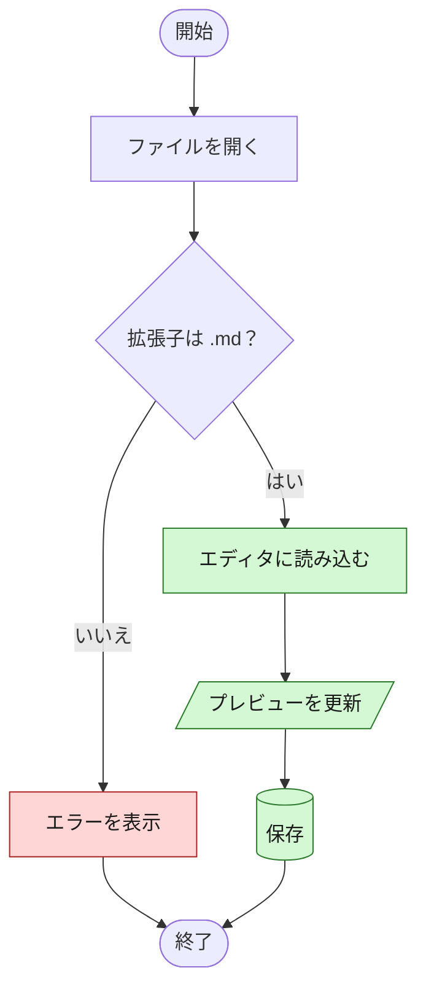

### 1-2. 左から右・サブグラフ

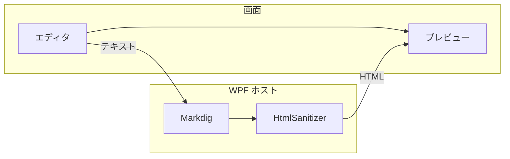

---

## 2. シーケンス図（Mermaid sequenceDiagram）

期待される表示：4 人の参加者、同期/非同期の矢印、ループ・分岐の枠、注記。

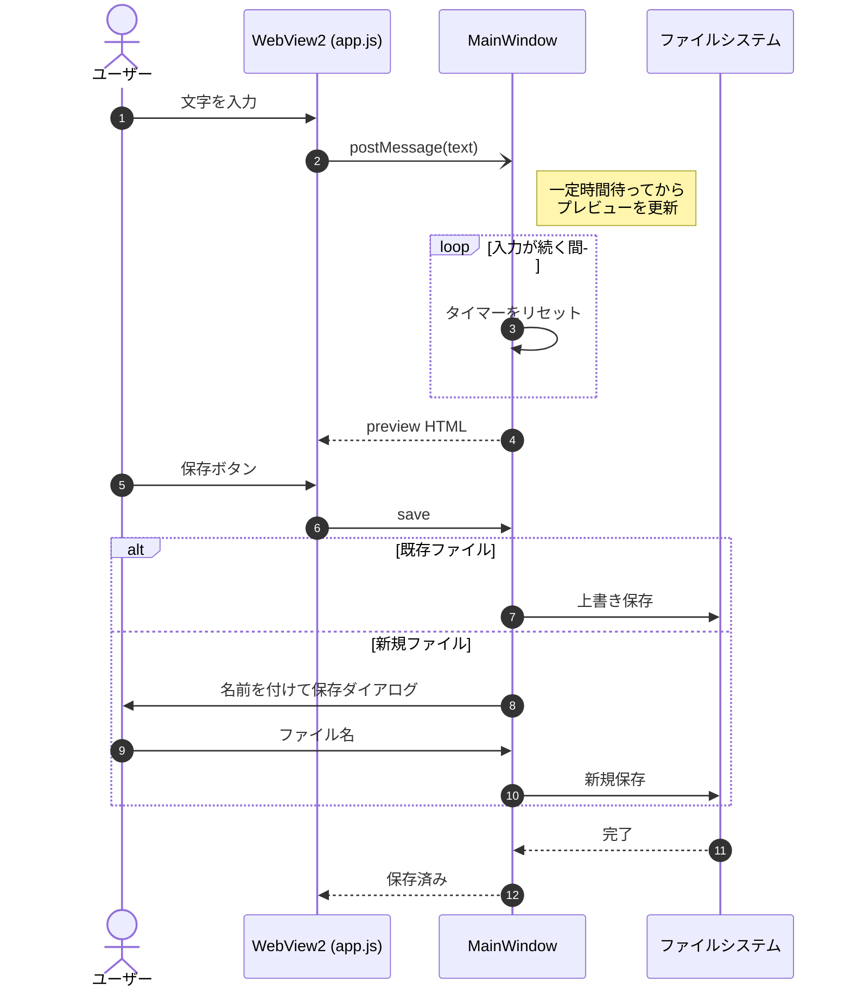

---

## 3. クラス図（Mermaid classDiagram）

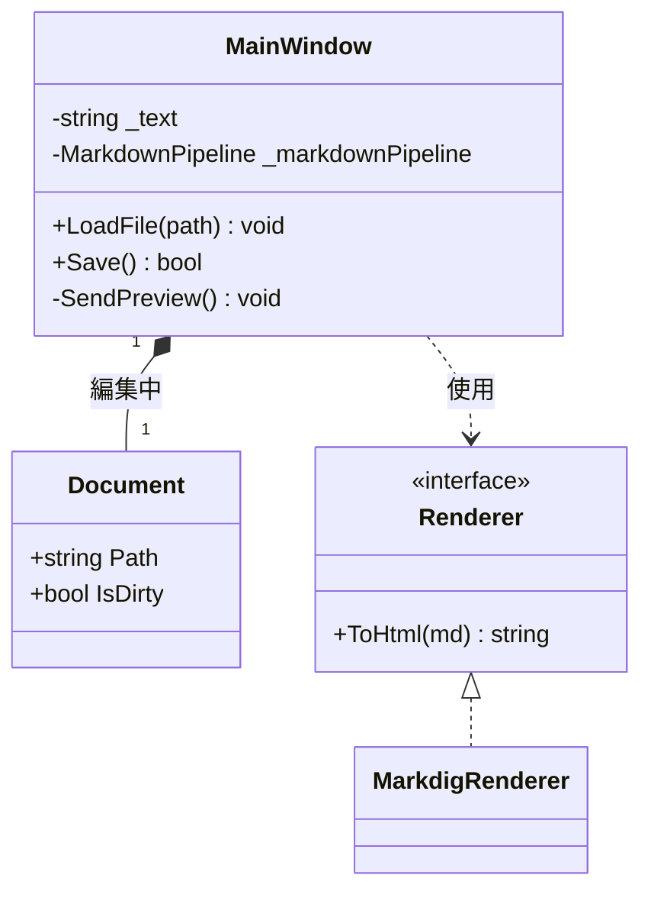

---

## 4. 状態遷移図（Mermaid stateDiagram）

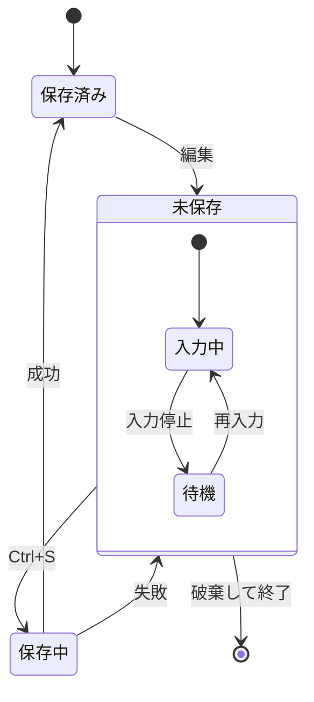

---

## 5. ER 図（Mermaid erDiagram）

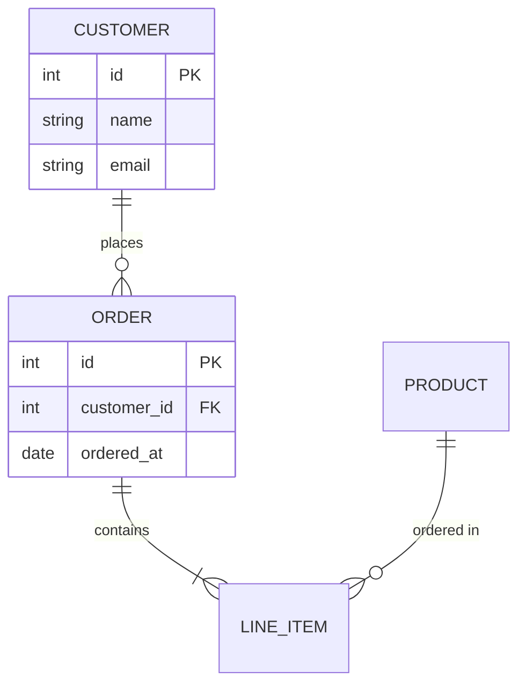

---

## 6. ガントチャート（Mermaid gantt）

期待される表示：横軸が日付、セクションごとに色分けされたバー。完了・進行中・重要タスクの表現。

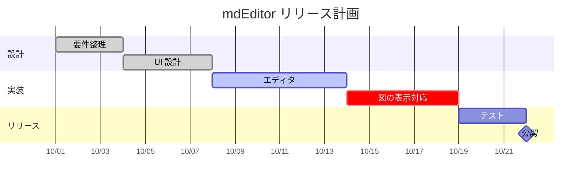

---

## 7. 円グラフ（Mermaid pie）

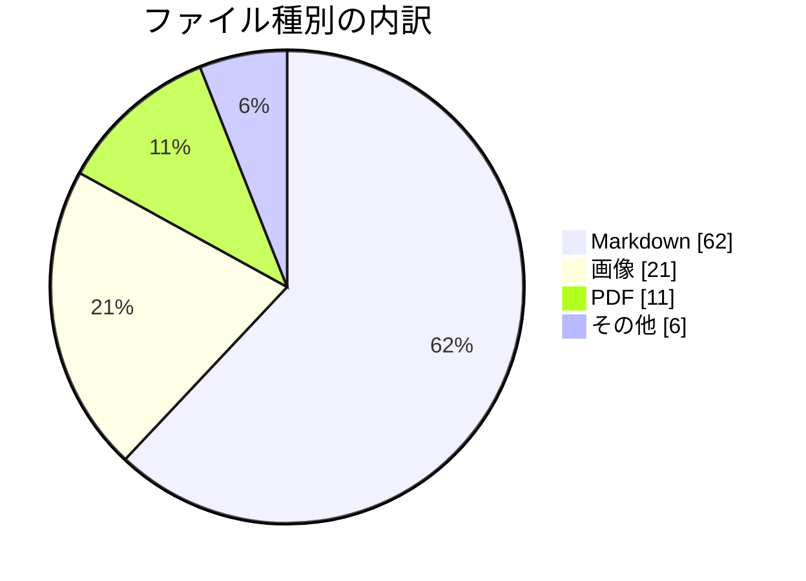

---

## 8. 棒グラフ・折れ線グラフ（Mermaid xychart-beta）

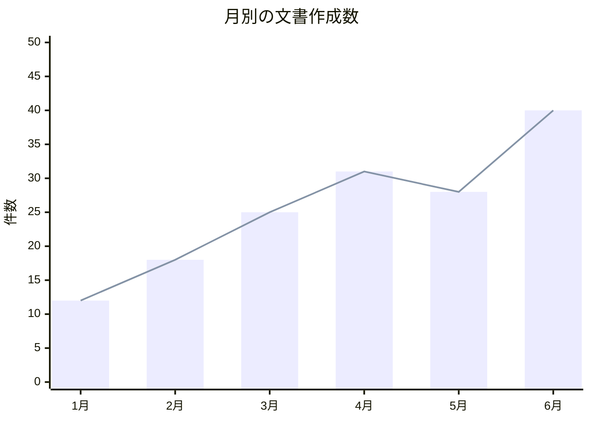

---

## 9. 4 象限チャート（Mermaid quadrantChart）

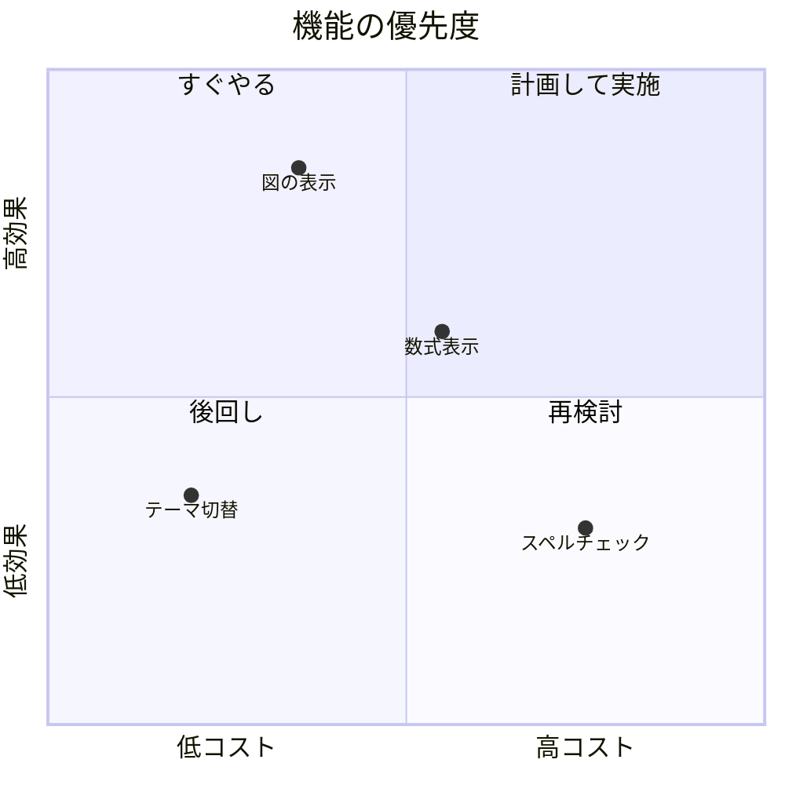

---

## 10. ユーザージャーニー（Mermaid journey）

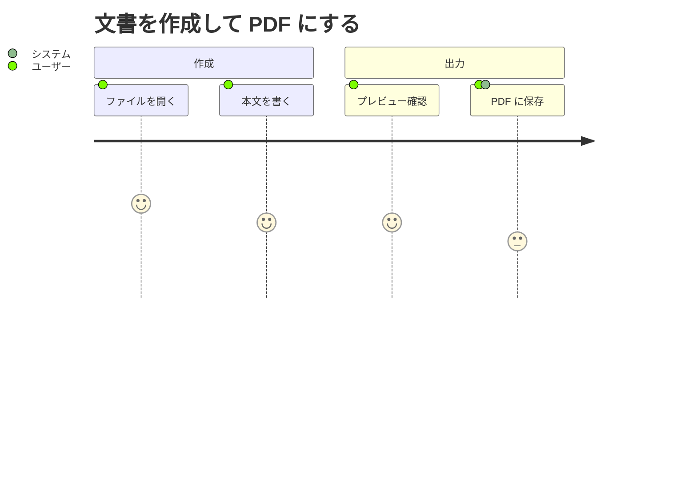

---

## 11. Git グラフ（Mermaid gitGraph）

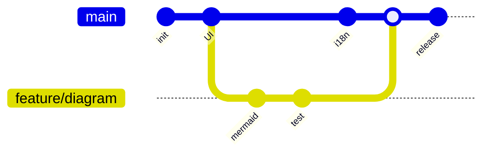

---

## 12. マインドマップ（Mermaid mindmap）

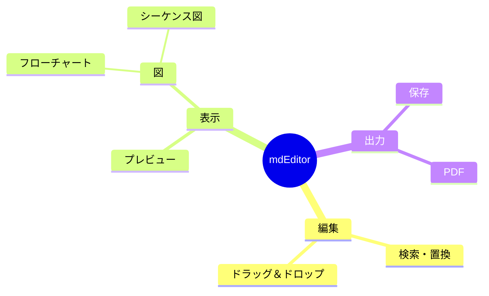

---

## 13. タイムライン（Mermaid timeline）

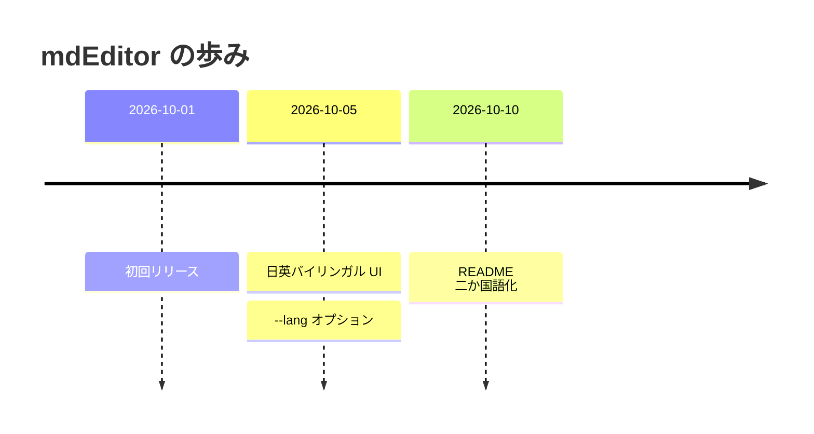

---

## 14. サンキーダイアグラム（Mermaid sankey-beta）

Mermaid のサンキーは日本語などの非 ASCII 文字の名前に対応していないため、英数字の名前を使います。

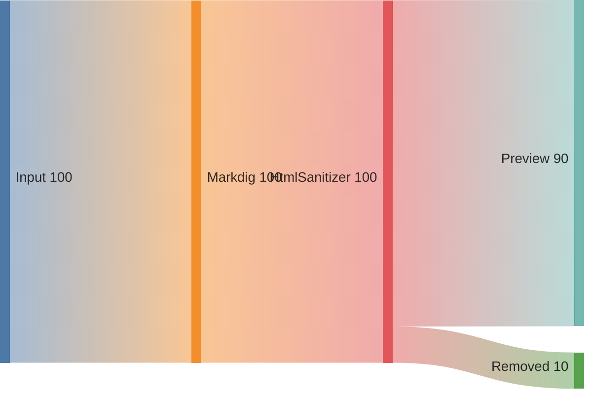

---

## 15. Mermaid の構文エラー（エラー表示の確認）

期待される表示：アプリが固まらず、エラーメッセージまたは元のコードが表示される。他の図の表示に影響しない。

```mermaid
flowchart TD
    A --> B --
    これは壊れた構文です {{{
```

---

## 16. その他の図の記法（対応していれば表示）

### 16-1. Graphviz（dot）

期待される表示：上の「開く」から、mdEditor の中の流れ（編集画面 → 変換 → 安全化 → プレビュー）を通って、「名前を付けて保存」へ進む色付きの図。表の形の箱、角の丸い箱、点線の双方向の矢印がある。

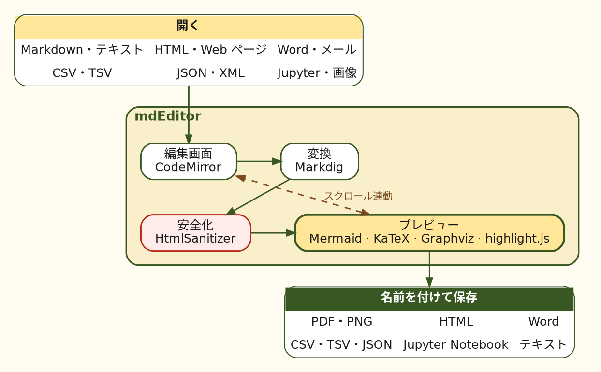

### 16-2. PlantUML

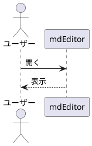

### 16-3. nomnoml

```nomnoml
[Editor]->[Preview]
[Preview]->[PDF]
```

---

## 17. 数式（KaTeX / MathJax）

インライン数式： $E = mc^2$ 、 $\sum_{i=1}^{n} i = \frac{n(n+1)}{2}$

ブロック数式：

$$
\int_{-\infty}^{\infty} e^{-x^2}\,dx = \sqrt{\pi}
$$

$$
\begin{pmatrix} a & b \\ c & d \end{pmatrix}
\begin{pmatrix} x \\ y \end{pmatrix}
=
\begin{pmatrix} ax + by \\ cx + dy \end{pmatrix}
$$

---

## 18. 比較用：図ではないもの（崩れないことの確認）

### 18-1. 普通のコードブロック

```javascript
// mermaid と書かれていても、言語が違えば図にしない
const text = "flowchart TD; A --> B";
console.log(text);
```

### 18-2. 言語指定なしのコードブロック

```
graph TD
    A --> B
```

### 18-3. テキストの図（等幅で揃っていること）

```text
+--------+      +---------+      +----------+
| Editor | ---> | Markdig | ---> | Preview  |
+--------+      +---------+      +----------+
```

### 18-4. 表

| 図の種類 | 記法 | 確認結果 |
|:---|:---:|---:|
| フローチャート | `flowchart` | ☐ |
| シーケンス図 | `sequenceDiagram` | ☐ |
| クラス図 | `classDiagram` | ☐ |
| 状態遷移図 | `stateDiagram-v2` | ☐ |
| ER 図 | `erDiagram` | ☐ |
| ガント | `gantt` | ☐ |
| 円グラフ | `pie` | ☐ |
| 数式 | `$...$` | ☐ |

---

## 19. コードの色分け（highlight.js）

期待される表示：言語名を書いたコードブロックは、キーワード（赤）・文字列（紺）・数値（青）・関数名（紫）・属性（茶）・タグ（緑）・コメント（灰色の斜体）に色分けされる。夜の配色では明るい色になる。言語名のないブロックは色が付かない。PDF・PNG・HTML・Word に保存しても色が残る。

### 19-1. Python

```python
from pathlib import Path

def count_headings(path: Path) -> int:
    """見出しの数を数える"""
    lines = path.read_text(encoding="utf-8").splitlines()
    return sum(1 for line in lines if line.startswith("#"))  # コメント

print(count_headings(Path("README.md")), 3.14, True, None)
```

### 19-2. JavaScript / TypeScript

```javascript
const formats = ["pdf", "png", "html", "docx"];
export async function save(name, format = "pdf") {
  if (!formats.includes(format)) throw new Error(`unknown: ${format}`);
  return { name, format, size: 1024 * 2 };
}
```

```ts
interface Heading { level: number; text: string }
const toc = (items: Heading[]): string[] =>
  items.map((h) => "  ".repeat(h.level - 2) + "- " + h.text);
```

### 19-3. C#

```csharp
public sealed record Document(string Path, int Version);

public static class Saver
{
    // 保存に失敗しても元のファイルは残る
    public static async Task SaveAsync(Document doc, string text)
    {
        await File.WriteAllTextAsync(doc.Path + ".tmp", text);
        File.Move(doc.Path + ".tmp", doc.Path, overwrite: true);
    }
}
```

### 19-4. PowerShell・シェル

```powershell
Get-ChildItem -Path $env:USERPROFILE\Documents -Filter *.md |
    Where-Object { $_.Length -gt 1KB } |
    ForEach-Object { Write-Host "$($_.Name): $($_.Length) bytes" }
```

```bash
for file in docs/*.md; do
  echo "checking $file" && grep -c "^#" "$file"
done
```

### 19-5. SQL・JSON・YAML

```sql
SELECT name, COUNT(*) AS pages
FROM documents
WHERE saved_at >= '2026-10-01' AND format IN ('pdf', 'docx')
GROUP BY name
ORDER BY pages DESC;
```

```json
{
  "app": "mdEditor",
  "version": "1.0.11",
  "formats": ["pdf", "html"],
  "offline": true,
  "zoom": 0.9
}
```

```yaml
app: mdEditor
theme: auto   # auto, light, dark
paper: A4
backup:
  enabled: true
  interval: 15
```

### 19-6. HTML・CSS

```html
<!-- コメント -->
<button id="save" class="primary"
        aria-keyshortcuts="Control+S">保存</button>
```

```css
.preview-content pre {
  padding: 12px;
  border: 1px solid #1A1A1A;
  border-radius: 6px;
}
```

### 19-7. diff

```diff
- PDFに保存ボタン
+ 名前を付けて保存で PDF を選ぶ
  変わらない行
```

### 19-8. 短い言語名と、言語名なし

`py`・`js`・`cs`・`sh`・`ps1` のような短い書き方でも色が付く。最後のブロックは言語名がないので色が付かない。

```py
print("short name")
```

```ps1
Write-Output "short name"
```

```
no language: def print const SELECT
```

---

## 20. GitHub と同じ書き方

期待される表示：GitHub の README と同じように表示される。先頭の項目（title・version・tags）は表になっている。注意書きは色付きの線・記号・題名の枠、数式は数式、絵文字は絵、折りたたみは押すと開く。PDF・PNG・Word に保存すると、折りたたみは開いた状態で入る。

### 20-1. 注意書き（アラート）

> [!NOTE]
> 補足の情報です。

> [!TIP]
> 便利な使い方です。

> [!IMPORTANT]
> 大事なことです。

> [!WARNING]
> 気を付けることです。

> [!CAUTION]
> 危険があることです。

### 20-2. 数式（GitHub の書き方）

```math
\sum_{k=1}^{n} k = \frac{n(n+1)}{2}
```

文中の数式 $`e^{i\pi} + 1 = 0`$ も表示される。

### 20-3. 絵文字の短縮名

:rocket: :sparkles: :memo: :white_check_mark: :warning: （顔文字 :) はそのまま）

### 20-4. HTML（GitHub が許しているもの）

<details>
<summary>クリックで開く</summary>

折りたたまれた **本文** です。表やコードも入れられます。

| キー | 操作 |
| --- | --- |
| <kbd>Ctrl</kbd>+<kbd>Shift</kbd>+<kbd>J</kbd> | 目次 |

</details>

<kbd>Ctrl</kbd>+<kbd>S</kbd> で保存。 H<sub>2</sub>O と 2<sup>10</sup>. <mark>強調</mark>

<p align="center"><b>中央寄せの文</b></p>

<script>document.title = "hacked"</script>
<a href="javascript:alert(1)">危ないリンク（文字だけになる）</a>

---

## 21. 3D モデル・地図・動画（GitHub と同じ書き方）

期待される表示：先頭のフロントマター（YAML）が、文書の最初にカード（項目名と値）として表示され、tags は札、author の中に name と url が並ぶ。立方体の 3D モデルの各面に、volt（赤）の「5」が浮き出ていて、本体はクリーム色で、地は濃い緑。ドラッグで回り、ホイールで拡大・縮小できる。地図には、東京と大阪の点、その間の線、富士山の位置を示す赤い三角が、日本の形の上に描かれ、お知らせ欄に「詳細な地図を読み込む」が出る。押すと、道路や地名の入った OpenStreetMap の地図になる。動画は、21-3 の 1 本目（同じフォルダーの動画）が音なしで自動で再生されて繰り返し（Windows の「アニメーション効果」がオフのときは、「設定」→「動画」で選ぶまで再生ボタンを表示）、2 本目（インターネット上の動画）は「画像・動画を読み込む」を押すまで読み込まない。

### 21-1. 3D モデル（STL）

本体（`solid cube`）と文字（`solid letters`）を別の solid にすると、mdEditor では 1 つ目をクリーム、2 つ目以降を volt で塗る（名前に `#RRGGBB` を書くとその色）。GitHub では 1 色で表示され、文字は凹凸で見える。

```stl
solid cube
facet normal 0 -1 0 outer loop vertex -14 -14 -14 vertex 14 -14 -14 vertex 14 -14 14 endloop endfacet
facet normal 0 -1 0 outer loop vertex -14 -14 -14 vertex 14 -14 14 vertex -14 -14 14 endloop endfacet
facet normal 0 1 0 outer loop vertex 14 14 -14 vertex -14 14 -14 vertex -14 14 14 endloop endfacet
facet normal 0 1 0 outer loop vertex 14 14 -14 vertex -14 14 14 vertex 14 14 14 endloop endfacet
facet normal 1 0 0 outer loop vertex 14 -14 -14 vertex 14 14 -14 vertex 14 14 14 endloop endfacet
facet normal 1 0 0 outer loop vertex 14 -14 -14 vertex 14 14 14 vertex 14 -14 14 endloop endfacet
facet normal -1 0 0 outer loop vertex -14 14 -14 vertex -14 -14 -14 vertex -14 -14 14 endloop endfacet
facet normal -1 0 0 outer loop vertex -14 14 -14 vertex -14 -14 14 vertex -14 14 14 endloop endfacet
facet normal 0 0 1 outer loop vertex -14 -14 14 vertex 14 -14 14 vertex 14 14 14 endloop endfacet
facet normal 0 0 1 outer loop vertex -14 -14 14 vertex 14 14 14 vertex -14 14 14 endloop endfacet
facet normal 0 0 -1 outer loop vertex -14 14 -14 vertex 14 14 -14 vertex 14 -14 -14 endloop endfacet
facet normal 0 0 -1 outer loop vertex -14 14 -14 vertex 14 -14 -14 vertex -14 -14 -14 endloop endfacet
endsolid cube
solid letters
facet normal 0 -1 0 outer loop vertex -7.5 -15.5 7.5 vertex 7.5 -15.5 7.5 vertex 7.5 -15.5 10.5 endloop endfacet
facet normal 0 -1 0 outer loop vertex -7.5 -15.5 7.5 vertex 7.5 -15.5 10.5 vertex -7.5 -15.5 10.5 endloop endfacet
facet normal 0 -1 0 outer loop vertex -7.5 -15.5 1.5 vertex -4.5 -15.5 1.5 vertex -4.5 -15.5 7.5 endloop endfacet
facet normal 0 -1 0 outer loop vertex -7.5 -15.5 1.5 vertex -4.5 -15.5 7.5 vertex -7.5 -15.5 7.5 endloop endfacet
facet normal 0 -1 0 outer loop vertex -4.5 -15.5 1.5 vertex 4.5 -15.5 1.5 vertex 4.5 -15.5 4.5 endloop endfacet
facet normal 0 -1 0 outer loop vertex -4.5 -15.5 1.5 vertex 4.5 -15.5 4.5 vertex -4.5 -15.5 4.5 endloop endfacet
facet normal 0 -1 0 outer loop vertex 4.5 -15.5 -7.5 vertex 7.5 -15.5 -7.5 vertex 7.5 -15.5 1.5 endloop endfacet
facet normal 0 -1 0 outer loop vertex 4.5 -15.5 -7.5 vertex 7.5 -15.5 1.5 vertex 4.5 -15.5 1.5 endloop endfacet
facet normal 0 -1 0 outer loop vertex -7.5 -15.5 -7.5 vertex -4.5 -15.5 -7.5 vertex -4.5 -15.5 -4.5 endloop endfacet
facet normal 0 -1 0 outer loop vertex -7.5 -15.5 -7.5 vertex -4.5 -15.5 -4.5 vertex -7.5 -15.5 -4.5 endloop endfacet
facet normal 0 -1 0 outer loop vertex -4.5 -15.5 -10.5 vertex 4.5 -15.5 -10.5 vertex 4.5 -15.5 -7.5 endloop endfacet
facet normal 0 -1 0 outer loop vertex -4.5 -15.5 -10.5 vertex 4.5 -15.5 -7.5 vertex -4.5 -15.5 -7.5 endloop endfacet
facet normal 0 0 1 outer loop vertex -7.5 -15.5 10.5 vertex 7.5 -15.5 10.5 vertex 7.5 -14 10.5 endloop endfacet
facet normal 0 0 1 outer loop vertex -7.5 -15.5 10.5 vertex 7.5 -14 10.5 vertex -7.5 -14 10.5 endloop endfacet
facet normal 0 0 -1 outer loop vertex -4.5 -14 7.5 vertex 7.5 -14 7.5 vertex 7.5 -15.5 7.5 endloop endfacet
facet normal 0 0 -1 outer loop vertex -4.5 -14 7.5 vertex 7.5 -15.5 7.5 vertex -4.5 -15.5 7.5 endloop endfacet
facet normal 0 0 1 outer loop vertex -4.5 -15.5 4.5 vertex 4.5 -15.5 4.5 vertex 4.5 -14 4.5 endloop endfacet
facet normal 0 0 1 outer loop vertex -4.5 -15.5 4.5 vertex 4.5 -14 4.5 vertex -4.5 -14 4.5 endloop endfacet
facet normal 0 0 -1 outer loop vertex -7.5 -14 1.5 vertex 4.5 -14 1.5 vertex 4.5 -15.5 1.5 endloop endfacet
facet normal 0 0 -1 outer loop vertex -7.5 -14 1.5 vertex 4.5 -15.5 1.5 vertex -7.5 -15.5 1.5 endloop endfacet
facet normal 0 0 1 outer loop vertex 4.5 -15.5 1.5 vertex 7.5 -15.5 1.5 vertex 7.5 -14 1.5 endloop endfacet
facet normal 0 0 1 outer loop vertex 4.5 -15.5 1.5 vertex 7.5 -14 1.5 vertex 4.5 -14 1.5 endloop endfacet
facet normal 0 0 1 outer loop vertex -7.5 -15.5 -4.5 vertex -4.5 -15.5 -4.5 vertex -4.5 -14 -4.5 endloop endfacet
facet normal 0 0 1 outer loop vertex -7.5 -15.5 -4.5 vertex -4.5 -14 -4.5 vertex -7.5 -14 -4.5 endloop endfacet
facet normal 0 0 -1 outer loop vertex -7.5 -14 -7.5 vertex -4.5 -14 -7.5 vertex -4.5 -15.5 -7.5 endloop endfacet
facet normal 0 0 -1 outer loop vertex -7.5 -14 -7.5 vertex -4.5 -15.5 -7.5 vertex -7.5 -15.5 -7.5 endloop endfacet
facet normal 0 0 -1 outer loop vertex 4.5 -14 -7.5 vertex 7.5 -14 -7.5 vertex 7.5 -15.5 -7.5 endloop endfacet
facet normal 0 0 -1 outer loop vertex 4.5 -14 -7.5 vertex 7.5 -15.5 -7.5 vertex 4.5 -15.5 -7.5 endloop endfacet
facet normal 0 0 1 outer loop vertex -4.5 -15.5 -7.5 vertex 4.5 -15.5 -7.5 vertex 4.5 -14 -7.5 endloop endfacet
facet normal 0 0 1 outer loop vertex -4.5 -15.5 -7.5 vertex 4.5 -14 -7.5 vertex -4.5 -14 -7.5 endloop endfacet
facet normal 0 0 -1 outer loop vertex -4.5 -14 -10.5 vertex 4.5 -14 -10.5 vertex 4.5 -15.5 -10.5 endloop endfacet
facet normal 0 0 -1 outer loop vertex -4.5 -14 -10.5 vertex 4.5 -15.5 -10.5 vertex -4.5 -15.5 -10.5 endloop endfacet
facet normal -1 0 0 outer loop vertex -7.5 -14 10.5 vertex -7.5 -14 1.5 vertex -7.5 -15.5 1.5 endloop endfacet
facet normal -1 0 0 outer loop vertex -7.5 -14 10.5 vertex -7.5 -15.5 1.5 vertex -7.5 -15.5 10.5 endloop endfacet
facet normal -1 0 0 outer loop vertex -7.5 -14 -4.5 vertex -7.5 -14 -7.5 vertex -7.5 -15.5 -7.5 endloop endfacet
facet normal -1 0 0 outer loop vertex -7.5 -14 -4.5 vertex -7.5 -15.5 -7.5 vertex -7.5 -15.5 -4.5 endloop endfacet
facet normal 1 0 0 outer loop vertex -4.5 -15.5 7.5 vertex -4.5 -15.5 4.5 vertex -4.5 -14 4.5 endloop endfacet
facet normal 1 0 0 outer loop vertex -4.5 -15.5 7.5 vertex -4.5 -14 4.5 vertex -4.5 -14 7.5 endloop endfacet
facet normal 1 0 0 outer loop vertex -4.5 -15.5 -4.5 vertex -4.5 -15.5 -7.5 vertex -4.5 -14 -7.5 endloop endfacet
facet normal 1 0 0 outer loop vertex -4.5 -15.5 -4.5 vertex -4.5 -14 -7.5 vertex -4.5 -14 -4.5 endloop endfacet
facet normal -1 0 0 outer loop vertex -4.5 -14 -7.5 vertex -4.5 -14 -10.5 vertex -4.5 -15.5 -10.5 endloop endfacet
facet normal -1 0 0 outer loop vertex -4.5 -14 -7.5 vertex -4.5 -15.5 -10.5 vertex -4.5 -15.5 -7.5 endloop endfacet
facet normal 1 0 0 outer loop vertex 4.5 -15.5 4.5 vertex 4.5 -15.5 1.5 vertex 4.5 -14 1.5 endloop endfacet
facet normal 1 0 0 outer loop vertex 4.5 -15.5 4.5 vertex 4.5 -14 1.5 vertex 4.5 -14 4.5 endloop endfacet
facet normal 1 0 0 outer loop vertex 4.5 -15.5 -7.5 vertex 4.5 -15.5 -10.5 vertex 4.5 -14 -10.5 endloop endfacet
facet normal 1 0 0 outer loop vertex 4.5 -15.5 -7.5 vertex 4.5 -14 -10.5 vertex 4.5 -14 -7.5 endloop endfacet
facet normal -1 0 0 outer loop vertex 4.5 -14 1.5 vertex 4.5 -14 -7.5 vertex 4.5 -15.5 -7.5 endloop endfacet
facet normal -1 0 0 outer loop vertex 4.5 -14 1.5 vertex 4.5 -15.5 -7.5 vertex 4.5 -15.5 1.5 endloop endfacet
facet normal 1 0 0 outer loop vertex 7.5 -15.5 10.5 vertex 7.5 -15.5 7.5 vertex 7.5 -14 7.5 endloop endfacet
facet normal 1 0 0 outer loop vertex 7.5 -15.5 10.5 vertex 7.5 -14 7.5 vertex 7.5 -14 10.5 endloop endfacet
facet normal 1 0 0 outer loop vertex 7.5 -15.5 1.5 vertex 7.5 -15.5 -7.5 vertex 7.5 -14 -7.5 endloop endfacet
facet normal 1 0 0 outer loop vertex 7.5 -15.5 1.5 vertex 7.5 -14 -7.5 vertex 7.5 -14 1.5 endloop endfacet
facet normal 0 1 0 outer loop vertex 7.5 15.5 7.5 vertex -7.5 15.5 7.5 vertex -7.5 15.5 10.5 endloop endfacet
facet normal 0 1 0 outer loop vertex 7.5 15.5 7.5 vertex -7.5 15.5 10.5 vertex 7.5 15.5 10.5 endloop endfacet
facet normal 0 1 0 outer loop vertex 7.5 15.5 1.5 vertex 4.5 15.5 1.5 vertex 4.5 15.5 7.5 endloop endfacet
facet normal 0 1 0 outer loop vertex 7.5 15.5 1.5 vertex 4.5 15.5 7.5 vertex 7.5 15.5 7.5 endloop endfacet
facet normal 0 1 0 outer loop vertex 4.5 15.5 1.5 vertex -4.5 15.5 1.5 vertex -4.5 15.5 4.5 endloop endfacet
facet normal 0 1 0 outer loop vertex 4.5 15.5 1.5 vertex -4.5 15.5 4.5 vertex 4.5 15.5 4.5 endloop endfacet
facet normal 0 1 0 outer loop vertex -4.5 15.5 -7.5 vertex -7.5 15.5 -7.5 vertex -7.5 15.5 1.5 endloop endfacet
facet normal 0 1 0 outer loop vertex -4.5 15.5 -7.5 vertex -7.5 15.5 1.5 vertex -4.5 15.5 1.5 endloop endfacet
facet normal 0 1 0 outer loop vertex 7.5 15.5 -7.5 vertex 4.5 15.5 -7.5 vertex 4.5 15.5 -4.5 endloop endfacet
facet normal 0 1 0 outer loop vertex 7.5 15.5 -7.5 vertex 4.5 15.5 -4.5 vertex 7.5 15.5 -4.5 endloop endfacet
facet normal 0 1 0 outer loop vertex 4.5 15.5 -10.5 vertex -4.5 15.5 -10.5 vertex -4.5 15.5 -7.5 endloop endfacet
facet normal 0 1 0 outer loop vertex 4.5 15.5 -10.5 vertex -4.5 15.5 -7.5 vertex 4.5 15.5 -7.5 endloop endfacet
facet normal 0 0 1 outer loop vertex 7.5 15.5 10.5 vertex -7.5 15.5 10.5 vertex -7.5 14 10.5 endloop endfacet
facet normal 0 0 1 outer loop vertex 7.5 15.5 10.5 vertex -7.5 14 10.5 vertex 7.5 14 10.5 endloop endfacet
facet normal 0 0 -1 outer loop vertex 4.5 14 7.5 vertex -7.5 14 7.5 vertex -7.5 15.5 7.5 endloop endfacet
facet normal 0 0 -1 outer loop vertex 4.5 14 7.5 vertex -7.5 15.5 7.5 vertex 4.5 15.5 7.5 endloop endfacet
facet normal 0 0 1 outer loop vertex 4.5 15.5 4.5 vertex -4.5 15.5 4.5 vertex -4.5 14 4.5 endloop endfacet
facet normal 0 0 1 outer loop vertex 4.5 15.5 4.5 vertex -4.5 14 4.5 vertex 4.5 14 4.5 endloop endfacet
facet normal 0 0 -1 outer loop vertex 7.5 14 1.5 vertex -4.5 14 1.5 vertex -4.5 15.5 1.5 endloop endfacet
facet normal 0 0 -1 outer loop vertex 7.5 14 1.5 vertex -4.5 15.5 1.5 vertex 7.5 15.5 1.5 endloop endfacet
facet normal 0 0 1 outer loop vertex -4.5 15.5 1.5 vertex -7.5 15.5 1.5 vertex -7.5 14 1.5 endloop endfacet
facet normal 0 0 1 outer loop vertex -4.5 15.5 1.5 vertex -7.5 14 1.5 vertex -4.5 14 1.5 endloop endfacet
facet normal 0 0 1 outer loop vertex 7.5 15.5 -4.5 vertex 4.5 15.5 -4.5 vertex 4.5 14 -4.5 endloop endfacet
facet normal 0 0 1 outer loop vertex 7.5 15.5 -4.5 vertex 4.5 14 -4.5 vertex 7.5 14 -4.5 endloop endfacet
facet normal 0 0 -1 outer loop vertex 7.5 14 -7.5 vertex 4.5 14 -7.5 vertex 4.5 15.5 -7.5 endloop endfacet
facet normal 0 0 -1 outer loop vertex 7.5 14 -7.5 vertex 4.5 15.5 -7.5 vertex 7.5 15.5 -7.5 endloop endfacet
facet normal 0 0 -1 outer loop vertex -4.5 14 -7.5 vertex -7.5 14 -7.5 vertex -7.5 15.5 -7.5 endloop endfacet
facet normal 0 0 -1 outer loop vertex -4.5 14 -7.5 vertex -7.5 15.5 -7.5 vertex -4.5 15.5 -7.5 endloop endfacet
facet normal 0 0 1 outer loop vertex 4.5 15.5 -7.5 vertex -4.5 15.5 -7.5 vertex -4.5 14 -7.5 endloop endfacet
facet normal 0 0 1 outer loop vertex 4.5 15.5 -7.5 vertex -4.5 14 -7.5 vertex 4.5 14 -7.5 endloop endfacet
facet normal 0 0 -1 outer loop vertex 4.5 14 -10.5 vertex -4.5 14 -10.5 vertex -4.5 15.5 -10.5 endloop endfacet
facet normal 0 0 -1 outer loop vertex 4.5 14 -10.5 vertex -4.5 15.5 -10.5 vertex 4.5 15.5 -10.5 endloop endfacet
facet normal 1 0 0 outer loop vertex 7.5 14 10.5 vertex 7.5 14 1.5 vertex 7.5 15.5 1.5 endloop endfacet
facet normal 1 0 0 outer loop vertex 7.5 14 10.5 vertex 7.5 15.5 1.5 vertex 7.5 15.5 10.5 endloop endfacet
facet normal 1 0 0 outer loop vertex 7.5 14 -4.5 vertex 7.5 14 -7.5 vertex 7.5 15.5 -7.5 endloop endfacet
facet normal 1 0 0 outer loop vertex 7.5 14 -4.5 vertex 7.5 15.5 -7.5 vertex 7.5 15.5 -4.5 endloop endfacet
facet normal -1 0 0 outer loop vertex 4.5 15.5 7.5 vertex 4.5 15.5 4.5 vertex 4.5 14 4.5 endloop endfacet
facet normal -1 0 0 outer loop vertex 4.5 15.5 7.5 vertex 4.5 14 4.5 vertex 4.5 14 7.5 endloop endfacet
facet normal -1 0 0 outer loop vertex 4.5 15.5 -4.5 vertex 4.5 15.5 -7.5 vertex 4.5 14 -7.5 endloop endfacet
facet normal -1 0 0 outer loop vertex 4.5 15.5 -4.5 vertex 4.5 14 -7.5 vertex 4.5 14 -4.5 endloop endfacet
facet normal 1 0 0 outer loop vertex 4.5 14 -7.5 vertex 4.5 14 -10.5 vertex 4.5 15.5 -10.5 endloop endfacet
facet normal 1 0 0 outer loop vertex 4.5 14 -7.5 vertex 4.5 15.5 -10.5 vertex 4.5 15.5 -7.5 endloop endfacet
facet normal -1 0 0 outer loop vertex -4.5 15.5 4.5 vertex -4.5 15.5 1.5 vertex -4.5 14 1.5 endloop endfacet
facet normal -1 0 0 outer loop vertex -4.5 15.5 4.5 vertex -4.5 14 1.5 vertex -4.5 14 4.5 endloop endfacet
facet normal -1 0 0 outer loop vertex -4.5 15.5 -7.5 vertex -4.5 15.5 -10.5 vertex -4.5 14 -10.5 endloop endfacet
facet normal -1 0 0 outer loop vertex -4.5 15.5 -7.5 vertex -4.5 14 -10.5 vertex -4.5 14 -7.5 endloop endfacet
facet normal 1 0 0 outer loop vertex -4.5 14 1.5 vertex -4.5 14 -7.5 vertex -4.5 15.5 -7.5 endloop endfacet
facet normal 1 0 0 outer loop vertex -4.5 14 1.5 vertex -4.5 15.5 -7.5 vertex -4.5 15.5 1.5 endloop endfacet
facet normal -1 0 0 outer loop vertex -7.5 15.5 10.5 vertex -7.5 15.5 7.5 vertex -7.5 14 7.5 endloop endfacet
facet normal -1 0 0 outer loop vertex -7.5 15.5 10.5 vertex -7.5 14 7.5 vertex -7.5 14 10.5 endloop endfacet
facet normal -1 0 0 outer loop vertex -7.5 15.5 1.5 vertex -7.5 15.5 -7.5 vertex -7.5 14 -7.5 endloop endfacet
facet normal -1 0 0 outer loop vertex -7.5 15.5 1.5 vertex -7.5 14 -7.5 vertex -7.5 14 1.5 endloop endfacet
facet normal 1 0 0 outer loop vertex 15.5 -7.5 7.5 vertex 15.5 7.5 7.5 vertex 15.5 7.5 10.5 endloop endfacet
facet normal 1 0 0 outer loop vertex 15.5 -7.5 7.5 vertex 15.5 7.5 10.5 vertex 15.5 -7.5 10.5 endloop endfacet
facet normal 1 0 0 outer loop vertex 15.5 -7.5 1.5 vertex 15.5 -4.5 1.5 vertex 15.5 -4.5 7.5 endloop endfacet
facet normal 1 0 0 outer loop vertex 15.5 -7.5 1.5 vertex 15.5 -4.5 7.5 vertex 15.5 -7.5 7.5 endloop endfacet
facet normal 1 0 0 outer loop vertex 15.5 -4.5 1.5 vertex 15.5 4.5 1.5 vertex 15.5 4.5 4.5 endloop endfacet
facet normal 1 0 0 outer loop vertex 15.5 -4.5 1.5 vertex 15.5 4.5 4.5 vertex 15.5 -4.5 4.5 endloop endfacet
facet normal 1 0 0 outer loop vertex 15.5 4.5 -7.5 vertex 15.5 7.5 -7.5 vertex 15.5 7.5 1.5 endloop endfacet
facet normal 1 0 0 outer loop vertex 15.5 4.5 -7.5 vertex 15.5 7.5 1.5 vertex 15.5 4.5 1.5 endloop endfacet
facet normal 1 0 0 outer loop vertex 15.5 -7.5 -7.5 vertex 15.5 -4.5 -7.5 vertex 15.5 -4.5 -4.5 endloop endfacet
facet normal 1 0 0 outer loop vertex 15.5 -7.5 -7.5 vertex 15.5 -4.5 -4.5 vertex 15.5 -7.5 -4.5 endloop endfacet
facet normal 1 0 0 outer loop vertex 15.5 -4.5 -10.5 vertex 15.5 4.5 -10.5 vertex 15.5 4.5 -7.5 endloop endfacet
facet normal 1 0 0 outer loop vertex 15.5 -4.5 -10.5 vertex 15.5 4.5 -7.5 vertex 15.5 -4.5 -7.5 endloop endfacet
facet normal 0 0 1 outer loop vertex 15.5 -7.5 10.5 vertex 15.5 7.5 10.5 vertex 14 7.5 10.5 endloop endfacet
facet normal 0 0 1 outer loop vertex 15.5 -7.5 10.5 vertex 14 7.5 10.5 vertex 14 -7.5 10.5 endloop endfacet
facet normal 0 0 -1 outer loop vertex 14 -4.5 7.5 vertex 14 7.5 7.5 vertex 15.5 7.5 7.5 endloop endfacet
facet normal 0 0 -1 outer loop vertex 14 -4.5 7.5 vertex 15.5 7.5 7.5 vertex 15.5 -4.5 7.5 endloop endfacet
facet normal 0 0 1 outer loop vertex 15.5 -4.5 4.5 vertex 15.5 4.5 4.5 vertex 14 4.5 4.5 endloop endfacet
facet normal 0 0 1 outer loop vertex 15.5 -4.5 4.5 vertex 14 4.5 4.5 vertex 14 -4.5 4.5 endloop endfacet
facet normal 0 0 -1 outer loop vertex 14 -7.5 1.5 vertex 14 4.5 1.5 vertex 15.5 4.5 1.5 endloop endfacet
facet normal 0 0 -1 outer loop vertex 14 -7.5 1.5 vertex 15.5 4.5 1.5 vertex 15.5 -7.5 1.5 endloop endfacet
facet normal 0 0 1 outer loop vertex 15.5 4.5 1.5 vertex 15.5 7.5 1.5 vertex 14 7.5 1.5 endloop endfacet
facet normal 0 0 1 outer loop vertex 15.5 4.5 1.5 vertex 14 7.5 1.5 vertex 14 4.5 1.5 endloop endfacet
facet normal 0 0 1 outer loop vertex 15.5 -7.5 -4.5 vertex 15.5 -4.5 -4.5 vertex 14 -4.5 -4.5 endloop endfacet
facet normal 0 0 1 outer loop vertex 15.5 -7.5 -4.5 vertex 14 -4.5 -4.5 vertex 14 -7.5 -4.5 endloop endfacet
facet normal 0 0 -1 outer loop vertex 14 -7.5 -7.5 vertex 14 -4.5 -7.5 vertex 15.5 -4.5 -7.5 endloop endfacet
facet normal 0 0 -1 outer loop vertex 14 -7.5 -7.5 vertex 15.5 -4.5 -7.5 vertex 15.5 -7.5 -7.5 endloop endfacet
facet normal 0 0 -1 outer loop vertex 14 4.5 -7.5 vertex 14 7.5 -7.5 vertex 15.5 7.5 -7.5 endloop endfacet
facet normal 0 0 -1 outer loop vertex 14 4.5 -7.5 vertex 15.5 7.5 -7.5 vertex 15.5 4.5 -7.5 endloop endfacet
facet normal 0 0 1 outer loop vertex 15.5 -4.5 -7.5 vertex 15.5 4.5 -7.5 vertex 14 4.5 -7.5 endloop endfacet
facet normal 0 0 1 outer loop vertex 15.5 -4.5 -7.5 vertex 14 4.5 -7.5 vertex 14 -4.5 -7.5 endloop endfacet
facet normal 0 0 -1 outer loop vertex 14 -4.5 -10.5 vertex 14 4.5 -10.5 vertex 15.5 4.5 -10.5 endloop endfacet
facet normal 0 0 -1 outer loop vertex 14 -4.5 -10.5 vertex 15.5 4.5 -10.5 vertex 15.5 -4.5 -10.5 endloop endfacet
facet normal 0 -1 0 outer loop vertex 14 -7.5 10.5 vertex 14 -7.5 1.5 vertex 15.5 -7.5 1.5 endloop endfacet
facet normal 0 -1 0 outer loop vertex 14 -7.5 10.5 vertex 15.5 -7.5 1.5 vertex 15.5 -7.5 10.5 endloop endfacet
facet normal 0 -1 0 outer loop vertex 14 -7.5 -4.5 vertex 14 -7.5 -7.5 vertex 15.5 -7.5 -7.5 endloop endfacet
facet normal 0 -1 0 outer loop vertex 14 -7.5 -4.5 vertex 15.5 -7.5 -7.5 vertex 15.5 -7.5 -4.5 endloop endfacet
facet normal 0 1 0 outer loop vertex 15.5 -4.5 7.5 vertex 15.5 -4.5 4.5 vertex 14 -4.5 4.5 endloop endfacet
facet normal 0 1 0 outer loop vertex 15.5 -4.5 7.5 vertex 14 -4.5 4.5 vertex 14 -4.5 7.5 endloop endfacet
facet normal 0 1 0 outer loop vertex 15.5 -4.5 -4.5 vertex 15.5 -4.5 -7.5 vertex 14 -4.5 -7.5 endloop endfacet
facet normal 0 1 0 outer loop vertex 15.5 -4.5 -4.5 vertex 14 -4.5 -7.5 vertex 14 -4.5 -4.5 endloop endfacet
facet normal 0 -1 0 outer loop vertex 14 -4.5 -7.5 vertex 14 -4.5 -10.5 vertex 15.5 -4.5 -10.5 endloop endfacet
facet normal 0 -1 0 outer loop vertex 14 -4.5 -7.5 vertex 15.5 -4.5 -10.5 vertex 15.5 -4.5 -7.5 endloop endfacet
facet normal 0 1 0 outer loop vertex 15.5 4.5 4.5 vertex 15.5 4.5 1.5 vertex 14 4.5 1.5 endloop endfacet
facet normal 0 1 0 outer loop vertex 15.5 4.5 4.5 vertex 14 4.5 1.5 vertex 14 4.5 4.5 endloop endfacet
facet normal 0 1 0 outer loop vertex 15.5 4.5 -7.5 vertex 15.5 4.5 -10.5 vertex 14 4.5 -10.5 endloop endfacet
facet normal 0 1 0 outer loop vertex 15.5 4.5 -7.5 vertex 14 4.5 -10.5 vertex 14 4.5 -7.5 endloop endfacet
facet normal 0 -1 0 outer loop vertex 14 4.5 1.5 vertex 14 4.5 -7.5 vertex 15.5 4.5 -7.5 endloop endfacet
facet normal 0 -1 0 outer loop vertex 14 4.5 1.5 vertex 15.5 4.5 -7.5 vertex 15.5 4.5 1.5 endloop endfacet
facet normal 0 1 0 outer loop vertex 15.5 7.5 10.5 vertex 15.5 7.5 7.5 vertex 14 7.5 7.5 endloop endfacet
facet normal 0 1 0 outer loop vertex 15.5 7.5 10.5 vertex 14 7.5 7.5 vertex 14 7.5 10.5 endloop endfacet
facet normal 0 1 0 outer loop vertex 15.5 7.5 1.5 vertex 15.5 7.5 -7.5 vertex 14 7.5 -7.5 endloop endfacet
facet normal 0 1 0 outer loop vertex 15.5 7.5 1.5 vertex 14 7.5 -7.5 vertex 14 7.5 1.5 endloop endfacet
facet normal -1 0 0 outer loop vertex -15.5 7.5 7.5 vertex -15.5 -7.5 7.5 vertex -15.5 -7.5 10.5 endloop endfacet
facet normal -1 0 0 outer loop vertex -15.5 7.5 7.5 vertex -15.5 -7.5 10.5 vertex -15.5 7.5 10.5 endloop endfacet
facet normal -1 0 0 outer loop vertex -15.5 7.5 1.5 vertex -15.5 4.5 1.5 vertex -15.5 4.5 7.5 endloop endfacet
facet normal -1 0 0 outer loop vertex -15.5 7.5 1.5 vertex -15.5 4.5 7.5 vertex -15.5 7.5 7.5 endloop endfacet
facet normal -1 0 0 outer loop vertex -15.5 4.5 1.5 vertex -15.5 -4.5 1.5 vertex -15.5 -4.5 4.5 endloop endfacet
facet normal -1 0 0 outer loop vertex -15.5 4.5 1.5 vertex -15.5 -4.5 4.5 vertex -15.5 4.5 4.5 endloop endfacet
facet normal -1 0 0 outer loop vertex -15.5 -4.5 -7.5 vertex -15.5 -7.5 -7.5 vertex -15.5 -7.5 1.5 endloop endfacet
facet normal -1 0 0 outer loop vertex -15.5 -4.5 -7.5 vertex -15.5 -7.5 1.5 vertex -15.5 -4.5 1.5 endloop endfacet
facet normal -1 0 0 outer loop vertex -15.5 7.5 -7.5 vertex -15.5 4.5 -7.5 vertex -15.5 4.5 -4.5 endloop endfacet
facet normal -1 0 0 outer loop vertex -15.5 7.5 -7.5 vertex -15.5 4.5 -4.5 vertex -15.5 7.5 -4.5 endloop endfacet
facet normal -1 0 0 outer loop vertex -15.5 4.5 -10.5 vertex -15.5 -4.5 -10.5 vertex -15.5 -4.5 -7.5 endloop endfacet
facet normal -1 0 0 outer loop vertex -15.5 4.5 -10.5 vertex -15.5 -4.5 -7.5 vertex -15.5 4.5 -7.5 endloop endfacet
facet normal 0 0 1 outer loop vertex -15.5 7.5 10.5 vertex -15.5 -7.5 10.5 vertex -14 -7.5 10.5 endloop endfacet
facet normal 0 0 1 outer loop vertex -15.5 7.5 10.5 vertex -14 -7.5 10.5 vertex -14 7.5 10.5 endloop endfacet
facet normal 0 0 -1 outer loop vertex -14 4.5 7.5 vertex -14 -7.5 7.5 vertex -15.5 -7.5 7.5 endloop endfacet
facet normal 0 0 -1 outer loop vertex -14 4.5 7.5 vertex -15.5 -7.5 7.5 vertex -15.5 4.5 7.5 endloop endfacet
facet normal 0 0 1 outer loop vertex -15.5 4.5 4.5 vertex -15.5 -4.5 4.5 vertex -14 -4.5 4.5 endloop endfacet
facet normal 0 0 1 outer loop vertex -15.5 4.5 4.5 vertex -14 -4.5 4.5 vertex -14 4.5 4.5 endloop endfacet
facet normal 0 0 -1 outer loop vertex -14 7.5 1.5 vertex -14 -4.5 1.5 vertex -15.5 -4.5 1.5 endloop endfacet
facet normal 0 0 -1 outer loop vertex -14 7.5 1.5 vertex -15.5 -4.5 1.5 vertex -15.5 7.5 1.5 endloop endfacet
facet normal 0 0 1 outer loop vertex -15.5 -4.5 1.5 vertex -15.5 -7.5 1.5 vertex -14 -7.5 1.5 endloop endfacet
facet normal 0 0 1 outer loop vertex -15.5 -4.5 1.5 vertex -14 -7.5 1.5 vertex -14 -4.5 1.5 endloop endfacet
facet normal 0 0 1 outer loop vertex -15.5 7.5 -4.5 vertex -15.5 4.5 -4.5 vertex -14 4.5 -4.5 endloop endfacet
facet normal 0 0 1 outer loop vertex -15.5 7.5 -4.5 vertex -14 4.5 -4.5 vertex -14 7.5 -4.5 endloop endfacet
facet normal 0 0 -1 outer loop vertex -14 7.5 -7.5 vertex -14 4.5 -7.5 vertex -15.5 4.5 -7.5 endloop endfacet
facet normal 0 0 -1 outer loop vertex -14 7.5 -7.5 vertex -15.5 4.5 -7.5 vertex -15.5 7.5 -7.5 endloop endfacet
facet normal 0 0 -1 outer loop vertex -14 -4.5 -7.5 vertex -14 -7.5 -7.5 vertex -15.5 -7.5 -7.5 endloop endfacet
facet normal 0 0 -1 outer loop vertex -14 -4.5 -7.5 vertex -15.5 -7.5 -7.5 vertex -15.5 -4.5 -7.5 endloop endfacet
facet normal 0 0 1 outer loop vertex -15.5 4.5 -7.5 vertex -15.5 -4.5 -7.5 vertex -14 -4.5 -7.5 endloop endfacet
facet normal 0 0 1 outer loop vertex -15.5 4.5 -7.5 vertex -14 -4.5 -7.5 vertex -14 4.5 -7.5 endloop endfacet
facet normal 0 0 -1 outer loop vertex -14 4.5 -10.5 vertex -14 -4.5 -10.5 vertex -15.5 -4.5 -10.5 endloop endfacet
facet normal 0 0 -1 outer loop vertex -14 4.5 -10.5 vertex -15.5 -4.5 -10.5 vertex -15.5 4.5 -10.5 endloop endfacet
facet normal 0 1 0 outer loop vertex -14 7.5 10.5 vertex -14 7.5 1.5 vertex -15.5 7.5 1.5 endloop endfacet
facet normal 0 1 0 outer loop vertex -14 7.5 10.5 vertex -15.5 7.5 1.5 vertex -15.5 7.5 10.5 endloop endfacet
facet normal 0 1 0 outer loop vertex -14 7.5 -4.5 vertex -14 7.5 -7.5 vertex -15.5 7.5 -7.5 endloop endfacet
facet normal 0 1 0 outer loop vertex -14 7.5 -4.5 vertex -15.5 7.5 -7.5 vertex -15.5 7.5 -4.5 endloop endfacet
facet normal 0 -1 0 outer loop vertex -15.5 4.5 7.5 vertex -15.5 4.5 4.5 vertex -14 4.5 4.5 endloop endfacet
facet normal 0 -1 0 outer loop vertex -15.5 4.5 7.5 vertex -14 4.5 4.5 vertex -14 4.5 7.5 endloop endfacet
facet normal 0 -1 0 outer loop vertex -15.5 4.5 -4.5 vertex -15.5 4.5 -7.5 vertex -14 4.5 -7.5 endloop endfacet
facet normal 0 -1 0 outer loop vertex -15.5 4.5 -4.5 vertex -14 4.5 -7.5 vertex -14 4.5 -4.5 endloop endfacet
facet normal 0 1 0 outer loop vertex -14 4.5 -7.5 vertex -14 4.5 -10.5 vertex -15.5 4.5 -10.5 endloop endfacet
facet normal 0 1 0 outer loop vertex -14 4.5 -7.5 vertex -15.5 4.5 -10.5 vertex -15.5 4.5 -7.5 endloop endfacet
facet normal 0 -1 0 outer loop vertex -15.5 -4.5 4.5 vertex -15.5 -4.5 1.5 vertex -14 -4.5 1.5 endloop endfacet
facet normal 0 -1 0 outer loop vertex -15.5 -4.5 4.5 vertex -14 -4.5 1.5 vertex -14 -4.5 4.5 endloop endfacet
facet normal 0 -1 0 outer loop vertex -15.5 -4.5 -7.5 vertex -15.5 -4.5 -10.5 vertex -14 -4.5 -10.5 endloop endfacet
facet normal 0 -1 0 outer loop vertex -15.5 -4.5 -7.5 vertex -14 -4.5 -10.5 vertex -14 -4.5 -7.5 endloop endfacet
facet normal 0 1 0 outer loop vertex -14 -4.5 1.5 vertex -14 -4.5 -7.5 vertex -15.5 -4.5 -7.5 endloop endfacet
facet normal 0 1 0 outer loop vertex -14 -4.5 1.5 vertex -15.5 -4.5 -7.5 vertex -15.5 -4.5 1.5 endloop endfacet
facet normal 0 -1 0 outer loop vertex -15.5 -7.5 10.5 vertex -15.5 -7.5 7.5 vertex -14 -7.5 7.5 endloop endfacet
facet normal 0 -1 0 outer loop vertex -15.5 -7.5 10.5 vertex -14 -7.5 7.5 vertex -14 -7.5 10.5 endloop endfacet
facet normal 0 -1 0 outer loop vertex -15.5 -7.5 1.5 vertex -15.5 -7.5 -7.5 vertex -14 -7.5 -7.5 endloop endfacet
facet normal 0 -1 0 outer loop vertex -15.5 -7.5 1.5 vertex -14 -7.5 -7.5 vertex -14 -7.5 1.5 endloop endfacet
facet normal 0 0 1 outer loop vertex -7.5 7.5 15.5 vertex 7.5 7.5 15.5 vertex 7.5 10.5 15.5 endloop endfacet
facet normal 0 0 1 outer loop vertex -7.5 7.5 15.5 vertex 7.5 10.5 15.5 vertex -7.5 10.5 15.5 endloop endfacet
facet normal 0 0 1 outer loop vertex -7.5 1.5 15.5 vertex -4.5 1.5 15.5 vertex -4.5 7.5 15.5 endloop endfacet
facet normal 0 0 1 outer loop vertex -7.5 1.5 15.5 vertex -4.5 7.5 15.5 vertex -7.5 7.5 15.5 endloop endfacet
facet normal 0 0 1 outer loop vertex -4.5 1.5 15.5 vertex 4.5 1.5 15.5 vertex 4.5 4.5 15.5 endloop endfacet
facet normal 0 0 1 outer loop vertex -4.5 1.5 15.5 vertex 4.5 4.5 15.5 vertex -4.5 4.5 15.5 endloop endfacet
facet normal 0 0 1 outer loop vertex 4.5 -7.5 15.5 vertex 7.5 -7.5 15.5 vertex 7.5 1.5 15.5 endloop endfacet
facet normal 0 0 1 outer loop vertex 4.5 -7.5 15.5 vertex 7.5 1.5 15.5 vertex 4.5 1.5 15.5 endloop endfacet
facet normal 0 0 1 outer loop vertex -7.5 -7.5 15.5 vertex -4.5 -7.5 15.5 vertex -4.5 -4.5 15.5 endloop endfacet
facet normal 0 0 1 outer loop vertex -7.5 -7.5 15.5 vertex -4.5 -4.5 15.5 vertex -7.5 -4.5 15.5 endloop endfacet
facet normal 0 0 1 outer loop vertex -4.5 -10.5 15.5 vertex 4.5 -10.5 15.5 vertex 4.5 -7.5 15.5 endloop endfacet
facet normal 0 0 1 outer loop vertex -4.5 -10.5 15.5 vertex 4.5 -7.5 15.5 vertex -4.5 -7.5 15.5 endloop endfacet
facet normal 0 1 0 outer loop vertex -7.5 10.5 15.5 vertex 7.5 10.5 15.5 vertex 7.5 10.5 14 endloop endfacet
facet normal 0 1 0 outer loop vertex -7.5 10.5 15.5 vertex 7.5 10.5 14 vertex -7.5 10.5 14 endloop endfacet
facet normal 0 -1 0 outer loop vertex -4.5 7.5 14 vertex 7.5 7.5 14 vertex 7.5 7.5 15.5 endloop endfacet
facet normal 0 -1 0 outer loop vertex -4.5 7.5 14 vertex 7.5 7.5 15.5 vertex -4.5 7.5 15.5 endloop endfacet
facet normal 0 1 0 outer loop vertex -4.5 4.5 15.5 vertex 4.5 4.5 15.5 vertex 4.5 4.5 14 endloop endfacet
facet normal 0 1 0 outer loop vertex -4.5 4.5 15.5 vertex 4.5 4.5 14 vertex -4.5 4.5 14 endloop endfacet
facet normal 0 -1 0 outer loop vertex -7.5 1.5 14 vertex 4.5 1.5 14 vertex 4.5 1.5 15.5 endloop endfacet
facet normal 0 -1 0 outer loop vertex -7.5 1.5 14 vertex 4.5 1.5 15.5 vertex -7.5 1.5 15.5 endloop endfacet
facet normal 0 1 0 outer loop vertex 4.5 1.5 15.5 vertex 7.5 1.5 15.5 vertex 7.5 1.5 14 endloop endfacet
facet normal 0 1 0 outer loop vertex 4.5 1.5 15.5 vertex 7.5 1.5 14 vertex 4.5 1.5 14 endloop endfacet
facet normal 0 1 0 outer loop vertex -7.5 -4.5 15.5 vertex -4.5 -4.5 15.5 vertex -4.5 -4.5 14 endloop endfacet
facet normal 0 1 0 outer loop vertex -7.5 -4.5 15.5 vertex -4.5 -4.5 14 vertex -7.5 -4.5 14 endloop endfacet
facet normal 0 -1 0 outer loop vertex -7.5 -7.5 14 vertex -4.5 -7.5 14 vertex -4.5 -7.5 15.5 endloop endfacet
facet normal 0 -1 0 outer loop vertex -7.5 -7.5 14 vertex -4.5 -7.5 15.5 vertex -7.5 -7.5 15.5 endloop endfacet
facet normal 0 -1 0 outer loop vertex 4.5 -7.5 14 vertex 7.5 -7.5 14 vertex 7.5 -7.5 15.5 endloop endfacet
facet normal 0 -1 0 outer loop vertex 4.5 -7.5 14 vertex 7.5 -7.5 15.5 vertex 4.5 -7.5 15.5 endloop endfacet
facet normal 0 1 0 outer loop vertex -4.5 -7.5 15.5 vertex 4.5 -7.5 15.5 vertex 4.5 -7.5 14 endloop endfacet
facet normal 0 1 0 outer loop vertex -4.5 -7.5 15.5 vertex 4.5 -7.5 14 vertex -4.5 -7.5 14 endloop endfacet
facet normal 0 -1 0 outer loop vertex -4.5 -10.5 14 vertex 4.5 -10.5 14 vertex 4.5 -10.5 15.5 endloop endfacet
facet normal 0 -1 0 outer loop vertex -4.5 -10.5 14 vertex 4.5 -10.5 15.5 vertex -4.5 -10.5 15.5 endloop endfacet
facet normal -1 0 0 outer loop vertex -7.5 10.5 14 vertex -7.5 1.5 14 vertex -7.5 1.5 15.5 endloop endfacet
facet normal -1 0 0 outer loop vertex -7.5 10.5 14 vertex -7.5 1.5 15.5 vertex -7.5 10.5 15.5 endloop endfacet
facet normal -1 0 0 outer loop vertex -7.5 -4.5 14 vertex -7.5 -7.5 14 vertex -7.5 -7.5 15.5 endloop endfacet
facet normal -1 0 0 outer loop vertex -7.5 -4.5 14 vertex -7.5 -7.5 15.5 vertex -7.5 -4.5 15.5 endloop endfacet
facet normal 1 0 0 outer loop vertex -4.5 7.5 15.5 vertex -4.5 4.5 15.5 vertex -4.5 4.5 14 endloop endfacet
facet normal 1 0 0 outer loop vertex -4.5 7.5 15.5 vertex -4.5 4.5 14 vertex -4.5 7.5 14 endloop endfacet
facet normal 1 0 0 outer loop vertex -4.5 -4.5 15.5 vertex -4.5 -7.5 15.5 vertex -4.5 -7.5 14 endloop endfacet
facet normal 1 0 0 outer loop vertex -4.5 -4.5 15.5 vertex -4.5 -7.5 14 vertex -4.5 -4.5 14 endloop endfacet
facet normal -1 0 0 outer loop vertex -4.5 -7.5 14 vertex -4.5 -10.5 14 vertex -4.5 -10.5 15.5 endloop endfacet
facet normal -1 0 0 outer loop vertex -4.5 -7.5 14 vertex -4.5 -10.5 15.5 vertex -4.5 -7.5 15.5 endloop endfacet
facet normal 1 0 0 outer loop vertex 4.5 4.5 15.5 vertex 4.5 1.5 15.5 vertex 4.5 1.5 14 endloop endfacet
facet normal 1 0 0 outer loop vertex 4.5 4.5 15.5 vertex 4.5 1.5 14 vertex 4.5 4.5 14 endloop endfacet
facet normal 1 0 0 outer loop vertex 4.5 -7.5 15.5 vertex 4.5 -10.5 15.5 vertex 4.5 -10.5 14 endloop endfacet
facet normal 1 0 0 outer loop vertex 4.5 -7.5 15.5 vertex 4.5 -10.5 14 vertex 4.5 -7.5 14 endloop endfacet
facet normal -1 0 0 outer loop vertex 4.5 1.5 14 vertex 4.5 -7.5 14 vertex 4.5 -7.5 15.5 endloop endfacet
facet normal -1 0 0 outer loop vertex 4.5 1.5 14 vertex 4.5 -7.5 15.5 vertex 4.5 1.5 15.5 endloop endfacet
facet normal 1 0 0 outer loop vertex 7.5 10.5 15.5 vertex 7.5 7.5 15.5 vertex 7.5 7.5 14 endloop endfacet
facet normal 1 0 0 outer loop vertex 7.5 10.5 15.5 vertex 7.5 7.5 14 vertex 7.5 10.5 14 endloop endfacet
facet normal 1 0 0 outer loop vertex 7.5 1.5 15.5 vertex 7.5 -7.5 15.5 vertex 7.5 -7.5 14 endloop endfacet
facet normal 1 0 0 outer loop vertex 7.5 1.5 15.5 vertex 7.5 -7.5 14 vertex 7.5 1.5 14 endloop endfacet
facet normal 0 0 -1 outer loop vertex -7.5 -7.5 -15.5 vertex 7.5 -7.5 -15.5 vertex 7.5 -10.5 -15.5 endloop endfacet
facet normal 0 0 -1 outer loop vertex -7.5 -7.5 -15.5 vertex 7.5 -10.5 -15.5 vertex -7.5 -10.5 -15.5 endloop endfacet
facet normal 0 0 -1 outer loop vertex -7.5 -1.5 -15.5 vertex -4.5 -1.5 -15.5 vertex -4.5 -7.5 -15.5 endloop endfacet
facet normal 0 0 -1 outer loop vertex -7.5 -1.5 -15.5 vertex -4.5 -7.5 -15.5 vertex -7.5 -7.5 -15.5 endloop endfacet
facet normal 0 0 -1 outer loop vertex -4.5 -1.5 -15.5 vertex 4.5 -1.5 -15.5 vertex 4.5 -4.5 -15.5 endloop endfacet
facet normal 0 0 -1 outer loop vertex -4.5 -1.5 -15.5 vertex 4.5 -4.5 -15.5 vertex -4.5 -4.5 -15.5 endloop endfacet
facet normal 0 0 -1 outer loop vertex 4.5 7.5 -15.5 vertex 7.5 7.5 -15.5 vertex 7.5 -1.5 -15.5 endloop endfacet
facet normal 0 0 -1 outer loop vertex 4.5 7.5 -15.5 vertex 7.5 -1.5 -15.5 vertex 4.5 -1.5 -15.5 endloop endfacet
facet normal 0 0 -1 outer loop vertex -7.5 7.5 -15.5 vertex -4.5 7.5 -15.5 vertex -4.5 4.5 -15.5 endloop endfacet
facet normal 0 0 -1 outer loop vertex -7.5 7.5 -15.5 vertex -4.5 4.5 -15.5 vertex -7.5 4.5 -15.5 endloop endfacet
facet normal 0 0 -1 outer loop vertex -4.5 10.5 -15.5 vertex 4.5 10.5 -15.5 vertex 4.5 7.5 -15.5 endloop endfacet
facet normal 0 0 -1 outer loop vertex -4.5 10.5 -15.5 vertex 4.5 7.5 -15.5 vertex -4.5 7.5 -15.5 endloop endfacet
facet normal 0 -1 0 outer loop vertex -7.5 -10.5 -15.5 vertex 7.5 -10.5 -15.5 vertex 7.5 -10.5 -14 endloop endfacet
facet normal 0 -1 0 outer loop vertex -7.5 -10.5 -15.5 vertex 7.5 -10.5 -14 vertex -7.5 -10.5 -14 endloop endfacet
facet normal 0 1 0 outer loop vertex -4.5 -7.5 -14 vertex 7.5 -7.5 -14 vertex 7.5 -7.5 -15.5 endloop endfacet
facet normal 0 1 0 outer loop vertex -4.5 -7.5 -14 vertex 7.5 -7.5 -15.5 vertex -4.5 -7.5 -15.5 endloop endfacet
facet normal 0 -1 0 outer loop vertex -4.5 -4.5 -15.5 vertex 4.5 -4.5 -15.5 vertex 4.5 -4.5 -14 endloop endfacet
facet normal 0 -1 0 outer loop vertex -4.5 -4.5 -15.5 vertex 4.5 -4.5 -14 vertex -4.5 -4.5 -14 endloop endfacet
facet normal 0 1 0 outer loop vertex -7.5 -1.5 -14 vertex 4.5 -1.5 -14 vertex 4.5 -1.5 -15.5 endloop endfacet
facet normal 0 1 0 outer loop vertex -7.5 -1.5 -14 vertex 4.5 -1.5 -15.5 vertex -7.5 -1.5 -15.5 endloop endfacet
facet normal 0 -1 0 outer loop vertex 4.5 -1.5 -15.5 vertex 7.5 -1.5 -15.5 vertex 7.5 -1.5 -14 endloop endfacet
facet normal 0 -1 0 outer loop vertex 4.5 -1.5 -15.5 vertex 7.5 -1.5 -14 vertex 4.5 -1.5 -14 endloop endfacet
facet normal 0 -1 0 outer loop vertex -7.5 4.5 -15.5 vertex -4.5 4.5 -15.5 vertex -4.5 4.5 -14 endloop endfacet
facet normal 0 -1 0 outer loop vertex -7.5 4.5 -15.5 vertex -4.5 4.5 -14 vertex -7.5 4.5 -14 endloop endfacet
facet normal 0 1 0 outer loop vertex -7.5 7.5 -14 vertex -4.5 7.5 -14 vertex -4.5 7.5 -15.5 endloop endfacet
facet normal 0 1 0 outer loop vertex -7.5 7.5 -14 vertex -4.5 7.5 -15.5 vertex -7.5 7.5 -15.5 endloop endfacet
facet normal 0 1 0 outer loop vertex 4.5 7.5 -14 vertex 7.5 7.5 -14 vertex 7.5 7.5 -15.5 endloop endfacet
facet normal 0 1 0 outer loop vertex 4.5 7.5 -14 vertex 7.5 7.5 -15.5 vertex 4.5 7.5 -15.5 endloop endfacet
facet normal 0 -1 0 outer loop vertex -4.5 7.5 -15.5 vertex 4.5 7.5 -15.5 vertex 4.5 7.5 -14 endloop endfacet
facet normal 0 -1 0 outer loop vertex -4.5 7.5 -15.5 vertex 4.5 7.5 -14 vertex -4.5 7.5 -14 endloop endfacet
facet normal 0 1 0 outer loop vertex -4.5 10.5 -14 vertex 4.5 10.5 -14 vertex 4.5 10.5 -15.5 endloop endfacet
facet normal 0 1 0 outer loop vertex -4.5 10.5 -14 vertex 4.5 10.5 -15.5 vertex -4.5 10.5 -15.5 endloop endfacet
facet normal -1 0 0 outer loop vertex -7.5 -10.5 -14 vertex -7.5 -1.5 -14 vertex -7.5 -1.5 -15.5 endloop endfacet
facet normal -1 0 0 outer loop vertex -7.5 -10.5 -14 vertex -7.5 -1.5 -15.5 vertex -7.5 -10.5 -15.5 endloop endfacet
facet normal -1 0 0 outer loop vertex -7.5 4.5 -14 vertex -7.5 7.5 -14 vertex -7.5 7.5 -15.5 endloop endfacet
facet normal -1 0 0 outer loop vertex -7.5 4.5 -14 vertex -7.5 7.5 -15.5 vertex -7.5 4.5 -15.5 endloop endfacet
facet normal 1 0 0 outer loop vertex -4.5 -7.5 -15.5 vertex -4.5 -4.5 -15.5 vertex -4.5 -4.5 -14 endloop endfacet
facet normal 1 0 0 outer loop vertex -4.5 -7.5 -15.5 vertex -4.5 -4.5 -14 vertex -4.5 -7.5 -14 endloop endfacet
facet normal 1 0 0 outer loop vertex -4.5 4.5 -15.5 vertex -4.5 7.5 -15.5 vertex -4.5 7.5 -14 endloop endfacet
facet normal 1 0 0 outer loop vertex -4.5 4.5 -15.5 vertex -4.5 7.5 -14 vertex -4.5 4.5 -14 endloop endfacet
facet normal -1 0 0 outer loop vertex -4.5 7.5 -14 vertex -4.5 10.5 -14 vertex -4.5 10.5 -15.5 endloop endfacet
facet normal -1 0 0 outer loop vertex -4.5 7.5 -14 vertex -4.5 10.5 -15.5 vertex -4.5 7.5 -15.5 endloop endfacet
facet normal 1 0 0 outer loop vertex 4.5 -4.5 -15.5 vertex 4.5 -1.5 -15.5 vertex 4.5 -1.5 -14 endloop endfacet
facet normal 1 0 0 outer loop vertex 4.5 -4.5 -15.5 vertex 4.5 -1.5 -14 vertex 4.5 -4.5 -14 endloop endfacet
facet normal 1 0 0 outer loop vertex 4.5 7.5 -15.5 vertex 4.5 10.5 -15.5 vertex 4.5 10.5 -14 endloop endfacet
facet normal 1 0 0 outer loop vertex 4.5 7.5 -15.5 vertex 4.5 10.5 -14 vertex 4.5 7.5 -14 endloop endfacet
facet normal -1 0 0 outer loop vertex 4.5 -1.5 -14 vertex 4.5 7.5 -14 vertex 4.5 7.5 -15.5 endloop endfacet
facet normal -1 0 0 outer loop vertex 4.5 -1.5 -14 vertex 4.5 7.5 -15.5 vertex 4.5 -1.5 -15.5 endloop endfacet
facet normal 1 0 0 outer loop vertex 7.5 -10.5 -15.5 vertex 7.5 -7.5 -15.5 vertex 7.5 -7.5 -14 endloop endfacet
facet normal 1 0 0 outer loop vertex 7.5 -10.5 -15.5 vertex 7.5 -7.5 -14 vertex 7.5 -10.5 -14 endloop endfacet
facet normal 1 0 0 outer loop vertex 7.5 -1.5 -15.5 vertex 7.5 7.5 -15.5 vertex 7.5 7.5 -14 endloop endfacet
facet normal 1 0 0 outer loop vertex 7.5 -1.5 -15.5 vertex 7.5 7.5 -14 vertex 7.5 -1.5 -14 endloop endfacet
endsolid letters
```

### 21-2. 地図（GeoJSON）

富士山は、山頂を中心とした三角形（頂点までの距離は約 12.5 km）で描いている。GeoJSON の面（Polygon）は、角の座標を順に並べ、最初の点で閉じる。

```geojson
{
  "type": "FeatureCollection",
  "features": [
    { "type": "Feature", "properties": { "name": "東京" }, "geometry": { "type": "Point", "coordinates": [139.767, 35.681] } },
    { "type": "Feature", "properties": { "name": "大阪", "marker-color": "#0969DA" }, "geometry": { "type": "Point", "coordinates": [135.502, 34.693] } },
    { "type": "Feature", "properties": { "name": "東海道" }, "geometry": { "type": "LineString", "coordinates": [[139.767, 35.681], [138.383, 34.976], [136.906, 35.170], [135.502, 34.693]] } },
    { "type": "Feature", "properties": { "name": "富士山", "fill": "#B92613" }, "geometry": { "type": "Polygon", "coordinates": [[[138.7274, 35.4731], [138.6080, 35.3043], [138.8468, 35.3043], [138.7274, 35.4731]]] } }
  ]
}
```

### 21-3. 動画

同じフォルダーの動画（リンクだけの行。GitHub ではリンクになる）:

[立方体の「5」が回る動画](import-test_files/cube5.mp4)

インターネット上の動画（リンクだけの行。許可するまで読み込まない）:

https://www.w3schools.com/html/mov_bbb.mp4

---

## 22. 画像の大きさと位置（GitHub と同じ書き方）

期待される表示：22-1 の紹介画像は、本文の幅の 25%・50%・100% の大きさで縦に並ぶ。22-2 のロゴタイプは中央に、シンボルマークは右に寄る。ダークモードでは、ロゴタイプが灰色抜きの版に変わる。22-3 では、シンボルマークの右側（2 つ目は左側）に文章が回り込み、`<br clear="all">` の後の段落は画像の下から始まる。どの画像も縦横の比は変わらない。

編集欄で画像の行にカーソルを置いて「画像の調整」（Ctrl+Shift+F）を押すか、プレビューの画像を右クリックすると、大きさと位置を選び直せる。Word に保存すると、22-1 の画像は同じ割合の大きさで入る（SVG の画像は説明の文字になる）。

画像は 5garashi.com設計事務所の公式アセット（CC BY-ND 4.0）を、改変せずに使っている。

### 22-1. 大きさ（本文の幅に対する割合）

<p></p>

<p></p>

<p></p>

### 22-2. 中央・右（ピクセルの幅）

<p align="center"><picture><source media="(prefers-color-scheme: dark)" srcset="import-test_files/5garashi_logotype_reversed_outlined.svg"></picture></p>

<p align="right"></p>

### 22-3. 文章の回り込み


シンボルマークは唐辛子のタリーマーク（画線法）です。縦 4 本の唐辛子を、5 本目の唐辛子が横に貫きます。`align="left"` の画像は左に寄り、この段落はその右側に回り込みます。`hspace` と `vspace` で、画像の周りに余白を取っています。


「1・2・3・4」と数えて、5 本目で締める——「5（ご）がらし」の名をそのまま図にした印です。`align="right"` の画像は右に寄り、この段落はその左側に回り込みます。

<br clear="all">

`<br clear="all">` で回り込みが終わり、この段落は画像の下から始まります。

---

## 確認チェックリスト

- [ ] すべての Mermaid 図がコードではなく図として表示される
- [ ] 日本語のラベルが文字化け・はみ出しせずに表示される
- [ ] 構文エラーの図があっても他の図は表示される
- [ ] 編集中に図が再描画され、ちらつきやスクロール位置の飛びがない
- [ ] 幅の狭いプレビューでも図が横にはみ出さない（またはスクロールできる）
- [ ] 「PDFに保存」で図が PDF に含まれる
- [ ] オフライン環境でも図が表示される
- [ ] Graphviz の図（16-1）が色付きの図として表示される
- [ ] 言語名を書いたコードブロック（19）が色分けされ、言語名のないものは色が付かない
- [ ] 「名前を付けて保存」で PDF・PNG・HTML・Word にしても、図とコードの色が残る
- [ ] 先頭の項目が表になり、GitHub の書き方（20）が GitHub と同じように表示される。スクリプトは動かず、危ないリンクは文字だけになる
- [ ] 先頭のフロントマターがカードになり、3D モデル（21-1）の各面に「5」が見えて回せて、地図（21-2）に点・線・富士山の三角が日本の上に描かれ、動画（21-3）が再生できる
- [ ] 画像（22）が指定した大きさ・位置で表示され、縦横の比が変わらず、回り込みが `<br clear="all">` で終わる。ダークモードでロゴタイプが灰色抜きになる

---

**作成者**: 5garashi.com設計事務所\
**ライセンス**: [MIT License](../LICENSE)
