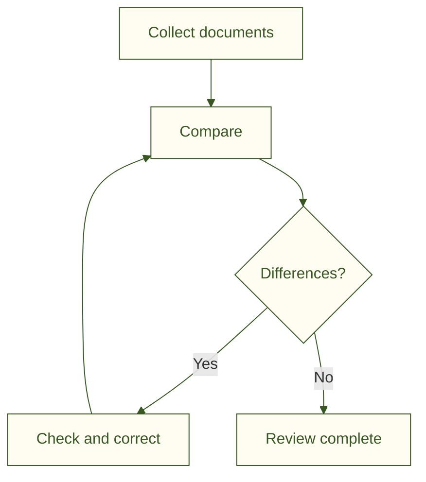

<!--
File: promotion/samples/quickstart-workflow.en.md
Description: mdEditor promotion material
Author: 5garashi.com Design Office
Created: 2026-10-12
Version: 1.5.0
License: MIT
Last updated: 2026-10-17
SPDX-License-Identifier: MIT
-->
# Document review procedure

Purpose: compare model numbers, ratings and revisions.

1. Collect the documents.
2. Compare model numbers, ratings and revisions.
3. Record differences and ask the owner to check them.
4. Review the corrected documents.

| Item | What to check |
| --- | --- |
| Model number | Same across documents? |
| Rating | Matching numbers and units? |
| Revision | The intended revision? |

- [x] Documents collected
- [ ] Differences checked
- [ ] Corrections reviewed

## Try it

Open a copy in mdEditor and change one `[ ]` above to `[x]`. A checked box appears in the preview. Select “Save”, then “Save As” and choose PDF. Open the PDF and check that it includes the diagram, table and checkmarks.
