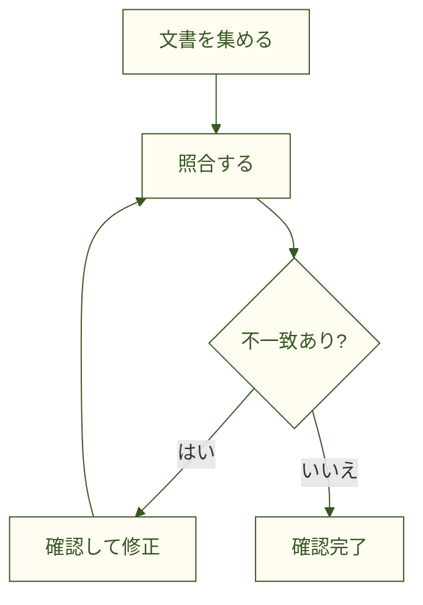

<!--
ファイル名 / File: promotion/samples/quickstart-workflow.md
概要 / Description: mdEditor紹介資料 / mdEditor promotion material
作成者 / Author: 5garashi.com設計事務所 / 5garashi.com Design Office
作成日 / Created: 2026-10-12
版 / Version: 1.1.0
ライセンス / License: MIT
最終更新 / Last updated: 2026-10-13
SPDX-License-Identifier: MIT
-->
# 文書レビューの手順

目的: 文書間の型式・定格・版番号を照合する。

1. 対象文書を集める。
2. 型式・定格・版番号を照合する。
3. 不一致を記録し、担当者に確認する。
4. 修正版を確認する。

| 項目 | 確認内容 |
| --- | --- |
| 型式 | 文書間で同じか |
| 定格 | 数値と単位が一致するか |
| 版番号 | 対象の版か |

- [x] 対象文書を準備した
- [ ] 不一致を確認した
- [ ] 修正版を確認した

## 試してみる

この文書のコピーをmdEditorで開き、上の `[ ]` を `[x]` に変えてみてください。プレビューでチェックが付きます。「保存」で文書を保存し、「PDFに保存」で書き出します。PDFにも図・表・チェック結果が含まれることを確認してください。
