<!--
  ファイル名 / File: samples/diagram-test.md
  概要 / Description: Test document for diagram, chart, and math rendering (Japanese)
  作成者 / Author: 5garashi.com設計事務所 / 5garashi.com Design Office
  作成日 / Created: 2026-10-10
  ライセンス / License: MIT
  SPDX-License-Identifier: MIT
-->
# 図・チャート表示テスト

mdEditor のプレビューで、各種ダイアグラムやチャートが正しく表示されるかを確認するためのテスト文書です。
各セクションの「期待される表示」と実際のプレビューを見比べてください。

---

## 1. フローチャート（Mermaid flowchart）

期待される表示：上から下へ流れる分岐付きのフローチャート。ひし形の判定ノードと、色付きのノードがある。

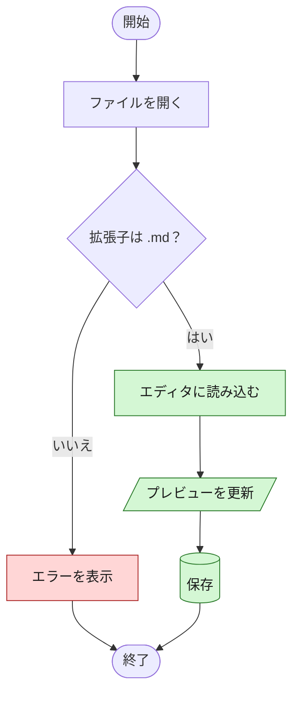

### 1-2. 左から右・サブグラフ

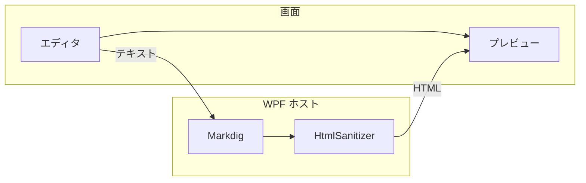

---

## 2. シーケンス図（Mermaid sequenceDiagram）

期待される表示：4 人の参加者、同期/非同期の矢印、ループ・分岐の枠、注記。

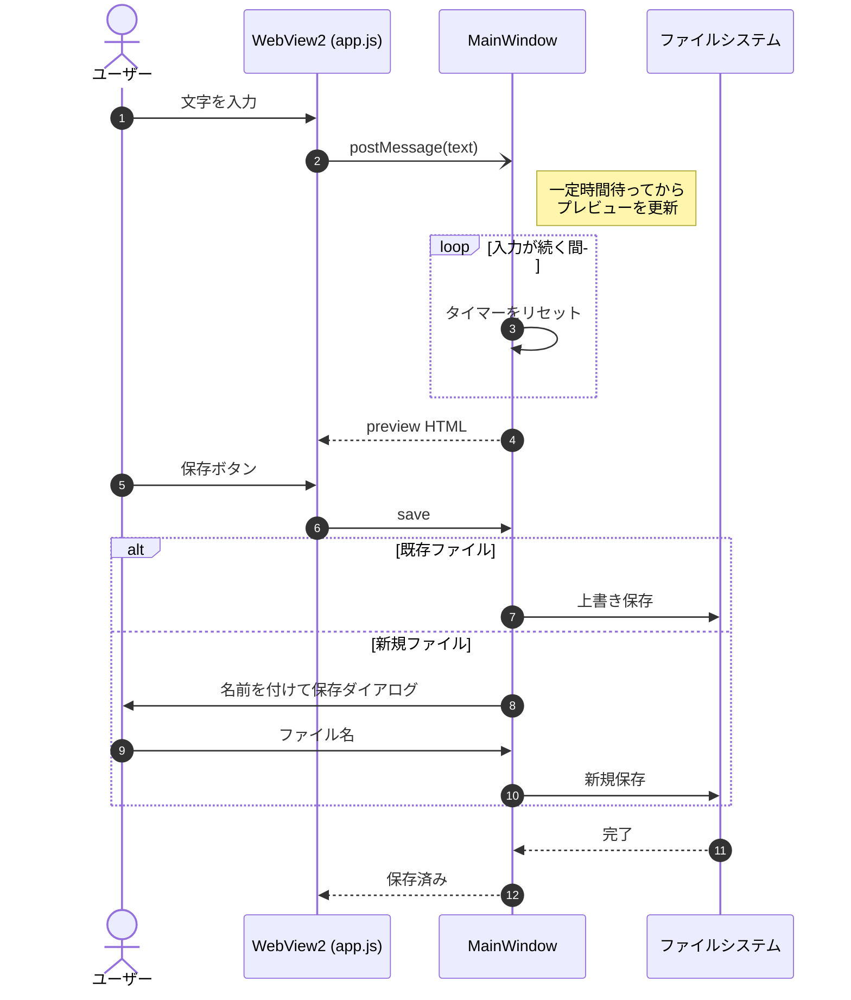

---

## 3. クラス図（Mermaid classDiagram）

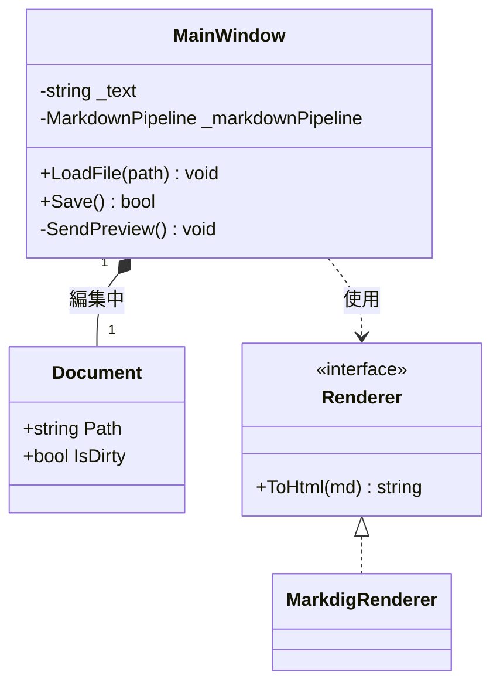

---

## 4. 状態遷移図（Mermaid stateDiagram）

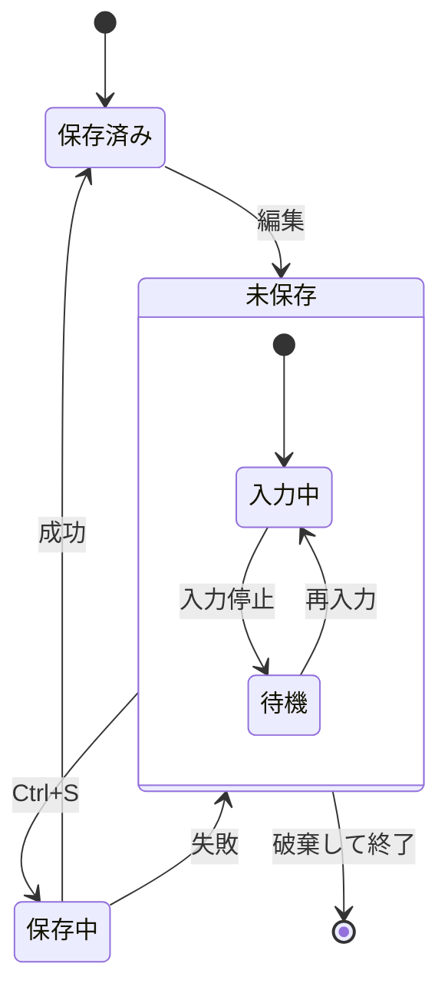

---

## 5. ER 図（Mermaid erDiagram）

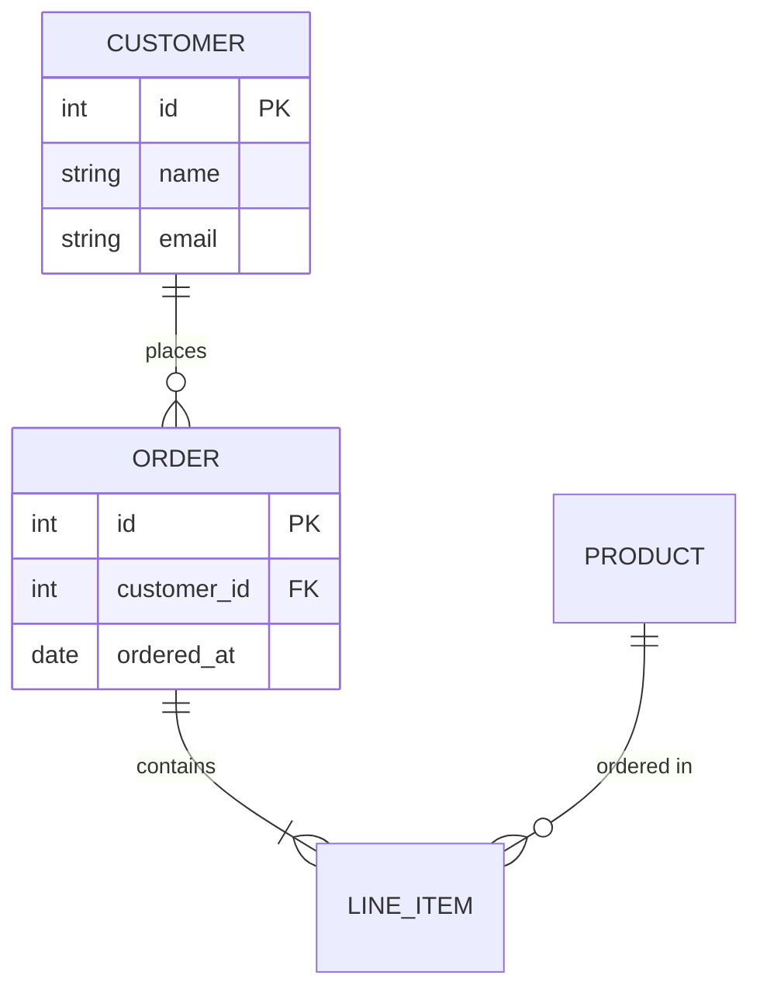

---

## 6. ガントチャート（Mermaid gantt）

期待される表示：横軸が日付、セクションごとに色分けされたバー。完了・進行中・重要タスクの表現。

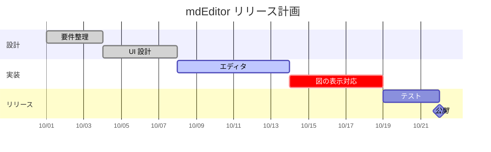

---

## 7. 円グラフ（Mermaid pie）

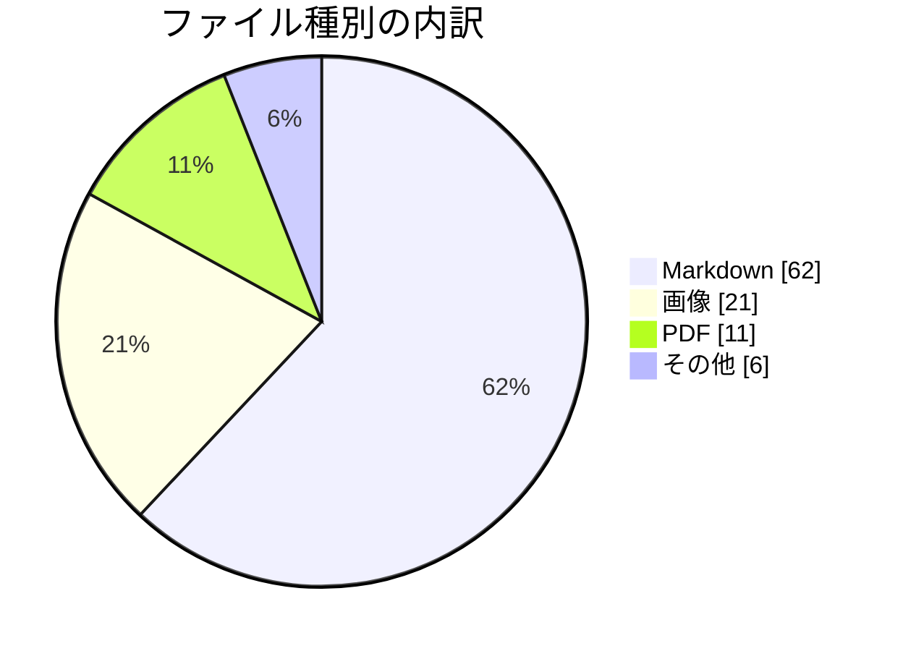

---

## 8. 棒グラフ・折れ線グラフ（Mermaid xychart-beta）

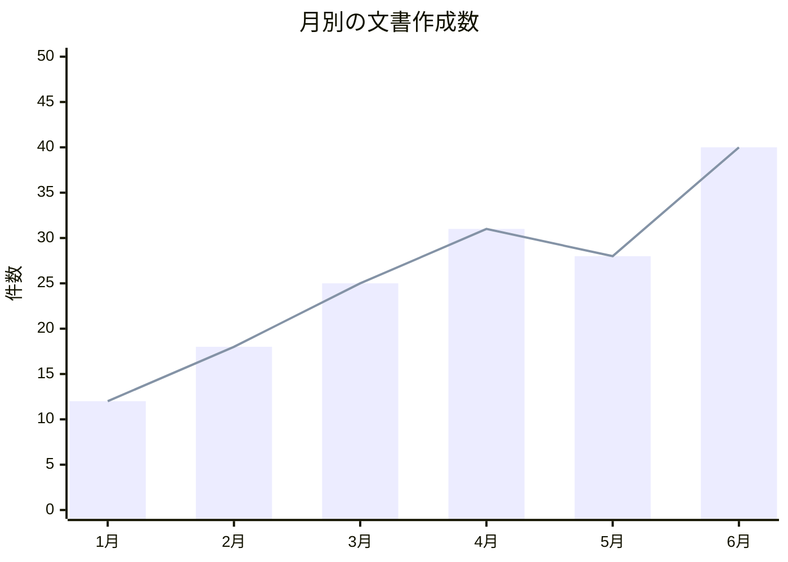

---

## 9. 4 象限チャート（Mermaid quadrantChart）

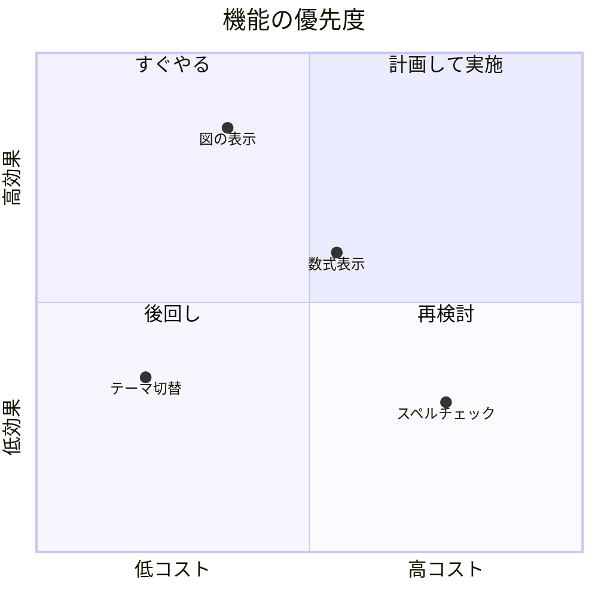

---

## 10. ユーザージャーニー（Mermaid journey）

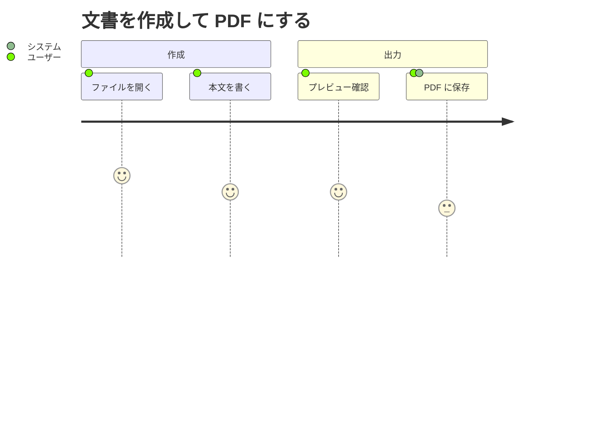

---

## 11. Git グラフ（Mermaid gitGraph）

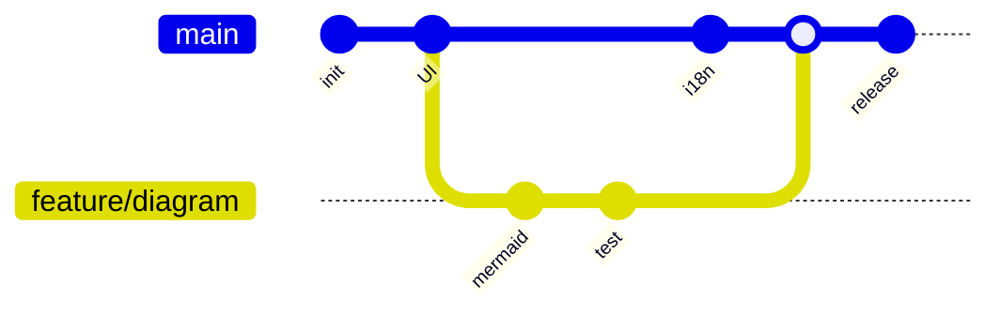

---

## 12. マインドマップ（Mermaid mindmap）

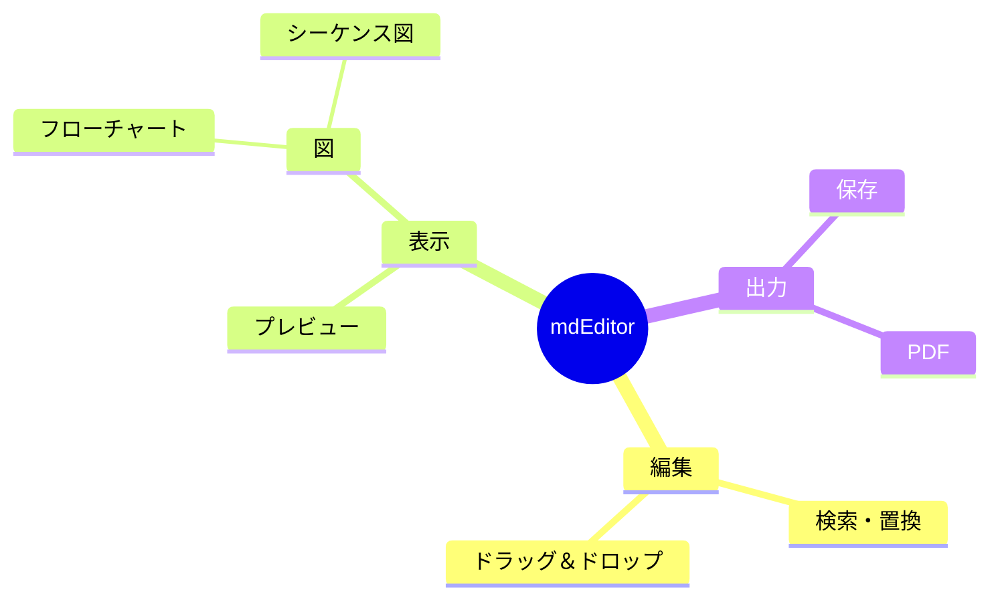

---

## 13. タイムライン（Mermaid timeline）

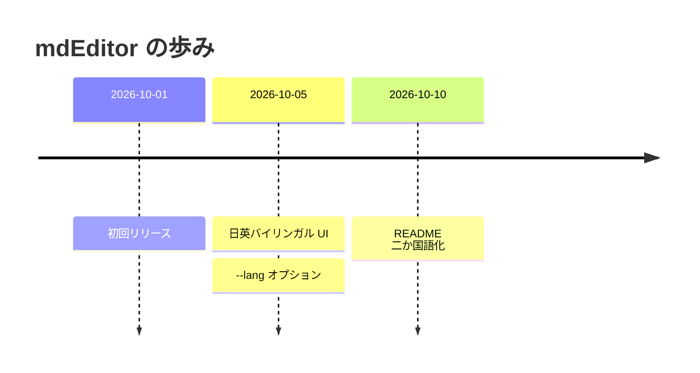

---

## 14. サンキーダイアグラム（Mermaid sankey-beta）

Mermaid のサンキーは日本語などの非 ASCII 文字の名前に対応していないため、英数字の名前を使います。

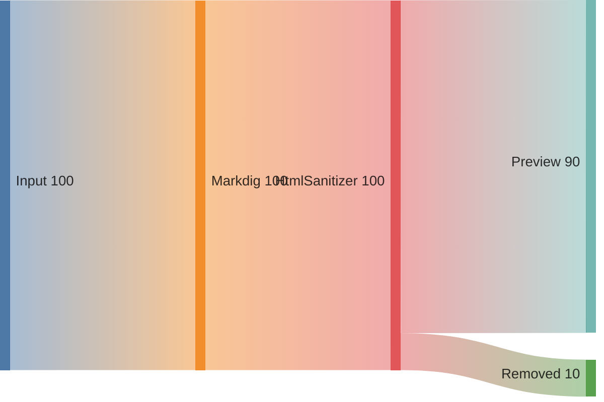

---

## 15. Mermaid の構文エラー（エラー表示の確認）

期待される表示：アプリが固まらず、エラーメッセージまたは元のコードが表示される。他の図の表示に影響しない。

```mermaid
flowchart TD
    A --> B --
    これは壊れた構文です {{{
```

---

## 16. その他の図の記法（対応していれば表示）

### 16-1. Graphviz（dot）

期待される表示：上の「開く」から、mdEditor の中の流れ（編集画面 → 変換 → 安全化 → プレビュー）を通って、「名前を付けて保存」へ進む色付きの図。表の形の箱、角の丸い箱、点線の双方向の矢印がある。

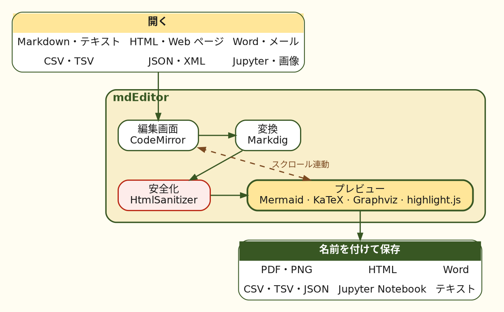

### 16-2. PlantUML

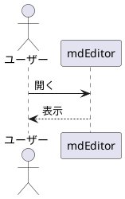

### 16-3. nomnoml

```nomnoml
[Editor]->[Preview]
[Preview]->[PDF]
```

---

## 17. 数式（KaTeX / MathJax）

インライン数式： $E = mc^2$ 、 $\sum_{i=1}^{n} i = \frac{n(n+1)}{2}$

ブロック数式：

$$
\int_{-\infty}^{\infty} e^{-x^2}\,dx = \sqrt{\pi}
$$

$$
\begin{pmatrix} a & b \\ c & d \end{pmatrix}
\begin{pmatrix} x \\ y \end{pmatrix}
=
\begin{pmatrix} ax + by \\ cx + dy \end{pmatrix}
$$

---

## 18. 比較用：図ではないもの（崩れないことの確認）

### 18-1. 普通のコードブロック

```javascript
// mermaid と書かれていても、言語が違えば図にしない
const text = "flowchart TD; A --> B";
console.log(text);
```

### 18-2. 言語指定なしのコードブロック

```
graph TD
    A --> B
```

### 18-3. テキストの図（等幅で揃っていること）

```text
+--------+      +---------+      +----------+
| Editor | ---> | Markdig | ---> | Preview  |
+--------+      +---------+      +----------+
```

### 18-4. 表

| 図の種類 | 記法 | 確認結果 |
|:---|:---:|---:|
| フローチャート | `flowchart` | ☐ |
| シーケンス図 | `sequenceDiagram` | ☐ |
| クラス図 | `classDiagram` | ☐ |
| 状態遷移図 | `stateDiagram-v2` | ☐ |
| ER 図 | `erDiagram` | ☐ |
| ガント | `gantt` | ☐ |
| 円グラフ | `pie` | ☐ |
| 数式 | `$...$` | ☐ |

---

## 19. コードの色分け（highlight.js）

期待される表示：言語名を書いたコードブロックは、キーワード（赤）・文字列（紺）・数値（青）・関数名（紫）・属性（茶）・タグ（緑）・コメント（灰色の斜体）に色分けされる。夜の配色では明るい色になる。言語名のないブロックは色が付かない。PDF・PNG・HTML・Word に保存しても色が残る。

### 19-1. Python

```python
from pathlib import Path

def count_headings(path: Path) -> int:
    """見出しの数を数える"""
    lines = path.read_text(encoding="utf-8").splitlines()
    return sum(1 for line in lines if line.startswith("#"))  # コメント

print(count_headings(Path("README.md")), 3.14, True, None)
```

### 19-2. JavaScript / TypeScript

```javascript
const formats = ["pdf", "png", "html", "docx"];
export async function save(name, format = "pdf") {
  if (!formats.includes(format)) throw new Error(`unknown: ${format}`);
  return { name, format, size: 1024 * 2 };
}
```

```ts
interface Heading { level: number; text: string }
const toc = (items: Heading[]): string[] =>
  items.map((h) => "  ".repeat(h.level - 2) + "- " + h.text);
```

### 19-3. C#

```csharp
public sealed record Document(string Path, int Version);

public static class Saver
{
    // 保存に失敗しても元のファイルは残る
    public static async Task SaveAsync(Document doc, string text)
    {
        await File.WriteAllTextAsync(doc.Path + ".tmp", text);
        File.Move(doc.Path + ".tmp", doc.Path, overwrite: true);
    }
}
```

### 19-4. PowerShell・シェル

```powershell
Get-ChildItem -Path $env:USERPROFILE\Documents -Filter *.md |
    Where-Object { $_.Length -gt 1KB } |
    ForEach-Object { Write-Host "$($_.Name): $($_.Length) bytes" }
```

```bash
for file in docs/*.md; do
  echo "checking $file" && grep -c "^#" "$file"
done
```

### 19-5. SQL・JSON・YAML

```sql
SELECT name, COUNT(*) AS pages
FROM documents
WHERE saved_at >= '2026-10-01' AND format IN ('pdf', 'docx')
GROUP BY name
ORDER BY pages DESC;
```

```json
{
  "app": "mdEditor",
  "version": "1.0.11",
  "formats": ["pdf", "html"],
  "offline": true,
  "zoom": 0.9
}
```

```yaml
app: mdEditor
theme: auto   # auto, light, dark
paper: A4
backup:
  enabled: true
  interval: 15
```

### 19-6. HTML・CSS

```html
<!-- コメント -->
<button id="save" class="primary"
        aria-keyshortcuts="Control+S">保存</button>
```

```css
.preview-content pre {
  padding: 12px;
  border: 1px solid #1A1A1A;
  border-radius: 6px;
}
```

### 19-7. diff

```diff
- PDFに保存ボタン
+ 名前を付けて保存で PDF を選ぶ
  変わらない行
```

### 19-8. 短い言語名と、言語名なし

`py`・`js`・`cs`・`sh`・`ps1` のような短い書き方でも色が付く。最後のブロックは言語名がないので色が付かない。

```py
print("short name")
```

```ps1
Write-Output "short name"
```

```
no language: def print const SELECT
```

---

## 確認チェックリスト

- [ ] すべての Mermaid 図がコードではなく図として表示される
- [ ] 日本語のラベルが文字化け・はみ出しせずに表示される
- [ ] 構文エラーの図があっても他の図は表示される
- [ ] 編集中に図が再描画され、ちらつきやスクロール位置の飛びがない
- [ ] 幅の狭いプレビューでも図が横にはみ出さない（またはスクロールできる）
- [ ] 「PDFに保存」で図が PDF に含まれる
- [ ] オフライン環境でも図が表示される
- [ ] Graphviz の図（16-1）が色付きの図として表示される
- [ ] 言語名を書いたコードブロック（19）が色分けされ、言語名のないものは色が付かない
- [ ] 「名前を付けて保存」で PDF・PNG・HTML・Word にしても、図とコードの色が残る

---

**作成者**: 5garashi.com設計事務所\
**ライセンス**: [MIT License](../LICENSE)
