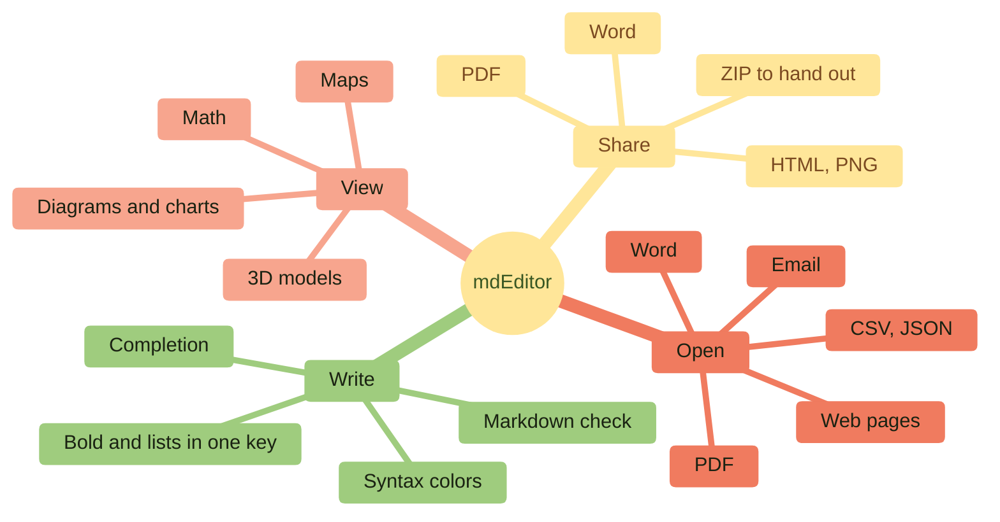
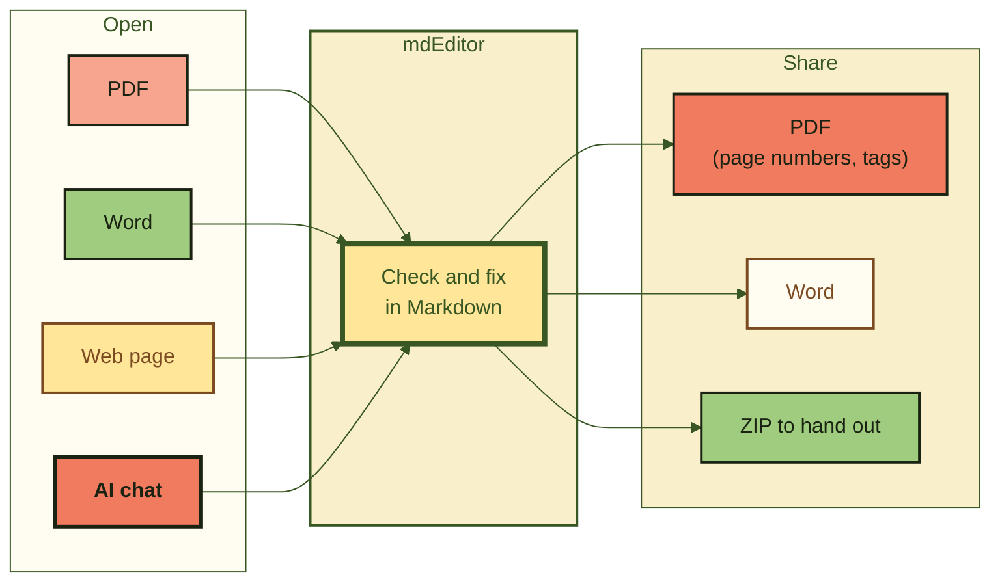
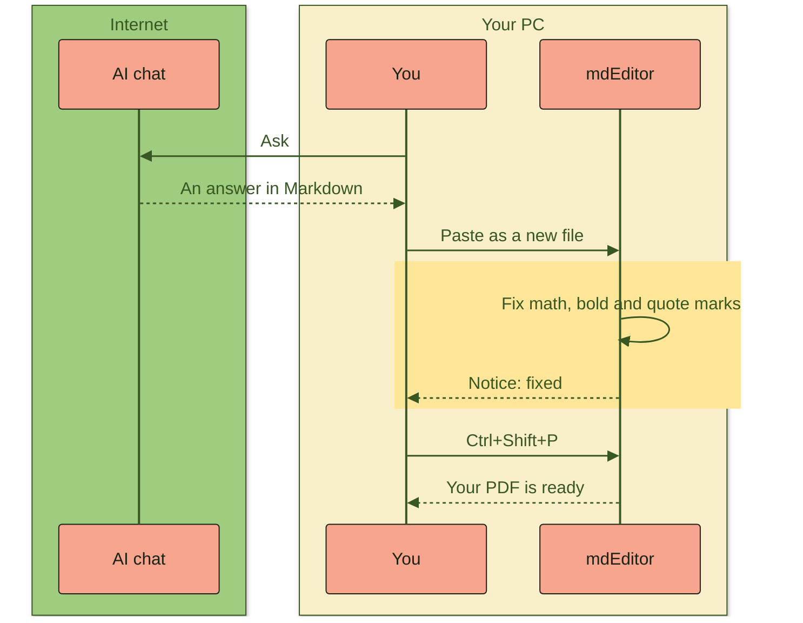
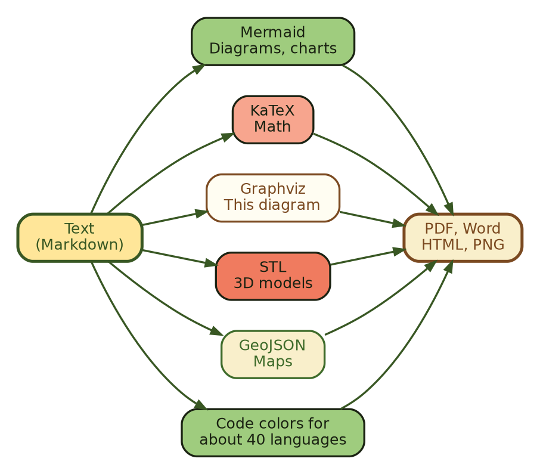
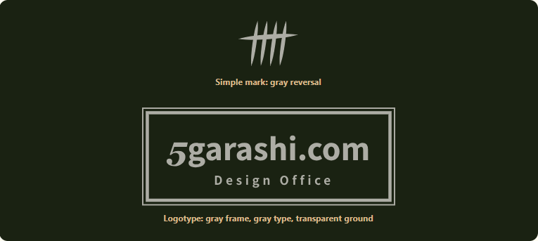

<!--
  ファイル名 / File: samples/key-features.en.md
  概要 / Description: mdEditor key features, shown with its own diagrams, math, 3D model, images, and map (English)
  作成者 / Author: 5garashi.com設計事務所 / 5garashi.com Design Office
  作成日 / Created: 2026-11-01
  ライセンス / License: MIT
  SPDX-License-Identifier: MIT
-->

<p align="center"><picture><source media="(prefers-color-scheme: dark)" srcset="import-test_files/5garashi_logotype_en_reversed_outlined.svg"></picture></p>

<p align="center"><b>Markdown editor & viewer for Windows</b></p>

<h1 align="center">mdEditor</h1>

<p align="center">
PDFs, Word files, answers from AI chats.<br>
Open them as Markdown, fix them, and get a PDF. <b>All on your PC.</b>
</p>

<p align="center">
Open with <kbd>Ctrl</kbd>+<kbd>O</kbd>, make a PDF with <kbd>Ctrl</kbd>+<kbd>Shift</kbd>+<kbd>P</kbd>. That's it.
</p>

> [!TIP]
> This document is itself a demo of mdEditor. Compare the editor on the left with the preview on the right. The diagrams, the math and the 3D model are all drawn from text.

> [!NOTE]
> This document assumes it is shown in mdEditor. On GitHub, the Graphviz (` ```dot `) diagram stays as code, and `\(…\)` math does not show as math. Check the rendering in mdEditor (Identity 8-9 (8)).

<!-- toc -->
- [1. What mdEditor does](#1-what-mdeditor-does)
- [2. PDF and Word, into Markdown](#2-pdf-and-word-into-markdown)
- [3. Answers from AI chats, reproduced as closely as possible](#3-answers-from-ai-chats-reproduced-as-closely-as-possible)
- [4. Math with KaTeX](#4-math-with-katex)
- [5. Diagrams with Graphviz, too](#5-diagrams-with-graphviz-too)
- [6. 3D models turn as you drag](#6-3d-models-turn-as-you-drag)
- [7. Images at any size and position](#7-images-at-any-size-and-position)
- [8. Maps, too](#8-maps-too)
- [9. Code in color](#9-code-in-color)
- [10. The story so far](#10-the-story-so-far)
- [11. Faster with keys](#11-faster-with-keys)
- [12. First steps](#12-first-steps)
<!-- /toc -->

---

## 1. What mdEditor does



| | With mdEditor | |
| :--- | :--- | :---: |
| **Open** | PDF, Word, web pages, email, CSV, JSON, XML and Jupyter notebooks, as Markdown | <kbd>Ctrl</kbd>+<kbd>O</kbd> |
| **Write** | Colors as you type, and wavy lines under mistakes | <kbd>F1</kbd> |
| **View** | Diagrams, math, 3D models and maps, shown at once in the preview beside the editor | <kbd>Ctrl</kbd>+<kbd>Shift</kbd>+<kbd>2</kbd> |
| **Share** | A PDF that looks just like the preview, in one click | <kbd>Ctrl</kbd>+<kbd>Shift</kbd>+<kbd>P</kbd> |

---

## 2. PDF and Word, into Markdown



> [!NOTE]
> Importing keeps what it can, within these limits. Multi-column layouts, tables without rules and scanned PDFs do not come back as they were. Diagrams and math become images.

---

## 3. Answers from AI chats, reproduced as closely as possible

Markdown copied from an AI chat has its quirks. mdEditor finds them when you open the file and fixes them. What it fixed shows in the notice, and one button puts it back.



For example, math in `\(…\)`, which AI chats often write, shows as math. Like the speed of light, \(c \approx 3.0 \times 10^8\ \text{m/s}\).

\[
E = mc^2 \qquad \text{and} \qquad e^{i\pi} + 1 = 0
\]

---

## 4. Math with KaTeX

$$
\int_{-\infty}^{\infty} e^{-x^2}\,dx = \sqrt{\pi}
\qquad
\sum_{k=1}^{n} k = \frac{n(n+1)}{2}
$$

$$
\begin{pmatrix} \cos\theta & -\sin\theta \\ \sin\theta & \cos\theta \end{pmatrix}
\begin{pmatrix} x \\ y \end{pmatrix}
=
\begin{pmatrix} x\cos\theta - y\sin\theta \\ x\sin\theta + y\cos\theta \end{pmatrix}
$$

Math also goes inside a sentence, like $\nabla \cdot \mathbf{E} = \rho / \varepsilon_0$.

---

## 5. Diagrams with Graphviz, too



---

## 6. 3D models turn as you drag

Write an STL in text form and it becomes a 3D model. Grab it with the mouse and turn it. It shows without an internet connection.

Write a part's color after its name, as in `solid star #3E6B2A`, and the background color in a `solid background #F9EFCB` line.

```stl
solid base #F07B5F
facet normal 0 0 1 outer loop vertex 0 0 0 vertex 18.48 7.65 0 vertex 7.65 18.48 0 endloop endfacet
facet normal 0 0 -1 outer loop vertex 0 0 -4 vertex 7.65 18.48 -4 vertex 18.48 7.65 -4 endloop endfacet
facet normal 0.7071 0.7071 0 outer loop vertex 18.48 7.65 -4 vertex 7.65 18.48 -4 vertex 7.65 18.48 0 endloop endfacet
facet normal 0.7071 0.7071 -0 outer loop vertex 18.48 7.65 -4 vertex 7.65 18.48 0 vertex 18.48 7.65 0 endloop endfacet
facet normal 0 -0 1 outer loop vertex 0 0 0 vertex 7.65 18.48 0 vertex -7.65 18.48 0 endloop endfacet
facet normal 0 0 -1 outer loop vertex 0 0 -4 vertex -7.65 18.48 -4 vertex 7.65 18.48 -4 endloop endfacet
facet normal 0 1 0 outer loop vertex 7.65 18.48 -4 vertex -7.65 18.48 -4 vertex -7.65 18.48 0 endloop endfacet
facet normal 0 1 -0 outer loop vertex 7.65 18.48 -4 vertex -7.65 18.48 0 vertex 7.65 18.48 0 endloop endfacet
facet normal 0 0 1 outer loop vertex 0 0 0 vertex -7.65 18.48 0 vertex -18.48 7.65 0 endloop endfacet
facet normal 0 0 -1 outer loop vertex 0 0 -4 vertex -18.48 7.65 -4 vertex -7.65 18.48 -4 endloop endfacet
facet normal -0.7071 0.7071 0 outer loop vertex -7.65 18.48 -4 vertex -18.48 7.65 -4 vertex -18.48 7.65 0 endloop endfacet
facet normal -0.7071 0.7071 0 outer loop vertex -7.65 18.48 -4 vertex -18.48 7.65 0 vertex -7.65 18.48 0 endloop endfacet
facet normal 0 0 1 outer loop vertex 0 0 0 vertex -18.48 7.65 0 vertex -18.48 -7.65 0 endloop endfacet
facet normal -0 0 -1 outer loop vertex 0 0 -4 vertex -18.48 -7.65 -4 vertex -18.48 7.65 -4 endloop endfacet
facet normal -1 0 0 outer loop vertex -18.48 7.65 -4 vertex -18.48 -7.65 -4 vertex -18.48 -7.65 0 endloop endfacet
facet normal -1 0 0 outer loop vertex -18.48 7.65 -4 vertex -18.48 -7.65 0 vertex -18.48 7.65 0 endloop endfacet
facet normal 0 0 1 outer loop vertex 0 0 0 vertex -18.48 -7.65 0 vertex -7.65 -18.48 0 endloop endfacet
facet normal 0 0 -1 outer loop vertex 0 0 -4 vertex -7.65 -18.48 -4 vertex -18.48 -7.65 -4 endloop endfacet
facet normal -0.7071 -0.7071 0 outer loop vertex -18.48 -7.65 -4 vertex -7.65 -18.48 -4 vertex -7.65 -18.48 0 endloop endfacet
facet normal -0.7071 -0.7071 0 outer loop vertex -18.48 -7.65 -4 vertex -7.65 -18.48 0 vertex -18.48 -7.65 0 endloop endfacet
facet normal 0 0 1 outer loop vertex 0 0 0 vertex -7.65 -18.48 0 vertex 7.65 -18.48 0 endloop endfacet
facet normal 0 -0 -1 outer loop vertex 0 0 -4 vertex 7.65 -18.48 -4 vertex -7.65 -18.48 -4 endloop endfacet
facet normal 0 -1 0 outer loop vertex -7.65 -18.48 -4 vertex 7.65 -18.48 -4 vertex 7.65 -18.48 0 endloop endfacet
facet normal 0 -1 0 outer loop vertex -7.65 -18.48 -4 vertex 7.65 -18.48 0 vertex -7.65 -18.48 0 endloop endfacet
facet normal 0 0 1 outer loop vertex 0 0 0 vertex 7.65 -18.48 0 vertex 18.48 -7.65 0 endloop endfacet
facet normal 0 0 -1 outer loop vertex 0 0 -4 vertex 18.48 -7.65 -4 vertex 7.65 -18.48 -4 endloop endfacet
facet normal 0.7071 -0.7071 0 outer loop vertex 7.65 -18.48 -4 vertex 18.48 -7.65 -4 vertex 18.48 -7.65 0 endloop endfacet
facet normal 0.7071 -0.7071 0 outer loop vertex 7.65 -18.48 -4 vertex 18.48 -7.65 0 vertex 7.65 -18.48 0 endloop endfacet
facet normal -0 0 1 outer loop vertex 0 0 0 vertex 18.48 -7.65 0 vertex 18.48 7.65 0 endloop endfacet
facet normal 0 0 -1 outer loop vertex 0 0 -4 vertex 18.48 7.65 -4 vertex 18.48 -7.65 -4 endloop endfacet
facet normal 1 0 0 outer loop vertex 18.48 -7.65 -4 vertex 18.48 7.65 -4 vertex 18.48 7.65 0 endloop endfacet
facet normal 1 0 0 outer loop vertex 18.48 -7.65 -4 vertex 18.48 7.65 0 vertex 18.48 -7.65 0 endloop endfacet
endsolid base
solid star #3E6B2A
facet normal 0 -0 1 outer loop vertex 0 0 7 vertex 0 16 7 vertex -3.82 5.26 7 endloop endfacet
facet normal 0 0 -1 outer loop vertex 0 0 0 vertex -3.82 5.26 0 vertex 0 16 0 endloop endfacet
facet normal -0.9422 0.3351 0 outer loop vertex 0 16 0 vertex -3.82 5.26 0 vertex -3.82 5.26 7 endloop endfacet
facet normal -0.9422 0.3351 0 outer loop vertex 0 16 0 vertex -3.82 5.26 7 vertex 0 16 7 endloop endfacet
facet normal 0 0 1 outer loop vertex 0 0 7 vertex -3.82 5.26 7 vertex -15.22 4.94 7 endloop endfacet
facet normal 0 0 -1 outer loop vertex 0 0 0 vertex -15.22 4.94 0 vertex -3.82 5.26 0 endloop endfacet
facet normal -0.0281 0.9996 0 outer loop vertex -3.82 5.26 0 vertex -15.22 4.94 0 vertex -15.22 4.94 7 endloop endfacet
facet normal -0.0281 0.9996 0 outer loop vertex -3.82 5.26 0 vertex -15.22 4.94 7 vertex -3.82 5.26 7 endloop endfacet
facet normal 0 0 1 outer loop vertex 0 0 7 vertex -15.22 4.94 7 vertex -6.18 -2.01 7 endloop endfacet
facet normal -0 0 -1 outer loop vertex 0 0 0 vertex -6.18 -2.01 0 vertex -15.22 4.94 0 endloop endfacet
facet normal -0.6095 -0.7928 0 outer loop vertex -15.22 4.94 0 vertex -6.18 -2.01 0 vertex -6.18 -2.01 7 endloop endfacet
facet normal -0.6095 -0.7928 0 outer loop vertex -15.22 4.94 0 vertex -6.18 -2.01 7 vertex -15.22 4.94 7 endloop endfacet
facet normal 0 0 1 outer loop vertex 0 0 7 vertex -6.18 -2.01 7 vertex -9.4 -12.94 7 endloop endfacet
facet normal 0 0 -1 outer loop vertex 0 0 0 vertex -9.4 -12.94 0 vertex -6.18 -2.01 0 endloop endfacet
facet normal -0.9592 0.2826 0 outer loop vertex -6.18 -2.01 0 vertex -9.4 -12.94 0 vertex -9.4 -12.94 7 endloop endfacet
facet normal -0.9592 0.2826 0 outer loop vertex -6.18 -2.01 0 vertex -9.4 -12.94 7 vertex -6.18 -2.01 7 endloop endfacet
facet normal 0 0 1 outer loop vertex 0 0 7 vertex -9.4 -12.94 7 vertex -0 -6.5 7 endloop endfacet
facet normal 0 0 -1 outer loop vertex 0 0 0 vertex -0 -6.5 0 vertex -9.4 -12.94 0 endloop endfacet
facet normal 0.5652 -0.825 0 outer loop vertex -9.4 -12.94 0 vertex -0 -6.5 0 vertex -0 -6.5 7 endloop endfacet
facet normal 0.5652 -0.825 0 outer loop vertex -9.4 -12.94 0 vertex -0 -6.5 7 vertex -9.4 -12.94 7 endloop endfacet
facet normal 0 0 1 outer loop vertex 0 0 7 vertex -0 -6.5 7 vertex 9.4 -12.94 7 endloop endfacet
facet normal 0 -0 -1 outer loop vertex 0 0 0 vertex 9.4 -12.94 0 vertex -0 -6.5 0 endloop endfacet
facet normal -0.5652 -0.825 0 outer loop vertex -0 -6.5 0 vertex 9.4 -12.94 0 vertex 9.4 -12.94 7 endloop endfacet
facet normal -0.5652 -0.825 0 outer loop vertex -0 -6.5 0 vertex 9.4 -12.94 7 vertex -0 -6.5 7 endloop endfacet
facet normal 0 0 1 outer loop vertex 0 0 7 vertex 9.4 -12.94 7 vertex 6.18 -2.01 7 endloop endfacet
facet normal 0 0 -1 outer loop vertex 0 0 0 vertex 6.18 -2.01 0 vertex 9.4 -12.94 0 endloop endfacet
facet normal 0.9592 0.2826 0 outer loop vertex 9.4 -12.94 0 vertex 6.18 -2.01 0 vertex 6.18 -2.01 7 endloop endfacet
facet normal 0.9592 0.2826 -0 outer loop vertex 9.4 -12.94 0 vertex 6.18 -2.01 7 vertex 9.4 -12.94 7 endloop endfacet
facet normal -0 0 1 outer loop vertex 0 0 7 vertex 6.18 -2.01 7 vertex 15.22 4.94 7 endloop endfacet
facet normal 0 0 -1 outer loop vertex 0 0 0 vertex 15.22 4.94 0 vertex 6.18 -2.01 0 endloop endfacet
facet normal 0.6095 -0.7928 0 outer loop vertex 6.18 -2.01 0 vertex 15.22 4.94 0 vertex 15.22 4.94 7 endloop endfacet
facet normal 0.6095 -0.7928 0 outer loop vertex 6.18 -2.01 0 vertex 15.22 4.94 7 vertex 6.18 -2.01 7 endloop endfacet
facet normal 0 0 1 outer loop vertex 0 0 7 vertex 15.22 4.94 7 vertex 3.82 5.26 7 endloop endfacet
facet normal 0 0 -1 outer loop vertex 0 0 0 vertex 3.82 5.26 0 vertex 15.22 4.94 0 endloop endfacet
facet normal 0.0281 0.9996 0 outer loop vertex 15.22 4.94 0 vertex 3.82 5.26 0 vertex 3.82 5.26 7 endloop endfacet
facet normal 0.0281 0.9996 -0 outer loop vertex 15.22 4.94 0 vertex 3.82 5.26 7 vertex 15.22 4.94 7 endloop endfacet
facet normal 0 0 1 outer loop vertex 0 0 7 vertex 3.82 5.26 7 vertex 0 16 7 endloop endfacet
facet normal 0 0 -1 outer loop vertex 0 0 0 vertex 0 16 0 vertex 3.82 5.26 0 endloop endfacet
facet normal 0.9422 0.3351 0 outer loop vertex 3.82 5.26 0 vertex 0 16 0 vertex 0 16 7 endloop endfacet
facet normal 0.9422 0.3351 -0 outer loop vertex 3.82 5.26 0 vertex 0 16 7 vertex 3.82 5.26 7 endloop endfacet
endsolid star
solid background #F9EFCB
endsolid background
```

---

## 7. Images at any size and position

Size an image as a share of the text width or in pixels, center it or move it right, or let the text wrap around it (written the same way as on GitHub). Press <kbd>Ctrl</kbd>+<kbd>Shift</kbd>+<kbd>F</kbd> (Adjust image) on the image's line, or right-click the image in the preview, and just pick.

<p align="center"></p>

<p align="center">&nbsp;&nbsp;&nbsp;&nbsp;&nbsp;&nbsp;&nbsp;&nbsp;</p>

<p align="right"><picture><source media="(prefers-color-scheme: dark)" srcset="import-test_files/5garashi_logotype_en_reversed_outlined.svg"></picture></p>

The symbol mark is a tally mark made of chili peppers. A fifth pepper runs across four upright ones: count 1, 2, 3, 4, and close the group with the fifth. It draws the name "5garashi" (go-garashi, five peppers) just as it sounds. An image with `align="left"` sits on the left, and this paragraph wraps around its right side.

<br clear="all">

<sub>The images are official assets of 5garashi.com Design Office (CC BY-ND 4.0), used unchanged. In dark mode, the logotype switches to its gray reversed version.</sub>

---

## 8. Maps, too

mdEditor comes in Japanese, English and Simplified Chinese.

```geojson
{
  "type": "FeatureCollection",
  "features": [
    { "type": "Feature", "properties": { "name": "日本語", "marker-color": "#B92613" }, "geometry": { "type": "Point", "coordinates": [139.767, 35.681] } },
    { "type": "Feature", "properties": { "name": "简体中文", "marker-color": "#385723" }, "geometry": { "type": "Point", "coordinates": [116.397, 39.909] } },
    { "type": "Feature", "properties": { "name": "English", "marker-color": "#7B4A21" }, "geometry": { "type": "Point", "coordinates": [-0.128, 51.507] } },
    { "type": "Feature", "properties": { "name": "English", "marker-color": "#7B4A21" }, "geometry": { "type": "Point", "coordinates": [-74.006, 40.713] } }
  ]
}
```

---

## 9. Code in color

```python
from pathlib import Path

def count_headings(path: str) -> int:
    """Count the headings in a Markdown file"""
    text = Path(path).read_text(encoding="utf-8")
    return sum(1 for line in text.splitlines() if line.startswith("#"))

print(count_headings("key-features.en.md"))
```

```diff
- A **“light-year”**is a unit of distance.
+ A <strong>“light-year”</strong>is a unit of distance.
```

---

## 10. The story so far


---

## 11. Faster with keys

<details>
<summary><b>Keys you will use often (click to open)</b></summary>

| Key | What it does |
| :--- | :--- |
| <kbd>Ctrl</kbd>+<kbd>B</kbd> / <kbd>Ctrl</kbd>+<kbd>I</kbd> | Bold / italic |
| <kbd>Enter</kbd> / <kbd>Tab</kbd> | Continue a list / indent |
| <kbd>Ctrl</kbd>+<kbd>Shift</kbd>+<kbd>W</kbd> | Tidy a table |
| <kbd>Ctrl</kbd>+<kbd>Shift</kbd>+<kbd>N</kbd> | Number the headings, or remove the numbers |
| <kbd>Ctrl</kbd>+<kbd>Shift</kbd>+<kbd>J</kbd> | Insert or update the table of contents |
| <kbd>Ctrl</kbd>+<kbd>Shift</kbd>+<kbd>P</kbd> | Save as PDF |
| <kbd>Ctrl</kbd>+<kbd>Shift</kbd>+<kbd>3</kbd> | Preview in its own window |
| <kbd>F1</kbd> | List of Markdown syntax |

</details>

---

## 12. First steps

- [x] Install mdEditor from the Microsoft Store
- [ ] Open a PDF you have
- [ ] Paste an answer from an AI chat
- [ ] Make a PDF with <kbd>Ctrl</kbd>+<kbd>Shift</kbd>+<kbd>P</kbd>

> [!IMPORTANT]
> Your documents are never sent anywhere. Converting to and from PDF and Word happens on your PC, too. No ads, no tracking, no account.

---

<p align="center"></p>

<p align="center">
<b>mdEditor by 5garashi.com</b><br>
<a href="https://apps.microsoft.com/detail/9NWW2QRCLMHC">Get it from Microsoft Store</a>
</p>

<p align="center"><sub>© 5garashi.com Design Office</sub></p>
