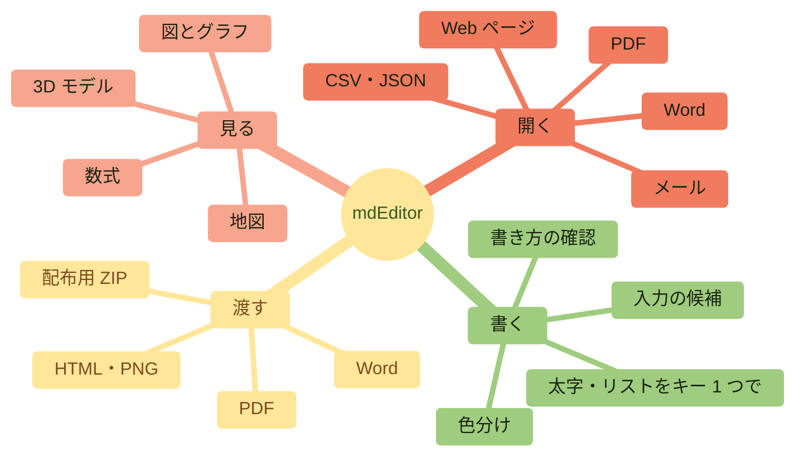
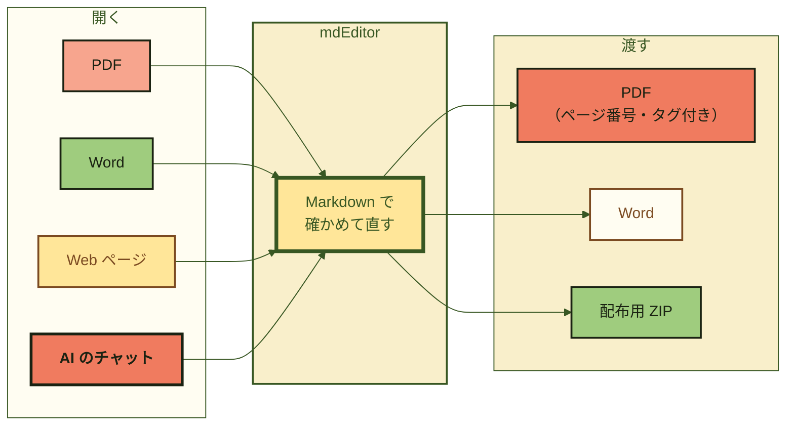
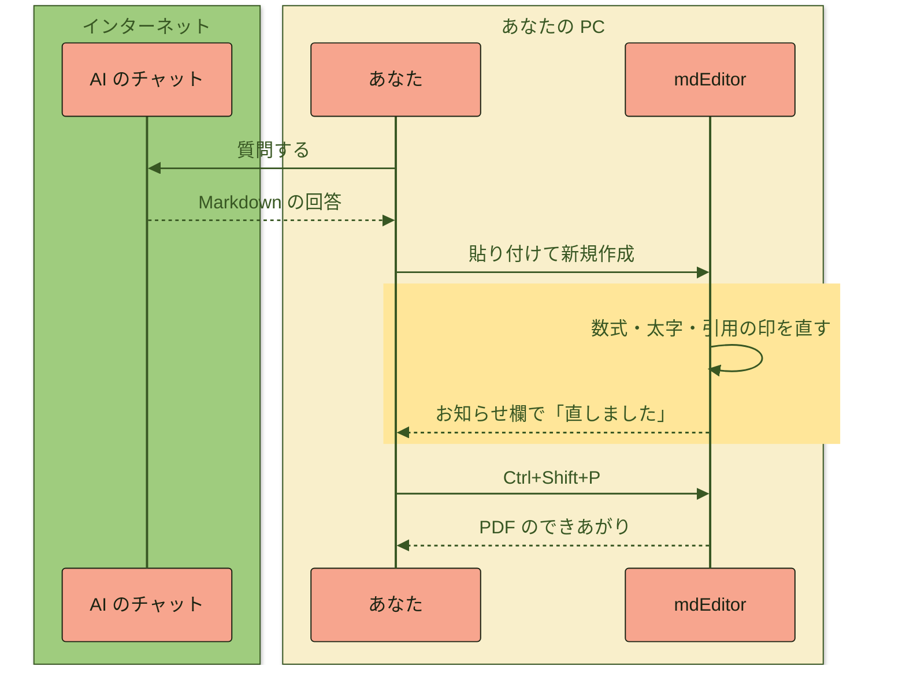
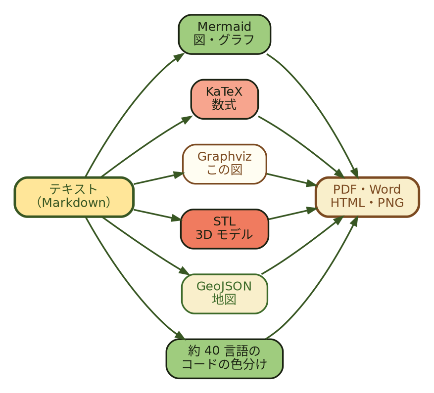
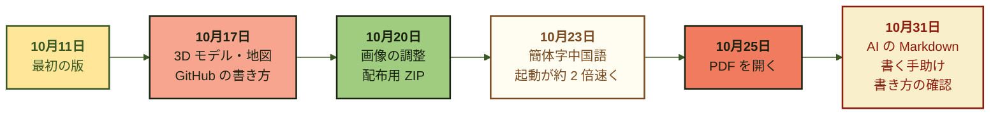

<!--
  ファイル名 / File: samples/key-features.md
  概要 / Description: mdEditor key features, shown with its own diagrams, math, 3D model, images, and map (Japanese)
  作成者 / Author: 5garashi.com設計事務所 / 5garashi.com Design Office
  作成日 / Created: 2026-11-01
  ライセンス / License: MIT
  SPDX-License-Identifier: MIT
-->

<p align="center"><picture><source media="(prefers-color-scheme: dark)" srcset="import-test_files/5garashi_logotype_reversed_outlined.svg"></picture></p>

<p align="center"><b>Markdown エディター & ビューアー for Windows</b></p>

<h1 align="center">mdEditor</h1>

<p align="center">
PDF も Word も、AI のチャットの回答も。<br>
開けば Markdown、直せば PDF。<b>ぜんぶ PC の中で。</b>
</p>

<p align="center">
<kbd>Ctrl</kbd>+<kbd>O</kbd> で開いて、<kbd>Ctrl</kbd>+<kbd>Shift</kbd>+<kbd>P</kbd> で PDF。それだけ。
</p>

> [!TIP]
> この文書そのものが、mdEditor のデモです。左の編集欄と右のプレビューを見比べてください。図も数式も 3D モデルも、すべてテキストから描いています。

> [!NOTE]
> この文書は mdEditor での表示を前提にしています。GitHub で開くと、Graphviz（` ```dot `）の図はコードのまま表示され、`\(…\)` の数式は数式になりません。表示の確認は mdEditor で行ってください（Identity 8-9 (8)）。

<!-- toc -->
- [1. mdEditor でできること](#1-mdeditor-でできること)
- [2. PDF も Word も、Markdown に](#2-pdf-も-word-もmarkdown-に)
- [3. AI のチャットの回答も、できる範囲で再現](#3-ai-のチャットの回答もできる範囲で再現)
- [4. 数式は KaTeX で](#4-数式は-katex-で)
- [5. 図は Graphviz でも](#5-図は-graphviz-でも)
- [6. 3D モデルは、ドラッグで回せる](#6-3d-モデルはドラッグで回せる)
- [7. 画像も、大きさと位置を自在に](#7-画像も大きさと位置を自在に)
- [8. 地図も描ける](#8-地図も描ける)
- [9. コードは色分け](#9-コードは色分け)
- [10. ここまでの歩み](#10-ここまでの歩み)
- [11. キーを覚えると、もっと速い](#11-キーを覚えるともっと速い)
- [12. はじめの一歩](#12-はじめの一歩)
<!-- /toc -->

---

## 1. mdEditor でできること



| | mdEditor なら | |
| :--- | :--- | :---: |
| **開く** | PDF・Word・Web ページ・メール・CSV・JSON・XML・Jupyter Notebook を Markdown に | <kbd>Ctrl</kbd>+<kbd>O</kbd> |
| **書く** | 書くそばから色分けし、書き間違いに波線 | <kbd>F1</kbd> |
| **見る** | 図・数式・3D モデル・地図を、横のプレビューにすぐ表示 | <kbd>Ctrl</kbd>+<kbd>Shift</kbd>+<kbd>2</kbd> |
| **渡す** | プレビューと同じ見た目の PDF をワンクリックで | <kbd>Ctrl</kbd>+<kbd>Shift</kbd>+<kbd>P</kbd> |

---

## 2. PDF も Word も、Markdown に



> [!NOTE]
> 取り込みは、できる範囲で行います。段組みの配置、罫線のない表、スキャンした PDF は元どおりには戻りません。図と数式は画像になります。

---

## 3. AI のチャットの回答も、できる範囲で再現

AI のチャットからコピーした Markdown には、癖があります。mdEditor は、開いたときにそれを見つけて直します。直したことはお知らせ欄に出て、ボタン 1 つで元に戻せます。



たとえば、AI がよく書く `\(…\)` の数式も、そのまま数式になります。光の速さ \(c \approx 3.0 \times 10^8\ \text{m/s}\) のように。

\[
E = mc^2 \qquad \text{と} \qquad e^{i\pi} + 1 = 0
\]

---

## 4. 数式は KaTeX で

$$
\int_{-\infty}^{\infty} e^{-x^2}\,dx = \sqrt{\pi}
\qquad
\sum_{k=1}^{n} k = \frac{n(n+1)}{2}
$$

$$
\begin{pmatrix} \cos\theta & -\sin\theta \\ \sin\theta & \cos\theta \end{pmatrix}
\begin{pmatrix} x \\ y \end{pmatrix}
=
\begin{pmatrix} x\cos\theta - y\sin\theta \\ x\sin\theta + y\cos\theta \end{pmatrix}
$$

文の中にも $\nabla \cdot \mathbf{E} = \rho / \varepsilon_0$ のように書けます。

---

## 5. 図は Graphviz でも



---

## 6. 3D モデルは、ドラッグで回せる

テキスト形式の STL を書くだけで、3D モデルになります。マウスでつかんで回してください。インターネットにつながなくても表示します。

部品の色は `solid star #3E6B2A` のように名前の後ろに、背景の色は `solid background #F9EFCB` の行で書けます。

```stl
solid base #F07B5F
facet normal 0 0 1 outer loop vertex 0 0 0 vertex 18.48 7.65 0 vertex 7.65 18.48 0 endloop endfacet
facet normal 0 0 -1 outer loop vertex 0 0 -4 vertex 7.65 18.48 -4 vertex 18.48 7.65 -4 endloop endfacet
facet normal 0.7071 0.7071 0 outer loop vertex 18.48 7.65 -4 vertex 7.65 18.48 -4 vertex 7.65 18.48 0 endloop endfacet
facet normal 0.7071 0.7071 -0 outer loop vertex 18.48 7.65 -4 vertex 7.65 18.48 0 vertex 18.48 7.65 0 endloop endfacet
facet normal 0 -0 1 outer loop vertex 0 0 0 vertex 7.65 18.48 0 vertex -7.65 18.48 0 endloop endfacet
facet normal 0 0 -1 outer loop vertex 0 0 -4 vertex -7.65 18.48 -4 vertex 7.65 18.48 -4 endloop endfacet
facet normal 0 1 0 outer loop vertex 7.65 18.48 -4 vertex -7.65 18.48 -4 vertex -7.65 18.48 0 endloop endfacet
facet normal 0 1 -0 outer loop vertex 7.65 18.48 -4 vertex -7.65 18.48 0 vertex 7.65 18.48 0 endloop endfacet
facet normal 0 0 1 outer loop vertex 0 0 0 vertex -7.65 18.48 0 vertex -18.48 7.65 0 endloop endfacet
facet normal 0 0 -1 outer loop vertex 0 0 -4 vertex -18.48 7.65 -4 vertex -7.65 18.48 -4 endloop endfacet
facet normal -0.7071 0.7071 0 outer loop vertex -7.65 18.48 -4 vertex -18.48 7.65 -4 vertex -18.48 7.65 0 endloop endfacet
facet normal -0.7071 0.7071 0 outer loop vertex -7.65 18.48 -4 vertex -18.48 7.65 0 vertex -7.65 18.48 0 endloop endfacet
facet normal 0 0 1 outer loop vertex 0 0 0 vertex -18.48 7.65 0 vertex -18.48 -7.65 0 endloop endfacet
facet normal -0 0 -1 outer loop vertex 0 0 -4 vertex -18.48 -7.65 -4 vertex -18.48 7.65 -4 endloop endfacet
facet normal -1 0 0 outer loop vertex -18.48 7.65 -4 vertex -18.48 -7.65 -4 vertex -18.48 -7.65 0 endloop endfacet
facet normal -1 0 0 outer loop vertex -18.48 7.65 -4 vertex -18.48 -7.65 0 vertex -18.48 7.65 0 endloop endfacet
facet normal 0 0 1 outer loop vertex 0 0 0 vertex -18.48 -7.65 0 vertex -7.65 -18.48 0 endloop endfacet
facet normal 0 0 -1 outer loop vertex 0 0 -4 vertex -7.65 -18.48 -4 vertex -18.48 -7.65 -4 endloop endfacet
facet normal -0.7071 -0.7071 0 outer loop vertex -18.48 -7.65 -4 vertex -7.65 -18.48 -4 vertex -7.65 -18.48 0 endloop endfacet
facet normal -0.7071 -0.7071 0 outer loop vertex -18.48 -7.65 -4 vertex -7.65 -18.48 0 vertex -18.48 -7.65 0 endloop endfacet
facet normal 0 0 1 outer loop vertex 0 0 0 vertex -7.65 -18.48 0 vertex 7.65 -18.48 0 endloop endfacet
facet normal 0 -0 -1 outer loop vertex 0 0 -4 vertex 7.65 -18.48 -4 vertex -7.65 -18.48 -4 endloop endfacet
facet normal 0 -1 0 outer loop vertex -7.65 -18.48 -4 vertex 7.65 -18.48 -4 vertex 7.65 -18.48 0 endloop endfacet
facet normal 0 -1 0 outer loop vertex -7.65 -18.48 -4 vertex 7.65 -18.48 0 vertex -7.65 -18.48 0 endloop endfacet
facet normal 0 0 1 outer loop vertex 0 0 0 vertex 7.65 -18.48 0 vertex 18.48 -7.65 0 endloop endfacet
facet normal 0 0 -1 outer loop vertex 0 0 -4 vertex 18.48 -7.65 -4 vertex 7.65 -18.48 -4 endloop endfacet
facet normal 0.7071 -0.7071 0 outer loop vertex 7.65 -18.48 -4 vertex 18.48 -7.65 -4 vertex 18.48 -7.65 0 endloop endfacet
facet normal 0.7071 -0.7071 0 outer loop vertex 7.65 -18.48 -4 vertex 18.48 -7.65 0 vertex 7.65 -18.48 0 endloop endfacet
facet normal -0 0 1 outer loop vertex 0 0 0 vertex 18.48 -7.65 0 vertex 18.48 7.65 0 endloop endfacet
facet normal 0 0 -1 outer loop vertex 0 0 -4 vertex 18.48 7.65 -4 vertex 18.48 -7.65 -4 endloop endfacet
facet normal 1 0 0 outer loop vertex 18.48 -7.65 -4 vertex 18.48 7.65 -4 vertex 18.48 7.65 0 endloop endfacet
facet normal 1 0 0 outer loop vertex 18.48 -7.65 -4 vertex 18.48 7.65 0 vertex 18.48 -7.65 0 endloop endfacet
endsolid base
solid star #3E6B2A
facet normal 0 -0 1 outer loop vertex 0 0 7 vertex 0 16 7 vertex -3.82 5.26 7 endloop endfacet
facet normal 0 0 -1 outer loop vertex 0 0 0 vertex -3.82 5.26 0 vertex 0 16 0 endloop endfacet
facet normal -0.9422 0.3351 0 outer loop vertex 0 16 0 vertex -3.82 5.26 0 vertex -3.82 5.26 7 endloop endfacet
facet normal -0.9422 0.3351 0 outer loop vertex 0 16 0 vertex -3.82 5.26 7 vertex 0 16 7 endloop endfacet
facet normal 0 0 1 outer loop vertex 0 0 7 vertex -3.82 5.26 7 vertex -15.22 4.94 7 endloop endfacet
facet normal 0 0 -1 outer loop vertex 0 0 0 vertex -15.22 4.94 0 vertex -3.82 5.26 0 endloop endfacet
facet normal -0.0281 0.9996 0 outer loop vertex -3.82 5.26 0 vertex -15.22 4.94 0 vertex -15.22 4.94 7 endloop endfacet
facet normal -0.0281 0.9996 0 outer loop vertex -3.82 5.26 0 vertex -15.22 4.94 7 vertex -3.82 5.26 7 endloop endfacet
facet normal 0 0 1 outer loop vertex 0 0 7 vertex -15.22 4.94 7 vertex -6.18 -2.01 7 endloop endfacet
facet normal -0 0 -1 outer loop vertex 0 0 0 vertex -6.18 -2.01 0 vertex -15.22 4.94 0 endloop endfacet
facet normal -0.6095 -0.7928 0 outer loop vertex -15.22 4.94 0 vertex -6.18 -2.01 0 vertex -6.18 -2.01 7 endloop endfacet
facet normal -0.6095 -0.7928 0 outer loop vertex -15.22 4.94 0 vertex -6.18 -2.01 7 vertex -15.22 4.94 7 endloop endfacet
facet normal 0 0 1 outer loop vertex 0 0 7 vertex -6.18 -2.01 7 vertex -9.4 -12.94 7 endloop endfacet
facet normal 0 0 -1 outer loop vertex 0 0 0 vertex -9.4 -12.94 0 vertex -6.18 -2.01 0 endloop endfacet
facet normal -0.9592 0.2826 0 outer loop vertex -6.18 -2.01 0 vertex -9.4 -12.94 0 vertex -9.4 -12.94 7 endloop endfacet
facet normal -0.9592 0.2826 0 outer loop vertex -6.18 -2.01 0 vertex -9.4 -12.94 7 vertex -6.18 -2.01 7 endloop endfacet
facet normal 0 0 1 outer loop vertex 0 0 7 vertex -9.4 -12.94 7 vertex -0 -6.5 7 endloop endfacet
facet normal 0 0 -1 outer loop vertex 0 0 0 vertex -0 -6.5 0 vertex -9.4 -12.94 0 endloop endfacet
facet normal 0.5652 -0.825 0 outer loop vertex -9.4 -12.94 0 vertex -0 -6.5 0 vertex -0 -6.5 7 endloop endfacet
facet normal 0.5652 -0.825 0 outer loop vertex -9.4 -12.94 0 vertex -0 -6.5 7 vertex -9.4 -12.94 7 endloop endfacet
facet normal 0 0 1 outer loop vertex 0 0 7 vertex -0 -6.5 7 vertex 9.4 -12.94 7 endloop endfacet
facet normal 0 -0 -1 outer loop vertex 0 0 0 vertex 9.4 -12.94 0 vertex -0 -6.5 0 endloop endfacet
facet normal -0.5652 -0.825 0 outer loop vertex -0 -6.5 0 vertex 9.4 -12.94 0 vertex 9.4 -12.94 7 endloop endfacet
facet normal -0.5652 -0.825 0 outer loop vertex -0 -6.5 0 vertex 9.4 -12.94 7 vertex -0 -6.5 7 endloop endfacet
facet normal 0 0 1 outer loop vertex 0 0 7 vertex 9.4 -12.94 7 vertex 6.18 -2.01 7 endloop endfacet
facet normal 0 0 -1 outer loop vertex 0 0 0 vertex 6.18 -2.01 0 vertex 9.4 -12.94 0 endloop endfacet
facet normal 0.9592 0.2826 0 outer loop vertex 9.4 -12.94 0 vertex 6.18 -2.01 0 vertex 6.18 -2.01 7 endloop endfacet
facet normal 0.9592 0.2826 -0 outer loop vertex 9.4 -12.94 0 vertex 6.18 -2.01 7 vertex 9.4 -12.94 7 endloop endfacet
facet normal -0 0 1 outer loop vertex 0 0 7 vertex 6.18 -2.01 7 vertex 15.22 4.94 7 endloop endfacet
facet normal 0 0 -1 outer loop vertex 0 0 0 vertex 15.22 4.94 0 vertex 6.18 -2.01 0 endloop endfacet
facet normal 0.6095 -0.7928 0 outer loop vertex 6.18 -2.01 0 vertex 15.22 4.94 0 vertex 15.22 4.94 7 endloop endfacet
facet normal 0.6095 -0.7928 0 outer loop vertex 6.18 -2.01 0 vertex 15.22 4.94 7 vertex 6.18 -2.01 7 endloop endfacet
facet normal 0 0 1 outer loop vertex 0 0 7 vertex 15.22 4.94 7 vertex 3.82 5.26 7 endloop endfacet
facet normal 0 0 -1 outer loop vertex 0 0 0 vertex 3.82 5.26 0 vertex 15.22 4.94 0 endloop endfacet
facet normal 0.0281 0.9996 0 outer loop vertex 15.22 4.94 0 vertex 3.82 5.26 0 vertex 3.82 5.26 7 endloop endfacet
facet normal 0.0281 0.9996 -0 outer loop vertex 15.22 4.94 0 vertex 3.82 5.26 7 vertex 15.22 4.94 7 endloop endfacet
facet normal 0 0 1 outer loop vertex 0 0 7 vertex 3.82 5.26 7 vertex 0 16 7 endloop endfacet
facet normal 0 0 -1 outer loop vertex 0 0 0 vertex 0 16 0 vertex 3.82 5.26 0 endloop endfacet
facet normal 0.9422 0.3351 0 outer loop vertex 3.82 5.26 0 vertex 0 16 0 vertex 0 16 7 endloop endfacet
facet normal 0.9422 0.3351 -0 outer loop vertex 3.82 5.26 0 vertex 0 16 7 vertex 3.82 5.26 7 endloop endfacet
endsolid star
solid background #F9EFCB
endsolid background
```

---

## 7. 画像も、大きさと位置を自在に

画像は、本文の幅に対する割合やピクセルで大きさを決め、中央・右に寄せたり、文章を回り込ませたりできます（GitHub と同じ書き方）。画像の行で <kbd>Ctrl</kbd>+<kbd>Shift</kbd>+<kbd>F</kbd>（画像の調整）を押すか、プレビューの画像を右クリックすると、選ぶだけで書き換えます。

<p align="center"></p>

<p align="center">&nbsp;&nbsp;&nbsp;&nbsp;&nbsp;&nbsp;&nbsp;&nbsp;</p>

<p align="right"><picture><source media="(prefers-color-scheme: dark)" srcset="import-test_files/5garashi_logotype_reversed_outlined.svg"></picture></p>

シンボルマークは、唐辛子のタリーマーク（画線法）です。縦 4 本の唐辛子を、5 本目が横に貫きます。「1・2・3・4」と数えて 5 本目で締める——「5（ご）がらし」の名をそのまま図にした印です。`align="left"` の画像は左に寄り、この段落はその右側に回り込みます。

<br clear="all">

<sub>画像は 5garashi.com設計事務所の公式アセット（CC BY-ND 4.0）を、改変せずに使っています。ダークモードでは、ロゴタイプが灰色抜きの版に替わります。</sub>

---

## 8. 地図も描ける

mdEditor は日本語・英語・簡体字中国語に対応しています。

```geojson
{
  "type": "FeatureCollection",
  "features": [
    { "type": "Feature", "properties": { "name": "日本語", "marker-color": "#B92613" }, "geometry": { "type": "Point", "coordinates": [139.767, 35.681] } },
    { "type": "Feature", "properties": { "name": "简体中文", "marker-color": "#385723" }, "geometry": { "type": "Point", "coordinates": [116.397, 39.909] } },
    { "type": "Feature", "properties": { "name": "English", "marker-color": "#7B4A21" }, "geometry": { "type": "Point", "coordinates": [-0.128, 51.507] } },
    { "type": "Feature", "properties": { "name": "English", "marker-color": "#7B4A21" }, "geometry": { "type": "Point", "coordinates": [-74.006, 40.713] } }
  ]
}
```

---

## 9. コードは色分け

```python
from pathlib import Path

def count_headings(path: str) -> int:
    """Markdown の見出しの数を数える"""
    text = Path(path).read_text(encoding="utf-8")
    return sum(1 for line in text.splitlines() if line.startswith("#"))

print(count_headings("key-features.md"))
```

```diff
- 太字は**「光年」**は、距離の単位です。
+ 太字は<strong>「光年」</strong>は、距離の単位です。
```

---

## 10. ここまでの歩み



---

## 11. キーを覚えると、もっと速い

<details>
<summary><b>よく使うキー（クリックで開く）</b></summary>

| キー | すること |
| :--- | :--- |
| <kbd>Ctrl</kbd>+<kbd>B</kbd> / <kbd>Ctrl</kbd>+<kbd>I</kbd> | 太字 / 斜体 |
| <kbd>Enter</kbd> / <kbd>Tab</kbd> | リストの続き / 段を下げる |
| <kbd>Ctrl</kbd>+<kbd>Shift</kbd>+<kbd>W</kbd> | 表を整える |
| <kbd>Ctrl</kbd>+<kbd>Shift</kbd>+<kbd>N</kbd> | 見出しに番号を付ける・外す |
| <kbd>Ctrl</kbd>+<kbd>Shift</kbd>+<kbd>J</kbd> | 目次を入れる・新しくする |
| <kbd>Ctrl</kbd>+<kbd>Shift</kbd>+<kbd>P</kbd> | PDF に保存 |
| <kbd>Ctrl</kbd>+<kbd>Shift</kbd>+<kbd>3</kbd> | プレビューを別のウィンドウに |
| <kbd>F1</kbd> | Markdown の書き方の一覧 |

</details>

---

## 12. はじめの一歩

- [x] Microsoft Store から mdEditor を入れる
- [ ] 手元の PDF を開いてみる
- [ ] AI のチャットの回答を貼り付けてみる
- [ ] <kbd>Ctrl</kbd>+<kbd>Shift</kbd>+<kbd>P</kbd> で PDF にする

> [!IMPORTANT]
> 文書の内容は、どこにも送りません。PDF や Word の変換も PC の中で行います。広告も、計測も、アカウントもありません。

---

<p align="center"></p>

<p align="center">
<b>mdEditor by 5garashi.com</b><br>
<a href="https://apps.microsoft.com/detail/9NWW2QRCLMHC">Microsoft Store で入手</a>
</p>

<p align="center"><sub>© 5garashi.com設計事務所</sub></p>
