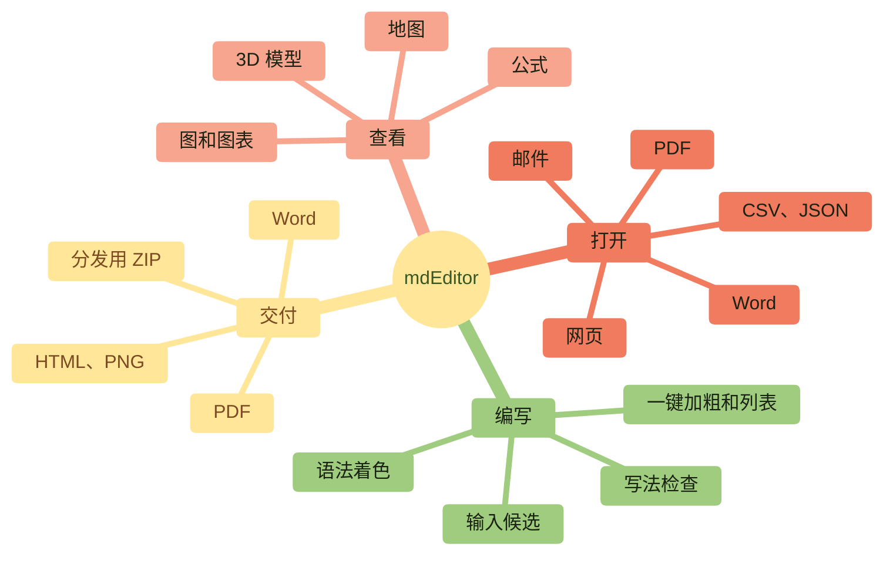
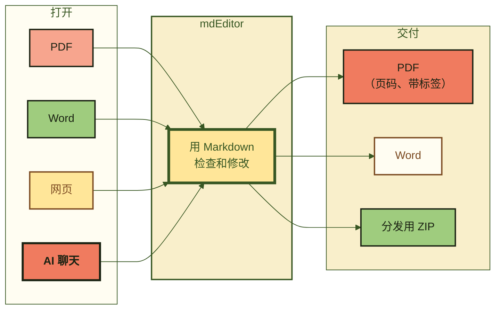
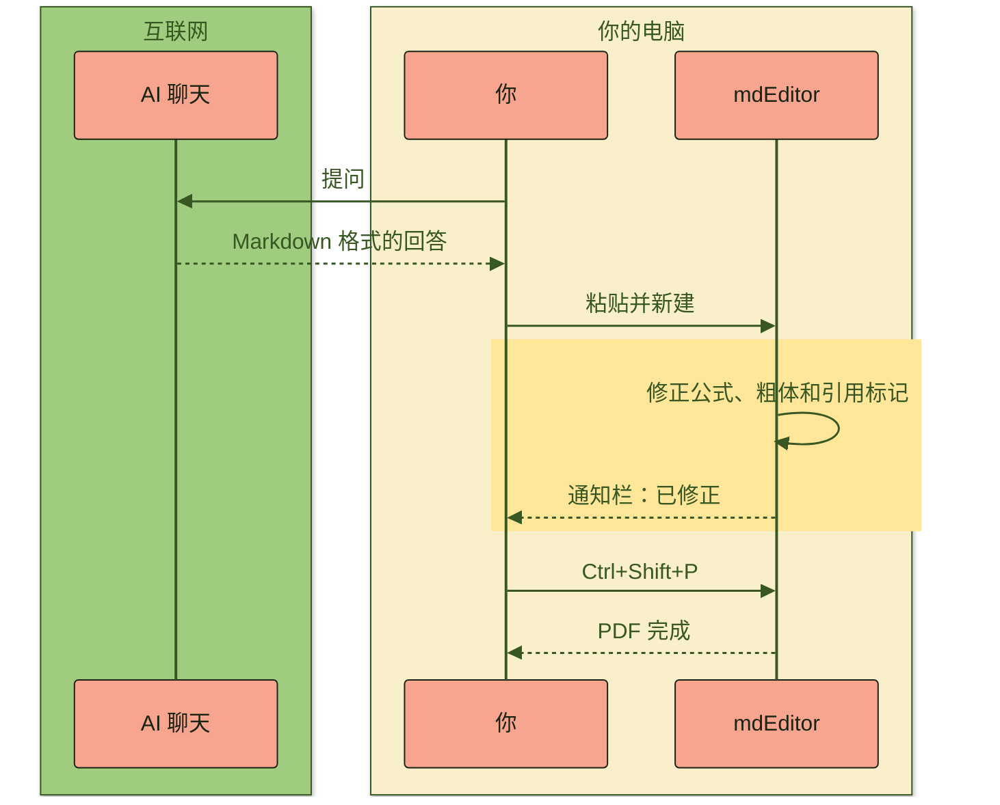
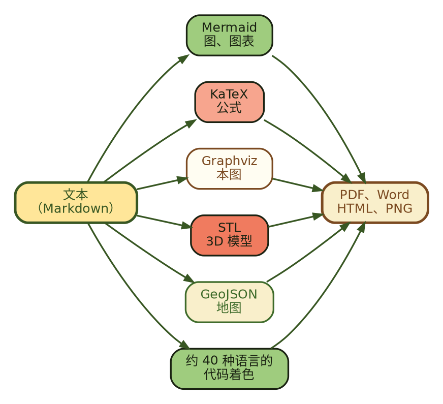

<!--
  ファイル名 / File: samples/key-features.zh-CN.md
  概要 / Description: mdEditor key features, shown with its own diagrams, math, 3D model, images, and map (Simplified Chinese)
  作成者 / Author: 5garashi.com設計事務所 / 5garashi.com Design Office
  作成日 / Created: 2026-11-01
  ライセンス / License: MIT
  SPDX-License-Identifier: MIT
-->

<p align="center"><picture><source media="(prefers-color-scheme: dark)" srcset="import-test_files/5garashi_logotype_en_reversed_outlined.svg"></picture></p>

<p align="center"><b>Windows 版 Markdown 编辑器和查看器</b></p>

<h1 align="center">mdEditor</h1>

<p align="center">
PDF、Word，还有 AI 聊天的回答。<br>
打开就是 Markdown，改好就是 PDF。<b>全部在你的电脑里。</b>
</p>

<p align="center">
<kbd>Ctrl</kbd>+<kbd>O</kbd> 打开，<kbd>Ctrl</kbd>+<kbd>Shift</kbd>+<kbd>P</kbd> 生成 PDF。就这么简单。
</p>

> [!TIP]
> 这份文档本身就是 mdEditor 的演示。请对照左边的编辑区和右边的预览。图、公式和 3D 模型，全部由文本绘制。

> [!NOTE]
> 本文档专为在 mdEditor 中查看而编写。在 GitHub 上打开时，Graphviz（` ```dot `）的图会按代码原样显示，`\(…\)` 的公式不会显示为公式。请在 mdEditor 中检查显示效果（Identity 8-9 (8)）。

<!-- toc -->
- [1. mdEditor 能做什么](#1-mdeditor-能做什么)
- [2. PDF 和 Word，都能变成 Markdown](#2-pdf-和-word都能变成-markdown)
- [3. AI 聊天的回答，也尽量还原](#3-ai-聊天的回答也尽量还原)
- [4. 公式用 KaTeX](#4-公式用-katex)
- [5. 图也可以用 Graphviz](#5-图也可以用-graphviz)
- [6. 3D 模型，拖动即可旋转](#6-3d-模型拖动即可旋转)
- [7. 图片的大小和位置，随心调整](#7-图片的大小和位置随心调整)
- [8. 还能画地图](#8-还能画地图)
- [9. 代码着色](#9-代码着色)
- [10. 一路走来](#10-一路走来)
- [11. 记住快捷键，更快](#11-记住快捷键更快)
- [12. 第一步](#12-第一步)
<!-- /toc -->

---

## 1. mdEditor 能做什么



| | 用 mdEditor | |
| :--- | :--- | :---: |
| **打开** | 把 PDF、Word、网页、邮件、CSV、JSON、XML、Jupyter Notebook 转成 Markdown | <kbd>Ctrl</kbd>+<kbd>O</kbd> |
| **编写** | 边写边着色，写错的地方显示波浪线 | <kbd>F1</kbd> |
| **查看** | 图、公式、3D 模型、地图，立即显示在旁边的预览中 | <kbd>Ctrl</kbd>+<kbd>Shift</kbd>+<kbd>2</kbd> |
| **交付** | 一键生成与预览外观相同的 PDF | <kbd>Ctrl</kbd>+<kbd>Shift</kbd>+<kbd>P</kbd> |

---

## 2. PDF 和 Word，都能变成 Markdown



> [!NOTE]
> 导入会尽量进行。多栏排版、没有框线的表格和扫描的 PDF 无法还原。图和公式会变成图片。

---

## 3. AI 聊天的回答，也尽量还原

从 AI 聊天复制的 Markdown 有一些习惯写法。mdEditor 会在打开时找出并修正。修正的内容显示在通知栏中，点一下按钮就能恢复原样。



例如，AI 常写的 `\(…\)` 公式，也会直接显示为公式。比如光速 \(c \approx 3.0 \times 10^8\ \text{m/s}\)。

\[
E = mc^2 \qquad \text{和} \qquad e^{i\pi} + 1 = 0
\]

---

## 4. 公式用 KaTeX

$$
\int_{-\infty}^{\infty} e^{-x^2}\,dx = \sqrt{\pi}
\qquad
\sum_{k=1}^{n} k = \frac{n(n+1)}{2}
$$

$$
\begin{pmatrix} \cos\theta & -\sin\theta \\ \sin\theta & \cos\theta \end{pmatrix}
\begin{pmatrix} x \\ y \end{pmatrix}
=
\begin{pmatrix} x\cos\theta - y\sin\theta \\ x\sin\theta + y\cos\theta \end{pmatrix}
$$

句子中也可以写公式，比如 $\nabla \cdot \mathbf{E} = \rho / \varepsilon_0$。

---

## 5. 图也可以用 Graphviz



---

## 6. 3D 模型，拖动即可旋转

只要写出文本格式的 STL，就会变成 3D 模型。用鼠标抓住旋转试试。不联网也能显示。

部件的颜色写在名称后面，例如 `solid star #3E6B2A`；背景色写成 `solid background #F9EFCB` 这一行。

```stl
solid base #F07B5F
facet normal 0 0 1 outer loop vertex 0 0 0 vertex 18.48 7.65 0 vertex 7.65 18.48 0 endloop endfacet
facet normal 0 0 -1 outer loop vertex 0 0 -4 vertex 7.65 18.48 -4 vertex 18.48 7.65 -4 endloop endfacet
facet normal 0.7071 0.7071 0 outer loop vertex 18.48 7.65 -4 vertex 7.65 18.48 -4 vertex 7.65 18.48 0 endloop endfacet
facet normal 0.7071 0.7071 -0 outer loop vertex 18.48 7.65 -4 vertex 7.65 18.48 0 vertex 18.48 7.65 0 endloop endfacet
facet normal 0 -0 1 outer loop vertex 0 0 0 vertex 7.65 18.48 0 vertex -7.65 18.48 0 endloop endfacet
facet normal 0 0 -1 outer loop vertex 0 0 -4 vertex -7.65 18.48 -4 vertex 7.65 18.48 -4 endloop endfacet
facet normal 0 1 0 outer loop vertex 7.65 18.48 -4 vertex -7.65 18.48 -4 vertex -7.65 18.48 0 endloop endfacet
facet normal 0 1 -0 outer loop vertex 7.65 18.48 -4 vertex -7.65 18.48 0 vertex 7.65 18.48 0 endloop endfacet
facet normal 0 0 1 outer loop vertex 0 0 0 vertex -7.65 18.48 0 vertex -18.48 7.65 0 endloop endfacet
facet normal 0 0 -1 outer loop vertex 0 0 -4 vertex -18.48 7.65 -4 vertex -7.65 18.48 -4 endloop endfacet
facet normal -0.7071 0.7071 0 outer loop vertex -7.65 18.48 -4 vertex -18.48 7.65 -4 vertex -18.48 7.65 0 endloop endfacet
facet normal -0.7071 0.7071 0 outer loop vertex -7.65 18.48 -4 vertex -18.48 7.65 0 vertex -7.65 18.48 0 endloop endfacet
facet normal 0 0 1 outer loop vertex 0 0 0 vertex -18.48 7.65 0 vertex -18.48 -7.65 0 endloop endfacet
facet normal -0 0 -1 outer loop vertex 0 0 -4 vertex -18.48 -7.65 -4 vertex -18.48 7.65 -4 endloop endfacet
facet normal -1 0 0 outer loop vertex -18.48 7.65 -4 vertex -18.48 -7.65 -4 vertex -18.48 -7.65 0 endloop endfacet
facet normal -1 0 0 outer loop vertex -18.48 7.65 -4 vertex -18.48 -7.65 0 vertex -18.48 7.65 0 endloop endfacet
facet normal 0 0 1 outer loop vertex 0 0 0 vertex -18.48 -7.65 0 vertex -7.65 -18.48 0 endloop endfacet
facet normal 0 0 -1 outer loop vertex 0 0 -4 vertex -7.65 -18.48 -4 vertex -18.48 -7.65 -4 endloop endfacet
facet normal -0.7071 -0.7071 0 outer loop vertex -18.48 -7.65 -4 vertex -7.65 -18.48 -4 vertex -7.65 -18.48 0 endloop endfacet
facet normal -0.7071 -0.7071 0 outer loop vertex -18.48 -7.65 -4 vertex -7.65 -18.48 0 vertex -18.48 -7.65 0 endloop endfacet
facet normal 0 0 1 outer loop vertex 0 0 0 vertex -7.65 -18.48 0 vertex 7.65 -18.48 0 endloop endfacet
facet normal 0 -0 -1 outer loop vertex 0 0 -4 vertex 7.65 -18.48 -4 vertex -7.65 -18.48 -4 endloop endfacet
facet normal 0 -1 0 outer loop vertex -7.65 -18.48 -4 vertex 7.65 -18.48 -4 vertex 7.65 -18.48 0 endloop endfacet
facet normal 0 -1 0 outer loop vertex -7.65 -18.48 -4 vertex 7.65 -18.48 0 vertex -7.65 -18.48 0 endloop endfacet
facet normal 0 0 1 outer loop vertex 0 0 0 vertex 7.65 -18.48 0 vertex 18.48 -7.65 0 endloop endfacet
facet normal 0 0 -1 outer loop vertex 0 0 -4 vertex 18.48 -7.65 -4 vertex 7.65 -18.48 -4 endloop endfacet
facet normal 0.7071 -0.7071 0 outer loop vertex 7.65 -18.48 -4 vertex 18.48 -7.65 -4 vertex 18.48 -7.65 0 endloop endfacet
facet normal 0.7071 -0.7071 0 outer loop vertex 7.65 -18.48 -4 vertex 18.48 -7.65 0 vertex 7.65 -18.48 0 endloop endfacet
facet normal -0 0 1 outer loop vertex 0 0 0 vertex 18.48 -7.65 0 vertex 18.48 7.65 0 endloop endfacet
facet normal 0 0 -1 outer loop vertex 0 0 -4 vertex 18.48 7.65 -4 vertex 18.48 -7.65 -4 endloop endfacet
facet normal 1 0 0 outer loop vertex 18.48 -7.65 -4 vertex 18.48 7.65 -4 vertex 18.48 7.65 0 endloop endfacet
facet normal 1 0 0 outer loop vertex 18.48 -7.65 -4 vertex 18.48 7.65 0 vertex 18.48 -7.65 0 endloop endfacet
endsolid base
solid star #3E6B2A
facet normal 0 -0 1 outer loop vertex 0 0 7 vertex 0 16 7 vertex -3.82 5.26 7 endloop endfacet
facet normal 0 0 -1 outer loop vertex 0 0 0 vertex -3.82 5.26 0 vertex 0 16 0 endloop endfacet
facet normal -0.9422 0.3351 0 outer loop vertex 0 16 0 vertex -3.82 5.26 0 vertex -3.82 5.26 7 endloop endfacet
facet normal -0.9422 0.3351 0 outer loop vertex 0 16 0 vertex -3.82 5.26 7 vertex 0 16 7 endloop endfacet
facet normal 0 0 1 outer loop vertex 0 0 7 vertex -3.82 5.26 7 vertex -15.22 4.94 7 endloop endfacet
facet normal 0 0 -1 outer loop vertex 0 0 0 vertex -15.22 4.94 0 vertex -3.82 5.26 0 endloop endfacet
facet normal -0.0281 0.9996 0 outer loop vertex -3.82 5.26 0 vertex -15.22 4.94 0 vertex -15.22 4.94 7 endloop endfacet
facet normal -0.0281 0.9996 0 outer loop vertex -3.82 5.26 0 vertex -15.22 4.94 7 vertex -3.82 5.26 7 endloop endfacet
facet normal 0 0 1 outer loop vertex 0 0 7 vertex -15.22 4.94 7 vertex -6.18 -2.01 7 endloop endfacet
facet normal -0 0 -1 outer loop vertex 0 0 0 vertex -6.18 -2.01 0 vertex -15.22 4.94 0 endloop endfacet
facet normal -0.6095 -0.7928 0 outer loop vertex -15.22 4.94 0 vertex -6.18 -2.01 0 vertex -6.18 -2.01 7 endloop endfacet
facet normal -0.6095 -0.7928 0 outer loop vertex -15.22 4.94 0 vertex -6.18 -2.01 7 vertex -15.22 4.94 7 endloop endfacet
facet normal 0 0 1 outer loop vertex 0 0 7 vertex -6.18 -2.01 7 vertex -9.4 -12.94 7 endloop endfacet
facet normal 0 0 -1 outer loop vertex 0 0 0 vertex -9.4 -12.94 0 vertex -6.18 -2.01 0 endloop endfacet
facet normal -0.9592 0.2826 0 outer loop vertex -6.18 -2.01 0 vertex -9.4 -12.94 0 vertex -9.4 -12.94 7 endloop endfacet
facet normal -0.9592 0.2826 0 outer loop vertex -6.18 -2.01 0 vertex -9.4 -12.94 7 vertex -6.18 -2.01 7 endloop endfacet
facet normal 0 0 1 outer loop vertex 0 0 7 vertex -9.4 -12.94 7 vertex -0 -6.5 7 endloop endfacet
facet normal 0 0 -1 outer loop vertex 0 0 0 vertex -0 -6.5 0 vertex -9.4 -12.94 0 endloop endfacet
facet normal 0.5652 -0.825 0 outer loop vertex -9.4 -12.94 0 vertex -0 -6.5 0 vertex -0 -6.5 7 endloop endfacet
facet normal 0.5652 -0.825 0 outer loop vertex -9.4 -12.94 0 vertex -0 -6.5 7 vertex -9.4 -12.94 7 endloop endfacet
facet normal 0 0 1 outer loop vertex 0 0 7 vertex -0 -6.5 7 vertex 9.4 -12.94 7 endloop endfacet
facet normal 0 -0 -1 outer loop vertex 0 0 0 vertex 9.4 -12.94 0 vertex -0 -6.5 0 endloop endfacet
facet normal -0.5652 -0.825 0 outer loop vertex -0 -6.5 0 vertex 9.4 -12.94 0 vertex 9.4 -12.94 7 endloop endfacet
facet normal -0.5652 -0.825 0 outer loop vertex -0 -6.5 0 vertex 9.4 -12.94 7 vertex -0 -6.5 7 endloop endfacet
facet normal 0 0 1 outer loop vertex 0 0 7 vertex 9.4 -12.94 7 vertex 6.18 -2.01 7 endloop endfacet
facet normal 0 0 -1 outer loop vertex 0 0 0 vertex 6.18 -2.01 0 vertex 9.4 -12.94 0 endloop endfacet
facet normal 0.9592 0.2826 0 outer loop vertex 9.4 -12.94 0 vertex 6.18 -2.01 0 vertex 6.18 -2.01 7 endloop endfacet
facet normal 0.9592 0.2826 -0 outer loop vertex 9.4 -12.94 0 vertex 6.18 -2.01 7 vertex 9.4 -12.94 7 endloop endfacet
facet normal -0 0 1 outer loop vertex 0 0 7 vertex 6.18 -2.01 7 vertex 15.22 4.94 7 endloop endfacet
facet normal 0 0 -1 outer loop vertex 0 0 0 vertex 15.22 4.94 0 vertex 6.18 -2.01 0 endloop endfacet
facet normal 0.6095 -0.7928 0 outer loop vertex 6.18 -2.01 0 vertex 15.22 4.94 0 vertex 15.22 4.94 7 endloop endfacet
facet normal 0.6095 -0.7928 0 outer loop vertex 6.18 -2.01 0 vertex 15.22 4.94 7 vertex 6.18 -2.01 7 endloop endfacet
facet normal 0 0 1 outer loop vertex 0 0 7 vertex 15.22 4.94 7 vertex 3.82 5.26 7 endloop endfacet
facet normal 0 0 -1 outer loop vertex 0 0 0 vertex 3.82 5.26 0 vertex 15.22 4.94 0 endloop endfacet
facet normal 0.0281 0.9996 0 outer loop vertex 15.22 4.94 0 vertex 3.82 5.26 0 vertex 3.82 5.26 7 endloop endfacet
facet normal 0.0281 0.9996 -0 outer loop vertex 15.22 4.94 0 vertex 3.82 5.26 7 vertex 15.22 4.94 7 endloop endfacet
facet normal 0 0 1 outer loop vertex 0 0 7 vertex 3.82 5.26 7 vertex 0 16 7 endloop endfacet
facet normal 0 0 -1 outer loop vertex 0 0 0 vertex 0 16 0 vertex 3.82 5.26 0 endloop endfacet
facet normal 0.9422 0.3351 0 outer loop vertex 3.82 5.26 0 vertex 0 16 0 vertex 0 16 7 endloop endfacet
facet normal 0.9422 0.3351 -0 outer loop vertex 3.82 5.26 0 vertex 0 16 7 vertex 3.82 5.26 7 endloop endfacet
endsolid star
solid background #F9EFCB
endsolid background
```

---

## 7. 图片的大小和位置，随心调整

图片可以按正文宽度的比例或像素设置大小，可以居中、靠右，也可以让文字环绕（与 GitHub 写法相同）。在图片所在行按 <kbd>Ctrl</kbd>+<kbd>Shift</kbd>+<kbd>F</kbd>（调整图像），或在预览中右键单击图片，只需选择即可改写。

<p align="center"></p>

<p align="center">&nbsp;&nbsp;&nbsp;&nbsp;&nbsp;&nbsp;&nbsp;&nbsp;</p>

<p align="right"><picture><source media="(prefers-color-scheme: dark)" srcset="import-test_files/5garashi_logotype_en_reversed_outlined.svg"></picture></p>

标志是用辣椒画成的计数符号（画线计数法）。第 5 根辣椒横穿竖着的 4 根：数“1、2、3、4”，用第 5 根收尾——把“5（go）garashi”这个名字直接画成了图案。`align="left"` 的图片靠左，这一段文字环绕在它的右侧。

<br clear="all">

<sub>图片使用 5garashi.com设计事务所的官方素材（CC BY-ND 4.0），未作修改。在深色模式下，标识字会换成灰色反白版本。</sub>

---

## 8. 还能画地图

mdEditor 支持日语、英语和简体中文。

```geojson
{
  "type": "FeatureCollection",
  "features": [
    { "type": "Feature", "properties": { "name": "日本語", "marker-color": "#B92613" }, "geometry": { "type": "Point", "coordinates": [139.767, 35.681] } },
    { "type": "Feature", "properties": { "name": "简体中文", "marker-color": "#385723" }, "geometry": { "type": "Point", "coordinates": [116.397, 39.909] } },
    { "type": "Feature", "properties": { "name": "English", "marker-color": "#7B4A21" }, "geometry": { "type": "Point", "coordinates": [-0.128, 51.507] } },
    { "type": "Feature", "properties": { "name": "English", "marker-color": "#7B4A21" }, "geometry": { "type": "Point", "coordinates": [-74.006, 40.713] } }
  ]
}
```

---

## 9. 代码着色

```python
from pathlib import Path

def count_headings(path: str) -> int:
    """统计 Markdown 文件中的标题数"""
    text = Path(path).read_text(encoding="utf-8")
    return sum(1 for line in text.splitlines() if line.startswith("#"))

print(count_headings("key-features.zh-CN.md"))
```

```diff
- **“光年”**是距离的单位。
+ <strong>“光年”</strong>是距离的单位。
```

---

## 10. 一路走来


---

## 11. 记住快捷键，更快

<details>
<summary><b>常用快捷键（点击展开）</b></summary>

| 按键 | 作用 |
| :--- | :--- |
| <kbd>Ctrl</kbd>+<kbd>B</kbd> / <kbd>Ctrl</kbd>+<kbd>I</kbd> | 粗体 / 斜体 |
| <kbd>Enter</kbd> / <kbd>Tab</kbd> | 继续列表 / 缩进 |
| <kbd>Ctrl</kbd>+<kbd>Shift</kbd>+<kbd>W</kbd> | 整理表格 |
| <kbd>Ctrl</kbd>+<kbd>Shift</kbd>+<kbd>N</kbd> | 给标题编号或取消编号 |
| <kbd>Ctrl</kbd>+<kbd>Shift</kbd>+<kbd>J</kbd> | 插入或更新目录 |
| <kbd>Ctrl</kbd>+<kbd>Shift</kbd>+<kbd>P</kbd> | 保存为 PDF |
| <kbd>Ctrl</kbd>+<kbd>Shift</kbd>+<kbd>3</kbd> | 在单独窗口中预览 |
| <kbd>F1</kbd> | Markdown 写法一览 |

</details>

---

## 12. 第一步

- [x] 从 Microsoft Store 安装 mdEditor
- [ ] 打开手头的 PDF 试试
- [ ] 粘贴 AI 聊天的回答试试
- [ ] 按 <kbd>Ctrl</kbd>+<kbd>Shift</kbd>+<kbd>P</kbd> 生成 PDF

> [!IMPORTANT]
> 文档内容不会发送到任何地方。PDF 和 Word 的转换也在电脑内完成。没有广告、没有统计，也不需要账户。

---

<p align="center"></p>

<p align="center">
<b>mdEditor by 5garashi.com</b><br>
<a href="https://apps.microsoft.com/detail/9NWW2QRCLMHC">从 Microsoft Store 获取</a>
</p>

<p align="center"><sub>© 5garashi.com设计事务所</sub></p>
