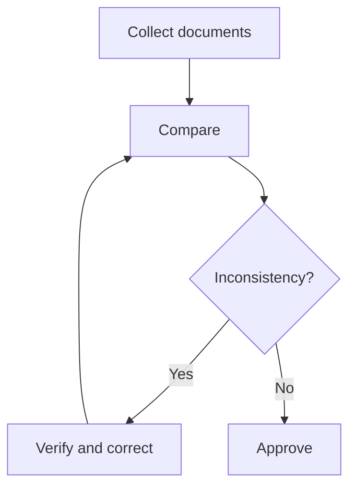

<!--
File: samples/quickstart-workflow.en.md
Description: mdEditor promotion material
Author: 5garashi.com Design Office
Created: 2026-10-12
Version: 1.0.5
License: MIT
SPDX-License-Identifier: MIT
-->
# Work procedure

Open in mdEditor, edit, then press Ctrl+Shift+P to save as PDF.

## Document review procedure

1. Collect the latest documents
2. Compare model names, ratings and revisions
3. Record inconsistencies
4. Ask the owner to verify and correct them

- [x] Prepare documents
- [ ] Check inconsistencies
- [ ] Approve revisions

| Item | Check |
| --- | --- |
| Model | Consistent across documents? |
| Rating | Same values and units? |

