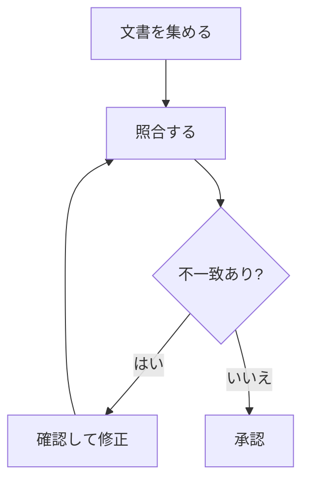

# 業務手順書

mdEditorで開き、編集して、Ctrl+Shift+PでPDFに保存してください。

## 文書レビューの手順

1. 最新版を集める
2. 型式・定格・版番号を照合する
3. 不一致を記録する
4. 担当者が確認し、修正する

- [x] 対象文書を準備
- [ ] 不一致を確認
- [ ] 修正版を承認

| 項目 | 確認内容 |
| --- | --- |
| 型式 | すべての文書で同じか |
| 定格 | 単位と数値が一致するか |

